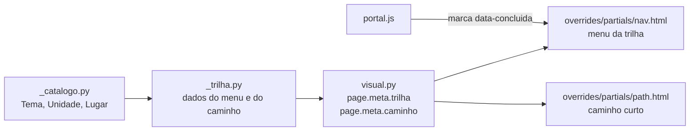

# Menu da trilha e páginas: design

- **Data:** 2026-10-17
- **Branches:** `feat/site-portal-de-ensino` (site) e `resumo/python-dicionarios-e-funcoes` (conteúdo)
- **Estado:** rascunho para revisão
- **Parte de:** [Portal de ensino](2026-10-17-portal-de-ensino-design.md)

## 1. Objetivo

Dentro de um tema, o aluno vê **primeiro o conteúdo**: o menu passa a mostrar a trilha do tema, com cada aula seguida dos seus exercícios. As páginas de aula, exercício e resposta ganham o mesmo cabeçalho e **um único próximo passo**. No Python, "Resumos" passa a se chamar **Aulas**, como já é em Cálculo e Sistemas Digitais.

**Critérios de sucesso:**

- **Menu:**
  - nenhuma página de tema mostra no menu ou no caminho "Enunciados", "Respostas" ou nome de arquivo;
  - de qualquer aula, os exercícios dela estão a 1 clique, no menu e no fim da página;
  - o menu mostra o ✓ do que já foi concluído.
- **Caminho no topo:** no máximo 3 itens; no celular, uma linha só.
- **Fim da aula e dos exercícios:** uma ação principal, sem "próximo" repetido.
- **Lighthouse no celular** (aula, exercício, resposta e tema):
  - Acessibilidade 100;
  - Desempenho de 90 ou mais, como no portal.
- **O que continua igual:**
  - o build `--strict` passa sem avisos;
  - as respostas de Python continuam batendo com os exemplos (88 de 88);
  - o Markdown continua legível no GitHub.

## 2. Decisões já tomadas

| Decisão | Escolha |
| ------- | ------- |
| Menu lateral | **A · Trilha do tema** (página de comparação: A, B e C) |
| Layout das páginas | Aprovado como na página de comparação: topo da aula, fim da aula, exercícios, resposta e celular |
| Nome de "Resumos" | **Aulas**, renomeando a pasta `conteudo/python/resumos/` → `conteudo/python/aulas/` |
| Templates do Material | **Muda a decisão do portal.** Dois arquivos são sobrescritos: `partials/nav.html` e `partials/path.html`. Sem isso, o menu da trilha teria que ser montado por JavaScript depois que a página abre, e piscaria a cada troca de página. O risco de atualização é coberto por um teste que trava a versão (seção 9) |
| Conteúdo | O texto das aulas e dos exercícios não muda. Mudam o nome da pasta, os links e a navegação manual da aula de Funções |

## 3. Fora do escopo

- O menu das abas Simulados, Meu progresso e Colabore continua como está.
- As respostas dos simulados (`simulados/*/respostas/*.py`) mantêm o layout atual.
- Recolher o menu (o modo foco, opção C).
- Migrar o progresso salvo com os endereços antigos de `resumos/`: o portal ainda não foi publicado, então ninguém tem progresso salvo nesses endereços.

## 4. Arquitetura

O catálogo (`_catalogo.py`) já conhece a trilha de cada tema: as unidades, os exercícios por nível e os simulados. O menu e o caminho passam a ser montados a partir dele, no build, e chegam ao template pelos metadados da página.

### 4.1 Arquivos

| Arquivo | O que muda |
| ------- | ---------- |
| `.mkdocs/_trilha.py` (novo) | Só dados, sem HTML: `menu_da_trilha(tema, src_atual, ...)` e `caminho(lugar, ...)` |
| `.mkdocs/overrides/partials/nav.html` (novo) | Nas páginas com `page.meta.trilha`, desenha o menu da trilha. Nas outras, desenha o menu do Material, igual a hoje |
| `.mkdocs/overrides/partials/trilha.html` (novo) | O HTML do menu da trilha, incluído pelo `nav.html` |
| `.mkdocs/overrides/partials/path.html` (novo) | Usa `page.meta.caminho` quando a página tem caminho próprio; senão, o caminho do Material |
| `.mkdocs/mkdocs.yml` | `custom_dir: overrides` |
| `.mkdocs/visual.py` | Cabeçalho, fim da página, abas de nível, cartões de exercício, `hide: [footer, tags]`, filtro do "Voltar" e do "Antes, leia" |
| `.mkdocs/hooks.py` | Limpeza do menu do Material, título da página de resposta, redirecionamentos |
| `.mkdocs/_componentes.py` | Componentes novos: sobretítulo, linha de informações, segmentos, abas de nível, próximo passo |
| `.mkdocs/portal.js` | Contagem "N de M concluídas" no menu e os segmentos da trilha (reaproveita `[data-pagina]`) |
| `.mkdocs/tailwind.css` → `site.css` | Estilo do menu da trilha e das páginas |

## 5. Menu lateral: trilha do tema

**Onde aparece:** em toda página dentro de `conteudo/<tema>/` de um tema do catálogo. Isso inclui:

- o README do tema;
- as aulas;
- os exercícios e as respostas;
- as outras páginas da pasta do tema.

As demais páginas mostram o menu do Material.

**Estrutura** (de cima para baixo):

1. **"‹ Todo o conteúdo":** link para a página Conteúdo.
2. **Cabeçalho do tema:**
   - ícone e área (por exemplo, "PROGRAMAÇÃO");
   - nome do tema, com link para a página do tema;
   - barra de progresso e o texto "N de M aulas concluídas". A palavra segue o rótulo da unidade: "aulas" ou "partes".
3. **As unidades, na ordem da trilha:**
   - Cada uma mostra o número e o título, com link para a aula.
   - O estado vem em um círculo:
     - número, se não foi feita;
     - ✓ verde, se foi concluída;
     - número com contorno, se é a atual.
   - A **unidade atual** fica aberta e mostra "Praticar", com os níveis (ponto colorido, nome e ✓ quando concluído).
   - As outras unidades com exercícios têm uma seta que abre e fecha os níveis sem sair da página.
   - A unidade atual é a que contém a página aberta: a aula, um dos níveis ou uma resposta desses exercícios.
4. **Simulados:** os simulados do tema, quando houver.
5. **Mais:** as outras páginas do tema que não estão na trilha, com o título da página. Ficam de fora:
   - o README do tema;
   - os enunciados e as respostas;
   - os índices gerados de pastas.

   Exemplos do que entra: o formulário de Cálculo e a lista "Exercícios de Python".

**Celular:** a gaveta mostra a mesma trilha e, depois dela:

- o índice da página atual, como o Material faz hoje;
- os atalhos das abas (Início, Conteúdo, Simulados, Meu progresso, Colabore), que no celular não aparecem no topo.

**Acessibilidade:**

- o menu é um `<nav aria-label="Trilha de <tema>">`;
- o link da página atual tem `aria-current="page"`;
- o estado é lido como texto ("concluída"), não só pela cor ou pelo ✓;
- a seta é um botão com `aria-expanded`;
- os alvos de toque têm 44 px de altura no celular.

**Progresso:**

- os itens levam `data-pagina` com a mesma chave das outras páginas do portal, e o `portal.js` marca `data-concluida` como já faz na página do tema;
- a contagem "N de M" é preenchida pelo `portal.js`;
- sem JavaScript, o menu aparece completo, só sem o ✓.

**Menu do Material (fora dos temas), mais limpo:**

- dentro de cada tema, a ordem fica: página do tema, aulas, exercícios, o resto;
- a seção "Respostas" sai do menu;
- a seção "Enunciados" some, e os assuntos dela sobem um nível.

As páginas continuam publicadas. O MkDocs só avisa, em nível INFO, que elas estão fora do menu.

## 6. Páginas

### 6.1 Caminho no topo

| Página | Caminho |
| ------ | ------- |
| Tema | Área |
| Aula e outras páginas do tema | Área › Tema |
| Exercícios | Área › Tema › Aula |
| Resposta | Tema › Aula › Nível (link para os exercícios) |

- A área leva para Conteúdo, já filtrado pela área (`conteudo/#area-<slug>`).
- No celular (abaixo de 60em), só o último item aparece, como "‹ Título".
- As páginas sem `page.meta.caminho` usam o caminho do Material.

### 6.2 Cabeçalho (aula, exercícios, resposta)

- **Sobretítulo**, antes do título, na cor da área:
  - "Aula 2 de 6" ("Parte 2 de 3" no Git);
  - "Exercícios · Aula 6";
  - "Resposta · Exercício 01".
- **Título:** o `# Título` do Markdown, sem mudança (mantém a âncora e o índice).
- **Linha de informações**, em texto normal (sem fonte de código):
  - o selo de nível (com link para Por nível);
  - o tempo de leitura (na aula) ou "N exercícios" (nos exercícios);
  - "↺ Rever a aula" (nos exercícios);
  - "✎ Sugerir melhoria", com link de edição no GitHub.
- **O que deixa de aparecer nessas páginas:**
  - as etiquetas do Material (`hide: [tags]`), porque o nível já está na linha;
  - os ícones de ver código-fonte e editar do Material.
- **Segmentos da trilha** (só na aula): um segmento por unidade. O verde marca as concluídas e o índigo marca a atual.

### 6.3 Fim da aula: próximo passo

Um bloco só:

1. "Concluí esta aula" (a mesma caixa de hoje).
2. "Agora, pratique": um cartão por nível, com o Fácil destacado como ação principal.
3. "Já praticou? Próxima aula: X →".

Variações:

- **Unidade sem exercícios:** a ação principal é a próxima aula.
- **Última unidade:** "Você chegou ao fim da trilha", com os simulados do tema (se houver) e o link para o tema.

O rodapé Anterior/Próximo do Material some nas aulas e nos exercícios (`hide: [footer]`).

### 6.4 Exercícios

- **Abas de nível** abaixo do título: Fácil · Intermediário · Difícil.
  - São links para os outros níveis da mesma aula, e o nível atual tem `aria-current="page"`.
  - Não são abas ARIA, porque cada uma leva a outra página.
- **"Antes, leia":** sai do site, porque "Rever a aula" já está na linha de informações. No GitHub continua.
- **Cartões:** cada `## Exercício NN: Título` vira um cartão, com o número num selo. O índice da direita mostra "NN · Título".
  - A âncora do GitHub (`#exercício-nn-...`) não muda.
  - O cartão é montado no HTML final (`on_page_content`), não no Markdown, para não interferir com blocos de código e exemplos.
- **Fim da página:** "Concluí estes exercícios" e a ação principal:
  - "Próximo nível: Intermediário →";
  - no Difícil, "Próxima aula: X →".

### 6.5 Resposta (exercícios de `conteudo/`)

- **Título:** o nome do exercício. Vem da seção `## Exercício NN: Título` do enunciado que aponta para o `.py`.
- **Sobretítulo:** "Resposta · Exercício NN".
- **Botões:**
  - "← Voltar ao enunciado", direto na âncora do exercício;
  - "⤓ Baixar .py".
- **Código:** o nome do arquivo fica só no cabeçalho do bloco.
- **Sem "próxima resposta":** a página está fora do menu e sem rodapé.
- **`.py` sem enunciado que aponte para ele:** fica como hoje.

### 6.6 Celular

- O caminho tem uma linha só (6.1).
- Menos espaço acima do título.
- Abas de nível e itens do menu com 44 px de altura.

### 6.7 Defeito "Voltar para Python"

- **O filtro:** `_sem_navegacao_manual` também tira:
  - os links para o `README.md` do tema;
  - qualquer parte com "voltar";
  - "📖 Antes, leia".

  Linha sem nada que sobre some inteira.
- **O conteúdo:** a aula de Funções passa a usar `[Voltar para Python →](../README.md)`, como a última aula de Cálculo.

## 7. Resumos → Aulas (Python)

- **A pasta:** `git mv conteudo/python/resumos conteudo/python/aulas`.
- **Os 33 links** que apontam para `resumos/` passam a apontar para `aulas/`:
  - os READMEs (raiz, `conteudo/`, Python e exercícios);
  - os enunciados (o "📖 Antes, leia");
  - o `CONTRIBUTING.md`.
- **Os textos:**
  - a coluna "Resumo" da tabela do roteiro vira "Aula";
  - "Resumos (condicionais, …)" vira "Aulas (…)";
  - o site passa a dizer "Aula N de 6", "Marcar aula como concluída" e "Próxima aula", porque o rótulo vem do nome da pasta.
- **Endereços antigos:** a lista `REDIRECIONAMENTOS` do `hooks.py` diz quais prefixos mudaram (`conteudo/python/resumos/` → `conteudo/python/aulas/`). Depois do build, para cada página publicada no prefixo novo, o hook grava no endereço antigo uma página que redireciona. A página de redirecionamento:
  - usa `meta refresh`, `rel=canonical` e `robots noindex`;
  - tem um link visível para a página nova;
  - usa endereço relativo, para funcionar em `/school-cc/`.

  A página antiga só é gravada se a nova existir e se o endereço antigo estiver livre. A pasta `resumos/` também redireciona.
- **Cálculo:** mantém `resumos/formulario.md`.
- **CLAUDE.md:** cita `resumos/` e só muda na main. Fica para o mantenedor, junto com a atualização que já está pendente.

## 8. Branches e entrega

| Branch | O que entra |
| ------ | ----------- |
| `feat/site-portal-de-ensino` | Seções 4 a 6, o código de redirecionamento e esta especificação |
| `resumo/python-dicionarios-e-funcoes` | Seção 7 (renomear e links) e a navegação da aula de Funções |

- As branches continuam independentes.
- A ordem de merge recomendada é o portal primeiro, porque é ele que traz os redirecionamentos.
- A prévia junta as duas numa branch temporária, só local.
- **Nada vai para o GitHub sem pedido.**

## 9. Testes e verificação

- **Testes automáticos em Python** (`test_trilha.py`, novo, mais os arquivos de teste que já existem):
  - **dados do menu:** a unidade atual é a da aula, a do nível e a da resposta; os níveis vêm na ordem certa; os simulados e o "Mais" aparecem; o README do tema fica sem unidade atual; o Git aparece sem exercícios;
  - **caminho:** cada tipo de página da tabela 6.1;
  - **filtro do "Voltar" e do "Antes, leia":** cada formato que existe no repositório hoje;
  - **título da resposta:** com enunciado e sem enunciado;
  - **limpeza do menu do Material:** sem Respostas, sem Enunciados, Aulas antes de Exercícios;
  - **redirecionamentos:** grava o arquivo, não sobrescreve página existente, não grava se o destino não existir, endereço relativo correto;
  - **trava de versão:** falha se a versão instalada do `mkdocs-material` for diferente da versão de onde os dois templates foram copiados.
- **Testes em Node:** os que já existem continuam passando.
- **Roteiros no navegador**, contra o site do build:
  - o menu da trilha no computador e na gaveta do celular;
  - o ✓ aparece depois de concluir;
  - as abas de nível;
  - o rodapé não aparece nas aulas;
  - o endereço antigo redireciona;
  - a navegação instantânea troca o menu sem piscar;
  - o índice da página aparece na gaveta.
- **Lighthouse** no celular: aula, exercício, resposta e tema.
- **Validador das respostas:** 88 de 88.
- **Build:** `--strict` sem avisos.

## 10. Riscos

| Risco | Como fica coberto |
| ----- | ----------------- |
| Atualizar o Material quebra os templates sobrescritos | Versão travada no `requirements.txt` e teste de trava (seção 9); os dois arquivos são pequenos |
| Link quebrado depois de renomear a pasta | O build `--strict` falha com link relativo quebrado; o GitHub usa os mesmos links |
| Página fora do menu parecer "perdida" | O caminho e o menu da trilha continuam valendo nela, e o botão "Voltar ao enunciado" leva de volta |
| O cartão do exercício quebrar o Markdown | É montado no HTML final, depois da conversão do Markdown |
| A navegação instantânea não reaplicar o ✓ | O `portal.js` já redesenha a cada troca de página (`document$`); há um roteiro para isso |
| `hide: [tags]` tirar a página da lista Por nível | O `hide` só esconde as etiquetas na página. Um teste do build confere que Por nível lista as mesmas páginas de antes |

## 11. Como vamos trabalhar

- **TDD:** cada mudança começa por um teste que falha.
- **Commits:**
  - só com a suíte verde;
  - mensagens em pt-BR, no formato `tipo(escopo): descrição`;
  - nenhuma referência a ferramentas de IA.
- **Entrega:** a prévia fica rodando em `http://localhost:8000` para validação antes de qualquer push.

## 12. Depois da revisão: páginas de área e menu da aba Conteúdo

Pedido aprovado depois da primeira entrega:

- **Página de cada área:** `conteudo/<área>/index.md`, gerada pelo `visual.py`. Mostra os temas da área na lista do catálogo, com o link "Ver todo o conteúdo". No menu do Material, ela vira a página da seção da área. Se existir uma pasta de verdade com esse nome, a área fica sem página e os links vão para o catálogo filtrado (`conteudo/#area-<slug>`).
- **Bloco da área na home:** o bloco inteiro é clicável e leva à página da área. As etiquetas dos temas continuam sendo links para os temas.
- **Menu da aba Conteúdo fora dos temas** (catálogo, Por nível e páginas de área): mesmo visual da trilha, com as áreas como seções, os temas com ícone e % de progresso e "Por nível" no fim.
- **Caminho no topo:** a área leva à página dela.

