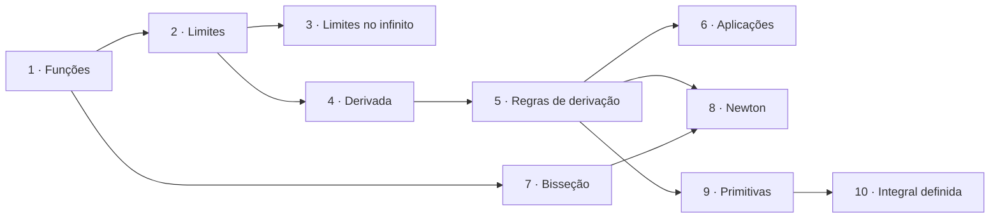
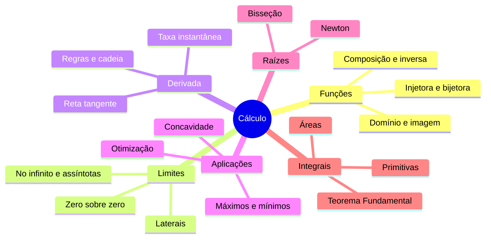

# 📈 Cálculo

> [← voltar para Conteúdo](../README.md)

**Nível:** 🟢 Iniciante

Funções, limites, derivadas, métodos numéricos para achar raízes e integrais: a base de matemática que aparece em disciplinas como **Matemática para Computação** e **Cálculo**. Tudo com exemplos de computação (algoritmos, servidores, redes neurais) e explicado do zero: basta saber a matemática do ensino médio.

## 🧭 Como estudar

1. **Leia a aula** na ordem. Cada uma tem teoria, passo a passo, exemplos resolvidos e um **mapa mental** no final.
2. **Faça o teste rápido** do fim da aula. No site, digite a resposta e clique em **Conferir**: o site corrige na hora.
3. **Errou?** Abra **Ver resposta** para ver a resolução comentada, refaça a conta e confira de novo.
4. **Pratique com os [exercícios](exercicios/README.md)** do assunto: 9 por aula, do fácil ao difícil.
5. **Revise** com o [formulário](resumos/formulario.md), que tem todas as fórmulas numa página só.
6. **Terminou as 10 aulas?** Faça os [simulados de Cálculo](../../simulados/README.md#-cálculo), com tempo marcado e pontuação.

> 💡 **Estude com papel, lápis e calculadora científica** (em **radianos** quando aparecer seno ou cosseno). Ler o exemplo não basta: copie a conta e refaça sozinho.

## 🗺️ Roteiro de estudo

| # | Aula | Nível | O que você aprende | Exercícios |
| - | ---- | ----- | ------------------ | ---------- |
| 1 | [Funções reais](aulas/01-funcoes.md) | 🟢 Iniciante | Domínio, imagem, injetora, composição, inversa e modelagem | [🟢](exercicios/01-funcoes/facil.md) · [🟡](exercicios/01-funcoes/intermediario.md) · [🔴](exercicios/01-funcoes/dificil.md) |
| 2 | [Limites](aulas/02-limites.md) | 🟢 Iniciante | Substituição, indeterminação 0/0, laterais, limites infinitos e confronto | [🟢](exercicios/02-limites/facil.md) · [🟡](exercicios/02-limites/intermediario.md) · [🔴](exercicios/02-limites/dificil.md) |
| 3 | [Limites no infinito](aulas/03-limites-no-infinito.md) | 🟡 Intermediário | Regra dos graus, raízes, assíntotas e modelos de longo prazo | [🟢](exercicios/03-limites-no-infinito/facil.md) · [🟡](exercicios/03-limites-no-infinito/intermediario.md) · [🔴](exercicios/03-limites-no-infinito/dificil.md) |
| 4 | [Derivada](aulas/04-derivada.md) | 🟡 Intermediário | Taxa de variação, definição pelo limite e reta tangente | [🟢](exercicios/04-derivada/facil.md) · [🟡](exercicios/04-derivada/intermediario.md) · [🔴](exercicios/04-derivada/dificil.md) |
| 5 | [Regras de derivação](aulas/05-regras-de-derivacao.md) | 🟡 Intermediário | Produto, quociente, cadeia, exponencial, logaritmo e trigonométricas | [🟢](exercicios/05-regras-de-derivacao/facil.md) · [🟡](exercicios/05-regras-de-derivacao/intermediario.md) · [🔴](exercicios/05-regras-de-derivacao/dificil.md) |
| 6 | [Aplicações da derivada](aulas/06-aplicacoes-da-derivada.md) | 🔴 Avançado | Crescimento, máximos e mínimos, concavidade e otimização | [🟢](exercicios/06-aplicacoes-da-derivada/facil.md) · [🟡](exercicios/06-aplicacoes-da-derivada/intermediario.md) · [🔴](exercicios/06-aplicacoes-da-derivada/dificil.md) |
| 7 | [Método da bisseção](aulas/07-bissecao.md) | 🟡 Intermediário | Bolzano, bisseção, cota de erro e código em Python | [🟢](exercicios/07-bissecao/facil.md) · [🟡](exercicios/07-bissecao/intermediario.md) · [🔴](exercicios/07-bissecao/dificil.md) |
| 8 | [Método de Newton](aulas/08-metodo-de-newton.md) | 🔴 Avançado | Iteração pela tangente, critério de parada e quando falha | [🟢](exercicios/08-metodo-de-newton/facil.md) · [🟡](exercicios/08-metodo-de-newton/intermediario.md) · [🔴](exercicios/08-metodo-de-newton/dificil.md) |
| 9 | [Primitivas](aulas/09-primitivas.md) | 🟡 Intermediário | Integral indefinida, tabela, condição inicial e substituição | [🟢](exercicios/09-primitivas/facil.md) · [🟡](exercicios/09-primitivas/intermediario.md) · [🔴](exercicios/09-primitivas/dificil.md) |
| 10 | [Integral definida e áreas](aulas/10-integral-definida.md) | 🔴 Avançado | Somas de Riemann, TFC, áreas entre curvas e integrais impróprias | [🟢](exercicios/10-integral-definida/facil.md) · [🟡](exercicios/10-integral-definida/intermediario.md) · [🔴](exercicios/10-integral-definida/dificil.md) |

## 🧠 Mapa mental da disciplina

Cada aula tem o seu mapa mental detalhado no final. Este é o mapa geral:

## ✍️ Como responder no corretor

O corretor do site entende vários jeitos de escrever a mesma resposta:

| Tipo de resposta | Pode escrever assim | Também aceita |
| ---------------- | ------------------- | ------------- |
| Número | `0,25` | `0.25`, `1/4`, `2/8` |
| Número com raiz, $\pi$ ou $e$ | `√2/2` | `sqrt(2)/2`, `0,7071`, `1/√2` |
| Infinito | `∞` | `infinito`, `+∞`, `-∞` |
| Não existe | `não existe` | `nao existe` |
| Função | `3x^2 + 2` | `2 + 3x²`, `3*x^2+2`, qualquer forma equivalente |
| Primitiva | `x^3/3 + C` | `x³/3 + K`, `(x^3 + 6)/3 + C` |

Para escrever funções:

| Para | Digite | Exemplo |
| ---- | ------ | ------- |
| Potência | `^` | `x^2`, `x^(1/3)`, `e^(2x)` |
| Raiz | `√` ou `sqrt()` | `√(x + 1)`, `sqrt(x)` |
| Logaritmo natural | `ln()` | `ln(x^2 + 1)` |
| Logaritmo em outra base | `log_2()` | `log_2(x)` |
| Seno, cosseno, tangente | `sen()`, `cos()`, `tg()` | `sen(2x)` |
| Módulo | `abs()` (ou duas barras verticais) | `ln(abs(x))` |
| Multiplicação | nada ou `*` | `2x`, `x(x + 1)`, `3e^x` |

> ⚠️ **Use parênteses no expoente:** `e^(2x)` é $e^{2x}$, mas `e^2x` é $e^2 \cdot x$. O corretor testa a sua função em vários pontos e, se ela errar, mostra um ponto em que as duas diferem. Nas primitivas, ele aceita qualquer resposta que difere da certa por uma constante, e avisa se faltar o `+ C`.

> ⚠️ O corretor só existe no site <https://rps4-school.github.io/school-cc/>. No GitHub, abra **Ver resposta** para conferir.

## 🔗 Links úteis

- [Desmos](https://www.desmos.com/calculator?lang=pt-BR): desenhe qualquer função e veja limites, tangentes e áreas.
- [GeoGebra](https://www.geogebra.org/graphing): gráficos, tabelas de valores e cálculo de integrais.
- [Khan Academy: Cálculo 1 (em português)](https://pt.khanacademy.org/math/calculus-1)

## 📁 Conteúdo desta pasta

| Pasta | O que vai aqui |
| ----- | -------------- |
| [`aulas/`](aulas/) | Uma aula completa por assunto, com exemplos, mapa mental e teste rápido |
| [`exercicios/`](exercicios/README.md) | 90 exercícios (9 por assunto) com resolução passo a passo |
| [`resumos/`](resumos/formulario.md) | O formulário com todas as fórmulas |
| `img/` | Figuras das aulas (gráficos de limites, tangentes, métodos numéricos e áreas) |

## 📚 Referências

- STEWART, James. *Cálculo*. v. 1. 8. ed. São Paulo: Cengage Learning, 2017.
- GUIDORIZZI, Hamilton L. *Um curso de cálculo*. v. 1. 6. ed. Rio de Janeiro: LTC, 2018.
- RUGGIERO, Márcia A. G.; LOPES, Vera L. R. *Cálculo numérico: aspectos teóricos e computacionais*. 2. ed. São Paulo: Pearson, 1996.
- [Khan Academy: Cálculo 1 (em português)](https://pt.khanacademy.org/math/calculus-1)
