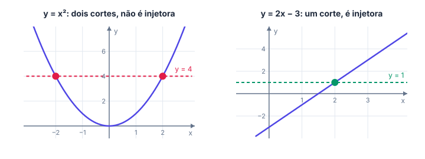
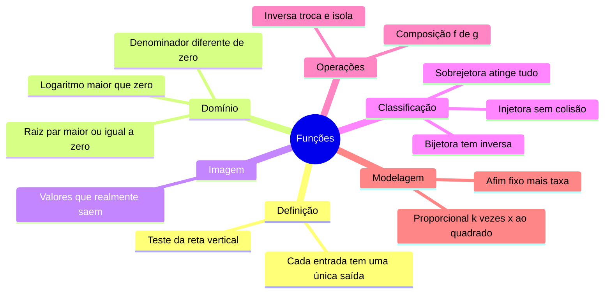

# 🧩 Funções reais

> [← voltar para Cálculo](../README.md) · Próximo: [Limites →](02-limites.md)

**Nível:** 🟢 Iniciante

## 🎯 Você vai aprender

- O que é uma **função** e como calcular valores como $f(2)$ e $f(2a)$.
- Como achar o **domínio**, isto é, as entradas em que a fórmula "não quebra".
- O que são **imagem**, função **injetora**, **sobrejetora** e **bijetora**.
- Como fazer a **composição** $f(g(x))$ e achar a **função inversa** $f^{-1}(x)$.
- Como transformar um problema de texto em função (**modelagem**).

## Em uma frase

> 💡 Uma função é uma **regra que recebe uma entrada e devolve exatamente uma saída**, como uma função de programação que, para o mesmo argumento, sempre retorna o mesmo valor.

## 1. O que é uma função

Pense numa função de Python:

```python
def f(x):
    return 2 * x + 1
```

Chamar `f(3)` sempre devolve `7`. Na matemática, escrevemos $f(x) = 2x + 1$ e dizemos que $f(3) = 7$.

| Programação | Matemática |
| ----------- | ---------- |
| Parâmetro `x` | Variável independente $x$ (a entrada) |
| Valor de retorno | Imagem de $x$, escrita $f(x)$ (a saída) |
| Tipos de entrada aceitos | **Domínio** |
| Tipo de retorno declarado | **Contradomínio** |
| Valores que realmente saem | **Imagem** |

A regra de ouro: **cada entrada tem uma única saída**. Duas entradas podem ter a mesma saída ($f(x) = x^2$ dá $f(2) = f(-2) = 4$), mas uma entrada nunca pode ter duas saídas.

> 💡 **Teste da reta vertical:** um gráfico é de função quando **toda reta vertical** corta o gráfico em **no máximo um ponto**. Um círculo, por exemplo, não é gráfico de função.

## 2. Calculando valores

Para calcular $f(\text{algo})$, troque **todo** $x$ da fórmula por esse "algo", **entre parênteses**.

**Exemplo 1:** um servidor calcula um índice de carga com $f(x) = \dfrac{x + 3}{x^2 + 1}$.

| Pedido | Conta | Resultado |
| ------ | ----- | --------- |
| $f(0)$ | $\dfrac{0 + 3}{0^2 + 1} = \dfrac{3}{1}$ | $3$ |
| $f(1)$ | $\dfrac{1 + 3}{1^2 + 1} = \dfrac{4}{2}$ | $2$ |
| $f(-3)$ | $\dfrac{-3 + 3}{(-3)^2 + 1} = \dfrac{0}{10}$ | $0$ |
| $f(2a)$ | $\dfrac{2a + 3}{(2a)^2 + 1}$ | $\dfrac{2a + 3}{4a^2 + 1}$ |

> ⚠️ $(-3)^2 = 9$, mas $-3^2 = -9$. Por isso o parêntese é obrigatório na substituição.

## 3. Domínio: onde a fórmula funciona

O **domínio** é o conjunto das entradas para as quais a conta existe nos reais. Na prática, você procura o que "quebra" a fórmula:

| Se a fórmula tem... | Exija que... | Por quê |
| ------------------- | ------------ | ------- |
| Fração $\dfrac{A}{B}$ | $B \neq 0$ | Não existe divisão por zero |
| Raiz par $\sqrt{A}$ | $A \geq 0$ | Raiz quadrada de negativo não é real |
| Raiz par no denominador $\dfrac{1}{\sqrt{A}}$ | $A > 0$ | Junta as duas regras acima |
| Logaritmo $\ln(A)$ | $A > 0$ | O logaritmo só existe para positivos |
| Polinômio ($3x^2 - x + 4$) | nada | Funciona para todo $x$ real |

**Exemplo 2:** $f(x) = \dfrac{2x + 1}{x^2 - x - 6}$.

O denominador não pode ser zero: $x^2 - x - 6 = 0 \Rightarrow (x - 3)(x + 2) = 0 \Rightarrow x = 3$ ou $x = -2$.

**Domínio:** todos os reais menos $3$ e $-2$, ou seja, $D = \mathbb{R} - \lbrace -2, 3 \rbrace$.

**Exemplo 3:** $g(x) = \dfrac{\sqrt{x - 2}}{x - 7}$.

| Condição | Resolve | Resultado |
| -------- | ------- | --------- |
| Raiz: $x - 2 \geq 0$ | $x \geq 2$ | $[2, \infty)$ |
| Fração: $x - 7 \neq 0$ | $x \neq 7$ | tira o $7$ |

**Domínio:** $[2, 7) \cup (7, \infty)$. As duas condições valem ao mesmo tempo.

**Exemplo 4:** $h(x) = \ln(x + 4)$. Exija $x + 4 > 0$, ou seja, $x > -4$. **Domínio:** $(-4, \infty)$.

### Notação de intervalos

| Escrita | Significa | Inclui as pontas? |
| ------- | --------- | ----------------- |
| $[2, 5]$ | $2 \leq x \leq 5$ | Inclui as duas |
| $(2, 5)$ | $2 < x < 5$ | Nenhuma |
| $[2, 5)$ | $2 \leq x < 5$ | Só o $2$ |
| $(-4, \infty)$ | $x > -4$ | Infinito nunca é incluído |

## 4. Imagem, injetora, sobrejetora e bijetora

A **imagem** é o conjunto dos valores que **realmente saem** da função. Para $f(x) = x^2 + 1$, como $x^2 \geq 0$, temos $f(x) \geq 1$: a imagem é $[1, \infty)$.

Pense numa **função hash**, que transforma cada arquivo num código:

| Tipo | Definição | Em computação |
| ---- | --------- | ------------- |
| **Injetora** | Entradas diferentes dão saídas diferentes | Hash **sem colisão** |
| **Sobrejetora** | Todo valor do contradomínio é atingido | Nenhum código "sobra" sem uso |
| **Bijetora** | Injetora **e** sobrejetora | Dá para desfazer: tem **inversa** |

> 💡 **Teste da reta horizontal:** a função é injetora quando **toda reta horizontal** corta o gráfico em **no máximo um ponto**.



| Função (com domínio $\mathbb{R}$) | Injetora? | Por quê |
| --------------------------------- | --------- | ------- |
| $f(x) = 2x - 3$ | Sim | Reta inclinada: cada altura aparece uma vez |
| $f(x) = x^2$ | Não | $f(2) = f(-2) = 4$ |
| $f(x) = x^2$ com domínio $[0, \infty)$ | Sim | Só sobra o "lado direito" da parábola |
| $f(x) = \sqrt[3]{x}$ | Sim | Sempre crescente |
| $f(x) = x^4 - 16$ | Não | $f(2) = f(-2) = 0$ |

**Exemplo 5:** $f(x) = x^2 + 1$, de $\mathbb{R}$ em $\mathbb{R}$, é sobrejetora? **Não:** a imagem é $[1, \infty)$, e números como $0$ ou $-5$ nunca saem. Se o contradomínio fosse $[1, \infty)$, ela seria sobrejetora.

## 5. Composição: uma função dentro da outra

$(f \circ g)(x) = f(g(x))$: primeiro aplica $g$, depois aplica $f$ no resultado. É um **pipeline**: a saída de uma etapa é a entrada da próxima.

**Exemplo 6:** $f(x) = 3x + 1$ (compacta) e $g(x) = x^2 - 2$ (calcula o custo).

| Composição | Conta | Resultado |
| ---------- | ----- | --------- |
| $f(g(x))$ | $3(x^2 - 2) + 1$ | $3x^2 - 5$ |
| $g(f(x))$ | $(3x + 1)^2 - 2 = 9x^2 + 6x + 1 - 2$ | $9x^2 + 6x - 1$ |
| $f(g(2))$ | $g(2) = 2$, depois $f(2) = 7$ | $7$ |

As duas ordens dão resultados **diferentes**: no pipeline, a ordem das etapas importa.

> ⚠️ Lembre-se do produto notável: $(a + b)^2 = a^2 + 2ab + b^2$. Errar isso é o erro mais comum na composição.

## 6. Função inversa: desfazendo a conta

A inversa $f^{-1}$ desfaz o que $f$ fez: se $f(3) = 10$, então $f^{-1}(10) = 3$. Só existe quando $f$ é **bijetora**.

**Exemplo 7:** um sistema codifica números com $f(x) = 4x - 9$. Qual número gerou o código $27$?

| Passo | Conta |
| ----- | ----- |
| 1. Troque $f(x)$ por $y$ | $y = 4x - 9$ |
| 2. Isole $x$ | $y + 9 = 4x \Rightarrow x = \dfrac{y + 9}{4}$ |
| 3. Troque os nomes | $f^{-1}(x) = \dfrac{x + 9}{4}$ |
| 4. Use | $f^{-1}(27) = \dfrac{36}{4} = 9$ |

Conferindo: $f(9) = 36 - 9 = 27$. ✔️

**Exemplo 8:** $f(x) = \dfrac{3x + 1}{x - 2}$.

$$
y = \frac{3x + 1}{x - 2} \;\Rightarrow\; y(x - 2) = 3x + 1 \;\Rightarrow\; yx - 3x = 2y + 1 \;\Rightarrow\; x(y - 3) = 2y + 1
$$

Logo $x = \dfrac{2y + 1}{y - 3}$ e $f^{-1}(x) = \dfrac{2x + 1}{x - 3}$. O truque: juntar os termos com $x$ de um lado e **colocar $x$ em evidência**.

**Exemplo 9 (domínio restrito):** $f(x) = x^2 - 6x + 5$ com domínio $[3, \infty)$.

Sem restrição, a parábola não é injetora. A partir do vértice ($x = 3$), ela só sobe, e aí a inversa existe. Completando o quadrado: $x^2 - 6x + 5 = (x - 3)^2 - 4$.

$$
y = (x - 3)^2 - 4 \;\Rightarrow\; (x - 3)^2 = y + 4 \;\Rightarrow\; x = 3 + \sqrt{y + 4}
$$

Usamos o sinal $+$ porque $x \geq 3$. Logo $f^{-1}(x) = 3 + \sqrt{x + 4}$, com domínio $[-4, \infty)$ (a imagem de $f$).

## 7. Modelagem: do texto para a fórmula

| O texto diz... | Modelo |
| -------------- | ------ |
| "valor fixo mais um tanto por unidade" | Afim: $f(x) = \text{fixo} + \text{taxa} \cdot x$ |
| "diminui tanto a cada unidade" | Afim com taxa negativa |
| "proporcional a $x$" | $f(x) = kx$ |
| "proporcional ao quadrado de $x$" | $f(x) = kx^2$ |

**Exemplo 10 (afim):** a frequência de um processador é $3{,}2$ GHz a $40$ °C e cai $0{,}015$ GHz a cada grau a mais.

$$
f(T) = 3{,}2 - 0{,}015\,(T - 40) = 3{,}8 - 0{,}015\,T
$$

A $60$ °C: $f(60) = 3{,}8 - 0{,}9 = 2{,}9$ GHz.

**Exemplo 11 (proporcional ao quadrado):** a potência de um processador é $P = k f^2$. Ele consome $24$ W a $2$ GHz.

| Pergunta | Conta | Resposta |
| -------- | ----- | -------- |
| Constante $k$ | $24 = k \cdot 2^2 \Rightarrow k = 6$ | $k = 6$ |
| Potência a $3$ GHz | $P = 6 \cdot 3^2$ | $54$ W |
| Frequência para $96$ W | $96 = 6 f^2 \Rightarrow f^2 = 16$ | $4$ GHz |

Repare: a frequência subiu $1{,}5$ vez (de 2 para 3 GHz) e a potência subiu $1{,}5^2 = 2{,}25$ vezes (de 24 para 54 W).

## 🧮 Passo a passo

**Domínio:**

1. Procure frações, raízes pares e logaritmos.
2. Escreva uma condição para cada um ($B \neq 0$, $A \geq 0$, $A > 0$).
3. Resolva cada condição e faça a **interseção** (todas valem juntas).

**Inversa:**

1. Troque $f(x)$ por $y$.
2. Isole $x$ (se aparecer $x$ dos dois lados, junte e coloque em evidência).
3. Troque $y$ por $x$ e escreva $f^{-1}(x)$.
4. Confira: $f^{-1}(f(a)) = a$ para um número qualquer.

## ⚠️ Erros comuns

| Erro | Como evitar |
| ---- | ----------- |
| Substituir sem parênteses: $-3^2$ | Sempre $f(-3) = (-3)^2 + \dots$ |
| Achar que $f^{-1}(x) = \dfrac{1}{f(x)}$ | O $-1$ é "inversa", não expoente |
| Esquecer uma condição do domínio | Uma condição para **cada** fração, raiz e logaritmo |
| Achar que $f(g(x)) = g(f(x))$ | Calcule as duas: em geral são diferentes |
| Dizer que $x^2$ é injetora | Teste $x = 2$ e $x = -2$ |
| Errar $(a + b)^2$ | É $a^2 + 2ab + b^2$, nunca $a^2 + b^2$ |

## 💡 Macetes

- **Domínio = "o que quebra a conta?"** Divisão por zero, raiz de negativo e log de não positivo.
- **Composição de dentro para fora:** em $f(g(x))$, calcule $g$ primeiro.
- **Inversa desfaz na ordem contrária:** $f(x) = 4x - 9$ multiplica por 4 e tira 9; a inversa **soma 9** e **divide por 4**.
- **Injetora no olho:** se o gráfico "volta" (sobe e desce), não é injetora.

## 🧠 Mapa mental



## ✅ Teste rápido

**1.** Para $f(x) = 3x - 5$, quanto vale $f(4)$?

<details>
<summary>Ver resposta</summary>

**Número:** `7`

$f(4) = 3 \cdot 4 - 5 = 12 - 5 = 7$.
</details>

**2.** A função $f(x) = \dfrac{\sqrt{x - 3}}{x - 5}$ aceita todo $x \geq 3$, **menos um**. Qual?

<details>
<summary>Ver resposta</summary>

**Número:** `5`

A raiz pede $x \geq 3$ e o denominador pede $x \neq 5$. O único valor $\geq 3$ que sai é o **5**.
</details>

**3.** Com $f(x) = 2x + 1$ e $g(x) = x^2$, escreva $f(g(x))$.

<details>
<summary>Ver resposta</summary>

**Função:** `2x^2 + 1`

Coloque $g(x) = x^2$ no lugar do $x$ de $f$: $f(x^2) = 2x^2 + 1$.
</details>

**4.** Escreva a inversa de $f(x) = \dfrac{x - 7}{3}$.

<details>
<summary>Ver resposta</summary>

**Função:** `3x + 7`

$y = \dfrac{x - 7}{3} \Rightarrow 3y = x - 7 \Rightarrow x = 3y + 7$. Logo $f^{-1}(x) = 3x + 7$.
</details>

**5.** $f(x) = x^2 + 1$, com domínio $\mathbb{R}$, é injetora? Responda **sim** ou **não**.

<details>
<summary>Ver resposta</summary>

**Resposta:** `não`

$f(1) = f(-1) = 2$: duas entradas diferentes com a mesma saída.
</details>

**6.** Qual é o **menor valor** da imagem de $f(x) = x^2 + 1$?

<details>
<summary>Ver resposta</summary>

**Número:** `1`

Como $x^2 \geq 0$, temos $x^2 + 1 \geq 1$, e o valor $1$ sai quando $x = 0$. A imagem é $[1, \infty)$.
</details>

**7.** Um armazenamento em nuvem cobra 15 reais fixos por mês mais 0,50 real por GB. Quanto custa um mês com 40 GB?

<details>
<summary>Ver resposta</summary>

**Número:** `35`

$C(x) = 15 + 0{,}5x \Rightarrow C(40) = 15 + 20 = 35$ reais.
</details>

**8.** A potência é proporcional ao quadrado da frequência ($P = kf^2$) e vale $20$ W a $2$ GHz. Quanto vale a $3$ GHz?

<details>
<summary>Ver resposta</summary>

**Número:** `45`

$20 = k \cdot 4 \Rightarrow k = 5$. Então $P(3) = 5 \cdot 9 = 45$ W.
</details>

## ✏️ Agora pratique

São 9 exercícios sobre este assunto, do fácil ao difícil, com resolução passo a passo:

| 🟢 Fácil | 🟡 Intermediário | 🔴 Difícil |
| -------- | ---------------- | ---------- |
| [Exercícios 01 a 03](../exercicios/01-funcoes/facil.md) | [Exercícios 04 a 06](../exercicios/01-funcoes/intermediario.md) | [Exercícios 07 a 09](../exercicios/01-funcoes/dificil.md) |

## 📖 Para ir além (fora da ementa)

- **Funções em programação funcional:** `map(f, lista)` aplica $f$ a cada item, e compor funções é exatamente o que um pipeline de dados faz.
- **Hash e o princípio da casa dos pombos:** se há mais arquivos possíveis do que códigos, a função hash **não pode** ser injetora. Colisões são inevitáveis, só dá para torná-las raras.

## 📚 Referências

- STEWART, James. *Cálculo*. v. 1. 8. ed. São Paulo: Cengage Learning, 2017. Capítulo 1.
- GUIDORIZZI, Hamilton L. *Um curso de cálculo*. v. 1. 6. ed. Rio de Janeiro: LTC, 2018. Capítulo 5.
- [Khan Academy: funções (em português)](https://pt.khanacademy.org/math/algebra)
