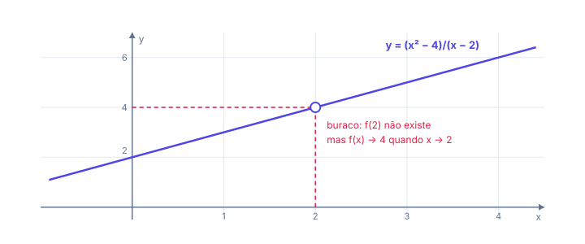
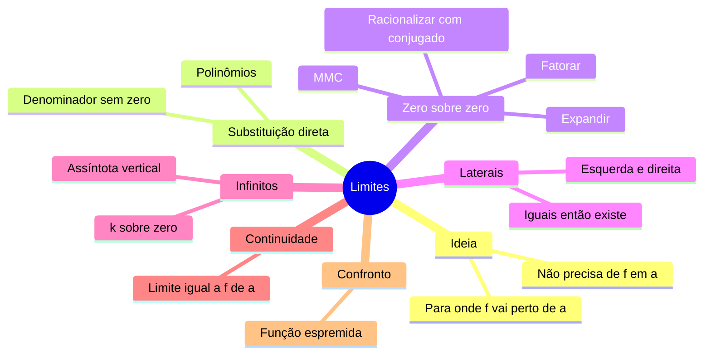

# 🎯 Limites

> [← Funções](01-funcoes.md) · Próximo: [Limites no infinito →](03-limites-no-infinito.md)

**Nível:** 🟢 Iniciante

## 🎯 Você vai aprender

- A ideia de **limite**: para onde $f(x)$ vai quando $x$ chega perto de um número.
- Calcular limites por **substituição direta**.
- Resolver a indeterminação $\frac{0}{0}$ **fatorando**, **expandindo**, **racionalizando** e tirando o **MMC**.
- Usar **limites laterais** para decidir se um limite existe.
- Reconhecer **limites infinitos** (assíntota vertical) e usar o **Teorema do Confronto**.

## Em uma frase

> 💡 O limite responde "**de qual valor $f(x)$ se aproxima** quando $x$ chega cada vez mais perto de $a$?", **sem precisar** que $x$ seja igual a $a$.

## 1. A ideia: chegar perto

Considere $f(x) = \dfrac{x^2 - 4}{x - 2}$. Em $x = 2$ a conta dá $\frac{0}{0}$ e não existe. Mas veja o que acontece **perto** de 2:

| $x$ | 1,9 | 1,99 | 1,999 | 2 | 2,001 | 2,01 | 2,1 |
| --- | --- | ---- | ----- | - | ----- | ---- | --- |
| $f(x)$ | 3,9 | 3,99 | 3,999 | não existe | 4,001 | 4,01 | 4,1 |

Pelos dois lados, $f(x)$ chega perto de **4**. Escrevemos:

$$
\lim_{x \to 2} \frac{x^2 - 4}{x - 2} = 4
$$

O gráfico é a reta $y = x + 2$ com um **buraco** em $(2, 4)$. O limite olha para onde a curva **vai**, não para o que acontece **no** ponto.

> 💡 **Pense num download:** é como o carregamento de um arquivo. A barra chega a 99,9%, 99,99%... O limite é **100%**, mesmo que você esteja olhando antes de terminar.

## 2. Substituição direta

Se a função é um polinômio, ou uma fração cujo denominador **não zera** no ponto, o limite é só **substituir**.

**Exemplo 1:** $\displaystyle\lim_{x \to 2} (3x^2 - x + 4) = 3 \cdot 4 - 2 + 4 = 14$.

**Exemplo 2:** $\displaystyle\lim_{x \to -1} \frac{2x^3 + x - 5}{x + 3} = \frac{-2 - 1 - 5}{2} = \frac{-8}{2} = -4$.

### Propriedades

| Propriedade | Em símbolos |
| ----------- | ----------- |
| Limite da soma | $\lim (f + g) = \lim f + \lim g$ |
| Constante sai para fora | $\lim (k \cdot f) = k \cdot \lim f$ |
| Limite do produto | $\lim (f \cdot g) = \lim f \cdot \lim g$ |
| Limite do quociente | $\lim \dfrac{f}{g} = \dfrac{\lim f}{\lim g}$, se $\lim g \neq 0$ |
| Limite da potência | $\lim f^n = (\lim f)^n$ |

## 3. A indeterminação 0/0

Se a substituição der $\frac{0}{0}$, **o limite ainda pode existir**: a conta só está "escondendo" um fator que zera em cima e embaixo. A estratégia é **simplificar** esse fator e substituir de novo.

> ⚠️ $\frac{0}{0}$ **não** é zero, nem um, nem "não existe". É um aviso: "**faça mais contas**".

### Técnica 1: fatorar

**Exemplo 3:** $\displaystyle\lim_{x \to 4} \frac{x^2 - x - 12}{x - 4}$. Substituindo: $\frac{16 - 4 - 12}{0} = \frac{0}{0}$.

Se $x = 4$ zera o polinômio, então $(x - 4)$ é um fator dele: $x^2 - x - 12 = (x - 4)(x + 3)$.

$$
\lim_{x \to 4} \frac{(x - 4)(x + 3)}{x - 4} = \lim_{x \to 4} (x + 3) = 7
$$

**Exemplo 4 (dois trinômios):** $\displaystyle\lim_{x \to -3} \frac{x^2 + 5x + 6}{x^2 - 9}$.

$$
\lim_{x \to -3} \frac{(x + 2)(x + 3)}{(x - 3)(x + 3)} = \lim_{x \to -3} \frac{x + 2}{x - 3} = \frac{-1}{-6} = \frac{1}{6}
$$

**Exemplo 5 (cubo):** $\displaystyle\lim_{x \to 3} \frac{x^3 - 27}{x^2 - 9}$. Use $a^3 - b^3 = (a - b)(a^2 + ab + b^2)$:

$$
\lim_{x \to 3} \frac{(x - 3)(x^2 + 3x + 9)}{(x - 3)(x + 3)} = \frac{9 + 9 + 9}{6} = \frac{27}{6} = \frac{9}{2}
$$

| Fatoração útil | Fórmula |
| -------------- | ------- |
| Diferença de quadrados | $a^2 - b^2 = (a - b)(a + b)$ |
| Trinômio com raízes $r_1$ e $r_2$ | $ax^2 + bx + c = a(x - r_1)(x - r_2)$ |
| Diferença de cubos | $a^3 - b^3 = (a - b)(a^2 + ab + b^2)$ |
| Soma de cubos | $a^3 + b^3 = (a + b)(a^2 - ab + b^2)$ |

### Técnica 2: expandir

**Exemplo 6:** $\displaystyle\lim_{h \to 0} \frac{(2 + h)^2 - 4}{h}$.

Expanda: $(2 + h)^2 - 4 = 4 + 4h + h^2 - 4 = 4h + h^2 = h(4 + h)$.

$$
\lim_{h \to 0} \frac{h(4 + h)}{h} = \lim_{h \to 0} (4 + h) = 4
$$

Esse formato, com $h \to 0$, é exatamente o que aparece na [definição de derivada](04-derivada.md).

### Técnica 3: racionalizar (quando tem raiz)

**Exemplo 7:** $\displaystyle\lim_{x \to 3} \frac{\sqrt{x + 6} - 3}{x - 3}$. Substituindo: $\frac{3 - 3}{0} = \frac{0}{0}$.

Multiplique em cima e embaixo pelo **conjugado** $\sqrt{x + 6} + 3$. Em cima vira diferença de quadrados:

$$
\frac{(\sqrt{x + 6} - 3)(\sqrt{x + 6} + 3)}{(x - 3)(\sqrt{x + 6} + 3)} = \frac{x + 6 - 9}{(x - 3)(\sqrt{x + 6} + 3)} = \frac{1}{\sqrt{x + 6} + 3}
$$

Agora substitua: $\dfrac{1}{\sqrt{9} + 3} = \dfrac{1}{6}$.

### Técnica 4: MMC (fração dentro de fração)

**Exemplo 8:** $\displaystyle\lim_{x \to 3} \frac{\frac{1}{x} - \frac{1}{3}}{x - 3}$.

O MMC de cima dá $\dfrac{1}{x} - \dfrac{1}{3} = \dfrac{3 - x}{3x} = \dfrac{-(x - 3)}{3x}$. Então:

$$
\lim_{x \to 3} \frac{-(x - 3)}{3x\,(x - 3)} = \lim_{x \to 3} \frac{-1}{3x} = -\frac{1}{9}
$$

> 💡 $3 - x = -(x - 3)$. Esse sinal de menos é o que mais se perde nesse tipo de questão.

## 4. Limites laterais

Às vezes a função muda de fórmula num ponto, como um plano de internet que muda o preço a partir de certo consumo. Aí olhamos cada lado separado:

| Notação | Lê-se | Usa os valores de $x$... |
| ------- | ----- | ------------------------ |
| $\lim_{x \to a^-} f(x)$ | limite pela esquerda | menores que $a$ |
| $\lim_{x \to a^+} f(x)$ | limite pela direita | maiores que $a$ |

> 💡 **O limite existe só quando os dois laterais existem e são iguais.**

**Exemplo 9:**

$$
f(x) = \begin{cases} 2x + 1, & x < 3 \\ x^2 - 2, & x \geq 3 \end{cases}
$$

| Lado | Fórmula usada | Valor |
| ---- | ------------- | ----- |
| Esquerda ($x < 3$) | $2x + 1$ | $7$ |
| Direita ($x \geq 3$) | $x^2 - 2$ | $7$ |

Iguais: $\displaystyle\lim_{x \to 3} f(x) = 7$.

**Exemplo 10:**

$$
g(x) = \begin{cases} x^2 - 1, & x < 2 \\ 2x, & x \geq 2 \end{cases}
$$

Pela esquerda dá $3$; pela direita dá $4$. Diferentes: o limite em $x = 2$ **não existe** (o gráfico dá um "salto").

## 5. Limites infinitos e assíntota vertical

Quando o denominador vai a zero e o numerador **não**, o valor explode.

**Exemplo 11:** numa fila, o tempo de espera cresce como $T(\rho) = \dfrac{1}{1 - \rho}$, onde $\rho$ é a ocupação do servidor.

| $\rho$ | 0,9 | 0,99 | 0,999 |
| ------ | --- | ---- | ----- |
| $T(\rho)$ | 10 | 100 | 1000 |

$$
\lim_{\rho \to 1^-} \frac{1}{1 - \rho} = +\infty
$$

Com o servidor quase 100% ocupado, a espera cresce sem limite. Pela direita ($\rho > 1$), o denominador é negativo e pequeno: o limite é $-\infty$. A reta $\rho = 1$ é uma **assíntota vertical**.

| Resultado da substituição | O que fazer |
| ------------------------- | ----------- |
| Um número | É o limite |
| $\frac{0}{0}$ | Indeterminação: simplifique |
| $\frac{k}{0}$ com $k \neq 0$ | Vai para $\pm\infty$: estude o **sinal** de cada lado |

## 6. Continuidade

Uma função é **contínua** em $x = a$ quando o gráfico não tem buraco nem salto ali, isto é:

$$
\lim_{x \to a} f(x) = f(a)
$$

Polinômios, $e^x$, $\operatorname{sen} x$ e $\cos x$ são contínuos em todo $\mathbb{R}$. Frações, raízes e logaritmos são contínuos em todo o seu domínio. A continuidade é o que garante que os [métodos de raízes](07-bissecao.md) funcionem.

## 7. Teorema do Confronto (sanduíche)

Se $g(x) \leq f(x) \leq h(x)$ perto de $a$ e $g$ e $h$ têm o **mesmo** limite $L$, então $f$ também vai para $L$: ela está "espremida".

**Exemplo 12:** $\displaystyle\lim_{x \to 0} x^2 \operatorname{sen}\left(\frac{1}{x}\right)$.

O seno oscila sem parar perto de 0, mas sempre $-1 \leq \operatorname{sen}(\tfrac{1}{x}) \leq 1$. Multiplicando por $x^2 \geq 0$:

$$
-x^2 \leq x^2 \operatorname{sen}\left(\frac{1}{x}\right) \leq x^2
$$

Como $-x^2 \to 0$ e $x^2 \to 0$, o limite é **0**. É como um sinal com ruído cuja amplitude encolhe até sumir.

## 🧮 Passo a passo

1. **Substitua** o valor de $x$.
2. Deu número? **Pronto.**
3. Deu $\frac{0}{0}$? Escolha a técnica:

| A expressão tem... | Técnica |
| ------------------ | ------- |
| Polinômios em cima e embaixo | Fatorar e cancelar |
| $(a + h)^n$ | Expandir e pôr $h$ em evidência |
| Raiz quadrada | Multiplicar pelo conjugado |
| Frações dentro da fração | MMC |

4. Deu $\frac{k}{0}$? Estude o sinal dos dois lados: $+\infty$, $-\infty$ ou não existe.
5. Função definida por partes? Calcule os **dois laterais** e compare.

## ⚠️ Erros comuns

| Erro | Como evitar |
| ---- | ----------- |
| Dizer que $\frac{0}{0} = 0$ ou $= 1$ | É indeterminação: simplifique |
| Cancelar termos de uma soma: $\frac{x + 3}{x} = 3$ | Só se cancela **fator** (o que multiplica) |
| Esquecer o sinal em $3 - x = -(x - 3)$ | Escreva o sinal na linha de baixo |
| Achar que o limite é $f(a)$ sempre | Só para funções contínuas |
| Responder um só lateral | O limite precisa dos **dois** iguais |

## 💡 Macetes

- **Se $x = a$ zera o polinômio, $(x - a)$ é fator dele.** Divida e pronto.
- **Viu raiz? Pense no conjugado.** $(\sqrt{A} - B)(\sqrt{A} + B) = A - B^2$.
- **Confira no número:** troque $x$ por $a + 0{,}001$ na calculadora e veja se bate com sua resposta.

## 🧠 Mapa mental

## ✅ Teste rápido

**1.** Calcule $\displaystyle\lim_{x \to 2} (x^2 + 3x - 1)$.

Ver resposta

**Número:** `9`

Substituição direta: $4 + 6 - 1 = 9$.

**2.** Calcule $\displaystyle\lim_{x \to 5} \frac{x^2 - 25}{x - 5}$.

Ver resposta

**Número:** `10`

$\frac{0}{0}$. Fatorando: $\frac{(x - 5)(x + 5)}{x - 5} = x + 5 \to 10$.

**3.** Calcule $\displaystyle\lim_{x \to 1} \frac{x^2 + 2x - 3}{x - 1}$.

Ver resposta

**Número:** `4`

$x^2 + 2x - 3 = (x - 1)(x + 3)$. Cancelando: $x + 3 \to 4$.

**4.** Calcule $\displaystyle\lim_{x \to 9} \frac{\sqrt{x} - 3}{x - 9}$.

Ver resposta

**Número:** `1/6`

Pelo conjugado: $\dfrac{x - 9}{(x - 9)(\sqrt{x} + 3)} = \dfrac{1}{\sqrt{x} + 3} \to \dfrac{1}{6}$. Outro jeito: $x - 9 = (\sqrt{x} - 3)(\sqrt{x} + 3)$.

**5.** Calcule $\displaystyle\lim_{h \to 0} \frac{(1 + h)^2 - 1}{h}$.

Ver resposta

**Número:** `2`

$(1 + h)^2 - 1 = 2h + h^2 = h(2 + h)$. Cancelando $h$: $2 + h \to 2$.

**6.** Seja $f(x) = x + 4$ para $x < 1$ e $f(x) = 3x$ para $x \geq 1$. Quanto vale o limite **pela esquerda** em $x = 1$?

Ver resposta

**Número:** `5`

Pela esquerda vale a fórmula $x + 4$: $1 + 4 = 5$.

**7.** Na mesma função da questão 6, o limite $\displaystyle\lim_{x \to 1} f(x)$ existe? Responda **sim** ou **não**.

Ver resposta

**Resposta:** `não`

Pela esquerda dá $5$ e pela direita dá $3 \cdot 1 = 3$. Laterais diferentes: o limite não existe.

**8.** Calcule $\displaystyle\lim_{x \to 0^+} \frac{1}{x}$.

Ver resposta

**Número:** `∞`

Para $x$ positivo e pequeno ($0{,}01$, $0{,}001$...), $\frac{1}{x}$ fica $100$, $1000$... e cresce sem limite: $+\infty$. No corretor, escreva `∞` ou `infinito`.

**9.** Calcule $\displaystyle\lim_{x \to 0} x^2 \cos\left(\frac{1}{x}\right)$.

Ver resposta

**Número:** `0`

Confronto: $-x^2 \leq x^2 \cos(\tfrac{1}{x}) \leq x^2$, e os dois lados vão a 0.

## ✏️ Agora pratique

São 9 exercícios sobre este assunto, do fácil ao difícil, com resolução passo a passo:

| 🟢 Fácil | 🟡 Intermediário | 🔴 Difícil |
| -------- | ---------------- | ---------- |
| [Exercícios 01 a 03](../exercicios/02-limites/facil.md) | [Exercícios 04 a 06](../exercicios/02-limites/intermediario.md) | [Exercícios 07 a 09](../exercicios/02-limites/dificil.md) |

## 📖 Para ir além (fora da ementa)

- **Definição formal ($\varepsilon$–$\delta$):** "$f(x)$ fica tão perto de $L$ quanto se queira ($\varepsilon$), desde que $x$ esteja perto o bastante de $a$ ($\delta$)". É a versão rigorosa da tabela da seção 1.
- **Limite fundamental:** $\displaystyle\lim_{x \to 0} \frac{\operatorname{sen} x}{x} = 1$ (com $x$ em radianos). É ele que dá a derivada do seno.

## 📚 Referências

- STEWART, James. *Cálculo*. v. 1. 8. ed. São Paulo: Cengage Learning, 2017. Capítulo 2.
- GUIDORIZZI, Hamilton L. *Um curso de cálculo*. v. 1. 6. ed. Rio de Janeiro: LTC, 2018. Capítulo 3.
- [Khan Academy: limites e continuidade (em português)](https://pt.khanacademy.org/math/calculus-1)
