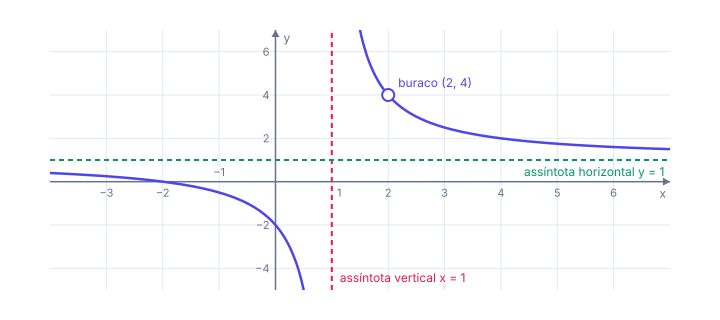
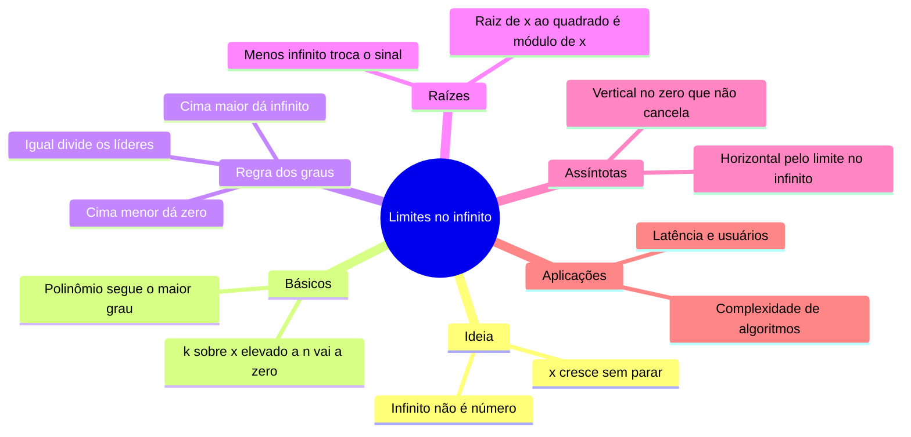

# ♾️ Limites no infinito

> [← Limites](02-limites.md) · Próximo: [Derivada →](04-derivada.md)

**Nível:** 🟡 Intermediário

## 🎯 Você vai aprender

- O que significa $x \to \infty$ e por que "não se substitui o infinito".
- A **regra dos graus** para frações de polinômios.
- Limites com **raiz** no numerador ou no denominador, inclusive com $x \to -\infty$.
- Encontrar **assíntotas horizontais e verticais**.
- Interpretar modelos de **longo prazo**: latência, usuários, epidemias e complexidade de algoritmos.

## Em uma frase

> 💡 O limite no infinito diz **para onde a função se estabiliza** (ou se ela explode) quando a entrada cresce sem parar, como o tempo de um algoritmo para entradas gigantes.

## 1. A ideia: entradas enormes

Veja $f(x) = \dfrac{1}{x}$ com $x$ cada vez maior:

| $x$ | 10 | 100 | 1 000 | 1 000 000 |
| --- | -- | --- | ----- | --------- |
| $f(x)$ | 0,1 | 0,01 | 0,001 | 0,000001 |

Os valores chegam tão perto de 0 quanto quisermos, **sem nunca serem 0**. Escrevemos:

$$
\lim_{x \to \infty} \frac{1}{x} = 0
$$

> ⚠️ $\infty$ **não é um número**. "$x \to \infty$" quer dizer "$x$ cresce sem parar". Por isso não dá para "substituir $x = \infty$": é preciso analisar o comportamento.

### Os limites que você usa o tempo todo

| Limite | Valor | Intuição |
| ------ | ----- | -------- |
| $\displaystyle\lim_{x \to \pm\infty} \frac{k}{x^n}$ (com $n > 0$) | $0$ | Número fixo dividido por algo gigante |
| $\displaystyle\lim_{x \to \infty} x^n$ (com $n > 0$) | $\infty$ | Cresce sem parar |
| $\displaystyle\lim_{x \to -\infty} x^2$ | $\infty$ | Expoente par: sempre positivo |
| $\displaystyle\lim_{x \to -\infty} x^3$ | $-\infty$ | Expoente ímpar: mantém o sinal |
| $\displaystyle\lim_{x \to \infty} e^{-x}$ | $0$ | $e^{-x} = \frac{1}{e^x}$ |
| $\displaystyle\lim_{x \to \infty} \ln x$ | $\infty$ | Cresce, mas bem devagar |

## 2. Polinômios: quem manda é o maior expoente

Para $x$ enorme, o termo de maior grau "engole" os outros:

$$
\lim_{x \to \infty} (x^3 - 100x^2) = \lim_{x \to \infty} x^3\left(1 - \frac{100}{x}\right) = \infty
$$

Em $x = 1\,000\,000$, o termo $x^3$ vale $10^{18}$ e $100x^2$ vale "só" $10^{14}$. É a mesma ideia da notação **O-grande**: um algoritmo $O(n^3)$ sempre perde para um $O(n^2)$ quando $n$ é grande, mesmo com constantes enormes.

## 3. Frações de polinômios: a regra dos graus

**Método:** divida o numerador e o denominador pela **maior potência do denominador**. Todo termo do tipo $\frac{k}{x^n}$ vai a zero.

**Exemplo 1 (mesmo grau):** o tempo por item de um algoritmo é $T(n) = \dfrac{6n^2 + 2n + 1}{2n^2 + 5}$.

$$
\lim_{n \to \infty} \frac{6n^2 + 2n + 1}{2n^2 + 5} = \lim_{n \to \infty} \frac{6 + \frac{2}{n} + \frac{1}{n^2}}{2 + \frac{5}{n^2}} = \frac{6}{2} = 3
$$

Para entradas grandes, o algoritmo gasta cerca de **3 ms por item**.

**Exemplo 2 (grau de cima menor):** máquinas infectadas por um vírus, em milhares, $M(t) = \dfrac{20t + 3}{t^2 + 1}$.

$$
\lim_{t \to \infty} \frac{20t + 3}{t^2 + 1} = \lim_{t \to \infty} \frac{\frac{20}{t} + \frac{3}{t^2}}{1 + \frac{1}{t^2}} = \frac{0}{1} = 0
$$

Segundo o modelo, a infecção **desaparece** a longo prazo.

**Exemplo 3 (grau de cima maior):** $\displaystyle\lim_{x \to \infty} \frac{x^3 + 1}{x^2 + 1}$. Dividindo por $x^2$: $\dfrac{x + \frac{1}{x^2}}{1 + \frac{1}{x^2}} \to \infty$. Com $x \to -\infty$, o $x$ do numerador leva a $-\infty$.

**Exemplo 4 ($x \to -\infty$):** $\displaystyle\lim_{x \to -\infty} \frac{x^2 - 2x + 3}{3x^2 + x + 1} = \frac{1}{3}$. Mesmo grau: a regra vale também para $-\infty$.

### Resumo da regra dos graus

| Comparação dos graus | Limite em $\pm\infty$ | Exemplo |
| -------------------- | --------------------- | ------- |
| Cima **igual** a baixo | Razão dos coeficientes líderes | $\dfrac{6n^2 + \dots}{2n^2 + \dots} \to 3$ |
| Cima **menor** | $0$ | $\dfrac{20t + 3}{t^2 + 1} \to 0$ |
| Cima **maior** | $\pm\infty$ (veja o sinal) | $\dfrac{x^3 + 1}{x^2 + 1} \to \infty$ |

## 4. Quando tem raiz

Use que $\sqrt{x^2} = \lvert x \rvert$: para $x > 0$ é $x$; para $x < 0$ é $-x$.

**Exemplo 5:** $\displaystyle\lim_{x \to \infty} \frac{\sqrt{4x^2 + 5}}{3x + 1}$.

Tire $x^2$ de dentro da raiz: $\sqrt{4x^2 + 5} = \sqrt{x^2\left(4 + \frac{5}{x^2}\right)} = \lvert x \rvert \sqrt{4 + \frac{5}{x^2}}$. Com $x > 0$:

$$
\lim_{x \to \infty} \frac{x\sqrt{4 + \frac{5}{x^2}}}{x\left(3 + \frac{1}{x}\right)} = \frac{\sqrt{4}}{3} = \frac{2}{3}
$$

Com $x \to -\infty$, $\lvert x \rvert = -x$ e o resultado troca de sinal: $-\dfrac{2}{3}$.

**Exemplo 6:** $\displaystyle\lim_{x \to \infty} \frac{2x^3 + 1}{\sqrt{x^6 + x}}$. A raiz se comporta como $\sqrt{x^6} = x^3$: o "grau" de baixo é **3**, igual ao de cima. Resultado: $\dfrac{2}{1} = 2$.

> 💡 **Grau de uma raiz:** $\sqrt{x^6}$ tem "grau" $\frac{6}{2} = 3$. Depois disso, aplique a regra dos graus normalmente.

## 5. Assíntotas

| Tipo | Quando existe | Como achar |
| ---- | ------------- | ---------- |
| **Horizontal** $y = L$ | $\displaystyle\lim_{x \to \pm\infty} f(x) = L$ | Regra dos graus |
| **Vertical** $x = a$ | $\displaystyle\lim_{x \to a} f(x) = \pm\infty$ | Zeros do denominador **que não cancelam** |

**Exemplo 7:** $f(x) = \dfrac{x^2 - 4}{x^2 - 3x + 2}$.

Fatore tudo: $f(x) = \dfrac{(x - 2)(x + 2)}{(x - 2)(x - 1)}$.

| Ponto | O que acontece | Conclusão |
| ----- | -------------- | --------- |
| $x = 2$ | O fator $(x - 2)$ **cancela**: $\displaystyle\lim_{x \to 2} f(x) = \frac{4}{1} = 4$ | **Buraco** em $(2, 4)$, não é assíntota |
| $x = 1$ | Denominador zera e o numerador não | **Assíntota vertical** $x = 1$ |
| $x \to \pm\infty$ | Mesmo grau, coeficientes $1$ e $1$ | **Assíntota horizontal** $y = 1$ |

> ⚠️ Nem todo zero do denominador é assíntota vertical. **Fatore primeiro**: se o fator cancelar, é só um buraco.

## 6. Modelos de longo prazo

**Exemplo 8 (latência):** com $n$ servidores, a latência é $L(n) = 40 + \dfrac{200}{n}$ ms.

$\displaystyle\lim_{n \to \infty} L(n) = 40 + 0 = 40$ ms. Com mais servidores a latência cai, mas **nunca fica abaixo de 40 ms**, e nenhum número finito de servidores dá exatamente 40: $\frac{200}{n}$ nunca é zero.

**Exemplo 9 (usuários):** após uma campanha, os usuários ativos são $U(t) = 3000 + \dfrac{8000t}{t^2 + 2t + 10}$, com $t$ em meses.

| Pergunta | Conta | Resposta |
| -------- | ----- | -------- |
| $U(2)$ | $3000 + \dfrac{16\,000}{4 + 4 + 10} = 3000 + 888{,}9$ | cerca de 3 889 usuários |
| Longo prazo | Fração com grau 1 sobre grau 2: vai a $0$ | $U \to 3000$ |
| Assíntota horizontal | — | $y = 3000$ |

A campanha dá um pico, mas a base estabiliza em 3 000 usuários.

**Exemplo 10 (descobrir o parâmetro):** a taxa de acerto de uma cache com $n$ blocos é $T(n) = \dfrac{an + 1}{4n + 7}$, e para $n$ enorme ela se aproxima de $0{,}75$. Pela regra dos graus, o limite é $\dfrac{a}{4}$. Então $\dfrac{a}{4} = 0{,}75$ e $a = 3$.

## 🧮 Passo a passo

1. É polinômio? Olhe só o termo de **maior grau**.
2. É fração? Compare os graus (ou divida tudo pela maior potência do denominador).
3. Tem raiz? Tire $x^2$ (ou $x^6$...) de dentro e lembre que $\sqrt{x^2} = \lvert x \rvert$.
4. É $x \to -\infty$? Cuidado com os sinais: potência ímpar e $\lvert x \rvert = -x$.
5. Interprete: o limite é o valor em que o sistema se estabiliza.

## ⚠️ Erros comuns

| Erro | Como evitar |
| ---- | ----------- |
| "Substituir $x = \infty$" e fazer $\frac{\infty}{\infty} = 1$ | $\frac{\infty}{\infty}$ é indeterminação: use a regra dos graus |
| Dividir pela maior potência do **numerador** com grau maior | Divida pela do **denominador** (ou compare os graus) |
| Esquecer que $\sqrt{x^2} = \lvert x \rvert$ com $x \to -\infty$ | Lá, $\lvert x \rvert = -x$: o sinal troca |
| Achar que todo zero do denominador é assíntota | Fatore: se cancelar, é buraco |
| Dizer que a função "chega" ao limite | O limite pode nunca ser atingido ($40 + \frac{200}{n}$) |

## 💡 Macetes

- **Mesmo grau:** divida os números da frente. **Cima menor:** zero. **Cima maior:** infinito.
- **Raiz divide o grau por 2:** $\sqrt{x^4} \sim x^2$, $\sqrt{x^6} \sim x^3$.
- **Confira com um número grande:** troque $x$ por $1000$ na calculadora.
- **Ordem de crescimento:** $\ln x \ll x^n \ll e^x$. Exponencial ganha de qualquer polinômio.

## 🧠 Mapa mental

## ✅ Teste rápido

**1.** Calcule $\displaystyle\lim_{x \to \infty} \frac{4x - 1}{2x + 5}$.

Ver resposta

**Número:** `2`

Mesmo grau: $\frac{4}{2} = 2$.

**2.** Calcule $\displaystyle\lim_{x \to \infty} \frac{5x + 2}{x^2 + 1}$.

Ver resposta

**Número:** `0`

Grau de cima (1) menor que o de baixo (2): **0**.

**3.** Calcule $\displaystyle\lim_{x \to \infty} \frac{2x^3}{x^2 + 7}$.

Ver resposta

**Número:** `∞`

Grau de cima maior, e os coeficientes são positivos: $+\infty$.

**4.** Calcule $\displaystyle\lim_{x \to -\infty} \frac{6x^2 - x}{3x^2 + 4}$.

Ver resposta

**Número:** `2`

Mesmo grau (2): $\frac{6}{3} = 2$. Como o expoente é par, $-\infty$ não muda nada.

**5.** Calcule $\displaystyle\lim_{x \to \infty} \frac{\sqrt{16x^2 + 1}}{2x + 3}$.

Ver resposta

**Número:** `2`

$\sqrt{16x^2 + 1} \sim 4x$ para $x > 0$. Então $\frac{4x}{2x} \to 2$.

**6.** A latência com $n$ servidores é $L(n) = 25 + \dfrac{300}{n}$ ms. Qual é o limite quando $n \to \infty$?

Ver resposta

**Número:** `25`

$\frac{300}{n} \to 0$, então $L \to 25$ ms.

**7.** Qual é a assíntota vertical de $f(x) = \dfrac{x + 1}{x - 4}$? Responda o valor de $x$.

Ver resposta

**Número:** `4`

O denominador zera em $x = 4$ e o numerador vale $5 \neq 0$ ali: assíntota vertical $x = 4$.

**8.** Para $T(n) = \dfrac{an + 2}{5n + 1}$, o limite em $n \to \infty$ é $0{,}6$. Quanto vale $a$?

Ver resposta

**Número:** `3`

Mesmo grau: o limite é $\frac{a}{5}$. Então $\frac{a}{5} = 0{,}6 \Rightarrow a = 3$.

## ✏️ Agora pratique

São 9 exercícios sobre este assunto, do fácil ao difícil, com resolução passo a passo:

| 🟢 Fácil | 🟡 Intermediário | 🔴 Difícil |
| -------- | ---------------- | ---------- |
| [Exercícios 01 a 03](../exercicios/03-limites-no-infinito/facil.md) | [Exercícios 04 a 06](../exercicios/03-limites-no-infinito/intermediario.md) | [Exercícios 07 a 09](../exercicios/03-limites-no-infinito/dificil.md) |

## 📖 Para ir além (fora da ementa)

- **Notação assintótica:** dizer que um algoritmo é $O(n^2)$ é, na prática, dizer que $\dfrac{T(n)}{n^2}$ fica limitado quando $n \to \infty$.
- **Assíntota oblíqua:** quando o grau de cima é **exatamente um a mais**, o gráfico se aproxima de uma reta inclinada. Ela sai da divisão de polinômios.
- **Explore no [GeoGebra](https://www.geogebra.org/graphing):** digite a função, afaste o zoom e veja o gráfico "grudar" na assíntota.

## 📚 Referências

- STEWART, James. *Cálculo*. v. 1. 8. ed. São Paulo: Cengage Learning, 2017. Seção 2.6.
- GUIDORIZZI, Hamilton L. *Um curso de cálculo*. v. 1. 6. ed. Rio de Janeiro: LTC, 2018. Capítulo 4.
