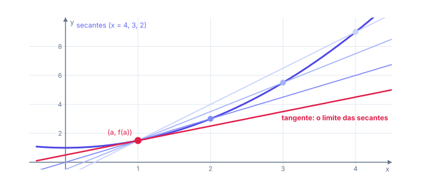
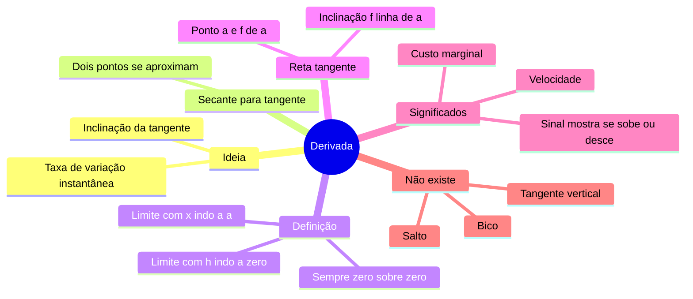

# 📐 Derivada: a ideia

> [← Limites no infinito](03-limites-no-infinito.md) · Próximo: [Regras de derivação →](05-regras-de-derivacao.md)

**Nível:** 🟡 Intermediário

## 🎯 Você vai aprender

- A diferença entre **taxa de variação média** e **taxa instantânea**.
- O **problema da reta tangente** e como a reta secante vira tangente.
- A **definição de derivada** pelo limite, nas duas formas.
- Calcular derivadas **pela definição**.
- Escrever a **equação da reta tangente**.
- Onde a derivada **não existe**.

## Em uma frase

> 💡 A derivada mede **o quão rápido uma coisa muda num instante**: é a velocidade de um robô, o custo extra de mais um usuário, a inclinação da curva naquele ponto.

## 1. Taxa média e taxa instantânea

Um robô anda numa esteira e sua posição, em metros, é $s(t) = t^2$ ($t$ em segundos).

**Taxa média** entre $t = 1$ e $t = 3$:

$$
\frac{s(3) - s(1)}{3 - 1} = \frac{9 - 1}{2} = 4 \text{ m/s}
$$

É a "velocidade média". Mas qual é a velocidade **exatamente** em $t = 1$? Encolha o intervalo:

| Intervalo | Taxa média |
| --------- | ---------- |
| de 1 a 2 | $\dfrac{4 - 1}{1} = 3$ |
| de 1 a 1,1 | $\dfrac{1{,}21 - 1}{0{,}1} = 2{,}1$ |
| de 1 a 1,01 | $\dfrac{1{,}0201 - 1}{0{,}01} = 2{,}01$ |
| de 1 a 1,001 | $2{,}001$ |

As taxas se aproximam de **2**: a velocidade **instantânea** em $t = 1$ é 2 m/s. Isso é um limite, e esse limite é a **derivada**.

## 2. O problema da reta tangente

Ligue dois pontos do gráfico, $(a, f(a))$ e $(x, f(x))$: essa é a **reta secante**, com inclinação

$$
m_{\text{sec}} = \frac{f(x) - f(a)}{x - a}
$$

Agora aproxime $x$ de $a$. A secante gira e encosta na curva: vira a **reta tangente**.

Na figura, $f(x) = \dfrac{x^2}{2} + 1$ e $a = 1$.

A inclinação da tangente é o limite das inclinações das secantes. Essa é a derivada.

## 3. A definição de derivada

Há duas formas equivalentes. Escrevendo $x = a + h$ (com $h$ sendo o "passo"):

| Forma | Fórmula | Use quando... |
| ----- | ------- | ------------- |
| Com $h$ | $f'(x) = \displaystyle\lim_{h \to 0} \frac{f(x + h) - f(x)}{h}$ | Quer a **função** derivada |
| Num ponto | $f'(a) = \displaystyle\lim_{x \to a} \frac{f(x) - f(a)}{x - a}$ | Quer o **valor** num ponto |

Notações: $f'(x)$, $y'$, $\dfrac{dy}{dx}$ e $\dfrac{d}{dx}f(x)$ são a mesma coisa.

> 💡 A conta sempre dá $\frac{0}{0}$ ao substituir $h = 0$. Resolver a derivada pela definição é resolver um limite $\frac{0}{0}$ com as técnicas da [aula de Limites](02-limites.md).

## 4. Derivando pela definição

**Exemplo 1:** $f(x) = 2x^2 + 3$.

| Passo | Conta |
| ----- | ----- |
| 1. Calcule $f(x + h)$ | $2(x + h)^2 + 3 = 2x^2 + 4xh + 2h^2 + 3$ |
| 2. Subtraia $f(x)$ | $4xh + 2h^2$ |
| 3. Divida por $h$ | $\dfrac{h(4x + 2h)}{h} = 4x + 2h$ |
| 4. Faça $h \to 0$ | $4x$ |

Logo $f'(x) = 4x$. O $+3$ sumiu: **constantes não mudam, então têm taxa zero**.

**Exemplo 2:** $f(x) = x^2 - 5x$.

$$
\frac{f(x + h) - f(x)}{h} = \frac{(x + h)^2 - 5(x + h) - x^2 + 5x}{h} = \frac{2xh + h^2 - 5h}{h} = 2x + h - 5
$$

Com $h \to 0$: $f'(x) = 2x - 5$.

**Exemplo 3:** $f(x) = \dfrac{1}{x}$. Aqui entra o MMC:

$$
\frac{\frac{1}{x + h} - \frac{1}{x}}{h} = \frac{x - (x + h)}{h\,x(x + h)} = \frac{-1}{x(x + h)} \;\xrightarrow{h \to 0}\; -\frac{1}{x^2}
$$

**Exemplo 4 (num ponto, com raiz):** $f(x) = \sqrt{x}$ em $a = 9$.

$$
f'(9) = \lim_{x \to 9} \frac{\sqrt{x} - 3}{x - 9} = \lim_{x \to 9} \frac{\sqrt{x} - 3}{(\sqrt{x} - 3)(\sqrt{x} + 3)} = \frac{1}{6}
$$

Usamos $x - 9 = (\sqrt{x} - 3)(\sqrt{x} + 3)$, a diferença de quadrados ao contrário.

### O padrão que aparece

| $f(x)$ | $f'(x)$ pela definição |
| ------ | ---------------------- |
| $c$ (constante) | $0$ |
| $x$ | $1$ |
| $x^2$ | $2x$ |
| $x^3$ | $3x^2$ |
| $\dfrac{1}{x} = x^{-1}$ | $-\dfrac{1}{x^2} = -1 \cdot x^{-2}$ |
| $\sqrt{x} = x^{1/2}$ | $\dfrac{1}{2\sqrt{x}} = \dfrac{1}{2}x^{-1/2}$ |

O expoente **desce multiplicando** e **diminui 1**: $\left(x^n\right)' = n\,x^{n-1}$. É a **regra da potência**, o atalho da [próxima aula](05-regras-de-derivacao.md).

## 5. A reta tangente

A reta tangente ao gráfico no ponto de abscissa $a$ passa por $(a, f(a))$ e tem inclinação $f'(a)$:

$$
y - f(a) = f'(a)\,(x - a)
$$

**Exemplo 5:** reta tangente a $y = x^3 - 3x$ em $x_0 = 2$ (em computação gráfica, curvas são aproximadas por pedacinhos de retas tangentes).

| Passo | Conta |
| ----- | ----- |
| 1. Ponto | $f(2) = 8 - 6 = 2$, então $(2, 2)$ |
| 2. Derivada | $f'(x) = 3x^2 - 3$ |
| 3. Inclinação | $f'(2) = 12 - 3 = 9$ |
| 4. Equação | $y - 2 = 9(x - 2) \Rightarrow y = 9x - 16$ |

Confira: em $x = 2$, a reta dá $18 - 16 = 2$, que é o ponto. ✔️

**Tangente horizontal** é onde $f'(x) = 0$: o gráfico "para de subir ou de descer". Para $y = x^3 - 3x$: $3x^2 - 3 = 0 \Rightarrow x = \pm 1$, nos pontos $(1, -2)$ e $(-1, 2)$.

## 6. O que a derivada significa

| Contexto | $f(x)$ | $f'(x)$ |
| -------- | ------ | ------- |
| Movimento | Posição | Velocidade |
| Velocidade | Velocidade | Aceleração |
| Negócios | Custo de produzir $x$ unidades | **Custo marginal** (custo da próxima unidade) |
| Computação | Usuários no tempo $t$ | Novos usuários por dia |
| Gráfico | Altura da curva | **Inclinação** da curva |

O sinal também diz muito: $f' > 0$, a função **sobe**; $f' < 0$, **desce**; $f' = 0$, está **parada** (pode ser um topo ou um fundo). Isso é a base da [aula de aplicações](06-aplicacoes-da-derivada.md).

## 7. Onde a derivada não existe

| Situação | Exemplo | Por quê |
| -------- | ------- | ------- |
| **Bico** (quina) | $\lvert x \rvert$ em $x = 0$ | Pela esquerda a inclinação é $-1$; pela direita, $+1$ |
| **Salto** ou buraco | Função por partes descontínua | Sem continuidade não há derivada |
| **Tangente vertical** | $\sqrt[3]{x}$ em $x = 0$ | A inclinação seria infinita |

> 💡 Toda função **derivável** é **contínua**, mas nem toda função contínua é derivável: $\lvert x \rvert$ é contínua em 0, mas tem bico.

## 🧮 Passo a passo (definição)

1. Escreva $f(x + h)$, trocando **todo** $x$ por $(x + h)$.
2. Calcule $f(x + h) - f(x)$ e simplifique: os termos sem $h$ **sempre se cancelam**.
3. Coloque $h$ em evidência e cancele com o $h$ de baixo.
4. Faça $h \to 0$.
5. Confira com a regra da potência.

## ⚠️ Erros comuns

| Erro | Como evitar |
| ---- | ----------- |
| $f(x + h) = f(x) + h$ | Troque **cada** $x$ por $(x + h)$: $(x + h)^2 \neq x^2 + h$ |
| Substituir $h = 0$ antes de cancelar | Dá $\frac{0}{0}$: simplifique primeiro |
| Na reta tangente, usar $f'(x)$ em vez de $f'(a)$ | A inclinação é um **número** |
| Confundir taxa média com instantânea | Média usa dois pontos; instantânea é o limite |
| Achar que toda função contínua tem derivada | Bicos ($\lvert x \rvert$) não têm |

## 💡 Macetes

- **Depois de subtrair $f(x)$, todo termo restante tem $h$.** Se sobrar termo sem $h$, tem erro de conta.
- **Reta tangente em 3 números:** $a$, $f(a)$ e $f'(a)$. Depois é só $y - f(a) = f'(a)(x - a)$.
- **Confira numericamente:** $\dfrac{f(a + 0{,}001) - f(a)}{0{,}001}$ fica bem perto de $f'(a)$.

## 🧠 Mapa mental

## ✅ Teste rápido

**1.** Qual é a taxa de variação média de $f(x) = x^2$ entre $x = 1$ e $x = 4$?

Ver resposta

**Número:** `5`

$\dfrac{f(4) - f(1)}{4 - 1} = \dfrac{16 - 1}{3} = 5$.

**2.** Pela definição, derive $f(x) = 5x^2$.

Ver resposta

**Função:** `10x`

$\dfrac{5(x + h)^2 - 5x^2}{h} = \dfrac{10xh + 5h^2}{h} = 10x + 5h \to 10x$.

**3.** Para $f(x) = x^2 - 4x$, quanto vale $f'(3)$?

Ver resposta

**Número:** `2`

$f'(x) = 2x - 4$, então $f'(3) = 6 - 4 = 2$.

**4.** Calcule $\displaystyle\lim_{h \to 0} \frac{(3 + h)^2 - 9}{h}$. (É a derivada de qual função, em qual ponto?)

Ver resposta

**Número:** `6`

$(3 + h)^2 - 9 = 6h + h^2$; dividindo por $h$: $6 + h \to 6$. É $f'(3)$ para $f(x) = x^2$, que vale $2 \cdot 3 = 6$.

**5.** Escreva a reta tangente a $y = x^2$ no ponto de abscissa $x = 2$ (na forma $y = \dots$).

Ver resposta

**Função:** `4x - 4`

Ponto $(2, 4)$; inclinação $f'(2) = 2 \cdot 2 = 4$. Então $y - 4 = 4(x - 2)$, ou seja, $y = 4x - 4$.

**6.** Para $f(x) = \dfrac{1}{x}$, quanto vale $f'(2)$?

Ver resposta

**Número:** `-1/4`

$f'(x) = -\dfrac{1}{x^2}$, então $f'(2) = -\dfrac{1}{4}$.

**7.** A derivada de $f(x) = \lvert x \rvert$ existe em $x = 0$? Responda **sim** ou **não**.

Ver resposta

**Resposta:** `não`

Pela esquerda a inclinação é $-1$ e pela direita é $1$: o gráfico tem um bico.

**8.** A posição de um robô é $s(t) = 4t^2$ metros. Qual é a velocidade em $t = 3$ s?

Ver resposta

**Número:** `24`

$s'(t) = 8t$, então $s'(3) = 24$ m/s.

## ✏️ Agora pratique

São 9 exercícios sobre este assunto, do fácil ao difícil, com resolução passo a passo:

| 🟢 Fácil | 🟡 Intermediário | 🔴 Difícil |
| -------- | ---------------- | ---------- |
| [Exercícios 01 a 03](../exercicios/04-derivada/facil.md) | [Exercícios 04 a 06](../exercicios/04-derivada/intermediario.md) | [Exercícios 07 a 09](../exercicios/04-derivada/dificil.md) |

## 📖 Para ir além (fora da ementa)

- **Derivada numérica:** os computadores aproximam $f'(x)$ por $\dfrac{f(x + h) - f(x - h)}{2h}$ com $h$ pequeno (diferença central). É mais precisa que a da definição.
- **Gradiente:** em funções de várias variáveis, as derivadas parciais formam o gradiente, que aponta a direção de maior subida. O treino de redes neurais "desce" na direção contrária a ele.

## 📚 Referências

- STEWART, James. *Cálculo*. v. 1. 8. ed. São Paulo: Cengage Learning, 2017. Seções 2.7 e 2.8.
- GUIDORIZZI, Hamilton L. *Um curso de cálculo*. v. 1. 6. ed. Rio de Janeiro: LTC, 2018. Capítulo 7.
