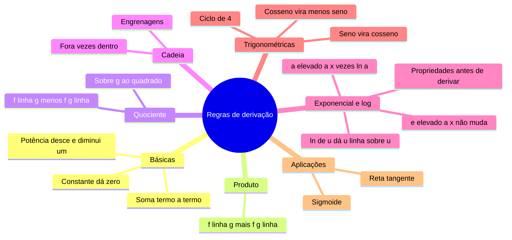

# 🧮 Regras de derivação

> [← Derivada](04-derivada.md) · Próximo: [Aplicações da derivada →](06-aplicacoes-da-derivada.md)

**Nível:** 🟡 Intermediário

## 🎯 Você vai aprender

- As regras da **potência**, da **soma**, do **produto** e do **quociente**.
- A **regra da cadeia**, para funções dentro de funções.
- As derivadas de $e^x$, $a^x$, $\ln x$, $\log_a x$, seno, cosseno e tangente.
- Usar as **propriedades do logaritmo** para simplificar antes de derivar.
- Derivadas de **ordem superior** e a derivada da **sigmoide**, usada em redes neurais.

## Em uma frase

> 💡 Ninguém deriva pela definição no dia a dia: com **meia dúzia de regras** você deriva qualquer função montada com somas, produtos, divisões e composições.

## 1. A tabela que você precisa saber

| Função | Derivada | Exemplo |
| ------ | -------- | ------- |
| $c$ (constante) | $0$ | $(7)' = 0$ |
| $x^n$ | $n\,x^{n-1}$ | $(x^5)' = 5x^4$ |
| $e^x$ | $e^x$ | — |
| $a^x$ | $a^x \ln a$ | $(2^x)' = 2^x \ln 2$ |
| $\ln x$ | $\dfrac{1}{x}$ | — |
| $\log_a x$ | $\dfrac{1}{x \ln a}$ | $(\log_2 x)' = \dfrac{1}{x \ln 2}$ |
| $\operatorname{sen} x$ | $\cos x$ | — |
| $\cos x$ | $-\operatorname{sen} x$ | — |
| $\operatorname{tg} x$ | $\sec^2 x = \dfrac{1}{\cos^2 x}$ | — |

| Regra | Fórmula |
| ----- | ------- |
| Constante vezes função | $(c\,f)' = c\,f'$ |
| Soma e diferença | $(f \pm g)' = f' \pm g'$ |
| **Produto** | $(f\,g)' = f'\,g + f\,g'$ |
| **Quociente** | $\left(\dfrac{f}{g}\right)' = \dfrac{f'\,g - f\,g'}{g^2}$ |
| **Cadeia** | $\left(f(g(x))\right)' = f'(g(x)) \cdot g'(x)$ |

## 2. Potência, soma e constante

**Exemplo 1:** $f(x) = 2x^5 - 3x^3 + 4x - 7$. Derive termo a termo:

$$
f'(x) = 2 \cdot 5x^4 - 3 \cdot 3x^2 + 4 - 0 = 10x^4 - 9x^2 + 4
$$

### Prepare antes de derivar

A regra da potência vale para **qualquer expoente**, inclusive negativo e fracionário. Então reescreva raízes e frações como potências:

| Escrito assim | Reescreva | Derivada | Volte para |
| ------------- | --------- | -------- | ---------- |
| $\dfrac{5}{x^3}$ | $5x^{-3}$ | $-15x^{-4}$ | $-\dfrac{15}{x^4}$ |
| $\sqrt{x}$ | $x^{1/2}$ | $\frac{1}{2}x^{-1/2}$ | $\dfrac{1}{2\sqrt{x}}$ |
| $\sqrt[3]{x^2}$ | $x^{2/3}$ | $\frac{2}{3}x^{-1/3}$ | $\dfrac{2}{3\sqrt[3]{x}}$ |
| $\dfrac{1}{\sqrt{x}}$ | $x^{-1/2}$ | $-\frac{1}{2}x^{-3/2}$ | $-\dfrac{1}{2x\sqrt{x}}$ |

**Exemplo 2:** $f(x) = (2x + 1)^2$. Expanda primeiro: $4x^2 + 4x + 1$, então $f'(x) = 8x + 4$.

**Exemplo 3:** $f(x) = \dfrac{x^2 + 3\sqrt{x}}{x}$. Divida cada termo por $x$: $f(x) = x + 3x^{-1/2}$.

$$
f'(x) = 1 - \frac{3}{2}x^{-3/2} = 1 - \frac{3}{2x\sqrt{x}}
$$

> 💡 Simplificar antes evita a regra do quociente e reduz muito a chance de erro.

## 3. Regra do produto

$$
(f\,g)' = f'\,g + f\,g'
$$

"Deriva o primeiro e mantém o segundo, **mais** mantém o primeiro e deriva o segundo."

**Exemplo 4:** as requisições de um serviço crescem como $R(t) = (2t^2 + t)\,e^t$.

| Parte | Valor |
| ----- | ----- |
| $f = 2t^2 + t$ | $f' = 4t + 1$ |
| $g = e^t$ | $g' = e^t$ |

$$
R'(t) = (4t + 1)e^t + (2t^2 + t)e^t = e^t\,(2t^2 + 5t + 1)
$$

**Exemplo 5:** $f(x) = x^3 \ln x$. Então $f'(x) = 3x^2 \ln x + x^3 \cdot \dfrac{1}{x} = x^2(3 \ln x + 1)$.

> ⚠️ $(f\,g)' \neq f'\,g'$. A derivada do produto **não** é o produto das derivadas.

## 4. Regra do quociente

$$
\left(\frac{f}{g}\right)' = \frac{f'\,g - f\,g'}{g^2}
$$

Macete para decorar: "**deriva cima vezes baixo, menos cima vezes deriva baixo, sobre baixo ao quadrado**". A ordem importa por causa do sinal de menos.

**Exemplo 6:** $f(x) = \dfrac{2x + 3}{x - 1}$.

$$
f'(x) = \frac{2(x - 1) - (2x + 3) \cdot 1}{(x - 1)^2} = \frac{2x - 2 - 2x - 3}{(x - 1)^2} = -\frac{5}{(x - 1)^2}
$$

**Exemplo 7:** $y = \dfrac{e^x}{x^2}$.

$$
y' = \frac{e^x \cdot x^2 - e^x \cdot 2x}{x^4} = \frac{x\,e^x(x - 2)}{x^4} = \frac{e^x(x - 2)}{x^3}
$$

## 5. Regra da cadeia

Use quando há uma função **dentro** de outra: $f(g(x))$. Deriva a de **fora** (mantendo a de dentro intacta) e **multiplica** pela derivada da de **dentro**.

$$
\left(f(g(x))\right)' = f'(g(x)) \cdot g'(x)
$$

> 💡 **Engrenagens:** se a engrenagem de fora gira 3 vezes mais rápido que a do meio, e a do meio gira 2 vezes mais rápido que a de dentro, a de fora gira $3 \cdot 2 = 6$ vezes mais rápido. As taxas **se multiplicam**.

**Exemplo 8:** $f(x) = (2x^3 - 5)^4$. Fora: $u^4$; dentro: $u = 2x^3 - 5$.

$$
f'(x) = 4(2x^3 - 5)^3 \cdot 6x^2 = 24x^2(2x^3 - 5)^3
$$

**Exemplo 9:** $y = \sqrt{5 - 2x} = (5 - 2x)^{1/2}$.

$$
y' = \frac{1}{2}(5 - 2x)^{-1/2} \cdot (-2) = -\frac{1}{\sqrt{5 - 2x}}
$$

| Função | Fora | Dentro | Derivada |
| ------ | ---- | ------ | -------- |
| $e^{x^2 + 2x}$ | $e^u$ | $x^2 + 2x$ | $(2x + 2)\,e^{x^2 + 2x}$ |
| $\operatorname{sen}(3x^2)$ | $\operatorname{sen} u$ | $3x^2$ | $6x \cos(3x^2)$ |
| $(e^x + 2)^5$ | $u^5$ | $e^x + 2$ | $5(e^x + 2)^4\,e^x$ |
| $\operatorname{sen}(\operatorname{sen} x)$ | $\operatorname{sen} u$ | $\operatorname{sen} x$ | $\cos(\operatorname{sen} x) \cdot \cos x$ |
| $e^{-3x}$ | $e^u$ | $-3x$ | $-3e^{-3x}$ |

## 6. Exponencial e logaritmo com cadeia

| Forma | Derivada | Exemplo |
| ----- | -------- | ------- |
| $e^{u}$ | $u'\,e^{u}$ | $(e^{5x})' = 5e^{5x}$ |
| $a^{u}$ | $u'\,a^{u} \ln a$ | $(3^{x^2})' = 2x \cdot 3^{x^2} \ln 3$ |
| $\ln u$ | $\dfrac{u'}{u}$ | $(\ln(3x + 2))' = \dfrac{3}{3x + 2}$ |
| $\log_a u$ | $\dfrac{u'}{u \ln a}$ | $(\log_2(x^2))' = \dfrac{2}{x \ln 2}$ |

**Exemplo 10:** $f(x) = \ln(x^2 - 4)$. Então $f'(x) = \dfrac{2x}{x^2 - 4}$.

### Propriedades do logaritmo: simplifique antes

| Propriedade | Exemplo |
| ----------- | ------- |
| $\ln(a\,b) = \ln a + \ln b$ | $\ln(5x^2) = \ln 5 + 2\ln x$ |
| $\ln\left(\dfrac{a}{b}\right) = \ln a - \ln b$ | $\ln\left(\dfrac{x}{x + 1}\right) = \ln x - \ln(x + 1)$ |
| $\ln(a^n) = n \ln a$ | $\ln \sqrt{x} = \frac{1}{2}\ln x$ |

**Exemplo 11:** $f(x) = \ln\left[(x + 1)^3 (x - 2)^2\right]$. Sem as propriedades, seria cadeia com produto. Com elas:

$$
f(x) = 3\ln(x + 1) + 2\ln(x - 2) \;\Rightarrow\; f'(x) = \frac{3}{x + 1} + \frac{2}{x - 2}
$$

**Exemplo 12:** $f(x) = \ln(\ln x)$. Cadeia: $f'(x) = \dfrac{1}{\ln x} \cdot \dfrac{1}{x} = \dfrac{1}{x \ln x}$.

> 💡 Em computação, $\log_2 n$ aparece em toda parte (busca binária, árvores). Sua derivada, $\dfrac{1}{n \ln 2}$, encolhe quando $n$ cresce: dobrar a entrada custa só **um passo a mais**.

## 7. Trigonométricas e ordem superior

**Exemplo 13:** $f(x) = 3e^x + 2\ln x - 4\operatorname{sen} x + \cos x$.

$$
f'(x) = 3e^x + \frac{2}{x} - 4\cos x - \operatorname{sen} x
$$

A **derivada segunda** $f''$ é a derivada da derivada, e assim por diante: $f'''$, $f^{(4)}$, $f^{(n)}$.

| $n$ | 0 | 1 | 2 | 3 | 4 |
| --- | - | - | - | - | - |
| $(\operatorname{sen} x)^{(n)}$ | $\operatorname{sen} x$ | $\cos x$ | $-\operatorname{sen} x$ | $-\cos x$ | $\operatorname{sen} x$ |
| $(\cos x)^{(n)}$ | $\cos x$ | $-\operatorname{sen} x$ | $-\cos x$ | $\operatorname{sen} x$ | $\cos x$ |

O ciclo tem **4** passos. Para $f^{(n)}$, use o **resto de $n$ por 4**.

**Exemplo 14:** $(\cos x)^{(50)}$: $50 = 4 \cdot 12 + 2$, resto **2**. Pela tabela: $-\cos x$.

**Exemplo 15:** $f(x) = x^5$. $f' = 5x^4$, $f'' = 20x^3$, $f''' = 60x^2$, $f^{(4)} = 120x$, $f^{(5)} = 120$ e $f^{(6)} = 0$. Um polinômio de grau $n$ zera a partir da derivada $n + 1$.

## 8. Aplicação: a sigmoide das redes neurais

A função de ativação **sigmoide** é $\sigma(x) = \dfrac{1}{1 + e^{-x}} = (1 + e^{-x})^{-1}$. O treino (backpropagation) precisa de $\sigma'$.

Cadeia, com fora $u^{-1}$ e dentro $1 + e^{-x}$:

$$
\sigma'(x) = -(1 + e^{-x})^{-2} \cdot (-e^{-x}) = \frac{e^{-x}}{(1 + e^{-x})^2}
$$

Repare que $\sigma(x) \cdot (1 - \sigma(x)) = \dfrac{1}{1 + e^{-x}} \cdot \dfrac{e^{-x}}{1 + e^{-x}}$, que é a mesma coisa. Por isso

$$
\sigma'(x) = \sigma(x)\,\bigl(1 - \sigma(x)\bigr)
$$

e o computador reaproveita o valor de $\sigma$ que já calculou. Em $x = 0$: $\sigma(0) = \frac{1}{2}$, logo $\sigma'(0) = \frac{1}{2} \cdot \frac{1}{2} = \frac{1}{4}$.

## 9. Derivada num ponto e parâmetros

**Exemplo 16:** $f(x) = \dfrac{x}{e^{x^2 - 4}}$ em $x = 2$. Reescreva sem fração: $f(x) = x\,e^{4 - x^2}$. Produto e cadeia:

$$
f'(x) = e^{4 - x^2} + x \cdot e^{4 - x^2} \cdot (-2x) = e^{4 - x^2}(1 - 2x^2)
$$

Em $x = 2$: $e^0 (1 - 8) = -7$.

**Exemplo 17:** para $f(x) = \ln(x^2 + k)$, qual $k$ dá $f'(2) = \frac{1}{2}$? Temos $f'(x) = \dfrac{2x}{x^2 + k}$, então $f'(2) = \dfrac{4}{4 + k} = \dfrac{1}{2}$, e $k = 4$.

## 🧮 Passo a passo

1. **Simplifique:** raízes e frações viram potências; logaritmos se abrem com as propriedades.
2. **Identifique a "última operação"** da função (como a última conta que a calculadora faria):

| Última operação | Regra |
| --------------- | ----- |
| Soma ou diferença | Deriva termo a termo |
| Multiplicação | Produto |
| Divisão | Quociente (ou reescreva como produto com expoente negativo) |
| Função de outra função | Cadeia |

3. Aplique a regra e repita nas partes de dentro.
4. **Simplifique** o resultado (ponha fatores em evidência).

## ⚠️ Erros comuns

| Erro | Como evitar |
| ---- | ----------- |
| $(f\,g)' = f'\,g'$ | Produto: $f'g + fg'$ |
| Trocar a ordem no quociente | É $f'g - fg'$, **cima derivado primeiro** |
| Esquecer o "vezes a de dentro" na cadeia | $(\ln(3x + 1))' = \frac{3}{3x + 1}$, não $\frac{1}{3x + 1}$ |
| $(e^{x^2})' = e^{x^2}$ | Falta a cadeia: $2x\,e^{x^2}$ |
| $(\ln x)' = \ln$ algo | É $\frac{1}{x}$ |
| $(\cos x)' = \operatorname{sen} x$ | É $-\operatorname{sen} x$ |
| $(2^x)' = x \cdot 2^{x-1}$ | Isso é para $x^n$; exponencial: $2^x \ln 2$ |

## 💡 Macetes

- **Potência: "desce e diminui um".** Base variável, expoente fixo.
- **Exponencial: "copia e multiplica pela derivada do expoente"** (e por $\ln a$ se a base não for $e$).
- **Logaritmo: "derivada de dentro sobre o de dentro"**: $\dfrac{u'}{u}$.
- **Seno vira cosseno; cosseno vira menos seno.** O sinal de menos aparece quando "desce" do cosseno.
- **Confira com um número:** compare $f'(1)$ com $\frac{f(1{,}001) - f(1)}{0{,}001}$.

## 🧠 Mapa mental

## ✅ Teste rápido

**1.** Derive $f(x) = 4x^3 - 2x + 7$.

Ver resposta

**Função:** `12x^2 - 2`

Termo a termo: $12x^2 - 2 + 0$.

**2.** Derive $f(x) = \dfrac{3}{x^2}$.

Ver resposta

**Função:** `-6/x^3`

$3x^{-2} \Rightarrow -6x^{-3} = -\dfrac{6}{x^3}$.

**3.** Derive $f(x) = x^2 e^x$.

Ver resposta

**Função:** `e^x (x^2 + 2x)`

Produto: $2x\,e^x + x^2 e^x = e^x(x^2 + 2x)$.

**4.** Derive $f(x) = \dfrac{x + 1}{x - 1}$.

Ver resposta

**Função:** `-2/(x-1)^2`

$\dfrac{1 \cdot (x - 1) - (x + 1) \cdot 1}{(x - 1)^2} = \dfrac{-2}{(x - 1)^2}$.

**5.** Derive $f(x) = (x^2 + 1)^5$.

Ver resposta

**Função:** `10x (x^2 + 1)^4`

Cadeia: $5(x^2 + 1)^4 \cdot 2x$.

**6.** Derive $f(x) = \ln(5x + 1)$.

Ver resposta

**Função:** `5/(5x + 1)`

$\dfrac{u'}{u}$ com $u = 5x + 1$.

**7.** Derive $f(x) = \log_2 x$.

Ver resposta

**Função:** `1/(x ln 2)`

$(\log_a x)' = \dfrac{1}{x \ln a}$ com $a = 2$.

**8.** Derive $f(x) = \cos(2x)$.

Ver resposta

**Função:** `-2 sen(2x)`

Fora: $\cos u \to -\operatorname{sen} u$. Dentro: $2x \to 2$. Resultado: $-2\operatorname{sen}(2x)$.

**9.** Para a sigmoide $\sigma(x) = \dfrac{1}{1 + e^{-x}}$, quanto vale $\sigma'(0)$?

Ver resposta

**Número:** `1/4`

$\sigma'(0) = \sigma(0)(1 - \sigma(0)) = \frac{1}{2} \cdot \frac{1}{2} = \frac{1}{4}$.

**10.** Quanto vale a derivada de ordem 7 de $\operatorname{sen} x$, calculada em $x = 0$?

Ver resposta

**Número:** `-1`

$7 = 4 + 3$, resto **3**: $(\operatorname{sen} x)^{(7)} = -\cos x$. Em $x = 0$: $-\cos 0 = -1$.

## ✏️ Agora pratique

São 9 exercícios sobre este assunto, do fácil ao difícil, com resolução passo a passo:

| 🟢 Fácil | 🟡 Intermediário | 🔴 Difícil |
| -------- | ---------------- | ---------- |
| [Exercícios 01 a 03](../exercicios/05-regras-de-derivacao/facil.md) | [Exercícios 04 a 06](../exercicios/05-regras-de-derivacao/intermediario.md) | [Exercícios 07 a 09](../exercicios/05-regras-de-derivacao/dificil.md) |

## 📖 Para ir além (fora da ementa)

- **Derivação logarítmica:** para $y = x^x$, tire o $\ln$ dos dois lados ($\ln y = x \ln x$) e derive: $y' = x^x(\ln x + 1)$.
- **Diferenciação automática:** bibliotecas como PyTorch aplicam a regra da cadeia **automaticamente**, operação por operação, para treinar redes neurais.

## 📚 Referências

- STEWART, James. *Cálculo*. v. 1. 8. ed. São Paulo: Cengage Learning, 2017. Capítulo 3.
- GUIDORIZZI, Hamilton L. *Um curso de cálculo*. v. 1. 6. ed. Rio de Janeiro: LTC, 2018. Capítulo 7.
