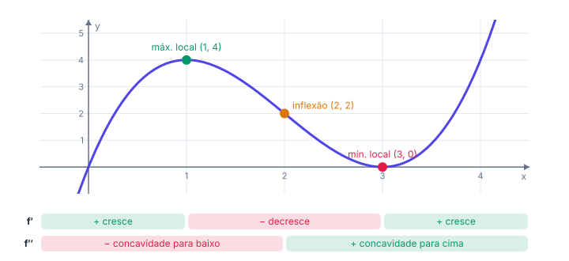
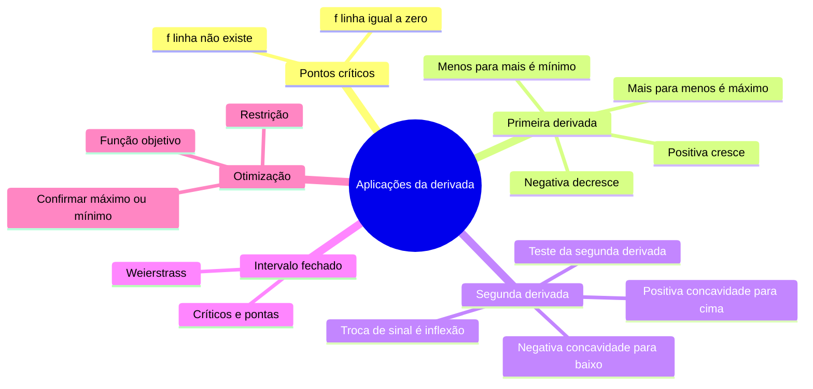

# 📈 Aplicações da derivada

> [← Regras de derivação](05-regras-de-derivacao.md) · Próximo: [Método da bisseção →](07-bissecao.md)

**Nível:** 🔴 Avançado

## 🎯 Você vai aprender

- Encontrar **pontos críticos**.
- Descobrir onde a função **cresce** e onde **decresce** (sinal de $f'$).
- Classificar **máximos e mínimos locais** (testes da 1ª e da 2ª derivada).
- Estudar a **concavidade** e achar **pontos de inflexão** (sinal de $f''$).
- Achar **extremos absolutos** num intervalo fechado.
- **Esboçar** o gráfico e resolver problemas de **otimização**.

## Em uma frase

> 💡 O sinal de $f'$ diz se a função **sobe ou desce**; o sinal de $f''$ diz se a curva está **sorrindo ou triste**. Com isso você acha o melhor valor possível: menor custo, maior área, menor tempo.

## 1. Pontos críticos

Um **ponto crítico** é um $c$ do domínio onde $f'(c) = 0$ (tangente horizontal) ou onde $f'(c)$ **não existe** (bico). Os máximos e mínimos locais só podem estar nesses pontos.

**Exemplo 1:** $f(x) = 2x^3 + 3x^2 - 36x + 5$.

$$
f'(x) = 6x^2 + 6x - 36 = 6(x^2 + x - 6) = 6(x + 3)(x - 2)
$$

$f'(x) = 0$ em $x = -3$ e $x = 2$. Esses são os pontos críticos.

> ⚠️ $f'(c) = 0$ **não garante** máximo nem mínimo. Em $f(x) = x^3$, temos $f'(0) = 0$, mas a função só sobe: $x = 0$ não é máximo nem mínimo.

## 2. Crescimento e o teste da 1ª derivada

| Sinal de $f'$ | A função... |
| ------------- | ----------- |
| $f' > 0$ | **cresce** ↗ |
| $f' < 0$ | **decresce** ↘ |

Faça um **quadro de sinais** com os pontos críticos. Para o Exemplo 1, teste um valor em cada pedaço:

| Intervalo | Teste | Sinal de $f'$ | $f$ |
| --------- | ----- | ------------- | --- |
| $x < -3$ | $f'(-4) = 36$ | $+$ | cresce ↗ |
| $-3 < x < 2$ | $f'(0) = -36$ | $-$ | decresce ↘ |
| $x > 2$ | $f'(3) = 36$ | $+$ | cresce ↗ |

**Teste da 1ª derivada:**

| $f'$ muda de... | O ponto é... |
| --------------- | ------------ |
| $+$ para $-$ (sobe, depois desce) | **máximo local** ⛰️ |
| $-$ para $+$ (desce, depois sobe) | **mínimo local** 🏞️ |
| não muda | nem um, nem outro |

No Exemplo 1: **máximo local** em $x = -3$, com $f(-3) = -54 + 27 + 108 + 5 = 86$; **mínimo local** em $x = 2$, com $f(2) = 16 + 12 - 72 + 5 = -39$.

## 3. Concavidade e inflexão

| Sinal de $f''$ | Concavidade | Formato |
| -------------- | ----------- | ------- |
| $f'' > 0$ | para **cima** | $\cup$ (sorriso) |
| $f'' < 0$ | para **baixo** | $\cap$ (tristeza) |

Um **ponto de inflexão** é onde a concavidade **troca**. Procure onde $f'' = 0$ e confira se o sinal muda.

No Exemplo 1: $f''(x) = 12x + 6$, que zera em $x = -\frac{1}{2}$. Antes é negativa e depois positiva: **inflexão** em $x = -\frac{1}{2}$, com $f(-\frac{1}{2}) = 23{,}5$.

### Teste da 2ª derivada

Um jeito rápido de classificar um ponto crítico $c$ com $f'(c) = 0$:

| $f''(c)$ | Conclusão |
| -------- | --------- |
| $< 0$ | **máximo** local (curva $\cap$) |
| $> 0$ | **mínimo** local (curva $\cup$) |
| $= 0$ | o teste **não decide**: use a 1ª derivada |

**Exemplo 2:** $f(x) = x^4 - 2x^2 + 3$. Então $f'(x) = 4x^3 - 4x = 4x(x - 1)(x + 1)$ e $f''(x) = 12x^2 - 4$.

| Crítico | $f''$ | Tipo | Valor |
| ------- | ----- | ---- | ----- |
| $x = -1$ | $8 > 0$ | mínimo local | $f(-1) = 2$ |
| $x = 0$ | $-4 < 0$ | máximo local | $f(0) = 3$ |
| $x = 1$ | $8 > 0$ | mínimo local | $f(1) = 2$ |

## 4. Esboço completo do gráfico

**Exemplo 3:** a carga de CPU de um servidor, numa escala adaptada, segue $f(x) = x^3 - 6x^2 + 9x$.

| Etapa | Conta | Resultado |
| ----- | ----- | --------- |
| 1. Derivada | $f'(x) = 3x^2 - 12x + 9 = 3(x - 1)(x - 3)$ | críticos em $1$ e $3$ |
| 2. Sinais de $f'$ | $+$ antes de 1, $-$ entre 1 e 3, $+$ depois de 3 | ↗ ↘ ↗ |
| 3. Extremos | $f(1) = 4$, $f(3) = 0$ | máx. local $(1, 4)$; mín. local $(3, 0)$ |
| 4. Segunda derivada | $f''(x) = 6x - 12$ | zera em $x = 2$ |
| 5. Concavidade | $\cap$ antes de 2, $\cup$ depois | inflexão em $(2, 2)$ |
| 6. Pontos extras | $f(0) = 0$, $f(4) = 4$ | — |

## 5. Extremos absolutos num intervalo fechado

**Teorema de Weierstrass:** uma função **contínua** num intervalo **fechado** $[a, b]$ sempre tem máximo e mínimo **absolutos**. Eles estão nos pontos críticos **ou nas pontas** do intervalo.

**Método do intervalo fechado:**

1. Ache os pontos críticos **dentro** de $[a, b]$.
2. Calcule $f$ nos críticos e nas duas pontas.
3. O maior valor é o máximo absoluto; o menor, o mínimo absoluto.

**Exemplo 4:** a temperatura relativa de um chip num teste é $T(t) = t^3 - 27t + 10$, com $t \in [-4, 5]$.

$T'(t) = 3t^2 - 27 = 0 \Rightarrow t = \pm 3$ (os dois estão no intervalo).

| $t$ | $-4$ (ponta) | $-3$ (crítico) | $3$ (crítico) | $5$ (ponta) |
| --- | ------------ | -------------- | ------------- | ----------- |
| $T(t)$ | $54$ | $64$ | $-44$ | $0$ |

**Máximo absoluto:** $64$, em $t = -3$. **Mínimo absoluto:** $-44$, em $t = 3$.

> ⚠️ Esquecer as pontas é o erro mais comum. Com $t \in [-4, 6]$, a ponta valeria $T(6) = 64$ e empataria com o crítico.

## 6. Otimização

**Receita:**

1. Desenhe e dê nome às variáveis.
2. Escreva a função que quer **maximizar ou minimizar**.
3. Use a **restrição** do problema para deixar só uma variável.
4. Derive, iguale a zero e resolva.
5. **Confirme** que é máximo ou mínimo (2ª derivada ou pontas) e responda ao que foi perguntado.

**Exemplo 5 (área máxima):** uma sala de servidores retangular será cercada com $120$ m de grade, e um dos lados fica na parede (sem grade). Que dimensões dão a maior área?

Sejam $x$ os dois lados perpendiculares à parede e $y$ o lado paralelo. Restrição: $2x + y = 120$, então $y = 120 - 2x$.

$$
A(x) = x(120 - 2x) = 120x - 2x^2 \qquad A'(x) = 120 - 4x = 0 \Rightarrow x = 30
$$

$A''(x) = -4 < 0$: é **máximo**. Dimensões: $30$ m por $y = 60$ m. Área máxima: $1800$ m².

**Exemplo 6 (tamanho de lote):** um sistema processa dados em lotes de tamanho $x$, e o tempo total é $T(x) = x + \dfrac{900}{x}$ segundos ($x > 0$). Lotes grandes demoram para encher; lotes pequenos geram muito overhead.

$$
T'(x) = 1 - \frac{900}{x^2} = 0 \Rightarrow x^2 = 900 \Rightarrow x = 30
$$

$T''(x) = \dfrac{1800}{x^3} > 0$ para $x > 0$: é **mínimo**. Lote ideal de $30$, com tempo $T(30) = 30 + 30 = 60$ s.

**Exemplo 7 (caixa):** de uma placa quadrada de $12$ cm de lado, cortam-se quadrados de lado $x$ nos cantos e dobram-se as abas para formar uma caixa sem tampa.

$$
V(x) = x(12 - 2x)^2, \quad 0 < x < 6 \qquad V'(x) = (12 - 2x)(12 - 6x)
$$

$V' = 0$ em $x = 2$ (o $x = 6$ zera a caixa). Volume máximo: $V(2) = 2 \cdot 8^2 = 128$ cm³.

## 🧮 Passo a passo (estudo da função)

1. Domínio.
2. $f'$, pontos críticos e quadro de sinais: cresce, decresce, máximos e mínimos.
3. $f''$, quadro de sinais: concavidade e inflexão.
4. Valores de $f$ nos pontos importantes (e limites no infinito, se preciso).
5. Marque os pontos e ligue respeitando subidas, descidas e concavidade.

## ⚠️ Erros comuns

| Erro | Como evitar |
| ---- | ----------- |
| Achar que $f'(c) = 0$ sempre é extremo | Confira a troca de sinal ($x^3$ não tem) |
| Esquecer as pontas no intervalo fechado | Sempre calcule $f(a)$ e $f(b)$ |
| Responder o $x$ quando pedem o valor | "Valor máximo" é $f(c)$; "onde" é $c$ |
| Achar que $f''(c) = 0$ é inflexão | Precisa **trocar** o sinal ($x^4$ em 0 não troca) |
| Na otimização, derivar com duas variáveis | Use a restrição para eliminar uma |

## 💡 Macetes

- **$f'$ manda na subida; $f''$ manda na curvatura.**
- **Máximo = $f'$ de $+$ para $-$**, como chegar ao topo de um morro.
- **Teste da 2ª derivada:** $f'' < 0$ é "boca para baixo", então máximo.
- **Na otimização, confira a resposta com um vizinho:** $T(29)$ e $T(31)$ devem ser maiores que $T(30)$.

## 🧠 Mapa mental

## ✅ Teste rápido

**1.** Qual é o ponto crítico de $f(x) = x^2 - 6x + 1$?

Ver resposta

**Número:** `3`

$f'(x) = 2x - 6 = 0 \Rightarrow x = 3$.

**2.** Para $f(x) = x^3 - 3x$, em qual $x$ está o **máximo local**?

Ver resposta

**Número:** `-1`

$f'(x) = 3x^2 - 3 = 0 \Rightarrow x = \pm 1$. $f''(x) = 6x$: $f''(-1) = -6 < 0$, máximo em $x = -1$.

**3.** Na mesma função, qual é o **valor** do mínimo local?

Ver resposta

**Número:** `-2`

O mínimo é em $x = 1$ ($f''(1) = 6 > 0$), e $f(1) = 1 - 3 = -2$.

**4.** Em qual $x$ está o ponto de inflexão de $f(x) = x^3 - 9x^2 + 1$?

Ver resposta

**Número:** `3`

$f''(x) = 6x - 18 = 0 \Rightarrow x = 3$, e o sinal troca ali.

**5.** Qual é o máximo absoluto de $f(x) = x^2 - 4x + 1$ no intervalo $[0, 5]$?

Ver resposta

**Número:** `6`

Crítico: $x = 2$, $f(2) = -3$. Pontas: $f(0) = 1$, $f(5) = 6$. O maior é **6**.

**6.** Para qual $x > 0$ o tempo $T(x) = x + \dfrac{100}{x}$ é mínimo?

Ver resposta

**Número:** `10`

$T'(x) = 1 - \dfrac{100}{x^2} = 0 \Rightarrow x = 10$. $T'' = \dfrac{200}{x^3} > 0$: mínimo.

**7.** Com $80$ m de grade e um lado na parede, qual é a maior área retangular possível, em m²?

Ver resposta

**Número:** `800`

$A(x) = x(80 - 2x)$; $A'(x) = 80 - 4x = 0 \Rightarrow x = 20$. Lados $20$ e $40$: área $800$ m².

**8.** $f(x) = x^3$ tem máximo ou mínimo local em $x = 0$? Responda **sim** ou **não**.

Ver resposta

**Resposta:** `não`

$f'(0) = 0$, mas $f'(x) = 3x^2 \geq 0$ dos dois lados: a função sempre sobe. Não há troca de sinal.

## ✏️ Agora pratique

São 9 exercícios sobre este assunto, do fácil ao difícil, com resolução passo a passo:

| 🟢 Fácil | 🟡 Intermediário | 🔴 Difícil |
| -------- | ---------------- | ---------- |
| [Exercícios 01 a 03](../exercicios/06-aplicacoes-da-derivada/facil.md) | [Exercícios 04 a 06](../exercicios/06-aplicacoes-da-derivada/intermediario.md) | [Exercícios 07 a 09](../exercicios/06-aplicacoes-da-derivada/dificil.md) |

## 📖 Para ir além (fora da ementa)

- **Gradiente descendente:** para minimizar o erro de um modelo, o computador dá passos na direção em que a função **desce** ($-f'$). É o teste da 1ª derivada virado algoritmo.
- **Regra de L'Hôpital:** em limites $\frac{0}{0}$ ou $\frac{\infty}{\infty}$, dá para derivar em cima e embaixo: $\displaystyle\lim \frac{f}{g} = \lim \frac{f'}{g'}$.

## 📚 Referências

- STEWART, James. *Cálculo*. v. 1. 8. ed. São Paulo: Cengage Learning, 2017. Capítulo 4.
- GUIDORIZZI, Hamilton L. *Um curso de cálculo*. v. 1. 6. ed. Rio de Janeiro: LTC, 2018. Capítulo 9.
