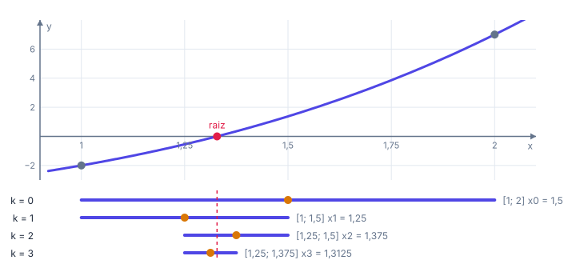
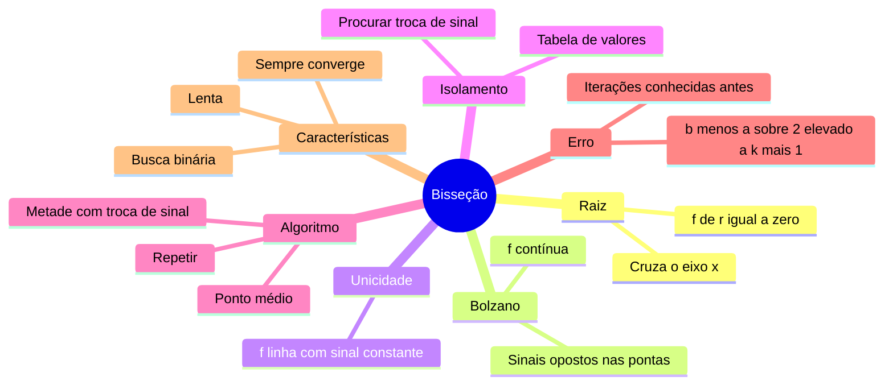

# ✂️ Raízes de equações: método da bisseção

> [← Aplicações da derivada](06-aplicacoes-da-derivada.md) · Próximo: [Método de Newton →](08-metodo-de-newton.md)

**Nível:** 🟡 Intermediário

## 🎯 Você vai aprender

- O que é a **raiz** (ou zero) de uma função e por que precisamos de métodos **numéricos**.
- O **Teorema de Bolzano** (existência) e o critério de **unicidade**.
- Como **isolar** uma raiz com uma tabela de valores.
- O **método da bisseção**, passo a passo e em **Python puro**.
- Calcular a **cota de erro** e quantas **iterações** são necessárias.

## Em uma frase

> 💡 A bisseção é a **busca binária** das equações: corta o intervalo ao meio, fica com a metade onde o sinal troca e repete até a raiz estar "encurralada" com a precisão desejada.

## 1. Por que métodos numéricos?

Uma **raiz** (ou **zero**) de $f$ é um número $r$ com $f(r) = 0$. No gráfico, é onde a curva **cruza o eixo $x$**.

Para $ax^2 + bx + c = 0$ existe a fórmula de Bhaskara. Mas e para estas?

| Equação | Onde aparece |
| ------- | ------------ |
| $x = \cos x$ | Animações: quando um objeto encontra a curva $y = \cos x$ |
| $x \ln x = 2$ | Tamanho de cache que equilibra custo e benefício |
| $x^3 + 2x - 5 = 0$ | Tamanho ideal de um bloco de dados |
| $x^2 = 100\,x \ln x$ | Quando um algoritmo $O(n^2)$ passa a perder para um $O(n \log n)$ |

Não existe fórmula fechada para a maioria delas. Os métodos numéricos produzem uma **sequência de aproximações** $x_0, x_1, x_2, \dots$ que chega tão perto da raiz quanto quisermos. Eles têm duas etapas:

1. **Isolamento:** achar um intervalo $[a, b]$ com **uma** raiz.
2. **Refinamento:** encolher esse intervalo (ou melhorar o chute) até a precisão pedida.

## 2. Teorema de Bolzano: existe raiz?

> 💡 **Teorema (existência):** se $f$ é **contínua** em $[a, b]$ e $f(a) \cdot f(b) < 0$ (sinais opostos), então existe **pelo menos uma** raiz em $(a, b)$.

A curva começa de um lado do eixo e termina do outro; sendo contínua (sem saltos), ela **tem** que cruzar o eixo.

> 💡 **Unicidade:** se, além disso, $f'$ existe e **não troca de sinal** em $[a, b]$, a raiz é **única** (a função só sobe ou só desce, então cruza o eixo uma vez só).

**Exemplo 1:** $f(x) = x^3 + 2x - 5$ em $[1, 2]$.

| Pergunta | Conta | Conclusão |
| -------- | ----- | --------- |
| Existe? | $f(1) = -2 < 0$ e $f(2) = 7 > 0$ | Sim (Bolzano) |
| É única? | $f'(x) = 3x^2 + 2 > 0$ sempre | Sim: $f$ só cresce |

> ⚠️ Bolzano exige **continuidade**. $f(x) = \dfrac{1}{x}$ troca de sinal em $[-1, 1]$, mas não tem raiz: ela "pula" em $x = 0$.

## 3. Isolando a raiz: busca incremental

Monte uma tabela e procure onde o **sinal troca**.

**Exemplo 2:** $f(x) = x - 3e^{-x}$, com $x \geq 0$.

| $x$ | 0 | 0,5 | 1 | 1,5 | 2 |
| --- | - | --- | - | --- | - |
| $f(x)$ | $-3$ | $-1{,}3196$ | $-0{,}1036$ | $0{,}8306$ | $1{,}594$ |
| Sinal | $-$ | $-$ | $-$ | $+$ | $+$ |

O sinal troca entre $1$ e $1{,}5$: há raiz em $[1; 1{,}5]$. E ela é única, porque $f'(x) = 1 + 3e^{-x} > 0$.

## 4. O método da bisseção

Partindo de $[a, b]$ com $f(a) \cdot f(b) < 0$:

1. Calcule o ponto médio $x_k = \dfrac{a + b}{2}$.
2. Se $f(a) \cdot f(x_k) < 0$, a raiz está à esquerda: faça $b = x_k$. Senão, faça $a = x_k$.
3. Repita até atingir a precisão.

Neste material, a contagem **começa em $x_0$** (o primeiro ponto médio).



**Exemplo 3:** raiz de $f(x) = x^3 + 2x - 5$ em $[1, 2]$ com precisão $\varepsilon = 0{,}01$.

| $k$ | $a$ | $b$ | $x_k$ | $f(x_k)$ | Erro $\leq$ |
| --- | --- | --- | ----- | -------- | ----------- |
| 0 | 1 | 2 | 1,5 | $+1{,}375$ | 0,5 |
| 1 | 1 | 1,5 | 1,25 | $-0{,}546875$ | 0,25 |
| 2 | 1,25 | 1,5 | 1,375 | $+0{,}349609$ | 0,125 |
| 3 | 1,25 | 1,375 | 1,3125 | $-0{,}114014$ | 0,0625 |
| 4 | 1,3125 | 1,375 | 1,34375 | $+0{,}113861$ | 0,03125 |
| 5 | 1,3125 | 1,34375 | 1,328125 | $-0{,}001049$ | 0,015625 |
| 6 | 1,328125 | 1,34375 | **1,335938** | $+0{,}056161$ | **0,0078125** |

Em $k = 6$ a cota de erro ($0{,}0078$) ficou abaixo de $0{,}01$: a resposta é $x_6 \approx 1{,}335938$. A raiz exata é $r \approx 1{,}328269$, e de fato $\lvert x_6 - r \rvert \approx 0{,}0077 \leq 0{,}0078$.

> 💡 Repare que $x_5$ estava até mais perto da raiz. A bisseção não "sabe" disso: ela só garante a **cota**, e é a cota que decide quando parar.

## 5. Cota de erro e número de iterações

A cada passo o intervalo cai pela metade. Depois de calcular $x_k$, a raiz está a no máximo meio intervalo dele:

$$
\lvert r - x_k \rvert \leq \frac{b_0 - a_0}{2^{k+1}}
$$

Para garantir erro $\leq \varepsilon$, procure o **menor $k$** com $\dfrac{b_0 - a_0}{2^{k+1}} \leq \varepsilon$, ou seja:

$$
2^{k+1} \geq \frac{b_0 - a_0}{\varepsilon} \quad\Longleftrightarrow\quad k \geq \log_2\left(\frac{b_0 - a_0}{\varepsilon}\right) - 1
$$

**Exemplo 4:** raiz em $[2, 3]$ com $\varepsilon = 10^{-4}$. Precisamos de $2^{k+1} \geq 10\,000$. Como $2^{13} = 8192$ e $2^{14} = 16\,384$, temos $k + 1 = 14$, ou seja, $k = 13$: entregamos $x_{13}$ (14 pontos médios).

| $n$ | 7 | 10 | 14 | 17 | 20 |
| --- | - | -- | -- | -- | -- |
| $2^n$ | 128 | 1 024 | 16 384 | 131 072 | 1 048 576 |

> 💡 **Isso só a bisseção faz:** saber **antes de começar** quantas iterações serão necessárias. Ótimo para sistemas embarcados com tempo de resposta garantido.

## 6. Em Python (sem `import`)

```python
def f(x):
    return x**3 + 2*x - 5


def bissecao(f, a, b, eps):
    # Bolzano: sem troca de sinal, não há garantia de raiz no intervalo.
    if f(a) * f(b) > 0:
        print("f(a) e f(b) têm o mesmo sinal: escolha outro intervalo.")
        return None
    k = 0
    while True:
        x = (a + b) / 2          # ponto médio x_k
        erro = (b - a) / 2       # a raiz está a no máximo isso de x_k
        print(f"{k:2d} | {a:.6f} | {b:.6f} | {x:.6f} | {f(x):+.6f} | {erro:.6f}")
        if erro <= eps or f(x) == 0:
            return x
        # Fica com a metade em que o sinal troca.
        if f(a) * f(x) < 0:
            b = x
        else:
            a = x
        k += 1


print(" k |    a     |    b     |   x_k    |   f(x_k)   |  erro <=")
raiz = bissecao(f, 1, 2, 0.01)
print("Raiz aproximada:", round(raiz, 6))
```

Saída:

```
 k |    a     |    b     |   x_k    |   f(x_k)   |  erro <=
 0 | 1.000000 | 2.000000 | 1.500000 | +1.375000 | 0.500000
 1 | 1.000000 | 1.500000 | 1.250000 | -0.546875 | 0.250000
 2 | 1.250000 | 1.500000 | 1.375000 | +0.349609 | 0.125000
 3 | 1.250000 | 1.375000 | 1.312500 | -0.114014 | 0.062500
 4 | 1.312500 | 1.375000 | 1.343750 | +0.113861 | 0.031250
 5 | 1.312500 | 1.343750 | 1.328125 | -0.001049 | 0.015625
 6 | 1.328125 | 1.343750 | 1.335938 | +0.056161 | 0.007812
Raiz aproximada: 1.335938
```

## 7. Vantagens e desvantagens

| ✅ Vantagens | ❌ Desvantagens |
| ----------- | --------------- |
| **Sempre converge** (se $f$ é contínua e troca de sinal) | **Lenta:** ganha só 1 bit de precisão por passo (cerca de 3,3 passos por casa decimal) |
| Número de iterações conhecido **antes** | Precisa de um intervalo com troca de sinal |
| Só precisa calcular $f$ (sem derivada) | Não acha raízes em que $f$ **não troca** de sinal (como $x^2 = 0$) |

## 🧮 Passo a passo

1. **Confira Bolzano:** $f$ contínua e $f(a) \cdot f(b) < 0$.
2. **Unicidade (se pedida):** mostre que $f'$ tem sinal constante em $[a, b]$.
3. **Quantas iterações:** menor $k$ com $\frac{b - a}{2^{k+1}} \leq \varepsilon$.
4. **Itere** em tabela: $a$, $b$, $x_k$, sinal de $f(x_k)$, novo intervalo.
5. **Responda** $x_k$ e, se pedido, a cota de erro.

## ⚠️ Erros comuns

| Erro | Como evitar |
| ---- | ----------- |
| Ficar com a metade errada | Compare o sinal de $f(x_k)$ com o de $f(a)$: **iguais**, troque $a$; diferentes, troque $b$ |
| Calculadora em graus com seno ou cosseno | Use **radianos** |
| Esquecer de checar continuidade | Bolzano não vale com saltos ou assíntotas |
| Errar a contagem de $k$ | Aqui o primeiro ponto médio é $x_0$, com erro $\leq \frac{b - a}{2}$ |
| Arredondar demais no meio das contas | Use 6 casas e arredonde só no fim |

## 💡 Macetes

- **Bisseção = busca binária:** cada passo divide o "espaço de busca" por 2, como achar um número de 1 a 1000 em 10 chutes.
- **Regra de bolso:** cada **10** iterações dividem o erro por $2^{10} \approx 1000$, ou seja, cerca de **3 casas decimais**.
- **Anote só o sinal de $f(x_k)$** quando estiver com pressa: é isso que decide o próximo intervalo.

## 🧠 Mapa mental



## ✅ Teste rápido

**1.** $f(x) = x^3 - x - 1$ tem garantia de raiz em $[1, 2]$? Responda **sim** ou **não**.

<details>
<summary>Ver resposta</summary>

**Resposta:** `sim`

$f$ é polinômio (contínua), $f(1) = -1 < 0$ e $f(2) = 5 > 0$: Bolzano garante.
</details>

**2.** Qual é o primeiro ponto médio $x_0$ da bisseção em $[1, 2]$?

<details>
<summary>Ver resposta</summary>

**Número:** `1,5`

$x_0 = \dfrac{1 + 2}{2} = 1{,}5$.
</details>

**3.** Aplique a bisseção a $f(x) = x^2 - 5$ em $[2, 3]$. Quanto vale $x_1$?

<details>
<summary>Ver resposta</summary>

**Número:** `2,25`

$x_0 = 2{,}5$ e $f(2{,}5) = 1{,}25 > 0$, com $f(2) = -1 < 0$: a raiz está em $[2; 2{,}5]$. Então $x_1 = 2{,}25$.
</details>

**4.** Na bisseção em $[2, 3]$, qual é a cota de erro de $x_2$?

<details>
<summary>Ver resposta</summary>

**Número:** `0,125`

$\dfrac{3 - 2}{2^{2+1}} = \dfrac{1}{8} = 0{,}125$.
</details>

**5.** Com raiz em $[0, 1]$ e $\varepsilon = 10^{-3}$, qual é o menor $k$ que garante a precisão?

<details>
<summary>Ver resposta</summary>

**Número:** `9`

$\dfrac{1}{2^{k+1}} \leq 0{,}001 \Rightarrow 2^{k+1} \geq 1000$. Como $2^{10} = 1024$, $k + 1 = 10$ e $k = 9$.
</details>

**6.** A raiz de $f(x) = x^3 + x - 1$ em $[0, 1]$ é única? Responda **sim** ou **não**.

<details>
<summary>Ver resposta</summary>

**Resposta:** `sim`

$f'(x) = 3x^2 + 1 > 0$: a função só cresce e cruza o eixo uma única vez.
</details>

**7.** Qual método permite saber, **antes de começar**, quantas iterações serão feitas: **bisseção** ou **Newton**?

<details>
<summary>Ver resposta</summary>

**Resposta:** `bisseção`

Na bisseção o intervalo cai pela metade a cada passo, então dá para calcular $k$ pela fórmula da cota de erro. Em Newton, a velocidade depende da função e do chute inicial.
</details>

## ✏️ Agora pratique

São 9 exercícios sobre este assunto, do fácil ao difícil, com resolução passo a passo:

| 🟢 Fácil | 🟡 Intermediário | 🔴 Difícil |
| -------- | ---------------- | ---------- |
| [Exercícios 01 a 03](../exercicios/07-bissecao/facil.md) | [Exercícios 04 a 06](../exercicios/07-bissecao/intermediario.md) | [Exercícios 07 a 09](../exercicios/07-bissecao/dificil.md) |

## 📖 Para ir além (fora da ementa)

- **Método da falsa posição:** em vez do ponto médio, usa o ponto onde a reta entre $(a, f(a))$ e $(b, f(b))$ corta o eixo. Costuma ser mais rápido que a bisseção.
- **`git bisect`:** o Git usa exatamente essa ideia para achar o commit que introduziu um bug: testa o commit do meio e descarta metade do histórico a cada passo.

## 📚 Referências

- RUGGIERO, Márcia A. G.; LOPES, Vera L. R. *Cálculo numérico: aspectos teóricos e computacionais*. 2. ed. São Paulo: Pearson, 1996. Capítulo 2.
- BURDEN, Richard L.; FAIRES, J. Douglas. *Análise numérica*. 3. ed. São Paulo: Cengage Learning, 2016. Seção 2.1.
