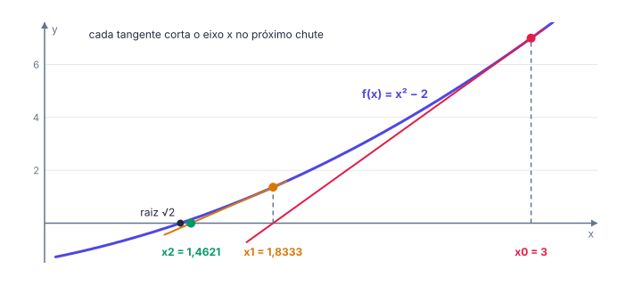
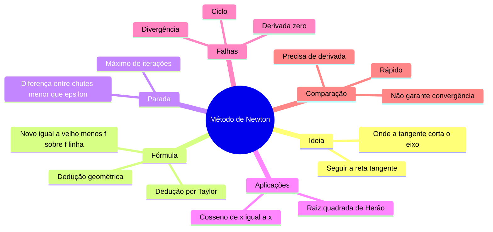

# 🚀 Raízes de equações: método de Newton

> [← Método da bisseção](07-bissecao.md) · Próximo: [Primitivas →](09-primitivas.md)

**Nível:** 🔴 Avançado

## 🎯 Você vai aprender

- A ideia do **método de Newton**: seguir a reta tangente até o eixo $x$.
- Deduzir a fórmula de dois jeitos: **geométrico** e por **Taylor**.
- Iterar à mão com o **critério de parada** $\lvert x_k - x_{k-1} \rvert < \varepsilon$.
- Programar o método em **Python puro**, e como o computador calcula $\sqrt{x}$.
- Reconhecer **quando Newton falha** e comparar com a bisseção.

## Em uma frase

> 💡 Newton troca a curva pela sua **reta tangente**, vê onde a tangente corta o eixo $x$ e usa esse ponto como novo chute: perto da raiz, o número de casas certas costuma **dobrar** a cada passo.

## 1. A ideia geométrica

Comece com um chute $x_0$. No ponto $(x_0, f(x_0))$, trace a tangente. Ela é uma reta, e achar onde uma reta corta o eixo é fácil: esse ponto é $x_1$. Repita a partir de $x_1$.



Na figura, $f(x) = x^2 - 2$ e $x_0 = 3$: a raiz é $\sqrt{2} \approx 1{,}4142$.

A tangente em $x_{k-1}$ tem inclinação $f'(x_{k-1})$. Ligando o ponto da curva ao ponto $(x_k, 0)$:

$$
f'(x_{k-1}) = \frac{f(x_{k-1}) - 0}{x_{k-1} - x_k} \;\Rightarrow\; x_{k-1} - x_k = \frac{f(x_{k-1})}{f'(x_{k-1})}
$$

$$
\boxed{\,x_k = x_{k-1} - \frac{f(x_{k-1})}{f'(x_{k-1})}\,}
$$

## 2. A mesma fórmula por Taylor

Perto de $x_{k-1}$, a função é quase a sua reta tangente (o **polinômio de Taylor de grau 1**):

$$
f(x) \approx f(x_{k-1}) + f'(x_{k-1})\,(x - x_{k-1})
$$

Queremos $f(r) = 0$. Trocando $x$ por $r$ e isolando:

$$
0 \approx f(x_{k-1}) + f'(x_{k-1})\,(r - x_{k-1}) \;\Rightarrow\; r \approx x_{k-1} - \frac{f(x_{k-1})}{f'(x_{k-1})}
$$

É uma aproximação (desprezamos o resto de Taylor), então repetimos até estabilizar.

## 3. Critério de parada

Pare quando dois chutes seguidos quase não mudarem:

$$
\lvert x_k - x_{k-1} \rvert < \varepsilon
$$

e entregue $x_k$. Na prática, também se põe um **número máximo de iterações**, para o programa não rodar para sempre se o método não convergir.

> ⚠️ Esse critério é prático, mas **não garante** $\lvert x_k - r \rvert < \varepsilon$: ele só diz que os chutes pararam de mudar. Por isso, confira também se $f(x_k)$ ficou perto de zero.

## 4. Exemplos resolvidos

**Exemplo 1:** $\sqrt{5}$ sem a função `sqrt`: resolva $f(x) = x^2 - 5 = 0$ com $x_0 = 2$ e $\varepsilon = 10^{-3}$. Aqui $f'(x) = 2x$.

| $k$ | $x_{k-1}$ | $f(x_{k-1})$ | $f'(x_{k-1})$ | $x_k$ | $\lvert x_k - x_{k-1} \rvert$ |
| --- | --------- | ------------ | ------------- | ----- | ----------------------------- |
| 1 | 2 | $-1$ | 4 | 2,25 | 0,25 |
| 2 | 2,25 | 0,0625 | 4,5 | 2,236111 | 0,013889 |
| 3 | 2,236111 | 0,000193 | 4,472222 | **2,236068** | 0,000043 |

Parou em $k = 3$: $\sqrt{5} \approx 2{,}236068$ (o valor exato é $2{,}2360679\dots$).

**Exemplo 2:** resolva a cúbica clássica $x^3 - 2x - 5 = 0$, a mesma que o próprio Newton usou para apresentar o método. Use $x_0 = 2$ e $\varepsilon = 10^{-3}$. Aqui $f'(x) = 3x^2 - 2$.

| $k$ | $x_{k-1}$ | $f(x_{k-1})$ | $f'(x_{k-1})$ | $x_k$ | $\lvert x_k - x_{k-1} \rvert$ |
| --- | --------- | ------------ | ------------- | ----- | ----------------------------- |
| 1 | 2 | $-1$ | 10 | 2,1 | 0,1 |
| 2 | 2,1 | 0,061 | 11,23 | 2,094568 | 0,005432 |
| 3 | 2,094568 | 0,000186 | 11,161647 | **2,094551** | 0,000017 |

Raiz $\approx 2{,}094551$, em 3 iterações.

**Exemplo 3 (radianos!):** quando $\cos x = x$? Resolva $f(x) = \cos x - x = 0$ com $x_0 = 1$. Aqui $f'(x) = -\operatorname{sen} x - 1$.

| $k$ | $x_{k-1}$ | $f(x_{k-1})$ | $f'(x_{k-1})$ | $x_k$ |
| --- | --------- | ------------ | ------------- | ----- |
| 1 | 1 | $-0{,}459698$ | $-1{,}841471$ | 0,750364 |
| 2 | 0,750364 | $-0{,}018923$ | $-1{,}681905$ | 0,739113 |
| 3 | 0,739113 | $-0{,}000046$ | $-1{,}673633$ | **0,739085** |

> ⚠️ Com seno e cosseno, a calculadora tem que estar em **radianos**. Em graus, a conta sai completamente errada.

## 5. Em Python (sem `import`)

```python
def f(x):
    return x**3 - 2*x - 5


def df(x):
    return 3*x**2 - 2          # derivada de f, calculada à mão


def newton(f, df, x, eps, max_iter=50):
    for k in range(1, max_iter + 1):
        d = df(x)
        if d == 0:
            print("Derivada zero: a tangente é horizontal. Troque o chute inicial.")
            return None
        novo = x - f(x) / d    # onde a tangente corta o eixo x
        print(f"{k:2d} | {x:.6f} | {f(x):+.6f} | {d:+.6f} | {novo:.6f} | {abs(novo - x):.6f}")
        if abs(novo - x) < eps:
            return novo
        x = novo
    print("Não convergiu em", max_iter, "iterações.")
    return None


print(" k | x_(k-1)  |  f(x_(k-1)) | f'(x_(k-1)) |   x_k    | |x_k - x_(k-1)|")
raiz = newton(f, df, 2, 0.001)
if raiz is not None:           # None: a função já explicou por que falhou
    print("Raiz aproximada:", round(raiz, 6))
```

Saída:

```
 k | x_(k-1)  |  f(x_(k-1)) | f'(x_(k-1)) |   x_k    | |x_k - x_(k-1)|
 1 | 2.000000 | -1.000000 | +10.000000 | 2.100000 | 0.100000
 2 | 2.100000 | +0.061000 | +11.230000 | 2.094568 | 0.005432
 3 | 2.094568 | +0.000186 | +11.161647 | 2.094551 | 0.000017
Raiz aproximada: 2.094551
```

### Como o computador calcula a raiz quadrada

Para $\sqrt{A}$, aplique Newton a $f(x) = x^2 - A$:

$$
x_k = x_{k-1} - \frac{x_{k-1}^2 - A}{2x_{k-1}} = \frac{1}{2}\left(x_{k-1} + \frac{A}{x_{k-1}}\right)
$$

É o **método de Herão** (ou babilônico): a média entre o chute e $A$ dividido pelo chute.

```python
def raiz_quadrada(A, eps=1e-10):
    if A < 0:
        return None             # sem raiz real: o laço nunca pararia
    x = A if A > 1 else 1.0     # chute inicial
    while True:
        novo = (x + A / x) / 2  # Newton para x**2 - A = 0
        if abs(novo - x) < eps:
            return novo
        x = novo


print(raiz_quadrada(2))    # 1.414213562373095
print(raiz_quadrada(10))   # 3.162277660168379
```

## 6. Quando Newton falha

| Problema | Exemplo | O que acontece |
| -------- | ------- | -------------- |
| **Derivada zero** | $f(x) = x^2 - 4$ com $x_0 = 0$ | Tangente horizontal: divisão por zero |
| **Ciclo** | $f(x) = x^3 - 2x + 2$ com $x_0 = 0$ | Os chutes alternam $0, 1, 0, 1, \dots$ para sempre |
| **Divergência** | Chute longe da raiz, numa região "achatada" | Os chutes se afastam |
| **Raiz múltipla** | $f(x) = (x - 1)^2$ | Converge, mas devagar |

**Exemplo 4 (o ciclo):** $f(x) = x^3 - 2x + 2$, $f'(x) = 3x^2 - 2$, $x_0 = 0$.

| $k$ | $x_{k-1}$ | $f$ | $f'$ | $x_k$ |
| --- | --------- | --- | ---- | ----- |
| 1 | 0 | 2 | $-2$ | $0 - \frac{2}{-2} = 1$ |
| 2 | 1 | 1 | 1 | $1 - \frac{1}{1} = 0$ |
| 3 | 0 | 2 | $-2$ | 1 |

O programa nunca para. A raiz real fica em $[-2, -1]$ ($f(-2) = -2$, $f(-1) = 3$). Saídas: usar a **bisseção** nesse intervalo ou recomeçar Newton com $x_0 = -2$.

> 💡 **Estratégia híbrida:** alguns passos de bisseção para chegar perto (seguro) e depois Newton para acabar (rápido). Muitas bibliotecas numéricas fazem assim.

## 7. Bisseção × Newton

Mesma equação da [aula de bisseção](07-bissecao.md): $x^3 + 2x - 5 = 0$, com precisão $0{,}01$.

| | Bisseção em $[1, 2]$ | Newton com $x_0 = 1{,}5$ |
| --- | -------------------- | ------------------------ |
| Iterações | 7 ($x_0$ a $x_6$) | 3 |
| Resposta | 1,335938 | 1,328269 |
| Erro real | 0,0077 | menos de 0,000001 |

| Critério | Bisseção | Newton |
| -------- | -------- | ------ |
| Precisa de | Intervalo com troca de sinal | Chute inicial **e** derivada |
| Converge sempre? | Sim | Não (pode ciclar ou divergir) |
| Velocidade | Lenta (1 bit por passo) | Rápida (dobra as casas certas perto da raiz) |
| Iterações previsíveis? | Sim, pela fórmula | Não |
| Tipo | **Intervalar** (cerca a raiz) | **Aberto** (não cerca) |

## 🧮 Passo a passo

1. Calcule $f'(x)$.
2. Monte a tabela: $k$, $x_{k-1}$, $f(x_{k-1})$, $f'(x_{k-1})$, $x_k$, $\lvert x_k - x_{k-1} \rvert$.
3. Calcule $x_k = x_{k-1} - \dfrac{f(x_{k-1})}{f'(x_{k-1})}$ com 6 casas.
4. Pare quando $\lvert x_k - x_{k-1} \rvert < \varepsilon$ e entregue $x_k$.
5. Confira: $f(x_k)$ deve estar bem perto de zero.

## ⚠️ Erros comuns

| Erro | Como evitar |
| ---- | ----------- |
| Somar em vez de subtrair: $x + \frac{f}{f'}$ | É **menos**: $x - \frac{f}{f'}$ |
| Inverter a fração: $\frac{f'}{f}$ | Função **em cima**, derivada embaixo |
| Calculadora em graus | **Radianos** com seno e cosseno |
| Entregar $x_{k-1}$ em vez de $x_k$ | A resposta é o **último** calculado |
| Insistir quando cicla | Troque o chute ou use bisseção |

## 💡 Macetes

- **"Novo = velho menos função sobre derivada."**
- **Bom chute = metade do trabalho:** use uma tabela de valores ou Bolzano para começar perto.
- **Use a memória da calculadora:** guarde $x_{k-1}$ e digite a fórmula uma vez; depois é só repetir com a tecla `Ans`.

## 🧠 Mapa mental



## ✅ Teste rápido

**1.** Para $f(x) = x^2 - 3$ e $x_0 = 2$, quanto vale $x_1$?

<details>
<summary>Ver resposta</summary>

**Número:** `1,75`

$x_1 = 2 - \dfrac{4 - 3}{2 \cdot 2} = 2 - \dfrac{1}{4} = 1{,}75$.
</details>

**2.** Com o método de Herão para $\sqrt{10}$ e chute $x_0 = 3$, quanto vale $x_1$? (Use 4 casas decimais ou a fração.)

<details>
<summary>Ver resposta</summary>

**Número:** `19/6`

$x_1 = \dfrac{1}{2}\left(3 + \dfrac{10}{3}\right) = \dfrac{1}{2} \cdot \dfrac{19}{3} = \dfrac{19}{6} \approx 3{,}1667$.
</details>

**3.** Para $f(x) = x^3 - x - 1$ e $x_0 = 1{,}5$, calcule $x_1$ (4 casas ou mais).

<details>
<summary>Ver resposta</summary>

**Número:** `1,347826 ± 0,0001`

$f(1{,}5) = 3{,}375 - 1{,}5 - 1 = 0{,}875$ e $f'(x) = 3x^2 - 1$, $f'(1{,}5) = 5{,}75$. Então $x_1 = 1{,}5 - \dfrac{0{,}875}{5{,}75} \approx 1{,}347826$.
</details>

**4.** Por que Newton falha para $f(x) = x^2 - 4$ com $x_0 = 0$? Quanto vale $f'(0)$?

<details>
<summary>Ver resposta</summary>

**Número:** `0`

$f'(x) = 2x$, então $f'(0) = 0$: a tangente é horizontal, nunca corta o eixo, e a fórmula divide por zero.
</details>

**5.** Em $\cos x = x$ com $x_0 = 1$, quanto vale $x_1$? (Calculadora em radianos; 4 casas.)

<details>
<summary>Ver resposta</summary>

**Número:** `0,750364 ± 0,0001`

$f(1) = \cos 1 - 1 \approx -0{,}459698$ e $f'(1) = -\operatorname{sen} 1 - 1 \approx -1{,}841471$. Então $x_1 = 1 - \dfrac{-0{,}459698}{-1{,}841471} \approx 0{,}750364$.
</details>

**6.** Qual método costuma convergir **mais rápido** perto da raiz: **bisseção** ou **Newton**?

<details>
<summary>Ver resposta</summary>

**Resposta:** `Newton`

Perto da raiz, Newton dobra o número de casas certas por passo; a bisseção ganha só um bit.
</details>

## ✏️ Agora pratique

São 9 exercícios sobre este assunto, do fácil ao difícil, com resolução passo a passo:

| 🟢 Fácil | 🟡 Intermediário | 🔴 Difícil |
| -------- | ---------------- | ---------- |
| [Exercícios 01 a 03](../exercicios/08-metodo-de-newton/facil.md) | [Exercícios 04 a 06](../exercicios/08-metodo-de-newton/intermediario.md) | [Exercícios 07 a 09](../exercicios/08-metodo-de-newton/dificil.md) |

## 📖 Para ir além (fora da ementa)

- **Método da secante:** troca $f'(x_{k-1})$ pela inclinação da reta entre os dois últimos chutes. Não precisa da derivada e ainda é rápido.
- **Raiz quadrada inversa rápida:** um truque famoso do jogo *Quake III* calcula $\frac{1}{\sqrt{x}}$ com um chute "mágico" seguido de **um passo de Newton**.

## 📚 Referências

- RUGGIERO, Márcia A. G.; LOPES, Vera L. R. *Cálculo numérico: aspectos teóricos e computacionais*. 2. ed. São Paulo: Pearson, 1996. Capítulo 2.
- BURDEN, Richard L.; FAIRES, J. Douglas. *Análise numérica*. 3. ed. São Paulo: Cengage Learning, 2016. Seção 2.3.
