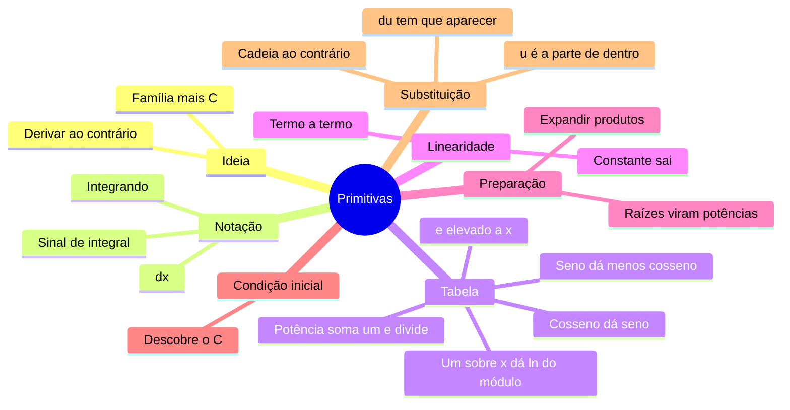

# ↩️ Primitivas (integral indefinida)

> [← Método de Newton](08-metodo-de-newton.md) · Próximo: [Integral definida →](10-integral-definida.md)

**Nível:** 🟡 Intermediário

## 🎯 Você vai aprender

- O que é uma **primitiva** e por que sempre aparece o **$+\,C$**.
- A notação $\int f(x)\,dx$.
- A **tabela de primitivas** e a **linearidade**.
- Integrar **potências** negativas e fracionárias (raízes).
- Achar a primitiva com uma **condição inicial**.
- A **regra da substituição**, que desfaz a regra da cadeia.

## Em uma frase

> 💡 Primitivar é **derivar ao contrário**: dada a taxa de variação, achar a função que a produziu. É o "Ctrl+Z" da derivada.

## 1. O que é uma primitiva

$F$ é uma **primitiva** de $f$ quando $F'(x) = f(x)$.

| $f(x)$ | Uma primitiva $F(x)$ | Conferindo |
| ------ | -------------------- | ---------- |
| $2x$ | $x^2$ | $(x^2)' = 2x$ ✔️ |
| $2x$ | $x^2 + 5$ | $(x^2 + 5)' = 2x$ ✔️ |
| $2x$ | $x^2 - 100$ | $(x^2 - 100)' = 2x$ ✔️ |

Como a derivada de uma constante é zero, **somar qualquer constante** dá outra primitiva. Por isso escrevemos todas de uma vez:

$$
\int 2x\,dx = x^2 + C
$$

| Símbolo | Nome | Significa |
| ------- | ---- | --------- |
| $\int$ | sinal de integral | "a primitiva de" |
| $f(x)$ | integrando | a função que vamos integrar |
| $dx$ | diferencial | a variável é $x$ |
| $C$ | constante de integração | qualquer número real |

> 💡 **Pense num download:** você sabe a velocidade de um download a cada instante e quer saber **quanto já baixou**. A velocidade é a derivada; o total baixado é a primitiva. O $C$ é quanto já existia antes de começar a contar.

## 2. A tabela de primitivas

Cada linha é uma regra de derivação lida **de trás para frente**:

| $f(x)$ | $\int f(x)\,dx$ | Observação |
| ------ | --------------- | ---------- |
| $k$ (constante) | $kx + C$ | |
| $x^n$ | $\dfrac{x^{n+1}}{n + 1} + C$ | Só se $n \neq -1$ |
| $\dfrac{1}{x} = x^{-1}$ | $\ln \lvert x \rvert + C$ | O caso $n = -1$ |
| $e^x$ | $e^x + C$ | |
| $e^{kx}$ | $\dfrac{e^{kx}}{k} + C$ | $k \neq 0$ |
| $a^x$ | $\dfrac{a^x}{\ln a} + C$ | |
| $\operatorname{sen} x$ | $-\cos x + C$ | Atenção ao sinal |
| $\cos x$ | $\operatorname{sen} x + C$ | |
| $\sec^2 x$ | $\operatorname{tg} x + C$ | |

**Regra da potência:** "**soma 1 no expoente e divide pelo novo expoente**". É o contrário de "desce e diminui um".

> ⚠️ Com $n = -1$ a regra da potência daria divisão por zero. Por isso $\int \frac{1}{x}\,dx$ é um caso especial: $\ln \lvert x \rvert + C$. O módulo existe porque $\frac{1}{x}$ também está definida para $x < 0$.

## 3. Linearidade

$$
\int \bigl(a\,f(x) + b\,g(x)\bigr)\,dx = a\int f(x)\,dx + b\int g(x)\,dx
$$

Integre **termo a termo**: as constantes **saem para fora**. Use **um único $C$** no final.

**Exemplo 1:** $\displaystyle\int (4x^3 - 6x^2 + 2x - 5)\,dx = x^4 - 2x^3 + x^2 - 5x + C$.

Conferindo: $(x^4 - 2x^3 + x^2 - 5x)' = 4x^3 - 6x^2 + 2x - 5$. ✔️

**Exemplo 2:** $\displaystyle\int \left(3e^x + \frac{2}{x} - \operatorname{sen} x\right)dx = 3e^x + 2\ln \lvert x \rvert + \cos x + C$.

> ⚠️ **Não existe regra do produto para primitiva**: $\int f\,g\,dx \neq \int f\,dx \cdot \int g\,dx$. Expanda ou simplifique antes.

## 4. Potências negativas e fracionárias

Reescreva como potência, como fizemos para derivar:

| Integrando | Reescreva | Primitiva |
| ---------- | --------- | --------- |
| $\dfrac{1}{x^3}$ | $x^{-3}$ | $\dfrac{x^{-2}}{-2} + C = -\dfrac{1}{2x^2} + C$ |
| $\sqrt{x}$ | $x^{1/2}$ | $\dfrac{x^{3/2}}{3/2} + C = \dfrac{2}{3}x^{3/2} + C$ |
| $\dfrac{1}{\sqrt{x}}$ | $x^{-1/2}$ | $\dfrac{x^{1/2}}{1/2} + C = 2\sqrt{x} + C$ |
| $\sqrt[3]{x^2}$ | $x^{2/3}$ | $\dfrac{x^{5/3}}{5/3} + C = \dfrac{3}{5}x^{5/3} + C$ |

> 💡 Dividir por uma fração é **multiplicar pela invertida**: $\dfrac{x^{3/2}}{3/2} = \dfrac{2}{3}x^{3/2}$.

**Exemplo 3 (simplifique antes):** $\displaystyle\int \frac{x^2 + 1}{x}\,dx = \int \left(x + \frac{1}{x}\right)dx = \frac{x^2}{2} + \ln \lvert x \rvert + C$.

**Exemplo 4 (expanda antes):** $\displaystyle\int (x + 2)^2\,dx = \int (x^2 + 4x + 4)\,dx = \frac{x^3}{3} + 2x^2 + 4x + C$.

## 5. Condição inicial: achando o C

Se o problema dá um valor da função, o $C$ deixa de ser qualquer: vira um número.

**Exemplo 5:** a velocidade de um robô é $v(t) = 6t^2 + 2$ m/s e, em $t = 0$, ele está na posição $s(0) = 5$ m. Onde ele está em $t = 2$?

| Passo | Conta |
| ----- | ----- |
| 1. Primitive | $s(t) = 2t^3 + 2t + C$ |
| 2. Use a condição | $s(0) = 0 + 0 + C = 5 \Rightarrow C = 5$ |
| 3. Função | $s(t) = 2t^3 + 2t + 5$ |
| 4. Responda | $s(2) = 16 + 4 + 5 = 25$ m |

## 6. Regra da substituição

É a **regra da cadeia ao contrário**. Ela serve quando o integrando tem uma função **e a derivada da parte de dentro** dela.

$$
\int f(g(x))\,g'(x)\,dx = \int f(u)\,du, \qquad u = g(x),\; du = g'(x)\,dx
$$

**Exemplo 6:** $\displaystyle\int (x^3 + 2)^5 \cdot 3x^2\,dx$.

| Passo | Conta |
| ----- | ----- |
| 1. Escolha $u$ (a "de dentro") | $u = x^3 + 2$ |
| 2. Derive | $du = 3x^2\,dx$ (exatamente o que sobrou!) |
| 3. Troque tudo | $\displaystyle\int u^5\,du = \frac{u^6}{6} + C$ |
| 4. Volte para $x$ | $\dfrac{(x^3 + 2)^6}{6} + C$ |

**Exemplo 7 (falta uma constante):** $\displaystyle\int x\,e^{-x^2}\,dx$.

$u = -x^2$, $du = -2x\,dx$, então $x\,dx = -\frac{1}{2}du$:

$$
\int e^{u} \cdot \left(-\frac{1}{2}\right)du = -\frac{1}{2}e^{u} + C = -\frac{1}{2}e^{-x^2} + C
$$

| Integral | $u$ | Resultado |
| -------- | --- | --------- |
| $\displaystyle\int 2\cos(2x - 1)\,dx$ | $2x - 1$ | $\operatorname{sen}(2x - 1) + C$ |
| $\displaystyle\int \frac{2x}{x^2 + 1}\,dx$ | $x^2 + 1$ | $\ln(x^2 + 1) + C$ |
| $\displaystyle\int e^{5x}\,dx$ | $5x$ | $\dfrac{e^{5x}}{5} + C$ |
| $\displaystyle\int \operatorname{tg} x\,dx = \int \frac{\operatorname{sen} x}{\cos x}\,dx$ | $\cos x$ | $-\ln \lvert \cos x \rvert + C$ |

> 💡 **Como escolher a substituição:** procure o que está "dentro" (de um parêntese elevado, de uma raiz, de um $e$, de um $\ln$) e veja se a derivada dele aparece multiplicando, a menos de uma constante.

## 🧮 Passo a passo

1. **Simplifique:** expanda produtos, separe frações, troque raízes por potências.
2. **Linearidade:** separe a soma e tire as constantes.
3. Cada termo está na tabela? Integre.
4. Não está? Tente **substituição**: $u$ = a parte de dentro.
5. Some **um** $+\,C$.
6. **Confira derivando:** a derivada da resposta tem que dar o integrando.

## ⚠️ Erros comuns

| Erro | Como evitar |
| ---- | ----------- |
| Esquecer o $+\,C$ | Primitiva é uma **família**: sempre $+\,C$ |
| $\int x^{-1}\,dx = \frac{x^0}{0}$ | Caso especial: $\ln \lvert x \rvert$ |
| $\int \operatorname{sen} x\,dx = \cos x$ | É $-\cos x$ (derive para conferir) |
| $\int f\,g = \int f \cdot \int g$ | Não existe regra do produto: expanda |
| Na substituição, deixar $x$ junto com $u$ | Tudo tem que virar $u$, inclusive o $dx$ |
| Esquecer de dividir pelo novo expoente | $\int x^4\,dx = \frac{x^5}{5}$, não $x^5$ |

## 💡 Macetes

- **Sempre dá para conferir:** derive a resposta. Se voltou ao integrando, está certa.
- **Sinal do seno e do cosseno:** derivando, o menos aparece no **cosseno**; integrando, aparece no **seno**.
- **$e^{kx}$:** a primitiva divide por $k$, porque derivar multiplicaria por $k$.

## 🧠 Mapa mental

## ✅ Teste rápido

> 💡 **No corretor:** escreva a primitiva com o `+ C` no final. Qualquer resposta que difere da certa só por uma constante é aceita.

**1.** Calcule $\displaystyle\int 6x^2\,dx$.

Ver resposta

**Primitiva:** `2x^3 + C`

$6 \cdot \dfrac{x^3}{3} = 2x^3$. Conferindo: $(2x^3)' = 6x^2$.

**2.** Calcule $\displaystyle\int (4x^3 - 2x + 5)\,dx$.

Ver resposta

**Primitiva:** `x^4 - x^2 + 5x + C`

Termo a termo: $x^4 - x^2 + 5x + C$.

**3.** Calcule $\displaystyle\int \frac{1}{x^3}\,dx$.

Ver resposta

**Primitiva:** `-1/(2x^2) + C`

$x^{-3} \Rightarrow \dfrac{x^{-2}}{-2} = -\dfrac{1}{2x^2}$.

**4.** Calcule $\displaystyle\int \sqrt{x}\,dx$.

Ver resposta

**Primitiva:** `(2/3) x^(3/2) + C`

$x^{1/2} \Rightarrow \dfrac{x^{3/2}}{3/2} = \dfrac{2}{3}x^{3/2}$. Também vale escrever $\frac{2}{3}x\sqrt{x}$.

**5.** Calcule $\displaystyle\int \left(3e^x + \frac{2}{x}\right)dx$.

Ver resposta

**Primitiva:** `3e^x + 2 ln|x| + C`

$\int e^x = e^x$ e $\int \frac{1}{x} = \ln \lvert x \rvert$. No corretor, `ln(x)` também é aceito.

**6.** Calcule $\displaystyle\int \cos x\,dx$.

Ver resposta

**Primitiva:** `sen(x) + C`

Porque $(\operatorname{sen} x)' = \cos x$.

**7.** Calcule $\displaystyle\int 2x\,(x^2 + 1)^4\,dx$.

Ver resposta

**Primitiva:** `(x^2 + 1)^5/5 + C`

$u = x^2 + 1$, $du = 2x\,dx$: $\int u^4\,du = \dfrac{u^5}{5} + C$.

**8.** Ache $F$ com $F'(x) = 2x$ e $F(0) = 3$.

Ver resposta

**Função:** `x^2 + 3`

$F(x) = x^2 + C$ e $F(0) = C = 3$. Aqui o $C$ é um número, então a resposta não leva $+\,C$.

## ✏️ Agora pratique

São 9 exercícios sobre este assunto, do fácil ao difícil, com resolução passo a passo:

| 🟢 Fácil | 🟡 Intermediário | 🔴 Difícil |
| -------- | ---------------- | ---------- |
| [Exercícios 01 a 03](../exercicios/09-primitivas/facil.md) | [Exercícios 04 a 06](../exercicios/09-primitivas/intermediario.md) | [Exercícios 07 a 09](../exercicios/09-primitivas/dificil.md) |

## 📖 Para ir além (fora da ementa)

- **Integração por partes:** $\int u\,dv = uv - \int v\,du$, a regra do produto ao contrário. Resolve $\int x\,e^x\,dx = e^x(x - 1) + C$.
- **Nem toda função tem primitiva "escrevível":** $\int e^{-x^2}\,dx$ não tem fórmula com funções elementares, mas é essencial em estatística (curva normal). Aí entram os métodos numéricos.

## 📚 Referências

- STEWART, James. *Cálculo*. v. 1. 8. ed. São Paulo: Cengage Learning, 2017. Seções 4.9 e 5.5.
- GUIDORIZZI, Hamilton L. *Um curso de cálculo*. v. 1. 6. ed. Rio de Janeiro: LTC, 2018. Capítulo 10.
