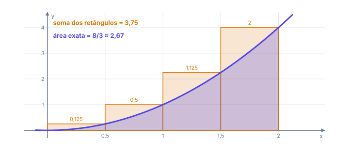
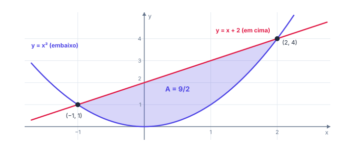
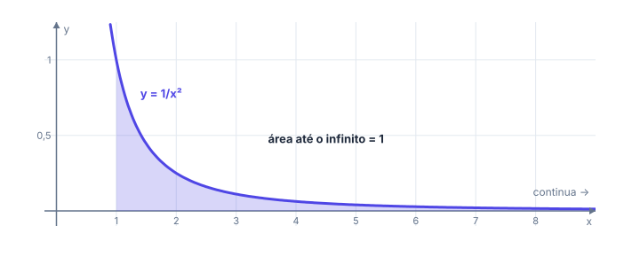
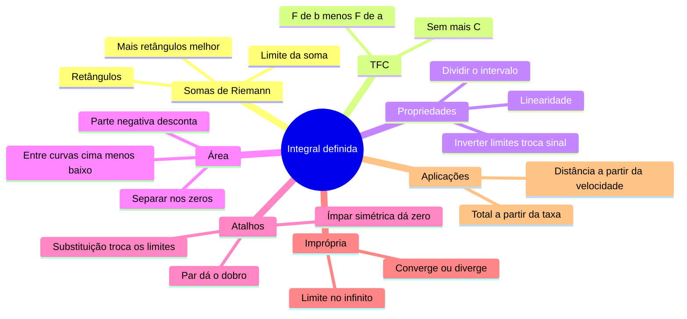

# 📊 Integral definida e áreas

> [← Primitivas](09-primitivas.md) · [Voltar para Cálculo →](../README.md)

**Nível:** 🔴 Avançado

## 🎯 Você vai aprender

- O problema da **área sob a curva** e as **somas de Riemann**.
- A notação $\int_a^b f(x)\,dx$ e suas **propriedades**.
- O **Teorema Fundamental do Cálculo** (TFC), que liga integral e primitiva.
- A diferença entre **integral** e **área** quando a função fica negativa.
- Calcular a **área entre duas curvas**.
- Usar **simetria**, **substituição** com limites e **integrais impróprias**.

## Em uma frase

> 💡 A integral definida **soma uma quantidade que varia**: área sob uma curva, total de requisições a partir da taxa por minuto, distância percorrida a partir da velocidade. E o TFC diz que, para calcular, basta uma **primitiva**.

## 1. O problema da área

Quanto vale a área sob $f(x) = x^2$, entre $x = 0$ e $x = 2$? Não é um retângulo nem um triângulo. A ideia: **aproximar por retângulos**.

Divida $[0, 2]$ em $n = 4$ pedaços de largura $\Delta x = \frac{2 - 0}{4} = 0{,}5$ e use a altura da função na **ponta direita** de cada pedaço:

| Pedaço | $[0; 0{,}5]$ | $[0{,}5; 1]$ | $[1; 1{,}5]$ | $[1{,}5; 2]$ |
| ------ | ------------ | ------------ | ------------ | ------------ |
| Altura $f(x_i)$ | $0{,}25$ | $1$ | $2{,}25$ | $4$ |
| Área do retângulo | $0{,}125$ | $0{,}5$ | $1{,}125$ | $2$ |

Soma: $0{,}125 + 0{,}5 + 1{,}125 + 2 = 3{,}75$. Como os retângulos passam por cima da curva, essa é uma estimativa **por excesso**. Usando a ponta esquerda, sairia $1{,}75$, uma estimativa **por falta**.

Com mais retângulos, a aproximação melhora:

| Retângulos $n$ | 4 | 10 | 100 | 1000 |
| -------------- | - | -- | --- | ---- |
| Soma (ponta direita) | 3,75 | 3,08 | 2,7068 | 2,670668 |

A soma se aproxima de $\frac{8}{3} \approx 2{,}6667$. Esse limite é a **integral definida**:

$$
\int_a^b f(x)\,dx = \lim_{n \to \infty} \sum_{i=1}^{n} f(x_i)\,\Delta x
$$

O $\int$ é um "S" esticado de **soma**; o $dx$ lembra a largura $\Delta x$ que ficou infinitamente fina.

## 2. O Teorema Fundamental do Cálculo

Calcular aquele limite toda vez seria um pesadelo. O TFC dá o atalho: se $F$ é **qualquer primitiva** de $f$ (contínua em $[a, b]$),

$$
\int_a^b f(x)\,dx = F(b) - F(a) = \Big[F(x)\Big]_a^b
$$

**Exemplo 1:** $\displaystyle\int_0^2 x^2\,dx = \left[\frac{x^3}{3}\right]_0^2 = \frac{8}{3} - 0 = \frac{8}{3}$. Exatamente o valor que as somas sugeriam.

> 💡 O $+\,C$ não precisa aparecer: ele aparece em $F(b)$ e em $F(a)$ e se cancela na subtração.

**Exemplo 2:** $\displaystyle\int_1^3 (2x + 1)\,dx = \Big[x^2 + x\Big]_1^3 = (9 + 3) - (1 + 1) = 10$.

**Exemplo 3:** $\displaystyle\int_0^{\pi} \operatorname{sen} x\,dx = \Big[-\cos x\Big]_0^{\pi} = -\cos \pi + \cos 0 = 1 + 1 = 2$.

**Exemplo 4:** $\displaystyle\int_1^{e} \frac{1}{x}\,dx = \Big[\ln x\Big]_1^{e} = 1 - 0 = 1$.

**Exemplo 5:** $\displaystyle\int_0^1 e^{2x}\,dx = \left[\frac{e^{2x}}{2}\right]_0^1 = \frac{e^2 - 1}{2} \approx 3{,}1945$.

**Exemplo 6 (total a partir da taxa):** um servidor recebe $r(t) = 20 + 6t$ requisições por minuto. Quantas chegam nos 10 primeiros minutos?

$$
\int_0^{10} (20 + 6t)\,dt = \Big[20t + 3t^2\Big]_0^{10} = 200 + 300 = 500 \text{ requisições}
$$

## 3. Propriedades

| Propriedade | Fórmula |
| ----------- | ------- |
| Linearidade | $\int_a^b (k f + g)\,dx = k\int_a^b f\,dx + \int_a^b g\,dx$ |
| Intervalo vazio | $\int_a^a f(x)\,dx = 0$ |
| Inverter os limites troca o sinal | $\int_b^a f(x)\,dx = -\int_a^b f(x)\,dx$ |
| Dividir o intervalo | $\int_a^b f\,dx = \int_a^c f\,dx + \int_c^b f\,dx$ |

## 4. Integral não é sempre área

Onde $f$ fica **abaixo** do eixo $x$, os retângulos têm altura negativa: a integral **desconta** essa parte.

**Exemplo 7:** $\displaystyle\int_0^{2\pi} \operatorname{sen} x\,dx = \Big[-\cos x\Big]_0^{2\pi} = -1 + 1 = 0$.

O resultado é zero porque a parte de cima ($+2$, de $0$ a $\pi$) cancela a de baixo ($-2$, de $\pi$ a $2\pi$). A **área** de verdade é a soma das partes em módulo:

$$
\text{Área} = \int_0^{\pi} \operatorname{sen} x\,dx + \left\lvert \int_{\pi}^{2\pi} \operatorname{sen} x\,dx \right\rvert = 2 + 2 = 4
$$

> ⚠️ Pediu **área**? Ache onde $f$ troca de sinal, integre cada pedaço e some os **valores absolutos**.

## 5. Área entre duas curvas

Se $f(x) \geq g(x)$ em $[a, b]$, a área entre elas é

$$
A = \int_a^b \bigl(f(x) - g(x)\bigr)\,dx \qquad \text{(de cima menos de baixo)}
$$

**Exemplo 8:** área entre $y = x + 2$ e $y = x^2$.

| Passo | Conta |
| ----- | ----- |
| 1. Onde se cruzam | $x^2 = x + 2 \Rightarrow x^2 - x - 2 = 0 \Rightarrow x = -1$ ou $x = 2$ |
| 2. Quem está em cima | Em $x = 0$: reta vale $2$, parábola vale $0$. A reta está em cima |
| 3. Integre | $\displaystyle\int_{-1}^{2} (x + 2 - x^2)\,dx = \left[\frac{x^2}{2} + 2x - \frac{x^3}{3}\right]_{-1}^{2}$ |
| 4. Substitua | $\left(2 + 4 - \frac{8}{3}\right) - \left(\frac{1}{2} - 2 + \frac{1}{3}\right) = \frac{10}{3} + \frac{7}{6} = \frac{9}{2}$ |

**Exemplo 9:** área entre $y = e^x$ e $y = x$ no intervalo $[0, 2]$. Como $e^x > x$ sempre:

$$
A = \int_0^2 (e^x - x)\,dx = \left[e^x - \frac{x^2}{2}\right]_0^2 = (e^2 - 2) - (1 - 0) = e^2 - 3 \approx 4{,}389
$$

## 6. Atalhos: simetria e substituição

| Se $f$ é... | Então $\int_{-a}^{a} f(x)\,dx$ vale... | Exemplos |
| ----------- | -------------------------------------- | -------- |
| **Ímpar** ($f(-x) = -f(x)$) | $0$ | $x^3$, $x$, $\operatorname{sen} x$ |
| **Par** ($f(-x) = f(x)$) | $2\int_0^a f(x)\,dx$ | $x^2$, $\cos x$, $\lvert x \rvert$ |

**Exemplo 10:** $\displaystyle\int_{-2}^{2} (x^3 + x^2)\,dx = 0 + 2\int_0^2 x^2\,dx = 2 \cdot \frac{8}{3} = \frac{16}{3}$.

**Substituição com limites:** quando trocar $x$ por $u$, **troque os limites também**.

**Exemplo 11:** $\displaystyle\int_0^1 2x\,(x^2 + 1)^3\,dx$, com $u = x^2 + 1$ e $du = 2x\,dx$. Em $x = 0$, $u = 1$; em $x = 1$, $u = 2$:

$$
\int_1^2 u^3\,du = \left[\frac{u^4}{4}\right]_1^2 = \frac{16 - 1}{4} = \frac{15}{4}
$$

## 7. Integrais impróprias

E se o intervalo for **infinito**? Integre até $t$ e faça $t \to \infty$.

**Exemplo 12:** $\displaystyle\int_1^{\infty} \frac{1}{x^2}\,dx = \lim_{t \to \infty} \left[-\frac{1}{x}\right]_1^t = \lim_{t \to \infty} \left(1 - \frac{1}{t}\right) = 1$. **Converge**: uma região infinitamente comprida com área finita!

**Exemplo 13:** $\displaystyle\int_1^{\infty} \frac{1}{x}\,dx = \lim_{t \to \infty} \ln t = \infty$. **Diverge**.

| Integral | Resultado |
| -------- | --------- |
| $\displaystyle\int_1^{\infty} \frac{1}{x^p}\,dx$ com $p > 1$ | Converge: $\dfrac{1}{p - 1}$ |
| $\displaystyle\int_1^{\infty} \frac{1}{x^p}\,dx$ com $p \leq 1$ | Diverge |
| $\displaystyle\int_0^{\infty} e^{-kx}\,dx$ com $k > 0$ | Converge: $\dfrac{1}{k}$ |

**Exemplo 14:** um download começa a $50$ MB/s e a velocidade cai como $v(t) = 50\,e^{-0{,}5t}$. Se ninguém parar, quanto será baixado no total?

$$
\int_0^{\infty} 50\,e^{-0{,}5t}\,dt = 50 \cdot \frac{1}{0{,}5} = 100 \text{ MB}
$$

A velocidade nunca chega a zero, mas o total é finito.

## 🧮 Passo a passo

1. **Ache uma primitiva** $F$ (sem o $+\,C$).
2. **Calcule** $F(b) - F(a)$, com parênteses em cada parte.
3. Pediu **área**? Veja onde $f$ fica negativa e separe os pedaços.
4. **Entre curvas:** cruzamentos, quem está em cima, integre "cima menos baixo".
5. **Limite infinito:** troque por $t$ e faça $t \to \infty$.

## ⚠️ Erros comuns

| Erro | Como evitar |
| ---- | ----------- |
| Fazer $F(a) - F(b)$ | É **de cima menos de baixo**: $F(b) - F(a)$ |
| Esquecer parênteses em $-F(a)$ | $-\left(\frac{1}{2} - 2\right)$ troca os dois sinais |
| Usar integral como área com $f$ negativa | Separe nos zeros e some os módulos |
| Na substituição, manter os limites de $x$ | Troque os limites para $u$ (ou volte para $x$ antes) |
| Achar que região infinita tem sempre área infinita | $\int_1^{\infty} \frac{1}{x^2}$ vale 1 |
| Calculadora em graus com $\pi$ | **Radianos** |

## 💡 Macetes

- **TFC em uma linha:** "primitiva no de cima, menos primitiva no de baixo".
- **Função ímpar em intervalo simétrico dá zero:** economize a conta.
- **Confira com a estimativa:** a integral de $f \geq 0$ fica entre a soma pela esquerda e a soma pela direita (quando $f$ só sobe ou só desce).

## 🧠 Mapa mental

## ✅ Teste rápido

**1.** Calcule $\displaystyle\int_0^3 x^2\,dx$.

Ver resposta

**Número:** `9`

$\left[\frac{x^3}{3}\right]_0^3 = \frac{27}{3} = 9$.

**2.** Calcule $\displaystyle\int_1^2 (2x + 3)\,dx$.

Ver resposta

**Número:** `6`

$\Big[x^2 + 3x\Big]_1^2 = (4 + 6) - (1 + 3) = 6$.

**3.** Calcule $\displaystyle\int_0^{\pi/2} \cos x\,dx$.

Ver resposta

**Número:** `1`

$\Big[\operatorname{sen} x\Big]_0^{\pi/2} = 1 - 0 = 1$.

**4.** Calcule $\displaystyle\int_1^{e} \frac{2}{x}\,dx$.

Ver resposta

**Número:** `2`

$\Big[2\ln x\Big]_1^{e} = 2 \cdot 1 - 2 \cdot 0 = 2$.

**5.** Qual é a área entre $y = x$ e $y = x^2$ no intervalo $[0, 1]$?

Ver resposta

**Número:** `1/6`

Em $[0, 1]$, $x \geq x^2$. Então $\int_0^1 (x - x^2)\,dx = \frac{1}{2} - \frac{1}{3} = \frac{1}{6}$.

**6.** Calcule $\displaystyle\int_{-2}^{2} x^3\,dx$.

Ver resposta

**Número:** `0`

$x^3$ é ímpar e o intervalo é simétrico: as duas metades se cancelam.

**7.** Calcule $\displaystyle\int_1^{\infty} \frac{1}{x^3}\,dx$.

Ver resposta

**Número:** `1/2`

$\left[-\frac{1}{2x^2}\right]_1^t = \frac{1}{2} - \frac{1}{2t^2} \to \frac{1}{2}$.

**8.** Estime $\displaystyle\int_0^2 x\,dx$ com uma soma de Riemann de $4$ retângulos, altura na ponta **direita**.

Ver resposta

**Número:** `2,5`

$\Delta x = 0{,}5$; alturas $0{,}5$, $1$, $1{,}5$ e $2$. Soma: $(0{,}5 + 1 + 1{,}5 + 2) \cdot 0{,}5 = 2{,}5$. O valor exato é $2$.

## ✏️ Agora pratique

São 9 exercícios sobre este assunto, do fácil ao difícil, com resolução passo a passo:

| 🟢 Fácil | 🟡 Intermediário | 🔴 Difícil |
| -------- | ---------------- | ---------- |
| [Exercícios 01 a 03](../exercicios/10-integral-definida/facil.md) | [Exercícios 04 a 06](../exercicios/10-integral-definida/intermediario.md) | [Exercícios 07 a 09](../exercicios/10-integral-definida/dificil.md) |

**Terminou as 10 aulas?** Revise com o [formulário](../resumos/formulario.md) e faça os [simulados de Cálculo](../../../simulados/README.md#-cálculo).

## 📖 Para ir além (fora da ementa)

- **Integração numérica:** quando não há primitiva com fórmula, o computador usa somas de Riemann melhoradas, como a **regra dos trapézios** e a **regra de Simpson**.
- **Monte Carlo:** sorteia pontos aleatórios num retângulo e conta quantos caem sob a curva. É assim que muitos programas de física e de renderização 3D calculam integrais difíceis.

## 📚 Referências

- STEWART, James. *Cálculo*. v. 1. 8. ed. São Paulo: Cengage Learning, 2017. Capítulo 5, Seções 6.1 e 7.8.
- GUIDORIZZI, Hamilton L. *Um curso de cálculo*. v. 1. 6. ed. Rio de Janeiro: LTC, 2018. Capítulos 11 e 13.
