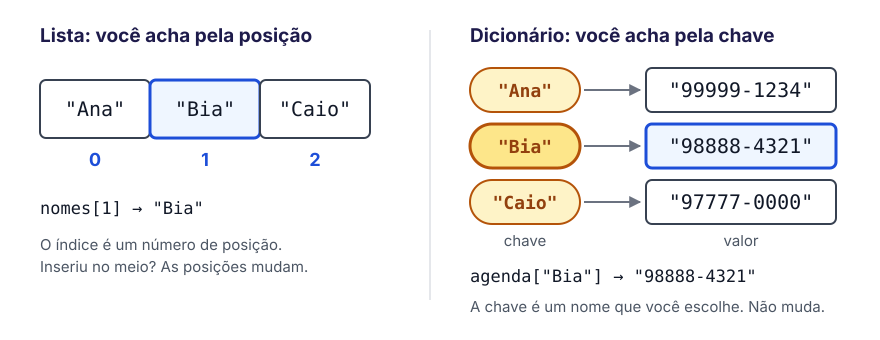
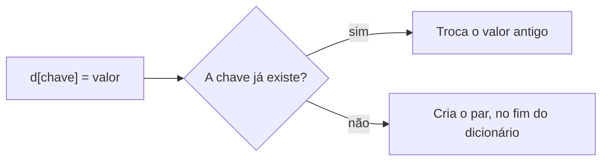
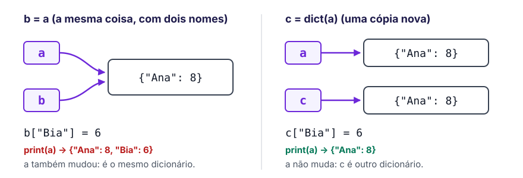
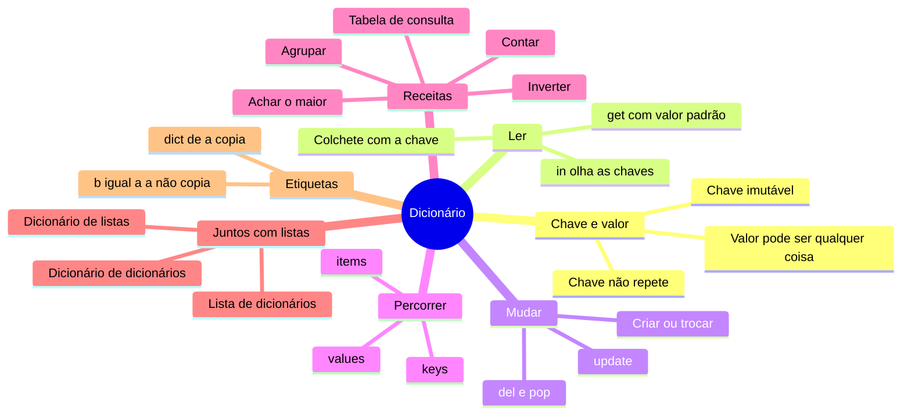

# 📒 Dicionários

> [← Strings](04-strings.md) · Próximo: [Funções →](06-funcoes.md)

**Nível:** 🟡 Intermediário

Um **dicionário** guarda informações em pares **chave → valor**. Em vez de achar um dado pela posição, como na lista, você acha pelo **nome** que deu a ele: a chave. É como a agenda do celular: você procura "Ana" e encontra o telefone dela, sem precisar saber em que linha ela está.

```python
agenda = {"Ana": "99999-1234", "Bia": "98888-4321"}
print(agenda["Ana"])   # 99999-1234
```

## 🎯 Você vai aprender

- A diferença entre **lista** e **dicionário**, e quando usar cada um.
- Criar, ler, alterar e remover pares chave → valor.
- Percorrer um dicionário com `keys()`, `values()` e `items()`.
- As receitas que mais aparecem: **contar**, **agrupar**, **achar o maior**, **inverter** e **tabela de consulta**.
- Montar estruturas com listas e dicionários um dentro do outro.
- Por que `b = a` não copia um dicionário.

## Lista × dicionário



| | Lista | Dicionário |
| --- | --- | --- |
| Acha um valor pela... | posição (`0`, `1`, `2`...) | chave (`"Ana"`, `"idade"`...) |
| Escreve com | colchetes `[ ]` | chaves `{ }` |
| Pode repetir? | Sim | Os valores sim; as **chaves não** |
| Ordem | É o que identifica cada item | Lembra a ordem em que as chaves entraram, mas a busca é pela chave |
| Bom para | uma sequência: as notas de uma prova, uma fila | ligar uma coisa a outra: nome → telefone, palavra → contagem |

> 💡 **Para decidir:** você vai procurar este dado por **posição** ou por **nome**? Por nome, use dicionário.

## Criando um dicionário

```python
aluno = {"nome": "Ana", "idade": 19, "curso": "CC"}   # chave: valor, separados por vírgula
vazio = {}                                              # dicionário vazio
precos = dict(cafe=5.5, pao=0.8)                        # o mesmo que {"cafe": 5.5, "pao": 0.8}
```

Os **valores** podem ser qualquer coisa: números, textos, listas e até outros dicionários. Já as **chaves** precisam ser valores que não mudam:

| Pode ser chave? | Exemplo | Por quê |
| --- | --- | --- |
| ✅ Texto | `"Ana"` | Não muda (é imutável) |
| ✅ Número | `2026`, `3.5` | Não muda |
| ✅ Tupla | `(1, 2)` | Não muda |
| ⛔ Lista | `[1, 2]` | Pode mudar: dá `TypeError: unhashable type: 'list'` |

> 📖 **Por baixo dos panos:** o Python transforma cada chave num número, o *hash*, que diz em que lugar da memória o valor está guardado. Por isso achar uma chave é **muito rápido**, mesmo num dicionário com milhões de itens. E por isso a chave não pode mudar depois de guardada: o lugar dela foi calculado a partir do valor.

## Lendo valores

Com `aluno = {"nome": "Ana", "idade": 19, "curso": "CC"}`:

| Código | Resultado | O que faz |
| --- | --- | --- |
| `aluno["nome"]` | `"Ana"` | O valor da chave |
| `aluno["email"]` | `KeyError: 'email'` | ⚠️ Chave que não existe dá erro |
| `aluno.get("email")` | `None` | Não dá erro: devolve `None` ("nada") |
| `aluno.get("email", "sem email")` | `"sem email"` | Devolve o valor padrão que você escolheu |
| `"idade" in aluno` | `True` | A chave existe? |
| `19 in aluno` | `False` | ⚠️ `in` procura nas **chaves**, não nos valores |
| `19 in aluno.values()` | `True` | Para procurar nos valores |
| `len(aluno)` | `3` | Quantos pares chave → valor |

## Inserir, alterar e remover

A mesma linha `d[chave] = valor` serve para **criar** e para **trocar**:



```python
estoque = {"caneta": 10}

estoque["lapis"] = 5          # cria:  {"caneta": 10, "lapis": 5}
estoque["caneta"] = 7         # troca: {"caneta": 7, "lapis": 5}
estoque["caneta"] += 3        # soma:  {"caneta": 10, "lapis": 5}

del estoque["lapis"]          # remove a chave: {"caneta": 10}
qtd = estoque.pop("caneta")   # remove e devolve o valor: qtd vale 10
estoque.pop("borracha", 0)    # chave que não existe: devolve o padrão (0), sem erro
```

| Operação | Código | Se a chave não existir |
| --- | --- | --- |
| Criar ou trocar | `d[k] = v` | Cria |
| Somar ao valor | `d[k] += 1` | ⛔ `KeyError` (use `d[k] = d.get(k, 0) + 1`) |
| Remover | `del d[k]` | ⛔ `KeyError` |
| Remover e devolver | `d.pop(k, padrão)` | Devolve o padrão |
| Juntar outro dicionário | `d.update(outro)` | Cria ou troca cada chave do outro |

## Percorrendo

```python
notas = {"Ana": 8.5, "Bia": 7.0, "Caio": 9.0}

for nome in notas:                  # só as chaves
    print(nome)

for nota in notas.values():         # só os valores
    print(nota)

for nome, nota in notas.items():    # chave e valor juntos (o mais usado)
    print(nome, "tirou", nota)
```

| Código | Dá | No exemplo |
| --- | --- | --- |
| `notas.keys()` | as chaves | `Ana`, `Bia`, `Caio` |
| `notas.values()` | os valores | `8.5`, `7.0`, `9.0` |
| `notas.items()` | os pares (chave, valor) | `("Ana", 8.5)`, `("Bia", 7.0)`, `("Caio", 9.0)` |
| `sorted(notas)` | uma lista com as chaves em ordem | `["Ana", "Bia", "Caio"]` |

- O dicionário **lembra a ordem** em que as chaves entraram (desde o Python 3.7).
- `keys()`, `values()` e `items()` são **janelas** para o dicionário (o Python Fluente chama de *views*): se o dicionário muda, elas mostram a mudança, sem copiar nada.

> ⚠️ **Não mude o tamanho do dicionário enquanto percorre.** Remover chaves dentro de `for k in d:` dá `RuntimeError: dictionary changed size during iteration`. Percorra uma cópia das chaves: `for k in list(d):`.

## Receitas que sempre aparecem

### 1. Contar

Quantas vezes cada coisa aparece? A **coisa** é a chave; a **contagem** é o valor.

```python
frase = "o rato roeu o rei"

contagem = {}
for palavra in frase.split():
    contagem[palavra] = contagem.get(palavra, 0) + 1

print(contagem)   # {'o': 2, 'rato': 1, 'roeu': 1, 'rei': 1}
```

O `get(palavra, 0)` devolve `0` na primeira vez que a palavra aparece, e a contagem até agora nas outras. **Teste de mesa**, o dicionário a cada volta:

| Volta | `palavra` | `contagem.get(palavra, 0)` | `contagem` depois da volta |
| --- | --- | --- | --- |
| 1 | `"o"` | `0` | `{"o": 1}` |
| 2 | `"rato"` | `0` | `{"o": 1, "rato": 1}` |
| 3 | `"roeu"` | `0` | `{"o": 1, "rato": 1, "roeu": 1}` |
| 4 | `"o"` | `1` | `{"o": 2, "rato": 1, "roeu": 1}` |
| 5 | `"rei"` | `0` | `{"o": 2, "rato": 1, "roeu": 1, "rei": 1}` |

### 2. Agrupar

Juntar itens que têm algo em comum. O valor de cada chave é uma **lista**:

```python
matriculas = ["Ana manhã", "Bia noite", "Caio manhã"]

turmas = {}
for linha in matriculas:
    nome, turno = linha.split()
    if turno not in turmas:
        turmas[turno] = []          # primeira vez deste turno: cria a lista vazia
    turmas[turno].append(nome)      # turmas[turno] é a lista; append muda a lista guardada

print(turmas)   # {'manhã': ['Ana', 'Caio'], 'noite': ['Bia']}
```

> 💡 `turmas.setdefault(turno, []).append(nome)` faz o `if` e o `append` numa linha só: se a chave não existe, ela é criada com `[]`; depois, o método devolve a lista guardada.

### 3. Achar o maior

```python
votos = {"Ana": 3, "Bruno": 5, "Carla": 2}

vencedor = ""
maior = 0
for nome, total in votos.items():
    if total > maior:
        vencedor = nome
        maior = total

print(vencedor, maior)   # Bruno 5
```

### 4. Inverter

Trocar o papel de chave e valor:

```python
capitais = {"PE": "Recife", "BA": "Salvador"}

estado_da_capital = {}
for uf, cidade in capitais.items():
    estado_da_capital[cidade] = uf

print(estado_da_capital["Recife"])   # PE
```

> ⚠️ Se dois valores forem iguais, eles viram **uma chave só** no dicionário invertido, e o último a entrar vence.

### 5. Tabela de consulta

Uma escada de `if`/`elif` que só traduz um valor em outro vira um dicionário:

```python
# Em vez de:
if dia == 1:
    nome = "domingo"
elif dia == 2:
    nome = "segunda"
# ... mais cinco elif

# Use:
dias = {1: "domingo", 2: "segunda", 3: "terça", 4: "quarta", 5: "quinta", 6: "sexta", 7: "sábado"}
nome = dias.get(dia, "dia inválido")
```

## Listas e dicionários juntos

Os valores podem ser listas e outros dicionários. Assim dá para guardar dados de verdade, como uma turma inteira:

![A variável turma aponta para um dicionário cujas chaves são nomes; cada nome aponta para outro dicionário com idade e notas; as notas são uma lista. O caminho turma["Ana"]["notas"][1] chega em 7.5.](../img/dicionario-aninhado.svg)

```python
turma = {
    "Ana": {"idade": 19, "notas": [8, 7.5, 9]},
    "Bia": {"idade": 20, "notas": [6, 9]},
}

print(turma["Ana"]["notas"][1])     # 7.5
turma["Bia"]["notas"].append(10)    # a Bia ganhou mais uma nota
```

Leia o caminho da esquerda para a direita: cada `[ ]` entra um nível.

| Formato | Exemplo | Para quê |
| --- | --- | --- |
| Lista de dicionários | `[{"nome": "Ana", "nota": 8}, {"nome": "Bia", "nota": 7}]` | Uma tabela: cada dicionário é uma linha |
| Dicionário de listas | `{"manhã": ["Ana", "Caio"], "noite": ["Bia"]}` | Grupos |
| Dicionário de dicionários | `{"Ana": {"idade": 19}, "Bia": {"idade": 20}}` | A ficha de cada um, achada pelo nome |

```python
alunos = [{"nome": "Ana", "nota": 8}, {"nome": "Bia", "nota": 7}]

for aluno in alunos:                 # cada aluno é um dicionário
    print(aluno["nome"], aluno["nota"])
```

## Variáveis são etiquetas

Uma variável **não é uma caixa** com uma cópia do dado. Ela é uma **etiqueta** colada no objeto. Essa é a imagem que o Luciano Ramalho usa no Python Fluente, e ela explica um comportamento que pega muita gente:



```python
a = {"Ana": 8}
b = a              # b é outra etiqueta no MESMO dicionário
b["Bia"] = 6
print(a)           # {'Ana': 8, 'Bia': 6}  (a mudou junto)

c = dict(a)        # um dicionário novo, com o mesmo conteúdo (a.copy() faz igual)
c["Caio"] = 5
print(a)           # {'Ana': 8, 'Bia': 6}  (a não mudou)
```

Isso vai ser importante em [Funções](06-funcoes.md): uma função que recebe um dicionário ou uma lista pode mudar o objeto de quem chamou.

## Erros comuns

| Erro | Exemplo | Como resolver |
| --- | --- | --- |
| `KeyError` | `notas["Duda"]` sem essa chave | `notas.get("Duda", 0)`, ou teste com `in` antes |
| Achar que tem posição | `notas[0]` | Não existe a chave `0`: use a chave certa |
| `in` nos valores | `8.5 in notas` dá `False` | `8.5 in notas.values()` |
| Lista como chave | `{[1, 2]: "x"}` | Use uma tupla `(1, 2)` ou um texto |
| Mudar o dicionário no `for` | `del d[k]` dentro de `for k in d:` | Percorra `list(d)` |
| `+=` numa chave nova | `cont[p] += 1` na primeira vez | `cont[p] = cont.get(p, 0) + 1` |
| Achar que `b = a` copia | `b = a` e depois mudar `b` | `b = dict(a)` |

## Para ir além (opcional)

- **Compreensão de dicionário**, como a de listas:

  ```python
  palavras = ["sol", "lua", "estrela"]
  tamanhos = {p: len(p) for p in palavras}   # {'sol': 3, 'lua': 3, 'estrela': 7}
  ```

- **Juntar dicionários** com `|` (Python 3.9 ou mais novo): `{"a": 1} | {"b": 2}` dá `{'a': 1, 'b': 2}`.
- **Conjuntos** (`set`) parecem dicionários só com as chaves: guardam itens sem repetir. `set("banana")` dá um conjunto com `'b'`, `'a'` e `'n'`.

## 🧠 Mapa mental



## 🧪 Vamos praticar?

Faça os [exercícios de Dicionários](../exercicios/enunciados/05-dicionarios/facil.md) ([🟡 Intermediário](../exercicios/enunciados/05-dicionarios/intermediario.md) · [🔴 Difícil](../exercicios/enunciados/05-dicionarios/dificil.md)): tradutor, agenda, votação, estoque, anagramas e a tabela de um campeonato.

## 📚 Referências

- [Tutorial Python: Dicionários](https://docs.python.org/pt-br/3/tutorial/datastructures.html#dictionaries)
- [Tutorial Python: Técnicas de iteração](https://docs.python.org/pt-br/3/tutorial/datastructures.html#looping-techniques)
- [Biblioteca padrão: tipos de mapeamento (dict)](https://docs.python.org/pt-br/3/library/stdtypes.html#typesmapping)
- RAMALHO, Luciano. *Python Fluente*. 2. ed. Edição online em português, 2023. [Capítulo 3: Dicionários e conjuntos](https://pythonfluente.com/#ch_dicts_sets) e [seção 6.2: Variáveis não são caixas](https://pythonfluente.com/#_variáveis_não_são_caixas).
- [Python Tutor: veja o dicionário mudando passo a passo](https://pythontutor.com/python-compiler.html#mode=edit)
