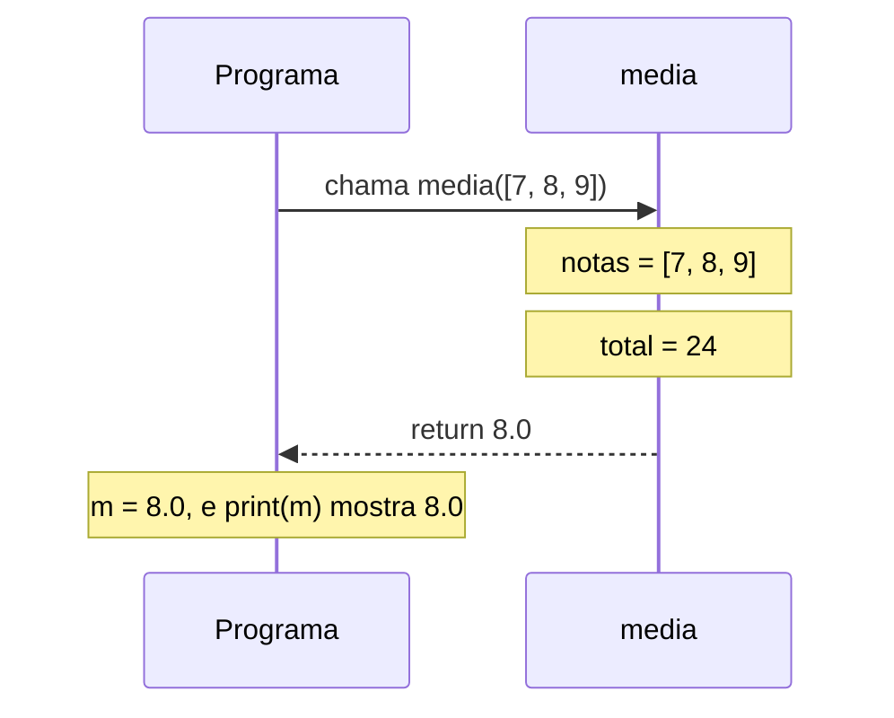
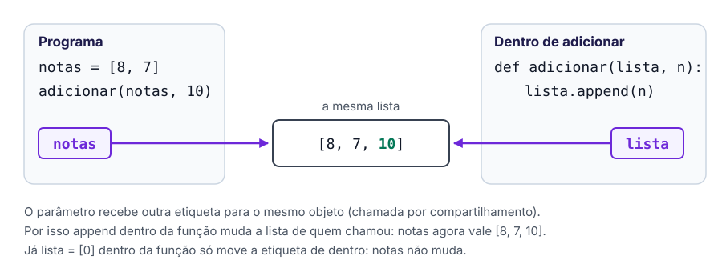
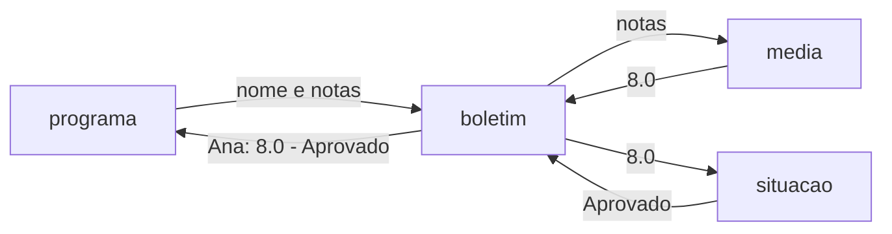
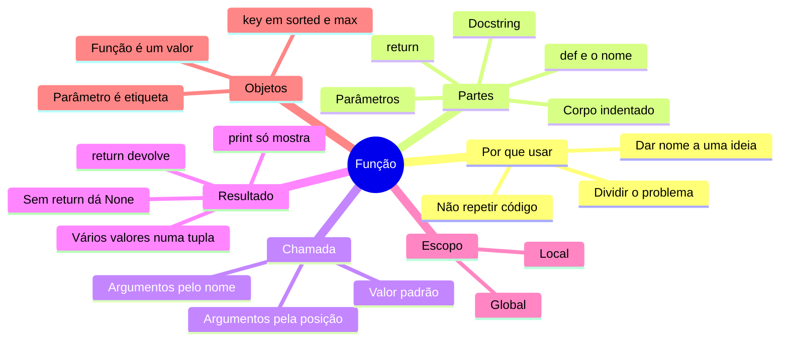

# 🧩 Funções

> [← Dicionários](05-dicionarios.md) · [Voltar para Python](../README.md)

**Nível:** 🟡 Intermediário

Uma **função** é um pedaço de código com nome, que faz **uma** tarefa e pode ser usado quantas vezes você quiser. Você já usa várias: `print`, `len`, `input`, `int`, `sum`. Agora vai criar as suas.

```python
def dobro(numero):
    return numero * 2

print(dobro(5))    # 10
print(dobro(21))   # 42
```

## 🎯 Você vai aprender

- Por que dividir um programa em funções.
- As partes de uma função: `def`, nome, parâmetros, corpo e `return`.
- O que acontece, passo a passo, quando uma função é chamada.
- A diferença entre `return` e `print`.
- Parâmetros com valor padrão e argumentos pelo nome.
- Onde uma variável existe (escopo).
- Por que uma função pode mudar a lista ou o dicionário que recebe.
- Que uma função também é um valor: dá para guardá-la num dicionário e passá-la para outra função.

## Por que criar funções?

Sem função, o mesmo cálculo se repete:

```python
notas_ana = [8, 7, 9]
media_ana = sum(notas_ana) / len(notas_ana)

notas_bia = [6, 9]
media_bia = sum(notas_bia) / len(notas_bia)
```

Com função, você escreve a ideia **uma vez** e dá um nome a ela:

```python
def media(notas):
    return sum(notas) / len(notas)

media_ana = media([8, 7, 9])
media_bia = media([6, 9])
```

| Vantagem | Na prática |
| --- | --- |
| Não repetir código | Achou um erro? Corrige num lugar só |
| Dar nome a uma ideia | `media(notas)` diz o que faz; a conta solta, não |
| Dividir um problema grande | Cada função resolve uma parte pequena |
| Testar por partes | Dá para testar `media` sozinha antes de usar no programa |

## Anatomia de uma função

![A função media, com cada parte numa cor: def, o nome, os parâmetros notas e casas (com valor padrão 1), a docstring, o corpo indentado e o return. Embaixo, a chamada m = media([7, 8, 9]), em que m vale 8.0.](../img/anatomia-da-funcao.svg)

```python
def media(notas, casas=1):
    """Devolve a média da lista de notas."""
    total = sum(notas)
    return round(total / len(notas), casas)
```

| Parte | No exemplo | Para que serve |
| --- | --- | --- |
| `def` | `def` | Avisa que ali começa uma função |
| Nome | `media` | Como a função vai ser chamada: minúsculas, com `_` entre as palavras |
| Parâmetros | `notas, casas=1` | Variáveis que recebem os valores da chamada |
| Docstring | `"""Devolve..."""` | Explica o que a função faz (aparece em `help(media)`) |
| Corpo | as linhas indentadas | O código que roda a cada chamada |
| `return` | `return round(...)` | Devolve o resultado e **encerra** a função |

> ⚠️ **Definir não executa.** O `def` só ensina ao Python o que a função faz. O corpo roda quando alguém **chama** a função, com parênteses: `media([7, 8, 9])`.

## O que acontece numa chamada

```python
def media(notas):
    total = sum(notas)
    return total / len(notas)

m = media([7, 8, 9])
print(m)
```



1. O programa **pausa** na linha `m = media([7, 8, 9])`.
2. O argumento `[7, 8, 9]` vai para o parâmetro `notas`.
3. O corpo da função roda.
4. O `return` devolve `8.0` e a função acaba.
5. O programa continua de onde parou: `8.0` toma o lugar da chamada e é guardado em `m`.

> 💡 Cole esse código no [Python Tutor](https://pythontutor.com/python-compiler.html#mode=edit) e clique em *Next*: dá para ver a função ganhar um quadro próprio, com as variáveis dela, e o quadro sumir depois do `return`.

## `return` × `print`

| | `return` | `print` |
| --- | --- | --- |
| O que faz | Devolve um valor para quem chamou | Mostra um texto na tela |
| Dá para usar o valor depois? | Sim: guardar, somar, comparar | Não: ele só aparece na tela |
| Encerra a função? | Sim | Não |

```python
def dobro_com_print(n):
    print(n * 2)

def dobro_com_return(n):
    return n * 2

x = dobro_com_print(5)    # mostra 10, mas x vale None
y = dobro_com_return(5)   # não mostra nada, e y vale 10

print(y + 1)              # 11
print(x + 1)              # TypeError: unsupported operand type(s) for +: 'NoneType' and 'int'
```

- Uma função sem `return` devolve **`None`**, o valor que quer dizer "nada".
- Regra prática: a função **calcula e devolve**; quem chama decide se mostra.

### Mais de um `return`

O `return` pode ficar dentro de um `if`. O primeiro que rodar encerra a função:

```python
def situacao(media):
    if media >= 7:
        return "Aprovado"
    if media >= 5:
        return "Recuperação"
    return "Reprovado"
```

### Devolvendo vários valores

```python
def menor_e_maior(numeros):
    return min(numeros), max(numeros)

menor, maior = menor_e_maior([4, 9, 1])
print(menor, maior)   # 1 9
```

O Python junta os valores numa **tupla**, `(1, 9)`, e você separa em duas variáveis na hora de receber.

## Parâmetros e argumentos

| Nome | Onde fica | Exemplo |
| --- | --- | --- |
| **Parâmetro** | Na definição (`def`) | `def potencia(base, expoente=2):` |
| **Argumento** | Na chamada | `potencia(3, 4)` |

```python
def potencia(base, expoente=2):
    return base ** expoente

print(potencia(3))                     # 9: expoente usou o valor padrão 2
print(potencia(3, 4))                  # 81: pela posição
print(potencia(expoente=3, base=2))    # 8: pelo nome (aí a ordem tanto faz)
```

| Jeito de passar | Exemplo | Como funciona |
| --- | --- | --- |
| Pela posição | `potencia(3, 4)` | O 1º argumento vai para o 1º parâmetro, e assim por diante |
| Pelo nome | `potencia(base=3, expoente=4)` | Deixa a chamada mais clara |
| Usando o padrão | `potencia(3)` | Parâmetro com `=` na definição pode ficar de fora |

- Na definição, os parâmetros com valor padrão vêm **depois** dos outros: `def f(a, b=1)` funciona; `def f(a=1, b)` dá `SyntaxError`.
- Na chamada, os argumentos pelo nome vêm **depois** dos pela posição: `potencia(3, expoente=4)`.
- Você já usou argumentos pelo nome: `print("a", "b", sep="-")` e `sorted(lista, reverse=True)`.

> ⚠️ **Não use uma lista ou um dicionário como valor padrão.** O valor padrão é criado **uma vez só**, quando a função é definida, e é reaproveitado em todas as chamadas. A documentação oficial e o Python Fluente avisam disso:
>
> ```python
> def adicionar(item, lista=[]):
>     lista.append(item)
>     return lista
>
> print(adicionar("a"))   # ['a']
> print(adicionar("b"))   # ['a', 'b']  ← o "a" sobrou da chamada anterior!
> ```
>
> Use `None` e crie a lista dentro: `def adicionar(item, lista=None):` e, no corpo, `if lista is None: lista = []`.

## Escopo: onde a variável existe

```python
def calcular_total(precos):
    total = 0              # total é LOCAL: só existe dentro da função
    for p in precos:
        total += p
    return total

valores = [10, 20]         # valores é GLOBAL: existe no programa todo
print(calcular_total(valores))   # 30
print(total)                     # NameError: name 'total' is not defined
```

| Variável | Onde é criada | Quem enxerga |
| --- | --- | --- |
| Local | Dentro da função (os parâmetros também são locais) | Só a própria função, e só durante a chamada |
| Global | Fora de qualquer função | O programa todo; as funções conseguem ler |

- Cada chamada ganha variáveis locais **novas**, que somem quando a função termina.
- Duas funções podem ter variáveis com o mesmo nome sem uma atrapalhar a outra.
- Se você **atribui** um valor a um nome dentro da função, ele vira local, mesmo que exista uma variável global com esse nome.

> 💡 **Boa prática:** a função recebe tudo de que precisa pelos **parâmetros** e entrega o resultado pelo **`return`**. Assim ela não depende de variáveis globais e funciona igual em qualquer programa.

## Funções que recebem listas e dicionários

Lembra que [variáveis são etiquetas](05-dicionarios.md#variáveis-são-etiquetas)? O parâmetro é **mais uma etiqueta** no mesmo objeto. O Python Fluente chama isso de **chamada por compartilhamento**: a função recebe o mesmo objeto, não uma cópia.



```python
def adicionar(lista, n):
    lista.append(n)        # muda a lista: quem chamou vê a mudança

def trocar(lista):
    lista = [0]            # só move a etiqueta de dentro: quem chamou não vê

notas = [8, 7]
adicionar(notas, 10)
print(notas)               # [8, 7, 10]

trocar(notas)
print(notas)               # [8, 7, 10]
```

| Dentro da função | Efeito fora dela |
| --- | --- |
| `lista.append(x)`, `lista[0] = x`, `d[chave] = v`, `d.pop(k)` | **Muda** o objeto de quem chamou |
| `lista = [...]`, `d = {...}` | Não muda nada fora |
| Qualquer coisa com números e textos | Nunca muda fora: eles são imutáveis |

> 💡 Se a função não deve mexer no original, trabalhe numa cópia (`nova = list(lista)` ou `novo = dict(d)`) e devolva a cópia.

## Funções chamando funções

Problemas grandes ficam fáceis quando cada função faz uma coisa só e uma chama a outra:

```python
def media(notas):
    return sum(notas) / len(notas)

def situacao(m):
    if m >= 7:
        return "Aprovado"
    return "Reprovado"

def boletim(nome, notas):
    m = media(notas)
    return nome + ": " + str(round(m, 1)) + " - " + situacao(m)

print(boletim("Ana", [8, 7, 9]))   # Ana: 8.0 - Aprovado
```



## Funções também são valores

Em Python, uma função é um objeto, como um número ou uma lista. O Python Fluente chama isso de **funções de primeira classe**: dá para guardar uma função numa variável, numa lista ou num dicionário, e passá-la para outra função.

```python
def somar(a, b):
    return a + b

def subtrair(a, b):
    return a - b

operacoes = {"+": somar, "-": subtrair}   # sem parênteses: guarda a função, não chama
print(operacoes["+"](3, 4))                # 7: pega a função no dicionário e chama
```

Uma função que recebe outra função é uma **função de ordem superior**. `sorted`, `max` e `min` aceitam uma função no argumento `key`, que diz **o que comparar**:

```python
palavras = ["banana", "kiwi", "uva"]
print(sorted(palavras, key=len))     # ['uva', 'kiwi', 'banana']: pelo tamanho

votos = {"Ana": 3, "Bruno": 5, "Carla": 2}
print(max(votos, key=votos.get))      # Bruno: a chave com o maior valor
```

## Como escrever uma função, passo a passo

1. **Nome e contrato:** o que ela recebe e o que devolve? Por exemplo, `eh_par(numero)` recebe um inteiro e devolve `True` ou `False`.
2. **Exemplos antes do código:** `eh_par(4)` deve dar `True`; `eh_par(7)`, `False`.
3. **Corpo:** escreva o código que resolve os exemplos.
4. **Teste:** chame com os exemplos e confira (`print(eh_par(4))`).
5. **Use** a função no programa.

## Erros comuns

| Erro | Exemplo | O que acontece |
| --- | --- | --- |
| Esquecer os parênteses | `print(media)` | Mostra `<function media at 0x...>` em vez de chamar |
| Esquecer o `return` | a função só faz a conta | Ela devolve `None` |
| `print` no lugar de `return` | `x = dobro_com_print(5)` | `x` vale `None` |
| Código depois do `return` | um `print("fim")` logo depois do `return` | A linha nunca roda |
| Argumento a menos | `potencia()` | `TypeError: potencia() missing 1 required positional argument: 'base'` |
| Usar a variável local fora | `print(total)` | `NameError` |
| Dar a uma variável o nome de uma função do Python | `sum = 0` e depois `sum(lista)` | `TypeError: 'int' object is not callable` |
| Lista vazia como valor padrão | `def f(x, lista=[])` | A mesma lista é usada em todas as chamadas |

## Para ir além (opcional)

- **`lambda`** cria uma função pequena, sem nome, numa linha: `sorted(palavras, key=lambda p: p[-1])` ordena pela última letra.
- **Recursão** é uma função que chama a si mesma: o fatorial de `n` é `n * fatorial(n - 1)`.
- **`*args` e `**kwargs`** deixam a função receber quantos argumentos vierem.

## 🧠 Mapa mental



## 🧪 Vamos praticar?

Faça os [exercícios de Funções](../exercicios/enunciados/06-funcoes/facil.md) ([🟡 Intermediário](../exercicios/enunciados/06-funcoes/intermediario.md) · [🔴 Difícil](../exercicios/enunciados/06-funcoes/dificil.md)). Os difíceis juntam tudo o que você estudou até aqui: condicionais, repetição, listas, matrizes, strings, dicionários e funções.

## 📚 Referências

- [Tutorial Python: Definindo funções](https://docs.python.org/pt-br/3/tutorial/controlflow.html#defining-functions)
- [Tutorial Python: Mais sobre definição de funções](https://docs.python.org/pt-br/3/tutorial/controlflow.html#more-on-defining-functions), com [argumentos com valor padrão](https://docs.python.org/pt-br/3/tutorial/controlflow.html#default-argument-values), [argumentos nomeados](https://docs.python.org/pt-br/3/tutorial/controlflow.html#keyword-arguments) e [strings de documentação](https://docs.python.org/pt-br/3/tutorial/controlflow.html#documentation-strings)
- RAMALHO, Luciano. *Python Fluente*. 2. ed. Edição online em português, 2023. [Capítulo 7: Funções como objetos de primeira classe](https://pythonfluente.com/#ch_func_objects) e [seção 6.5: Parâmetros de função como referências](https://pythonfluente.com/#_parâmetros_de_função_como_referências).
- [Python Tutor: veja a chamada da função passo a passo](https://pythontutor.com/python-compiler.html#mode=edit)
