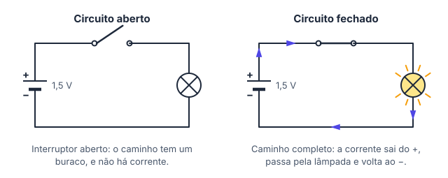
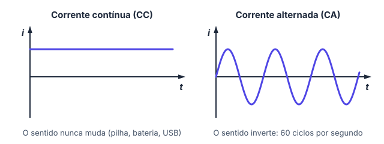
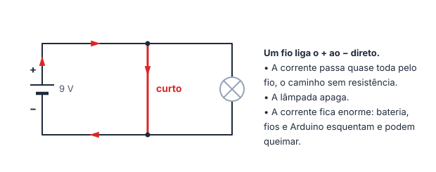
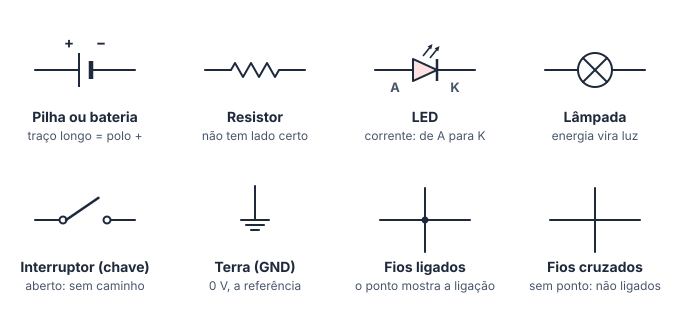

# ⚡ Introdução à eletrônica

> [← Mapa de Karnaugh](09-mapa-de-karnaugh.md) · Próximo: [Tensão, corrente, resistência e Lei de Ohm →](11-lei-de-ohm.md)

**Nível:** 🟢 Iniciante

> 📖 **Antes de começar:** esta aula abre a segunda parte do tema, **eletrônica e Arduino**, e não depende das anteriores. Se quiser, reveja na [aula 1](01-analogico-e-digital.md) por que o computador usa 0 e 1: é a eletrônica desta parte que faz isso acontecer.

## 🎯 Você vai aprender

- O que é **eletricidade**: carga elétrica, elétron livre e por que o metal conduz.
- A diferença entre **condutor**, **isolante** e **semicondutor**.
- As partes de um **circuito elétrico** e a diferença entre circuito **aberto** e **fechado**.
- **Corrente contínua** × **corrente alternada**.
- O que é um **curto-circuito** e por que ele é perigoso.
- Ler e desenhar um **esquema** com os símbolos de pilha, terra (GND), interruptor, resistor, LED e lâmpada.
- Usar os **prefixos** quilo, mili e micro (kΩ, mA, µA).

## Em uma frase

> 💡 Eletricidade é **carga elétrica em movimento**. Um circuito é um **caminho fechado**: a carga sai da fonte, passa por quem consome e volta para a fonte.

## 1. Do átomo à eletricidade

Toda matéria é feita de átomos. No centro fica o **núcleo**, com prótons e nêutrons; em volta, os **elétrons**.

| Partícula | Carga | Onde fica | Anda pelo fio? |
| --------- | ----- | --------- | -------------- |
| Próton | Positiva (+) | No núcleo | Não |
| Nêutron | Nenhuma | No núcleo | Não |
| Elétron | Negativa (−) | Em volta do núcleo | Só os **livres** |

- Um átomo com o mesmo número de prótons e elétrons é **neutro**.
- Se ele **ganha** um elétron, fica negativo (íon negativo). Se **perde**, fica positivo (íon positivo).
- Nos metais, alguns elétrons da camada de fora ficam fracamente presos e passeiam de átomo em átomo: são os **elétrons livres**. Quando algo os empurra todos para o mesmo lado, temos **corrente elétrica**.

> 💡 Quem "empurra" os elétrons é a **fonte** (pilha, bateria, porta USB). Esse empurrão se chama **tensão** e é o assunto da [próxima aula](11-lei-de-ohm.md).

## 2. Condutor, isolante e semicondutor

| Tipo | Elétrons livres | Exemplos | Onde aparece |
| ---- | --------------- | -------- | ------------ |
| **Condutor** | Muitos: a corrente passa fácil | Cobre, alumínio, ouro | Fios, jumpers, trilhas das placas |
| **Isolante** | Quase nenhum: a corrente quase não passa | Plástico, borracha, vidro, ar seco | Capa dos fios, corpo da protoboard |
| **Semicondutor** | Depende das condições (luz, calor, tensão) | Silício, germânio | LED, diodo, transistor, chips |

> 💡 **Ligação com a primeira parte:** o **transistor**, feito de semicondutor, funciona como um interruptor controlado por eletricidade. Bilhões deles formam as portas lógicas das aulas 7 a 9.

## 3. O circuito elétrico

Todo circuito tem quatro papéis:

| Parte | O que faz | Exemplos |
| ----- | --------- | -------- |
| **Fonte** (gerador) | Empurra as cargas, criando a tensão | Pilha, bateria, porta USB, carregador |
| **Condutor** | É o caminho | Fio, jumper, trilha da placa |
| **Carga** (consumidor) | Transforma a energia elétrica em outra coisa | Lâmpada (luz), LED (luz), motor (movimento), buzzer (som) |
| **Interruptor** (controle) | Abre ou fecha o caminho | Interruptor da parede, botão |

A corrente só existe com o caminho **completo, de ida e de volta**:

| Circuito | O caminho | Tem corrente? | A lâmpada |
| -------- | --------- | ------------- | --------- |
| **Fechado** | Completo, do + da fonte até o − | Sim | Acende |
| **Aberto** | Interrompido (interruptor desligado, fio solto ou partido) | Não | Apaga |

> ⚠️ **Um fio só não acende nada.** Ligar o + da pilha na lâmpada não basta: a corrente precisa de um segundo caminho, de volta ao −. Na eletrônica com Arduino, esse caminho de volta é o **GND**.

**Sentido da corrente.** Nos esquemas, a corrente sai do **+** da fonte, passa pelo circuito e entra no **−**. Esse é o **sentido convencional**, combinado antes de se descobrir o elétron. Os elétrons, na verdade, andam ao contrário. Para montar e calcular circuitos, isso não muda nada: todo esquema usa o convencional.

## 4. Corrente contínua e corrente alternada

| | Contínua (CC ou DC) | Alternada (CA ou AC) |
| - | ------------------- | -------------------- |
| Sentido | **Sempre o mesmo** | **Inverte** muitas vezes por segundo |
| Fontes | Pilha, bateria, porta USB, saída do carregador | Tomada (127 V ou 220 V) |
| Frequência | Não tem | 60 Hz no Brasil: 60 ciclos por segundo |
| Onde usamos | Arduino, LEDs, celular, computador | Distribuição de energia, chuveiro, geladeira |

> 💡 O carregador do celular é uma **fonte**: ele transforma a CA da tomada em CC de 5 V. O Arduino também trabalha em corrente contínua, com 5 V.

> ⚠️ **Segurança:** todos os circuitos deste tema usam pilhas, bateria de 9 V ou a porta USB. **Nunca** ligue um circuito de estudo na tomada: 127 V ou 220 V podem matar.

## 5. Curto-circuito

**Curto-circuito** é um caminho **sem resistência** entre os dois polos da fonte: um fio ligando o + direto no −, sem nada consumindo no meio.

| O que acontece | Por quê |
| -------------- | ------- |
| A lâmpada apaga | A corrente escolhe o caminho mais fácil e quase toda passa pelo fio |
| A corrente fica enorme | Nada no caminho limita a corrente |
| Pilha, fios e placa esquentam | A energia vira calor; pilhas podem vazar, e o Arduino ou a porta USB podem queimar |

Como ele acontece na prática:

- dois fios desencapados se encostam;
- um jumper liga o **5V** direto no **GND** do Arduino;
- um componente fica com as duas pernas na mesma fileira da protoboard (você vai ver na aula de protoboard).

> 💡 **Fusível** e **disjuntor** existem por causa do curto: quando a corrente passa do limite, eles abrem o circuito antes que algo pegue fogo.

## 6. Esquema elétrico: os símbolos

Um **esquema** mostra **o que está ligado com o quê**, sem se preocupar com a aparência das peças. Ele é o "mapa" do circuito: com ele você monta na protoboard, no simulador ou na placa.

| Símbolo | Detalhe que cai em prova |
| ------- | ------------------------ |
| Pilha ou bateria | O **traço longo** é o polo **+** |
| Resistor | Zigue-zague (ou retângulo, em alguns livros). Tanto faz o lado |
| LED | A corrente entra pelo **ânodo** (A, lado do triângulo) e sai pelo **cátodo** (K, lado da barra). Ao contrário, ele não acende |
| Interruptor | Desenhado aberto, a menos que o texto diga o contrário |
| Terra (GND) | Referência de **0 V**. Todos os símbolos de GND de um esquema estão ligados entre si, mesmo sem fio desenhado |
| Fios que se cruzam | Com **ponto** (nó): estão ligados. **Sem ponto**: só passam um por cima do outro |

**Exemplo 1: lendo o esquema de uma lanterna**

Siga a corrente com o dedo, saindo do **+** da bateria ①:

| Passo | Por onde passa | O que faz |
| ----- | -------------- | --------- |
| 1 | Interruptor ② | Se estiver aberto, o caminho para aqui e nada acende |
| 2 | Resistor ③ (82 Ω) | Limita a corrente, para o LED não queimar |
| 3 | LED ④ | Acende: a corrente entra pelo ânodo (lado do triângulo) |
| 4 | Volta ao **−** da bateria | O caminho fechou |

## 7. Unidades e prefixos

Em eletrônica, os valores são muito grandes ou muito pequenos. Os **prefixos** evitam um monte de zeros:

| Prefixo | Símbolo | Vale | Exemplo |
| ------- | ------- | ---- | ------- |
| mega | M | × 1 000 000 | 1 MΩ = 1 000 000 Ω |
| quilo | k | × 1 000 | 4,7 kΩ = 4 700 Ω |
| (nenhum) | | × 1 | 5 V |
| mili | m | ÷ 1 000 | 20 mA = 0,02 A |
| micro | µ | ÷ 1 000 000 | 500 µA = 0,0005 A |

As unidades que você vai usar o tempo todo (a próxima aula explica cada uma):

| Grandeza | Unidade | Símbolo |
| -------- | ------- | ------- |
| Tensão | volt | V |
| Corrente | ampere | A |
| Resistência | ohm | Ω |

**Exemplo 2: conversões**

| Converter | Conta | Resultado |
| --------- | ----- | --------- |
| 20 mA para A | 20 ÷ 1 000 | **0,02 A** |
| 0,5 A para mA | 0,5 × 1 000 | **500 mA** |
| 2,2 kΩ para Ω | 2,2 × 1 000 | **2 200 Ω** |
| 470 Ω para kΩ | 470 ÷ 1 000 | **0,47 kΩ** |

> ⚠️ **m minúsculo é mili; M maiúsculo é mega.** 5 mΩ e 5 MΩ diferem um bilhão de vezes.

## 🔬 Mão na massa

Use o simulador gratuito [Kit para Montar Circuito DC](https://phet.colorado.edu/pt_BR/simulations/circuit-construction-kit-dc), do PhET (roda no navegador, sem conta):

1. Com **fios, 1 lâmpada e 1 pilha**, acenda a lâmpada. Quantos fios foram necessários? Por quê?
2. Coloque um **interruptor** no caminho. Abra e feche: ele se comporta como o da sua casa?
3. Ligue um fio **direto** entre os polos da pilha. O que acontece com a lâmpada? E com a pilha?
4. Monte o circuito da lanterna (Exemplo 1) e desenhe o esquema dele no papel com os símbolos da seção 6.

## ⚠️ Erros comuns

| Erro | Como evitar |
| ---- | ----------- |
| Achar que a corrente "acaba" na lâmpada | Ela volta para a fonte: o circuito é um laço fechado |
| Ligar só um fio entre a pilha e a lâmpada | São dois caminhos: ida (do +) e volta (para o −) |
| Achar que curto-circuito é um "fio curto" | É um caminho **sem resistência** entre os polos, de qualquer tamanho |
| Confundir mA com MA | m minúsculo divide por mil; M maiúsculo multiplica por um milhão |
| Ligar experimento na tomada | Só pilha, bateria ou USB |

## 💡 Macetes

- **Siga o caminho com o dedo:** saia do + da fonte, passe pelos componentes e volte ao −. Se o dedo não volta, o circuito está aberto.
- **Mili ↔ unidade:** a vírgula anda 3 casas. Para a unidade maior (mA → A), para a esquerda; para a menor (A → mA), para a direita.
- **Num esquema, procure os pontos:** fio cruzado sem ponto não está ligado.

## 🧾 Resumo

| Ideia | Em poucas palavras |
| ----- | ------------------ |
| Eletricidade | Cargas em movimento; nos fios, os elétrons livres |
| Condutor, isolante, semicondutor | Conduz; não conduz; conduz conforme as condições |
| Circuito | Fonte + condutor + carga (+ interruptor), num caminho fechado |
| CC × CA | Um sentido só × sentido que inverte (60 Hz na tomada) |
| Curto-circuito | Caminho sem resistência entre os polos: corrente enorme |
| Esquema | O mapa das ligações; traço longo da pilha = +; ponto = fios ligados |
| Prefixos | k = × 1 000; m = ÷ 1 000; µ = ÷ 1 000 000 |

## ✅ Teste rápido

**1.** Um circuito tem pilha, fios e lâmpada, mas o interruptor está desligado. Ele está aberto ou fechado?

Ver resposta

**Resposta:** `aberto | circuito aberto`

Com o interruptor desligado, o caminho tem uma interrupção: não há corrente e a lâmpada fica apagada.

**2.** O silício é condutor, isolante ou semicondutor?

Ver resposta

**Resposta:** `semicondutor`

Ele conduz ou não conforme as condições, e é a matéria-prima de LEDs, transistores e chips.

**3.** A tomada de casa fornece corrente contínua ou alternada?

Ver resposta

**Resposta:** `alternada | corrente alternada | CA | AC`

Na tomada, o sentido da corrente inverte: são 60 ciclos por segundo (60 Hz) no Brasil.

**4.** Converta **0,15 A** para mA. Escreva só o número.

Ver resposta

**Número:** `150`

0,15 × 1 000 = **150 mA**

**5.** Quanto vale **3,3 kΩ** em ohms? Escreva só o número.

Ver resposta

**Número:** `3300`

3,3 × 1 000 = **3 300 Ω**

**6.** No símbolo da pilha, o traço mais longo é o polo positivo ou o negativo?

Ver resposta

**Resposta:** `positivo | +`

O traço **longo** é o **+**; o curto e grosso é o −.

**7.** Um fio liga diretamente o + ao − de uma bateria, sem passar por nenhum componente. Como se chama isso?

Ver resposta

**Resposta:** `curto-circuito | curto circuito | curto`

É um **curto-circuito**: a corrente fica enorme, porque nada no caminho a limita.

## ✏️ Agora pratique

São 9 exercícios sobre este assunto, do fácil ao difícil, com resolução passo a passo:

| 🟢 Fácil | 🟡 Intermediário | 🔴 Difícil |
| -------- | ---------------- | ---------- |
| [Exercícios 01 a 03](../exercicios/10-eletronica/facil.md) | [Exercícios 04 a 06](../exercicios/10-eletronica/intermediario.md) | [Exercícios 07 a 09](../exercicios/10-eletronica/dificil.md) |

## 📚 Referências

- BOYLESTAD, Robert L. *Introdução à análise de circuitos*. 12. ed. São Paulo: Pearson Prentice Hall, 2012. Capítulos 1 e 2.
- PhET Interactive Simulations. [Kit para Montar Circuito DC](https://phet.colorado.edu/pt_BR/simulations/circuit-construction-kit-dc). Universidade do Colorado em Boulder.
