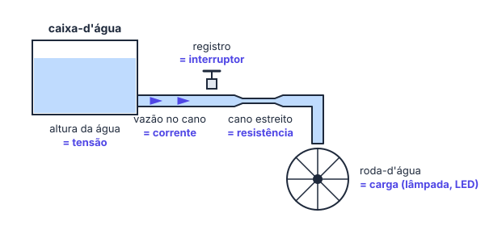
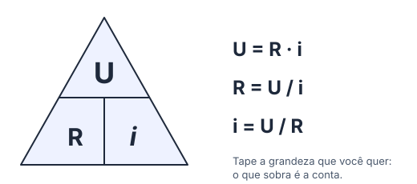
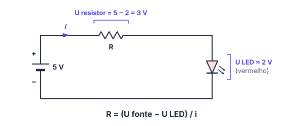

# 🔋 Tensão, corrente, resistência e Lei de Ohm

> [← Introdução à eletrônica](10-introducao-a-eletronica.md) · Próximo: [Circuitos em série e paralelo →](12-circuitos-serie-e-paralelo.md)

**Nível:** 🟢 Iniciante

> 📖 **Antes, leia:** [Introdução à eletrônica](10-introducao-a-eletronica.md). Você vai precisar de circuito fechado e dos prefixos (mA, kΩ).

## 🎯 Você vai aprender

- O que são **tensão**, **corrente** e **resistência**, e a unidade de cada uma.
- A analogia da **caixa-d'água**, para não confundir mais as três.
- A **Lei de Ohm** (U = R · i) nas três formas.
- Por que o **LED precisa de um resistor**, e como calcular o valor dele.
- Escolher um **valor comercial** de resistor.
- (ampliação) **Potência**: quanto um componente esquenta.

## Em uma frase

> 💡 A **tensão** empurra, a **resistência** segura e a **corrente** é o que consegue passar: **U = R · i**.

## 1. Tensão (U): o empurrão

**Tensão** é a diferença de potencial elétrico (**ddp**) entre dois pontos: a "vontade" que as cargas têm de ir de um ponto ao outro. Unidade: **volt (V)**.

- Tensão é sempre **entre dois pontos**: "a tensão da pilha" é a tensão entre o + e o −.
- Quanto maior a tensão, mais força para empurrar as cargas.

| Fonte | Tensão |
| ----- | ------ |
| Pilha AA ou AAA | 1,5 V |
| Bateria "quadrada" | 9 V |
| Porta USB e pino 5V do Arduino | 5 V |
| Tomada (corrente alternada) | 127 V ou 220 V |

**Pilhas em série somam as tensões:** 2 pilhas AA dão 2 × 1,5 = **3 V**; 4 pilhas dão 4 × 1,5 = **6 V**. É assim que o suporte de 4 pilhas do simulador mostra 6 V no multímetro.

> 💡 Muitos livros usam **V** tanto para a grandeza quanto para a unidade (V = 5 V). Aqui usamos **U** para a tensão, para não confundir.

## 2. Corrente (i): o que passa

**Corrente** é a quantidade de carga que passa por um ponto do fio a cada segundo. Unidade: **ampere (A)**. Na eletrônica, quase sempre em **miliampere (mA)**.

- Corrente **passa por** um componente: ela é medida no caminho, não entre dois pontos.
- No esquema, ela vai do **+** para o **−** por fora da fonte (sentido convencional).

| Situação | Corrente típica |
| -------- | --------------- |
| LED aceso | 5 a 20 mA |
| Pino do Arduino Uno | Até 20 mA recomendado (40 mA é o máximo absoluto) |
| Celular carregando | Cerca de 1 a 3 A |

## 3. Resistência (R): o que segura

**Resistência** é a dificuldade que o material oferece à passagem da corrente. Unidade: **ohm (Ω)**; muito usada em **kΩ**.

- Fio **fino e longo** resiste mais que fio **grosso e curto**; cobre resiste menos que ferro.
- A energia que "trava" na resistência vira **calor** (e, numa lâmpada de filamento, luz).
- O **resistor** é um componente feito para ter um valor exato de resistência. Ele serve para **limitar a corrente**. (O código de cores dele fica para a aula de componentes.)

## 4. A analogia da caixa-d'água

| Água | Eletricidade |
| ---- | ------------ |
| Altura da água na caixa (pressão) | **Tensão** (V) |
| Vazão: litros por segundo no cano | **Corrente** (A) |
| Cano estreito | **Resistência** (Ω) |
| Registro | **Interruptor** |
| Roda-d'água girando | **Carga** (lâmpada, LED, motor) |
| Bomba que leva a água de volta para a caixa | **Fonte** (a pilha "bombeia" as cargas de volta) |

Com a caixa mais alta (mais tensão), sai mais água (mais corrente). Com o cano mais estreito (mais resistência), sai menos. É exatamente o que a Lei de Ohm diz.

## 5. Lei de Ohm

> 💡 A tensão num resistor é a resistência vezes a corrente: **U = R · i**.

| Quero achar | Fórmula | Unidades |
| ----------- | ------- | -------- |
| Tensão | U = R · i | V = Ω · A |
| Resistência | R = U / i | Ω = V / A |
| Corrente | i = U / R | A = V / Ω |

> ⚠️ **Use unidades que combinam:** V, Ω e A. Se a corrente está em mA, converta para A antes (20 mA = 0,02 A). Ou use o atalho **kΩ com mA**: V = kΩ · mA.

**Exemplo 1: achar a corrente.** Um resistor de 1 kΩ está ligado a uma bateria de 9 V.

i = U / R = 9 / 1 000 = 0,009 A = **9 mA**

**Exemplo 2: achar a tensão.** Passam 12 mA por um resistor de 470 Ω.

U = R · i = 470 · 0,012 = **5,64 V**

**Exemplo 3: achar a resistência.** Com 3 V, um resistor deixa passar 25 mA.

R = U / i = 3 / 0,025 = **120 Ω**

**Proporção:** com o mesmo resistor, **dobrar a tensão dobra a corrente**. Com a mesma tensão, **dobrar a resistência corta a corrente pela metade**.

## 6. Por que o LED precisa de resistor

O LED é um diodo: só acende com a corrente no sentido certo (do ânodo para o cátodo). Depois que acende, a tensão nele fica quase fixa, a **tensão direta (U do LED)**. Qualquer tensão a mais faz a corrente subir muito rápido, e o LED queima em segundos.

> 💡 **O LED não segue a Lei de Ohm.** Por isso ele vai **em série com um resistor**: o LED fica com a tensão dele, o resistor fica com o resto, e a Lei de Ohm no resistor decide a corrente.

$$
R = \frac{U_{\text{fonte}} - U_{\text{LED}}}{i}
$$

Tensão direta típica de cada cor (confira no datasheet do seu LED):

| Cor | U do LED | Corrente de uso |
| --- | -------- | --------------- |
| Vermelho | ≈ 2,0 V (1,8 a 2,2) | 10 a 20 mA |
| Amarelo | ≈ 2,1 V | 10 a 20 mA |
| Verde (comum) | ≈ 2,2 V | 10 a 20 mA |
| Azul e branco | ≈ 3,0 V (2,8 a 3,4) | 10 a 20 mA |

> ⚠️ Talvez você veja a conta com **0,7 V**: essa é a queda de um **diodo comum de silício**, não de um LED. Para LED, use a tensão da cor dele.

**Exemplo 4: LED vermelho numa bateria de 9 V.** U do LED = 2 V e corrente desejada de 20 mA.

R = (9 − 2) / 0,02 = 7 / 0,02 = **350 Ω**

**Exemplo 5: LED azul no Arduino (5 V).** U do LED = 3 V e corrente de 15 mA.

R = (5 − 3) / 0,015 = 2 / 0,015 ≈ **133 Ω**

## 7. Valores comerciais

Ninguém vende resistor de 350 Ω: os fabricantes seguem uma tabela de valores. A mais comum é a **série E12**, com estes números multiplicados por 1, 10, 100, 1 000...

**10 · 12 · 15 · 18 · 22 · 27 · 33 · 39 · 47 · 56 · 68 · 82**

**Regra:** quando a conta não dá um valor da tabela, use o **próximo valor acima**. A corrente fica um pouco menor que a planejada, e o LED fica mais protegido.

| Conta deu | Use | Corrente com o valor comercial |
| --------- | --- | ------------------------------ |
| 350 Ω (Exemplo 4) | **390 Ω** | 7 / 390 ≈ 17,9 mA |
| 133 Ω (Exemplo 5) | **150 Ω** | 2 / 150 ≈ 13,3 mA |
| 215 Ω | **220 Ω** | |
| 1,4 kΩ | **1,5 kΩ** | |

> 💡 Com o Arduino (5 V) e LED vermelho, **220 Ω** e **330 Ω** são os clássicos: (5 − 2) / 220 ≈ 13,6 mA e (5 − 2) / 330 ≈ 9,1 mA. Os dois acendem bem e protegem o pino.

## 8. Potência (ampliação)

**Potência** é a energia que o componente transforma por segundo. Unidade: **watt (W)**. No resistor, ela vira calor.

| Fórmula | Use quando souber |
| ------- | ----------------- |
| P = U · i | Tensão e corrente |
| P = R · i² | Resistência e corrente |
| P = U² / R | Tensão e resistência |

Os resistores dos kits são de **1/4 W (0,25 W)**. Passou disso, eles esquentam demais e queimam.

**Exemplo 6:** o resistor de 390 Ω do Exemplo 4 fica com 7 V. P = U · i = 7 · (7 / 390) ≈ **0,13 W**, abaixo de 0,25 W: tudo certo.

**Exemplo 7:** um resistor de 10 Ω ligado direto nos 9 V. i = 9 / 10 = 0,9 A e P = 9 · 0,9 = **8,1 W**, mais de 30 vezes o limite: ele queima.

## 🔬 Mão na massa

1. No [Kit para Montar Circuito DC](https://phet.colorado.edu/pt_BR/simulations/circuit-construction-kit-dc), monte pilha, resistor e lâmpada. Ligue o **voltímetro** nas pontas do resistor e o **amperímetro** no caminho. Coloque uma segunda pilha em série: a corrente dobra?
2. Troque a pilha pela **bateria de 9 V** sem resistor e veja o que acontece com a lâmpada. Depois coloque um resistor e aumente o valor dele aos poucos.
3. No [Tinkercad Circuits](https://www.tinkercad.com/circuits) (grátis, precisa de conta), ponha 4 pilhas AA num suporte e meça a tensão com o multímetro. Depois acenda um LED vermelho com o resistor que você calcular para 20 mA.
4. No [laboratório do site](../laboratorio/experimentos/01-led-com-resistor/README.md), sem conta: meça a corrente do LED do Exemplo 4 e veja o que acontece com um resistor menor e sem resistor.

## ⚠️ Erros comuns

| Erro | Como evitar |
| ---- | ----------- |
| Usar mA direto com V e Ω | Converta para A (20 mA = 0,02 A) ou use kΩ com mA |
| Esquecer de tirar a tensão do LED | R = (U fonte − U LED) / i |
| Arredondar o resistor para baixo | Use o próximo valor comercial **acima** |
| Dizer que a tensão "passa" pelo componente | Tensão é **entre** dois pontos; corrente **passa por** |
| Ligar LED direto na bateria ou no pino | Sempre com resistor em série |

## 💡 Macetes

- **Triângulo:** tape a grandeza que você quer; o que sobra é a conta.
- **kΩ com mA dá V:** 2,2 kΩ com 3 mA dão 6,6 V, sem converter nada.
- **Confira o resultado:** corrente de LED fica entre 5 e 20 mA. Se deu 0,9 A, algo está errado.

## 🧾 Resumo

| Grandeza | O que é | Unidade |
| -------- | ------- | ------- |
| Tensão (U) | Empurrão entre dois pontos | volt (V) |
| Corrente (i) | Carga que passa por segundo | ampere (A), mA |
| Resistência (R) | Dificuldade para a corrente | ohm (Ω), kΩ |
| Lei de Ohm | U = R · i, R = U / i, i = U / R | |
| Resistor do LED | R = (U fonte − U LED) / i, depois o valor comercial acima | |
| Potência (ampliação) | P = U · i; resistor comum aguenta 0,25 W | watt (W) |

## ✅ Teste rápido

**1.** Quatro pilhas AA de 1,5 V em série fornecem qual tensão?

Ver resposta

**Grandeza:** `6 V`

4 × 1,5 = **6 V**

**2.** Um resistor de 2 kΩ está ligado a 10 V. Qual é a corrente?

Ver resposta

**Grandeza:** `5 mA`

i = U / R = 10 / 2 000 = 0,005 A = **5 mA** (ou, com o atalho, 10 V / 2 kΩ = 5 mA).

**3.** Qual resistência deixa passar 30 mA quando ligada a 4,5 V?

Ver resposta

**Grandeza:** `150 Ω`

R = U / i = 4,5 / 0,03 = **150 Ω**

**4.** Um LED vermelho (2 V, 15 mA) vai no pino de 5 V do Arduino. Qual é o resistor **calculado**?

Ver resposta

**Grandeza:** `200 Ω`

R = (5 − 2) / 0,015 = 3 / 0,015 = **200 Ω**

**5.** E qual **valor comercial** (série E12) você usaria no lugar dos 200 Ω?

Ver resposta

**Grandeza:** `220 Ω`

200 não está na série E12 (que tem 180 e 220): o próximo acima é **220 Ω**.

**6.** Converta 25 mA para ampere. Escreva só o número.

Ver resposta

**Número:** `0,025`

25 ÷ 1 000 = **0,025 A**

**7.** (ampliação) Um resistor de 100 Ω tem uma corrente de 0,05 A. Qual potência ele dissipa?

Ver resposta

**Grandeza:** `0,25 W`

P = R · i² = 100 · 0,05² = 100 · 0,0025 = **0,25 W**: exatamente o limite de um resistor comum de 1/4 W.

## ✏️ Agora pratique

São 9 exercícios sobre este assunto, do fácil ao difícil, com resolução passo a passo:

| 🟢 Fácil | 🟡 Intermediário | 🔴 Difícil |
| -------- | ---------------- | ---------- |
| [Exercícios 01 a 03](../exercicios/11-lei-de-ohm/facil.md) | [Exercícios 04 a 06](../exercicios/11-lei-de-ohm/intermediario.md) | [Exercícios 07 a 09](../exercicios/11-lei-de-ohm/dificil.md) |

## 📚 Referências

- BOYLESTAD, Robert L. *Introdução à análise de circuitos*. 12. ed. São Paulo: Pearson Prentice Hall, 2012. Capítulos 2 a 4.
- MCROBERTS, Michael. *Arduino básico*. 2. ed. São Paulo: Novatec, 2015. Capítulo 1 (resistor para LED).
- PhET Interactive Simulations. [Kit para Montar Circuito DC](https://phet.colorado.edu/pt_BR/simulations/circuit-construction-kit-dc). Universidade do Colorado em Boulder.
