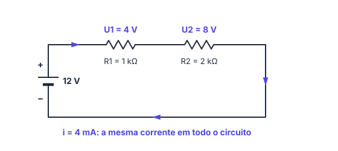
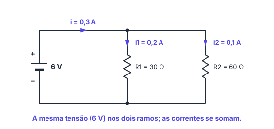
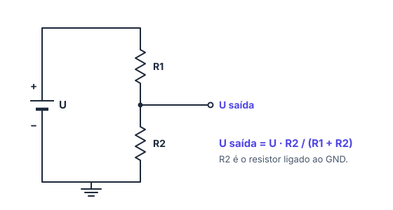
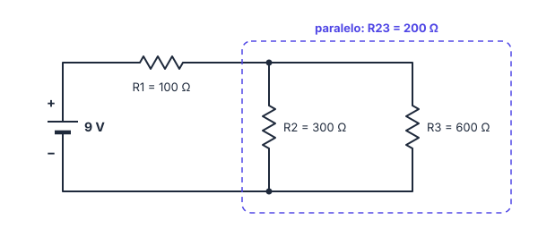
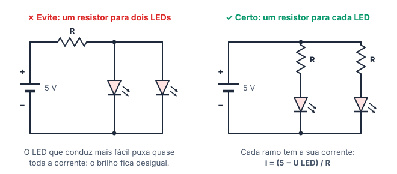

# 🔗 Circuitos em série e paralelo

> [← Tensão, corrente, resistência e Lei de Ohm](11-lei-de-ohm.md) · Próximo: [Protoboard, polaridade e medição →](13-protoboard-e-medicao.md)

**Nível:** 🟡 Intermediário

> 📖 **Antes, leia:** [Tensão, corrente, resistência e Lei de Ohm](11-lei-de-ohm.md). Você vai usar U = R · i o tempo todo.

## 🎯 Você vai aprender

- Reconhecer ligações em **série** e em **paralelo**, no desenho e no esquema.
- As regras de **tensão**, **corrente** e **resistência equivalente** de cada uma.
- Calcular a **resistência equivalente** (R eq).
- Usar o **divisor de tensão**, o circuito por trás do potenciômetro e do sensor de luz.
- Resolver **circuitos mistos** simples, por partes.
- Por que **cada LED em paralelo precisa do seu resistor**.

## Em uma frase

> 💡 Em **série**, a corrente é a mesma e a tensão se divide. Em **paralelo**, a tensão é a mesma e a corrente se divide.

## 1. Série: um caminho só

Os componentes ficam **um depois do outro**, e a corrente tem **um único caminho**. Se um deles abrir (queimar, soltar), **tudo para**, como nos pisca-piscas antigos de Natal.

| Grandeza | Regra |
| -------- | ----- |
| Corrente | A **mesma** em todos: i = i₁ = i₂ |
| Tensão | Se **divide**: U = U₁ + U₂ |
| Resistência equivalente | **Soma**: R eq = R₁ + R₂ |

**Exemplo 1:** bateria de 12 V com R₁ = 1 kΩ e R₂ = 2 kΩ em série.

| Passo | Conta | Resultado |
| ----- | ----- | --------- |
| R eq | 1 kΩ + 2 kΩ | **3 kΩ** |
| Corrente | i = 12 / 3 000 | **4 mA** (a mesma nos dois) |
| Tensão em R₁ | U₁ = 1 000 · 0,004 | **4 V** |
| Tensão em R₂ | U₂ = 2 000 · 0,004 | **8 V** |
| Conferência | 4 + 8 | 12 V ✓ |

> 💡 Em série, o **maior resistor fica com a maior parte da tensão**: R₂ é o dobro de R₁ e ficou com o dobro da tensão.

## 2. Paralelo: vários caminhos

Os componentes ficam **entre os mesmos dois pontos** (dois nós), cada um no seu ramo. Se um abrir, **os outros continuam**, como as lâmpadas e tomadas de uma casa.

| Grandeza | Regra |
| -------- | ----- |
| Tensão | A **mesma** em todos: U = U₁ = U₂ |
| Corrente | Se **divide**: i = i₁ + i₂ |
| Resistência equivalente | 1 / R eq = 1 / R₁ + 1 / R₂ |

Atalhos para a R eq:

| Caso | Fórmula |
| ---- | ------- |
| Dois resistores | R eq = (R₁ · R₂) / (R₁ + R₂), o "produto pela soma" |
| n resistores iguais a R | R eq = R / n |

> ⚠️ Em paralelo, a **R eq é sempre menor que o menor resistor**: cada ramo novo é mais um caminho para a corrente.

**Exemplo 2:** bateria de 6 V com R₁ = 30 Ω e R₂ = 60 Ω em paralelo.

| Passo | Conta | Resultado |
| ----- | ----- | --------- |
| Corrente em R₁ | 6 / 30 | **0,2 A** |
| Corrente em R₂ | 6 / 60 | **0,1 A** |
| Corrente total | 0,2 + 0,1 | **0,3 A** |
| R eq | (30 · 60) / (30 + 60) = 1 800 / 90 | **20 Ω** |
| Conferência | 6 / 20 | 0,3 A ✓ |

**Exemplo 3:** quatro resistores iguais de 40 Ω em paralelo numa fonte de 8 V.

R eq = 40 / 4 = **10 Ω**; cada ramo tem 8 / 40 = **0,2 A**; a fonte fornece 4 · 0,2 = **0,8 A** (ou 8 / 10).

## 3. Série × paralelo

| | Série | Paralelo |
| - | ----- | -------- |
| Caminhos | Um só | Um por componente |
| Corrente | Igual em todos | Se divide (soma) |
| Tensão | Se divide (soma) | Igual em todos |
| R eq | Soma: maior que todos | Menor que o menor |
| Se um abre | Tudo para | Os outros continuam |
| No dia a dia | Pilhas do controle remoto, pisca-pisca antigo | Tomadas e lâmpadas de casa |

## 4. Divisor de tensão

Dois resistores em **série** criam, no **ponto do meio**, uma tensão entre 0 e a da fonte:

$$
U_{\text{saída}} = U \cdot \frac{R_2}{R_1 + R_2}
$$

O R₂ é o resistor **ligado ao GND** (o de baixo no desenho).

**Exemplo 4:** 5 V com R₁ = 10 kΩ e R₂ = 10 kΩ: U saída = 5 · 10 / 20 = **2,5 V** (resistores iguais dividem ao meio). Com R₂ = 20 kΩ: U saída = 5 · 20 / 30 ≈ **3,33 V**.

> 💡 **Por que isso importa:** o **potenciômetro** é um divisor de tensão ajustável, e o **sensor de luz (LDR)** com um resistor forma um divisor cuja saída muda com a luz. O Arduino lê essa tensão e descobre a posição do botão ou a claridade do ambiente.

> ⚠️ A fórmula vale quando quase nenhuma corrente sai pelo ponto do meio. Uma entrada do Arduino quase não puxa corrente, então a conta funciona.

## 5. Circuito misto, por partes

Quando há série e paralelo juntos, resolva **de dentro para fora**: troque o que está claramente em paralelo (ou em série) pela R eq, redesenhe e repita.

**Exemplo 5:** bateria de 9 V; R₁ = 100 Ω em série com o paralelo de R₂ = 300 Ω e R₃ = 600 Ω.

| Passo | Conta | Resultado |
| ----- | ----- | --------- |
| Paralelo R₂ e R₃ | (300 · 600) / 900 | R₂₃ = **200 Ω** |
| R eq do circuito | 100 + 200 | **300 Ω** |
| Corrente da bateria | 9 / 300 | **30 mA** (passa toda por R₁) |
| Tensão em R₁ | 100 · 0,03 | **3 V** |
| Tensão no paralelo | 9 − 3 (ou 200 · 0,03) | **6 V** |
| Correntes nos ramos | 6 / 300 e 6 / 600 | **20 mA** e **10 mA** |
| Conferência | 20 + 10 | 30 mA ✓ |

## 6. LEDs em série e em paralelo

**Em série**, as tensões dos LEDs se **somam**, e um resistor só basta:

R = (U fonte − soma das U dos LEDs) / i

**Exemplo 6:** dois LEDs verdes (2,2 V cada) em série numa bateria de 9 V, a 15 mA.

R = (9 − 2 · 2,2) / 0,015 = 4,6 / 0,015 ≈ 307 Ω → comercial **330 Ω** → i = 4,6 / 330 ≈ **13,9 mA**.

Se um LED da fileira queimar (abrir), **todos apagam**. E a soma das tensões dos LEDs precisa ser **menor** que a da fonte: três LEDs vermelhos (6 V) não acendem com 5 V.

**Em paralelo**, cada LED fica com a mesma tensão, e **cada um precisa do seu resistor**:

| Com um resistor só para todos | Com um resistor por LED |
| ----------------------------- | ----------------------- |
| LEDs nunca são idênticos: o que conduz mais fácil puxa quase toda a corrente | Cada ramo tem a corrente calculada para ele |
| Brilho desigual; um pode queimar e jogar tudo no outro | Brilho igual; se um queimar, o outro continua igual |

**Exemplo 7:** dois ramos, cada um com resistor de 150 Ω e LED vermelho (2 V), ligados ao 5 V da placa. Cada ramo: (5 − 2) / 150 = **20 mA**. A fonte fornece 20 + 20 = **40 mA**.

## 🔬 Mão na massa

1. No [Kit para Montar Circuito DC](https://phet.colorado.edu/pt_BR/simulations/circuit-construction-kit-dc), monte duas lâmpadas em **série** e depois em **paralelo** na mesma pilha. Qual montagem deixa as lâmpadas mais fortes? Tire uma lâmpada de cada vez e veja o que acontece com a outra.
2. Use o **voltímetro** no ponto do meio de dois resistores em série (divisor de tensão) e confira a fórmula.
3. No [Tinkercad Circuits](https://www.tinkercad.com/circuits), ligue dois LEDs em paralelo numa bateria de 9 V, cada um com o resistor que você calcular, e meça a corrente total com o multímetro em série.
4. No laboratório do site, faça os experimentos [Série e paralelo](../laboratorio/experimentos/02-serie-e-paralelo/README.md) e [Divisor de tensão](../laboratorio/experimentos/03-divisor-de-tensao/README.md): as medidas têm que bater com as fórmulas desta aula.

## ⚠️ Erros comuns

| Erro | Como evitar |
| ---- | ----------- |
| Somar resistências em paralelo | Em paralelo, a R eq **diminui**: use o produto pela soma ou 1 / R eq |
| Esquecer de inverter no fim | Se 1 / R eq = 0,05, então R eq = 1 / 0,05 = 20 Ω (e não 0,05) |
| Achar que a corrente se divide em série | Em série ela é a **mesma**; quem se divide é a tensão |
| No divisor, pôr o resistor errado em cima da fração | No numerador vai o **R₂, o ligado ao GND** |
| Um resistor só para vários LEDs em paralelo | **Um resistor por LED** |

## 💡 Macetes

- **Dois iguais em paralelo:** metade do valor. **n iguais:** R / n.
- **Confira sempre:** em série, as tensões somam a da fonte; em paralelo, as correntes dos ramos somam a total.
- **Circuito misto:** comece pelo pedaço mais "fechado" (o paralelo) e vá trocando por R eq.

## 🧾 Resumo

| | Série | Paralelo |
| - | ----- | -------- |
| Corrente | Igual | Soma: i = i₁ + i₂ |
| Tensão | Soma: U = U₁ + U₂ | Igual |
| R eq | R₁ + R₂ | (R₁ · R₂) / (R₁ + R₂); R / n se iguais |
| Divisor de tensão | U saída = U · R₂ / (R₁ + R₂) | |
| LEDs | Somam as tensões; um resistor | Um resistor por LED |

## ✅ Teste rápido

**1.** Qual a resistência equivalente de 220 Ω e 330 Ω em **série**?

Ver resposta

**Grandeza:** `550 Ω`

Em série, soma: 220 + 330 = **550 Ω**

**2.** E a de 220 Ω e 330 Ω em **paralelo**?

Ver resposta

**Grandeza:** `132 Ω`

(220 · 330) / (220 + 330) = 72 600 / 550 = **132 Ω**, menor que o menor dos dois.

**3.** Três resistores de 1,5 kΩ estão em paralelo. Qual a resistência equivalente?

Ver resposta

**Grandeza:** `500 Ω`

Iguais em paralelo: R / n = 1 500 / 3 = **500 Ω**

**4.** Dois resistores **iguais** estão em série numa fonte de 6 V. Qual a tensão em cada um?

Ver resposta

**Grandeza:** `3 V`

A tensão se divide; como são iguais, metade para cada: **3 V**.

**5.** Uma bateria de 9 V alimenta dois ramos em paralelo, de 450 Ω e 900 Ω. Qual a corrente total?

Ver resposta

**Grandeza:** `30 mA`

9 / 450 = 20 mA e 9 / 900 = 10 mA. Total: 20 + 10 = **30 mA**.

**6.** Divisor de tensão em 9 V: R₁ = 2 kΩ em cima e R₂ = 1 kΩ ligado ao GND. Qual a tensão no ponto do meio?

Ver resposta

**Grandeza:** `3 V`

U saída = 9 · 1 / (2 + 1) = 9 / 3 = **3 V**

**7.** Numa fileira de LEDs ligados em **série**, um queima e abre. Os outros apagam? Responda sim ou não.

Ver resposta

**Resposta:** `sim`

Em série há um caminho só: com ele aberto, não passa corrente em nenhum LED.

## ✏️ Agora pratique

São 9 exercícios sobre este assunto, do fácil ao difícil, com resolução passo a passo:

| 🟢 Fácil | 🟡 Intermediário | 🔴 Difícil |
| -------- | ---------------- | ---------- |
| [Exercícios 01 a 03](../exercicios/12-serie-e-paralelo/facil.md) | [Exercícios 04 a 06](../exercicios/12-serie-e-paralelo/intermediario.md) | [Exercícios 07 a 09](../exercicios/12-serie-e-paralelo/dificil.md) |

## 📚 Referências

- BOYLESTAD, Robert L. *Introdução à análise de circuitos*. 12. ed. São Paulo: Pearson Prentice Hall, 2012. Capítulos 5 a 7.
- ALEXANDER, Charles K.; SADIKU, Matthew N. O. *Fundamentos de circuitos elétricos*. 5. ed. Porto Alegre: AMGH, 2013. Capítulo 2.
- PhET Interactive Simulations. [Kit para Montar Circuito DC](https://phet.colorado.edu/pt_BR/simulations/circuit-construction-kit-dc). Universidade do Colorado em Boulder.
