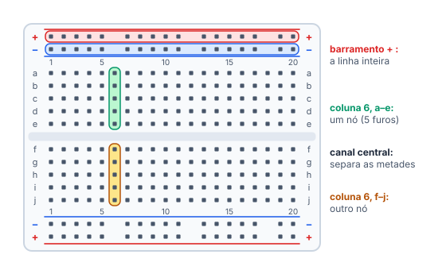
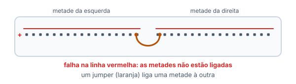
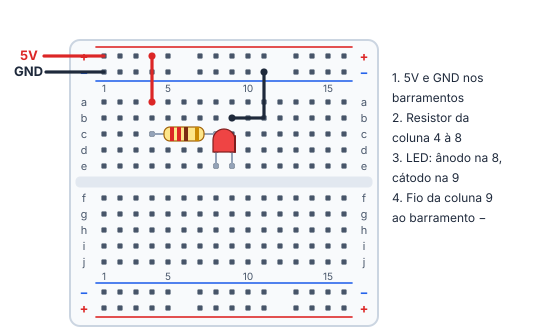
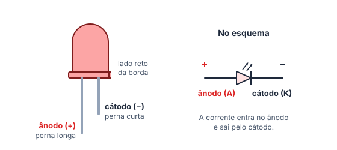
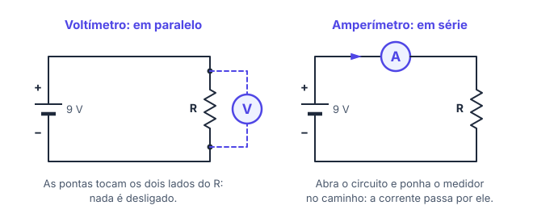

# 🧪 Protoboard, polaridade e medição

> [← Circuitos em série e paralelo](12-circuitos-serie-e-paralelo.md) · Próximo: [Componentes eletrônicos →](14-componentes-eletronicos.md)

**Nível:** 🟢 Iniciante

> 📖 **Antes, leia:** [Circuitos em série e paralelo](12-circuitos-serie-e-paralelo.md). Saber o que é ligar em série e em paralelo é o segredo da protoboard e do multímetro.

## 🎯 Você vai aprender

- Como a **protoboard** é ligada por dentro: tiras de 5 furos, canal central e barramentos.
- Montar um circuito **sem curto** e sem componente "pendurado".
- Achar a **polaridade** de LED, diodo, capacitor eletrolítico e bateria.
- Usar o **multímetro**: voltímetro em paralelo, amperímetro em série, ohmímetro com o circuito desligado e teste de continuidade.
- Ligar o **5V** e o **GND** do Arduino nos barramentos.
- **Achar defeitos** medindo tensões ao longo do caminho.

## Em uma frase

> 💡 Na protoboard, cada **coluna de 5 furos** é um fio só, e o canal do meio separa as metades. Tensão se mede **em paralelo**; corrente, **em série**.

## 1. Por dentro da protoboard

A **protoboard** (ou *breadboard*) é uma placa de furos com molas de metal por baixo. Você encaixa componentes e jumpers sem solda e desmonta quando quiser.

| Região | O que está ligado por dentro |
| ------ | ---------------------------- |
| **Área de trabalho, metade de cima** | Em cada coluna numerada, os 5 furos **a, b, c, d, e** formam um **nó** |
| **Área de trabalho, metade de baixo** | Em cada coluna, **f, g, h, i, j** formam **outro** nó |
| **Canal central** | Separa as metades: **e12 e f12 não estão ligados** |
| **Barramentos** (linhas + e −) | Cada linha é um nó **ao longo da placa**. Servem para levar o 5V e o GND para perto de tudo |

> ⚠️ **Barramento dividido:** em muitas protoboards grandes, os barramentos são **cortados no meio**: a linha vermelha ou azul tem uma falha no centro. As metades não estão ligadas até você pôr um jumper entre elas. Na dúvida, teste com o multímetro (seção 4).

## 2. Montando sem erro

| Regra | Por quê |
| ----- | ------- |
| As duas pernas de um componente ficam em **colunas diferentes** | Na mesma coluna, as duas pernas estão no mesmo nó: o componente fica em curto e nada passa por ele |
| Para ligar dois componentes **em série**, ponha uma perna de cada **na mesma coluna** | A coluna é o "fio" que une os dois |
| Leve o **5V** para o barramento **+** e o **GND** para o **−** | Assim qualquer ponto da placa alcança a alimentação com um jumper curto |
| Nunca ligue o **+** direto no **−** | É um curto-circuito |

**Exemplo 1: LED com resistor alimentado pelo 5V do Arduino**

| Passo | Ligação | Por quê |
| ----- | ------- | ------- |
| 1 | 5V → barramento **+**; GND → barramento **−** | Alimentação perto de tudo |
| 2 | Jumper do **+** à coluna 4; resistor de 220 Ω da coluna **4** à **8** | O resistor recebe o 5V |
| 3 | LED: **ânodo** na coluna 8, **cátodo** na coluna 9 | O ânodo fica no mesmo nó do resistor (série) |
| 4 | Jumper da coluna 9 ao barramento **−** | Fecha o caminho de volta ao GND |

Corrente no LED vermelho: (5 − 2) / 220 ≈ **13,6 mA**, dentro do recomendado.

## 3. Polaridade: quem tem lado certo

| Componente | Tem polaridade? | Como saber o lado |
| ---------- | --------------- | ----------------- |
| Resistor | Não | Qualquer lado |
| **LED** | Sim | Perna **longa** = ânodo (+). Perna **curta** e lado **reto** da borda = cátodo (−) |
| Diodo | Sim | A **faixa** pintada marca o cátodo (−) |
| Capacitor eletrolítico | Sim | A faixa com sinais de **−** marca o negativo; a perna longa é o + |
| Capacitor cerâmico | Não | Qualquer lado |
| Pilha e bateria | Sim | Marcadas com + e − |

> ⚠️ **LED ao contrário não acende** e, com até uns 5 V invertidos, normalmente não estraga. Já o **capacitor eletrolítico invertido** pode estufar e estourar: confira sempre a faixa.

## 4. O multímetro

O multímetro mede tensão, corrente e resistência. Cada medida tem um **jeito certo de ligar**, e ele vem direto da aula de série e paralelo:

| Medida | Seletor | Como ligar | Cuidado |
| ------ | ------- | ---------- | ------- |
| **Tensão** (voltímetro) | V com traço reto (V⎓) | Em **paralelo**: uma ponta de cada lado do que você quer medir | Escala acima do esperado (20 V para uma bateria de 9 V) |
| **Corrente** (amperímetro) | A⎓ ou mA | Em **série**: abra o circuito e ponha o multímetro no caminho | Ponta vermelha no borne de **A/mA**. **Nunca em paralelo**: vira um curto e queima o fusível do aparelho |
| **Resistência** (ohmímetro) | Ω | Nas pernas do componente, com o circuito **desligado** | De preferência, com o componente fora do circuito |
| **Continuidade** | Símbolo de som | Nos dois pontos que você quer testar | Apita se estão ligados: ótimo para achar fio partido e barramento dividido |

> 💡 **Para lembrar:** tensão é **entre** dois pontos, então o voltímetro toca os dois pontos (paralelo). Corrente **passa por** um fio, então ela precisa passar pelo amperímetro (série).

**Exemplo 2:** bateria de 9 V com R₁ = 1 kΩ e R₂ = 2 kΩ em série.

| Medida | Onde ligar | O multímetro mostra |
| ------ | ---------- | ------------------- |
| Tensão em R₂ | Pontas nos dois lados de R₂ | 2 kΩ · 3 mA = **6 V** |
| Corrente | No lugar de um fio do caminho | 9 V / 3 kΩ = **3 mA** |

## 5. Arduino na protoboard

- Ligue o pino **5V** no barramento **+** e um pino **GND** no **−**. O Arduino tem vários pinos GND, e todos estão ligados entre si.
- O 5V da placa alimenta LEDs e sensores. Os **pinos digitais** são outra história: cada um aguenta só uns **20 mA** (próximas aulas).
- **5V encostado no GND é curto.** A placa tem um fusível rearmável na USB, mas não conte com ele: confira antes de ligar o cabo.

## 6. Achando defeitos com o voltímetro

Quando algo não funciona, **meça a tensão em cada componente do caminho**, com o circuito ligado:

| O que você mede | O que significa |
| --------------- | --------------- |
| **0 V no resistor** | Não passa corrente (U = R · i = 0): o caminho está aberto ou bloqueado em algum lugar |
| **Toda a tensão da fonte num componente só** | O caminho está aberto ou bloqueado **nele**: fio solto, LED invertido ou queimado |
| **≈ 2 V no LED vermelho e o resto no resistor** | Tudo certo: há corrente |

**Exemplo 3:** um LED com resistor no 5V não acende. O voltímetro mostra **0 V no resistor** e **5 V no LED**. Sem corrente no resistor, e a tensão toda parada no LED: o LED está **invertido** (ou queimado). Vire o LED e meça de novo: deve dar uns 3 V no resistor.

## 7. Boas práticas e segurança (ampliação)

- **Monte desligado:** tire a USB ou a bateria, confira as ligações e só então ligue.
- **Cores:** vermelho para o +, preto para o GND. Fica muito mais fácil revisar.
- **Fios curtos e rentes à placa:** fio longo enrosca, solta e esconde erros.
- **Esquentou? Desligue na hora.** Calor quase sempre é curto ou falta de resistor.
- A protoboard é para **baixa tensão e baixa corrente**. Nada de tomada.

## 🔬 Mão na massa

No [Tinkercad Circuits](https://www.tinkercad.com/circuits) (grátis, precisa de conta):

1. Ponha uma protoboard e passe o mouse sobre os furos: o simulador destaca os que estão ligados. Confira as colunas, o canal e os barramentos.
2. Monte o **Exemplo 1** com uma bateria de 9 V no lugar do Arduino. Calcule o resistor para 15 mA antes.
3. Meça com o multímetro: a tensão no LED e no resistor (em paralelo) e a corrente (em série). As tensões somam 9 V?
4. Inverta o LED e meça de novo, como no Exemplo 3.

## ⚠️ Erros comuns

| Erro | Como evitar |
| ---- | ----------- |
| As duas pernas do componente na mesma coluna | Cada perna numa coluna diferente |
| Fio de volta do lado errado do canal | Confira: a–e e f–j da mesma coluna **não** estão ligados |
| Circuito na outra metade de um barramento dividido | Ponha um jumper entre as metades ou teste com continuidade |
| Amperímetro em paralelo | Amperímetro vai **no caminho** (série) |
| Medir resistência com o circuito ligado | Desligue antes |

## 💡 Macetes

- **Coluna = nó.** Para ver o circuito, pense em cada coluna como um ponto do esquema.
- **Não funciona? Meça antes de trocar peças:** a tensão em cada componente diz onde o caminho parou.
- **Continuidade antes de ligar:** um bipe entre + e − é curto. Conserte antes de pôr energia.

## 🧾 Resumo

| Ideia | Em poucas palavras |
| ----- | ------------------ |
| Protoboard | Coluna de 5 furos = um nó; canal separa a–e de f–j; barramentos levam 5V e GND |
| Montagem | Pernas em colunas diferentes; série = compartilhar coluna; nunca + no − |
| Polaridade | LED: perna longa = +; diodo: faixa = −; eletrolítico: faixa com − |
| Voltímetro | Em paralelo, com o circuito ligado |
| Amperímetro | Em série, no caminho; nunca em paralelo |
| Ohmímetro e continuidade | Com o circuito desligado |
| Defeito | Meça a tensão em cada componente: onde a tensão "para", está o problema |

## ✅ Teste rápido

**1.** Na protoboard, os furos **a12** e **c12** estão ligados? Responda sim ou não.

Ver resposta

**Resposta:** `sim`

Os dois estão na coluna 12, metade de cima (a–e): mesmo nó.

**2.** E os furos **e12** e **f12**?

Ver resposta

**Resposta:** `não`

O canal central separa a metade de cima (a–e) da de baixo (f–j).

**3.** E os furos **a12** e **a13**?

Ver resposta

**Resposta:** `não`

Colunas diferentes são nós diferentes, mesmo na mesma letra.

**4.** A perna mais longa do LED é o ânodo ou o cátodo?

Ver resposta

**Resposta:** `ânodo | anodo | positivo | +`

Perna **longa** = **ânodo** (+). Ela vai do lado do resistor que vem do 5V.

**5.** Para medir a corrente de um LED, o amperímetro vai em série ou em paralelo?

Ver resposta

**Resposta:** `série | em série`

A corrente precisa **passar pelo** amperímetro: ele entra no caminho, em série.

**6.** Para medir a tensão de uma pilha, o voltímetro vai em série ou em paralelo?

Ver resposta

**Resposta:** `paralelo | em paralelo`

Tensão é **entre** dois pontos: uma ponta em cada polo da pilha.

**7.** As duas pernas de um resistor foram parar na mesma coluna (as duas entre a e e). Passa corrente por ele? Responda sim ou não.

Ver resposta

**Resposta:** `não`

As duas pernas estão no mesmo nó: não há diferença de tensão entre elas, e a corrente segue pela coluna sem passar pelo resistor.

## ✏️ Agora pratique

São 9 exercícios sobre este assunto, do fácil ao difícil, com resolução passo a passo:

| 🟢 Fácil | 🟡 Intermediário | 🔴 Difícil |
| -------- | ---------------- | ---------- |
| [Exercícios 01 a 03](../exercicios/13-protoboard/facil.md) | [Exercícios 04 a 06](../exercicios/13-protoboard/intermediario.md) | [Exercícios 07 a 09](../exercicios/13-protoboard/dificil.md) |

## 📚 Referências

- MCROBERTS, Michael. *Arduino básico*. 2. ed. São Paulo: Novatec, 2015. Capítulo 1 (protoboard e LED).
- BOYLESTAD, Robert L. *Introdução à análise de circuitos*. 12. ed. São Paulo: Pearson Prentice Hall, 2012. Seções sobre voltímetro, amperímetro e ohmímetro (capítulos 2 a 4).
- [Tinkercad Circuits](https://www.tinkercad.com/circuits): protoboard e multímetro no navegador.
