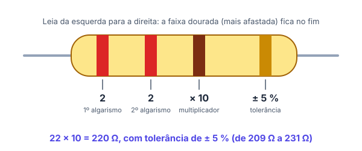
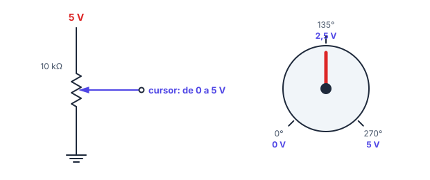
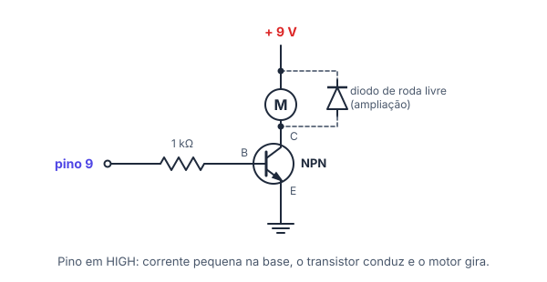
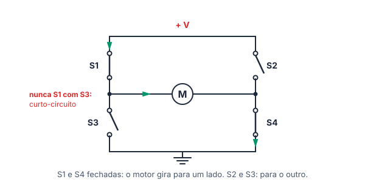

# 🧩 Componentes eletrônicos

> [← Protoboard, polaridade e medição](13-protoboard-e-medicao.md) · Próximo: [Arduino Uno →](15-arduino-uno.md)

**Nível:** 🟡 Intermediário

> 📖 **Antes, leia:** [Protoboard, polaridade e medição](13-protoboard-e-medicao.md). Você vai usar o divisor de tensão da [aula 12](12-circuitos-serie-e-paralelo.md) para entender o potenciômetro e o LDR.

## 🎯 Você vai aprender

- Ler o **código de cores** do resistor, de 4 e de 5 faixas.
- Como funcionam o **potenciômetro**, o **LDR** (sensor de luz) e o **botão de 4 pinos**.
- O que são o **LED RGB** e o **buzzer**.
- Para que servem o **capacitor** e o **diodo** (visão geral).
- Usar o **transistor como chave** para ligar um motor, e a **ponte H** para inverter o sentido dele.

## Em uma frase

> 💡 Cada componente faz **uma coisa só** com a corrente: limitar (resistor), variar (potenciômetro, LDR), ligar e desligar (botão, transistor), mostrar (LED) ou soar (buzzer).

## 1. Código de cores do resistor

O valor do resistor vem pintado em **faixas coloridas**. Leia da esquerda para a direita, com a faixa **dourada ou prateada** (a mais afastada) no fim.

| Cor | Algarismo | Multiplicador | Tolerância |
| --- | --------- | ------------- | ---------- |
| Preto | 0 | × 1 | |
| Marrom | 1 | × 10 | ± 1 % |
| Vermelho | 2 | × 100 | ± 2 % |
| Laranja | 3 | × 1 000 | |
| Amarelo | 4 | × 10 000 | |
| Verde | 5 | × 100 000 | ± 0,5 % |
| Azul | 6 | × 1 000 000 | ± 0,25 % |
| Violeta | 7 | × 10 000 000 | ± 0,1 % |
| Cinza | 8 | | ± 0,05 % |
| Branco | 9 | | |
| Dourado | | × 0,1 | ± 5 % |
| Prateado | | × 0,01 | ± 10 % |

| Faixas | 1ª | 2ª | 3ª | 4ª | 5ª |
| ------ | -- | -- | -- | -- | -- |
| **4 faixas** (o mais comum) | algarismo | algarismo | multiplicador | tolerância | |
| **5 faixas** (precisão) | algarismo | algarismo | algarismo | multiplicador | tolerância |

**Exemplo 1:**

| Faixas | Conta | Valor |
| ------ | ----- | ----- |
| vermelho, vermelho, marrom, dourado | 22 × 10 | **220 Ω** ± 5 % |
| marrom, preto, laranja, dourado | 10 × 1 000 | **10 kΩ** ± 5 % |
| amarelo, violeta, vermelho, dourado | 47 × 100 | **4,7 kΩ** ± 5 % |
| marrom, preto, preto, vermelho, marrom (5 faixas) | 100 × 100 | **10 kΩ** ± 1 % |

**Tolerância** é o quanto o valor real pode variar: um resistor de 220 Ω ± 5 % pode ter de 209 Ω a 231 Ω (5 % de 220 é 11).

> 💡 **Macete:** de **vermelho (2)** a **violeta (7)**, os algarismos seguem as cores do **arco-íris**: vermelho, laranja, amarelo, verde, azul, violeta. Antes vêm preto (0) e marrom (1); depois, cinza (8) e branco (9).

## 2. Potenciômetro

O **potenciômetro** é um resistor com **três terminais**: as duas pontas (com a resistência total, como 10 kΩ) e o **cursor**, no meio, que desliza quando você gira o eixo.

- Ligado como **divisor de tensão** (pontas no 5 V e no GND), o cursor dá uma tensão de **0 a 5 V**, conforme o giro. É assim que o Arduino lê um botão de volume.
- Num potenciômetro linear que gira 270°, a tensão no cursor é proporcional ao ângulo: U = 5 · ângulo / 270.

**Exemplo 2:** potenciômetro de 10 kΩ entre 5 V e GND, girado até 135° (metade do curso). U = 5 · 135 / 270 = **2,5 V**.

## 3. LDR: o sensor de luz

O **LDR** (*Light Dependent Resistor*) é um resistor cuja resistência **cai quando bate luz**:

| Ambiente | Resistência típica |
| -------- | ------------------ |
| Escuro | Centenas de kΩ a 1 MΩ |
| Sala iluminada | Cerca de 10 a 20 kΩ |
| Luz forte | Cerca de 1 kΩ |

Sozinho, ele não "fala" com o Arduino: é preciso montá-lo num **divisor de tensão** com um resistor fixo, como no exercício 09 da [aula 12](../exercicios/12-serie-e-paralelo/dificil.md). É o que acende sozinho o poste da rua quando escurece.

## 4. Botão de 4 pinos (push button)

O botão comum de protoboard tem **4 pinos**, mas só **2 contatos**: os pinos alinhados de cada lado estão **sempre ligados** entre si. Apertar liga um lado ao outro.

- Na protoboard, encaixe o botão **atravessando o canal central**, com A e B numa metade e C e D na outra.
- Girado 90°, ele pode ficar com os pinos que já estão ligados em colunas diferentes: aí ele age como um fio, **sempre ligado**.
- Ligar o botão ao Arduino pede um resistor de *pull-down* ou o *pull-up* interno: fica para a aula de entradas digitais.

## 5. LED RGB e buzzer

| Componente | Como funciona | Cuidados |
| ---------- | ------------- | -------- |
| **LED RGB** | Três LEDs (vermelho, verde e azul) numa peça só, com **4 pernas**. Misturando os três, você faz outras cores | **Cátodo comum**: a perna mais longa vai no GND. **Ânodo comum**: vai no +. Cada cor precisa do **seu resistor** |
| **Buzzer ativo** | Tem um oscilador dentro: com tensão, apita sozinho | Tem polaridade (perna longa no +) |
| **Buzzer passivo** | É um alto-falante pequeno: precisa de um sinal que liga e desliga muitas vezes por segundo (no Arduino, a função `tone`) | Mudando a frequência do sinal, muda a nota |

## 6. Capacitor e diodo (visão geral)

| Componente | O que faz | Analogia | Onde aparece |
| ---------- | --------- | -------- | ------------ |
| **Capacitor** | Guarda carga por pouco tempo e a devolve depois. Unidade: **farad (F)**, quase sempre em µF ou nF | Uma caixinha-d'água que enche e esvazia rápido | Estabilizar a alimentação, filtrar ruído, suavizar o sinal de um botão |
| **Diodo** | Deixa a corrente passar **num sentido só**, com uma queda de uns **0,7 V** (silício) | Uma válvula que só abre para um lado | Proteger contra pilha invertida; proteger o transistor de um motor |

O **LED** é um diodo que acende: por isso ele também só funciona num sentido.

## 7. Transistor como chave

Um pino do Arduino fornece no máximo uns **20 mA**. Um motor pequeno pede **100 a 500 mA**. Ligar o motor direto no pino queima o pino. A solução é o **transistor**: uma chave que uma corrente **pequena** controla e que deixa passar uma corrente **grande**.

| Terminal | Papel no NPN como chave |
| -------- | ----------------------- |
| **Base (B)** | Entrada de controle: recebe a corrente pequena do pino, por um resistor |
| **Coletor (C)** | Por onde entra a corrente grande, que vem da carga (o motor) |
| **Emissor (E)** | Por onde sai tudo, para o GND |

A corrente que sai pelo emissor é a soma das outras duas: **i E = i B + i C**.

- Pino em **HIGH**: entra uma corrente pequena na base, o transistor **conduz** e o motor gira.
- Pino em **LOW**: sem corrente na base, o transistor **corta** e o motor para.
- (ampliação) Num transistor de ganho **β = 100**, a corrente do coletor é até 100 vezes a da base: para 200 mA no motor, bastam 2 mA na base.
- (ampliação) O **diodo de roda livre**, ao lado do motor, protege o transistor do pico de tensão que o motor gera ao desligar.

## 8. Ponte H: motor para os dois lados

Para o motor girar ao contrário, a corrente precisa passar por ele **no outro sentido**. A **ponte H** faz isso com 4 chaves (na prática, 4 transistores) em volta do motor, no formato de um H:

| Chaves fechadas | A corrente no motor | O motor |
| --------------- | ------------------- | ------- |
| S1 e S4 | Da esquerda para a direita | Gira para um lado |
| S2 e S3 | Da direita para a esquerda | Gira para o outro |
| S1 e S3 (ou S2 e S4) | Não passa pelo motor | **Curto-circuito**: nunca faça isso |

Na prática, você usa um **módulo de ponte H** pronto (como o L298N ou o L9110S): o Arduino só diz o sentido e o módulo fecha as chaves certas.

## 🔬 Mão na massa

No [Tinkercad Circuits](https://www.tinkercad.com/circuits):

1. Ponha um resistor e mude o valor dele no painel: as faixas mudam de cor. Monte 220 Ω, 1 kΩ e 4,7 kΩ e confira com a tabela.
2. Ligue um potenciômetro entre 5 V e GND e meça o cursor com o multímetro enquanto gira.
3. Monte um LDR num divisor com um resistor de 10 kΩ e mude a luz no simulador: a tensão no meio sobe ou desce?
4. Monte o transistor com o motor da seção 7, ligando a base a uma bateria pelo resistor. Meça a corrente da base e a do motor.

## ⚠️ Erros comuns

| Erro | Como evitar |
| ---- | ----------- |
| Ler o resistor de trás para frente | A faixa dourada ou prateada fica no **fim** |
| Esquecer o multiplicador | Vermelho, vermelho, marrom é 22 **× 10** = 220 Ω, e não 221 |
| Botão girado 90° na protoboard | Atravesse o canal, com os pinos do mesmo lado em colunas diferentes |
| Motor ligado direto no pino | Use um transistor (ou um módulo de ponte H) |
| Fechar S1 e S3 da ponte H juntas | Isso é curto: só diagonais (S1 e S4, ou S2 e S3) |

## 💡 Macetes

- **Resistor de 220 Ω** é vermelho, vermelho, marrom. **10 kΩ** é marrom, preto, laranja. Os dois mais usados com Arduino.
- **Potenciômetro e LDR** são resistores que mudam: ligados num divisor, viram uma tensão que o Arduino lê.
- **Pino do Arduino não é fonte de força:** só dá ordem. Quem fornece a corrente grande é a fonte, através do transistor.

## 🧾 Resumo

| Componente | Ideia principal |
| ---------- | --------------- |
| Resistor | Algarismo, algarismo, multiplicador, tolerância |
| Potenciômetro | Divisor ajustável: o cursor dá de 0 V até a tensão da fonte |
| LDR | Mais luz, menos resistência; precisa de um divisor |
| Botão de 4 pinos | Pares sempre ligados; apertar liga um par ao outro |
| LED RGB e buzzer | Três LEDs numa peça; buzzer ativo apita sozinho, o passivo precisa de `tone` |
| Capacitor e diodo | Guarda carga; deixa passar num sentido só |
| Transistor | Chave controlada pela base: i E = i B + i C |
| Ponte H | Diagonais de chaves invertem o motor |

## ✅ Teste rápido

**1.** Qual o valor do resistor **vermelho, vermelho, marrom**?

Ver resposta

**Grandeza:** `220 Ω`

Vermelho (2), vermelho (2), marrom (× 10): 22 × 10 = **220 Ω**

**2.** E do resistor **marrom, preto, laranja**?

Ver resposta

**Grandeza:** `10 kΩ`

Marrom (1), preto (0), laranja (× 1 000): 10 × 1 000 = 10 000 Ω = **10 kΩ**

**3.** E do resistor **amarelo, violeta, vermelho, dourado**?

Ver resposta

**Grandeza:** `4,7 kΩ`

Amarelo (4), violeta (7), vermelho (× 100): 47 × 100 = 4 700 Ω = **4,7 kΩ**

**4.** Qual é a tolerância de um resistor com a faixa dourada? Escreva só o número (em %).

Ver resposta

**Número:** `5`

Dourado na última faixa = **± 5 %**

**5.** Um potenciômetro de 10 kΩ está entre 5 V e GND, com o cursor na metade do curso. Qual a tensão no cursor?

Ver resposta

**Grandeza:** `2,5 V`

Na metade do curso, o cursor divide a tensão ao meio: **2,5 V**.

**6.** Quando bate mais luz no LDR, a resistência dele aumenta ou diminui?

Ver resposta

**Resposta:** `diminui | cai`

Mais luz, **menos** resistência: de centenas de kΩ no escuro até cerca de 1 kΩ na luz forte.

**7.** Para fazer um motor DC girar nos dois sentidos, usa-se: (a) um resistor, (b) uma ponte H ou (c) um LDR? Responda com a letra.

Ver resposta

**Resposta:** `b`

A **ponte H** inverte o sentido da corrente no motor fechando chaves em diagonal.

## ✏️ Agora pratique

São 9 exercícios sobre este assunto, do fácil ao difícil, com resolução passo a passo:

| 🟢 Fácil | 🟡 Intermediário | 🔴 Difícil |
| -------- | ---------------- | ---------- |
| [Exercícios 01 a 03](../exercicios/14-componentes/facil.md) | [Exercícios 04 a 06](../exercicios/14-componentes/intermediario.md) | [Exercícios 07 a 09](../exercicios/14-componentes/dificil.md) |

## 📚 Referências

- MCROBERTS, Michael. *Arduino básico*. 2. ed. São Paulo: Novatec, 2015. Capítulos 1 a 4 (LED, resistor, potenciômetro, botão e buzzer).
- MONK, Simon. *Programação com Arduino: começando com sketches*. 2. ed. Porto Alegre: Bookman, 2017.
- BOYLESTAD, Robert L.; NASHELSKY, Louis. *Dispositivos eletrônicos e teoria de circuitos*. 11. ed. São Paulo: Pearson, 2013. Capítulos sobre diodos e transistores bipolares.
