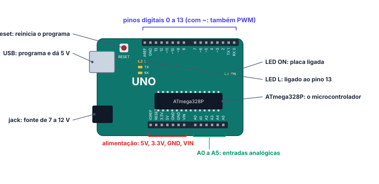

# 🤖 Arduino Uno

> [← Componentes eletrônicos](14-componentes-eletronicos.md) · Próximo: [Programação Arduino em C/C++ →](16-programacao-arduino.md)

**Nível:** 🟢 Iniciante

> 📖 **Antes, leia:** [Protoboard, polaridade e medição](13-protoboard-e-medicao.md). Você vai ligar a placa na protoboard e precisa saber onde ficam o 5V e o GND.

## 🎯 Você vai aprender

- O que é um **microcontrolador** e como ele é diferente de um computador.
- O que forma a **plataforma Arduino**: placa, IDE, linguagem e comunidade.
- As **placas** mais comuns e quando usar cada uma.
- A **anatomia do Uno**: pinos digitais, analógicos, PWM, alimentação, LED L e reset.
- Os **limites elétricos** que não deixam a placa queimar.
- O caminho do código até a placa: **IDE**, placa, porta, verificar e carregar.
- Onde treinar sem ter a placa: os **simuladores**.

## Em uma frase

> 💡 O Arduino é um **computador pequeno num chip só**: ele lê sensores, decide e liga coisas, repetindo o mesmo programa para sempre.

## 1. Microcontrolador × computador

Um **microcontrolador** junta num único chip o processador, a memória e os **pinos de entrada e saída**, que vão direto em LEDs, botões e sensores.

| | Notebook | Arduino Uno (ATmega328P) |
| - | -------- | ------------------------ |
| Velocidade | Bilhões de ciclos por segundo (GHz) | **16 milhões** por segundo (16 MHz) |
| Memória de programa | Disco de centenas de GB | **32 KB** de memória flash |
| Memória para variáveis | Vários GB de RAM | **2 KB** de SRAM |
| Sistema operacional | Windows, Linux, macOS | Nenhum: roda **um programa só** |
| Liga direto em LED e botão? | Não | **Sim**, pelos pinos |
| Gasto de energia | Dezenas de watts | Menos de meio watt |

> 💡 **Ligação com a primeira parte:** dentro do ATmega328P, os pinos são bits de registradores. Ligar o pino 8 é pôr um bit em 1, como você vai ver na aula de saídas digitais.

## 2. A plataforma Arduino

O Arduino nasceu em 2005, no Interaction Design Institute Ivrea, na Itália: um grupo (Massimo Banzi, David Cuartielles, Tom Igoe, Gianluca Martino e David Mellis) queria uma placa **barata e fácil** para quem nunca tinha programado eletrônica.

| Parte | O que é |
| ----- | ------- |
| **Placas** | Oficiais e compatíveis, de vários tamanhos |
| **IDE** | O programa onde você escreve o código e manda para a placa |
| **Linguagem** | C/C++ com funções prontas (`pinMode`, `digitalWrite`, `delay`...) |
| **Arduino Cloud** | Versão on-line da IDE e painéis para projetos conectados |
| **Comunidade** | Milhares de bibliotecas, tutoriais e projetos abertos |

**Hardware aberto.** Os desenhos das placas oficiais são publicados sob a licença **CC BY-SA** (Creative Commons, Atribuição e Compartilha Igual): qualquer um pode copiar e adaptar, até para vender, desde que dê o crédito e publique as mudanças com a mesma licença. Por isso existem tantas placas **compatíveis**, de outros fabricantes. O nome **Arduino**, porém, é marca registrada: as compatíveis usam outros nomes.

## 3. As placas mais comuns

| Placa | Pinos digitais | Pinos analógicos | Memória | Quando usar |
| ----- | -------------- | ---------------- | ------- | ----------- |
| **Uno R3** | 14 (6 com PWM) | 6 | 32 KB | **Para começar**: é a desta disciplina |
| Mega 2560 | 54 | 16 | 256 KB | Projetos com muitos sensores e motores |
| Nano | 14 | 8 | 32 KB | O Uno em miniatura: encaixa na protoboard |
| Pro Mini | 14 | 8 | 32 KB | Projetos finais pequenos (sem USB na placa) |
| Leonardo | 20 | 12 | 32 KB | Pode se passar por **teclado ou mouse** no computador |
| LilyPad | 14 | 6 | 32 KB | Redonda, para **costurar em roupas** |
| Uno R4 WiFi | 14 | 6 | 256 KB | **Wi-Fi** e uma matriz de LEDs na placa |
| Nano 33 IoT | 14 | 8 | 256 KB | **Wi-Fi e Bluetooth** num formato pequeno |

## 4. A anatomia do Uno

| Parte | Para que serve |
| ----- | -------------- |
| **Pinos digitais 0 a 13** | Entrada ou saída: **HIGH** (5 V) ou **LOW** (0 V) |
| **Pinos com ~** (3, 5, 6, 9, 10 e 11) | Além de digitais, fazem **PWM**: um "meio ligado" para controlar brilho (aula de PWM) |
| **Pinos 0 (RX) e 1 (TX)** | São a **comunicação serial** com o computador: evite usá-los para LEDs |
| **A0 a A5** | **Entradas analógicas**: leem tensões de 0 a 5 V (também funcionam como digitais) |
| **5V e 3.3V** | Fornecem tensão para sensores e LEDs |
| **GND** | Vários pinos, todos ligados entre si: o 0 V do circuito |
| **VIN** | Entrada para uma fonte externa (a mesma do jack) |
| **USB** | Programa a placa e dá 5 V para ela |
| **Jack** | Fonte externa de **7 a 12 V** |
| **LED L** | Um LED já ligado ao **pino 13** (no código, `LED_BUILTIN`) |
| **LED ON** | Aceso quando a placa está ligada |
| **Reset** | Reinicia o programa do começo |

## 5. Limites que não se pode passar

| Limite | Valor | O que acontece se passar |
| ------ | ----- | ------------------------ |
| Corrente por pino | **20 mA** recomendado, **40 mA** no máximo absoluto | O pino (ou o chip todo) queima |
| Soma das correntes dos pinos | Até **200 mA** no chip | O chip esquenta e pode queimar |
| Tensão num pino | De **0 a 5 V** | Mais que 5 V num pino estraga a entrada |
| Fonte no jack ou no VIN | **7 a 12 V** recomendado | Abaixo, a placa fica instável; acima, o regulador esquenta |

> ⚠️ **O pino dá ordens, não força.** Um LED com resistor (uns 15 mA) tudo bem. Motor, fita de LED ou alto-falante grande precisam de um **transistor** ou de um módulo, como na aula de componentes.

## 6. Do código à placa

O programa do Arduino se chama **sketch** e fica num arquivo `.ino`, dentro de uma pasta com o mesmo nome.

| Passo | Na IDE do Arduino |
| ----- | ----------------- |
| 1 | Instale a IDE (gratuita, em [arduino.cc](https://www.arduino.cc/en/software)) |
| 2 | Ligue a placa no USB: o **LED ON** acende |
| 3 | Escolha a placa (**Arduino Uno**) e a **porta** (COM3 no Windows, `/dev/ttyACM0` no Linux...) |
| 4 | Abra um exemplo: **Arquivo → Exemplos → 01.Basics → Blink** |
| 5 | **Verificar** (✓): compila e mostra os erros, sem mandar nada |
| 6 | **Carregar** (→): compila e envia. O **LED L** começa a piscar |

Ao **verificar**, a IDE traduz o seu C++ para **código de máquina** do ATmega328P. Ao **carregar**, um pequeno programa que já mora na placa (o *bootloader*) grava esse código na memória flash. Depois disso, a placa roda o programa sozinha, mesmo desligada do computador, se tiver uma fonte.

> 💡 **A porta não aparece?** Troque o cabo: muitos cabos USB só carregam e não passam dados. Placas compatíveis às vezes precisam de um driver (o mais comum é o **CH340**).

## 7. Sem placa? Use um simulador

| Simulador | O que tem |
| --------- | --------- |
| [Tinkercad Circuits](https://www.tinkercad.com/circuits) | Uno, protoboard, LEDs, sensores e multímetro; código em blocos ou em texto (grátis, precisa de conta) |
| [Wokwi](https://wokwi.com/) | Simulador on-line de Arduino com muitos componentes (grátis; salvar pede conta) |

Os projetos guiados do **[Laboratório Arduino](../laboratorio/README.md)** deste tema trazem a montagem, o código e os testes para fazer num desses simuladores.

## 🔬 Mão na massa

1. No Tinkercad, crie um circuito, arraste um **Arduino Uno R3** e abra **Código → Texto**. O código que aparece pisca o LED L: clique em **Iniciar simulação** e veja.
2. Ache na placa do simulador: o pino 13, o LED L, os pinos com ~, o A0, o 5V e um GND.
3. Se tiver uma placa de verdade, siga os 6 passos da seção 6 com o exemplo Blink.

## ⚠️ Erros comuns

| Erro | Como evitar |
| ---- | ----------- |
| Ligar LED no pino sem resistor | Sempre com resistor (uns 220 Ω) |
| Ligar motor direto no pino | Use transistor ou um módulo de ponte H |
| Usar os pinos 0 e 1 e o monitor serial ao mesmo tempo | Deixe 0 e 1 livres para a serial |
| Esquecer de escolher a placa e a porta | Confira em **Ferramentas** antes de carregar |
| Pôr 9 V no pino 5V | Fonte externa vai no jack ou no **VIN** |

## 💡 Macetes

- **PWM tem til:** os pinos com `~` (3, 5, 6, 9, 10 e 11) são os que fazem PWM.
- **Pino 13 = LED L:** dá para testar um programa sem montar nada.
- **Contas de corrente:** some os mA de tudo que está ligado nos pinos; passou de 200 mA, divida a carga ou use transistores.

## 🧾 Resumo

| Ideia | Em poucas palavras |
| ----- | ------------------ |
| Microcontrolador | Processador + memória + pinos num chip; um programa só, para sempre |
| Plataforma | Placa + IDE + linguagem + comunidade; hardware aberto (CC BY-SA) |
| Uno R3 | ATmega328P, 16 MHz, 32 KB; 14 digitais (6 PWM) e 6 analógicos |
| Limites | 20 mA por pino (40 mA máx.), 200 mA no total, 0 a 5 V nos pinos |
| Do código à placa | Placa e porta → Verificar (compila) → Carregar (grava) |

## ✅ Teste rápido

**1.** Quantos pinos digitais tem o Arduino Uno?

Ver resposta

**Número:** `14`

Os pinos **0 a 13**.

**2.** Quantos deles fazem PWM?

Ver resposta

**Número:** `6`

Os marcados com til: 3, 5, 6, 9, 10 e 11.

**3.** Qual é a corrente máxima **recomendada** por pino?

Ver resposta

**Grandeza:** `20 mA`

**20 mA** recomendado; 40 mA é o máximo absoluto, que não se deve encostar.

**4.** O LED L da placa está ligado a qual pino?

Ver resposta

**Número:** `13`

Ao **pino 13**, que no código também se chama `LED_BUILTIN`.

**5.** Qual é o microcontrolador do Uno R3?

Ver resposta

**Resposta:** `ATmega328P | ATmega328 | ATmega 328P`

O **ATmega328P**, a 16 MHz.

**6.** Qual placa pode se passar por teclado ou mouse no computador?

Ver resposta

**Resposta:** `Leonardo | Arduino Leonardo`

O **Leonardo**, que tem a USB dentro do próprio microcontrolador.

**7.** Qual botão da IDE compila **e** envia o programa para a placa: Verificar ou Carregar?

Ver resposta

**Resposta:** `Carregar`

**Verificar** só compila e mostra os erros. **Carregar** compila e grava na placa.

## ✏️ Agora pratique

São 9 exercícios sobre este assunto, do fácil ao difícil, com resolução passo a passo:

| 🟢 Fácil | 🟡 Intermediário | 🔴 Difícil |
| -------- | ---------------- | ---------- |
| [Exercícios 01 a 03](../exercicios/15-arduino-uno/facil.md) | [Exercícios 04 a 06](../exercicios/15-arduino-uno/intermediario.md) | [Exercícios 07 a 09](../exercicios/15-arduino-uno/dificil.md) |

## 📚 Referências

- BANZI, Massimo; SHILOH, Michael. *Primeiros passos com o Arduino*. 2. ed. São Paulo: Novatec, 2015.
- MCROBERTS, Michael. *Arduino básico*. 2. ed. São Paulo: Novatec, 2015. Capítulo 1.
- [Documentação do Arduino Uno R3](https://docs.arduino.cc/hardware/uno-rev3/) (em inglês): pinos, alimentação e limites.
