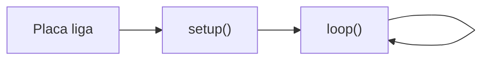

# 💻 Programação Arduino em C/C++

> [← Arduino Uno](15-arduino-uno.md) · Próximo: [Saídas digitais, LED e Blink →](17-saidas-digitais.md)

**Nível:** 🟢 Iniciante

> 📖 **Antes, leia:** [Arduino Uno](15-arduino-uno.md). Se você já estudou [Python](../../python/README.md), esta aula compara as duas linguagens o tempo todo.

## 🎯 Você vai aprender

- A estrutura de um **sketch**: `setup()` e `loop()`.
- As regras do C/C++: **chaves**, **ponto e vírgula** e **tipos**.
- Os **tipos** do Uno e os seus limites: o `int` tem só **16 bits**.
- **Variáveis**, **constantes** e onde cada uma vale (escopo).
- `if`, `for`, `while` e **funções**, lado a lado com Python.
- Os erros mais comuns: `=` × `==`, divisão inteira e estouro.

## Em uma frase

> 💡 Todo sketch tem duas partes: **`setup()` roda uma vez**, quando a placa liga; **`loop()` roda de novo e de novo**, para sempre.

## 1. O esqueleto do sketch

```cpp
void setup() {
  // roda UMA vez: quando a placa liga ou depois do reset
}

void loop() {
  // roda para sempre: chegou no fim, volta para o começo
}
```



| Função | Quando roda | O que vai nela |
| ------ | ----------- | -------------- |
| `setup()` | Uma vez, no começo | Configurar pinos, abrir a serial, valores iniciais |
| `loop()` | Sem parar, até desligar | O comportamento: ler, decidir, ligar e desligar |

Por baixo, o Arduino faz algo parecido com `setup();` seguido de um laço infinito que chama `loop()`.

## 2. C/C++ para quem sabe Python

| | Python | C/C++ no Arduino |
| - | ------ | ---------------- |
| Bloco | Indentação | `{ }` (a indentação é só para ler) |
| Fim da instrução | Fim da linha | **`;` obrigatório** |
| Comentário | `# texto` | `// uma linha` ou `/* várias */` |
| Criar variável | `x = 5` | `int x = 5;` (o **tipo** vem antes) |
| Verdadeiro e falso | `True`, `False` | `true`, `false` |
| E, não | `and`, `not` | `&&`, `!` |
| Decisão | `if x > 3:` | `if (x > 3) { ... }` |
| Senão se | `elif` | `else if` |
| Repetir 5 vezes | `for i in range(5):` | `for (int i = 0; i < 5; i++) { ... }` |
| Enquanto | `while x < 10:` | `while (x < 10) { ... }` |
| Somar 1 | `x += 1` | `x++;` ou `x += 1;` |
| Função | `def dobro(x):` | `int dobro(int x) { ... }` |
| Mostrar na tela | `print(x)` | `Serial.println(x);` (aula de monitor serial) |

O **ou** do Python (`or`) vira duas barras verticais: `||`. Por exemplo, `if (a > 5 || b > 5)`.

## 3. Tipos no Uno

Em C/C++, toda variável tem um **tipo**, que diz quantos bits ela ocupa e que valores cabem nela.

| Tipo | Tamanho | Faixa de valores | Uso típico |
| ---- | ------- | ---------------- | ---------- |
| `bool` | 8 bits | `true` ou `false` | Estado de um LED ou botão |
| `byte` | 8 bits | 0 a 255 | Brilho do PWM, um byte da serial |
| `char` | 8 bits | Um caractere, como `'A'` | Letras e comandos |
| `int` | **16 bits** | −32 768 a 32 767 | Contas pequenas, números de pino |
| `unsigned int` | 16 bits | 0 a 65 535 | Contagens que nunca são negativas |
| `long` | 32 bits | Cerca de −2,1 bilhões a 2,1 bilhões | Contas grandes |
| `unsigned long` | 32 bits | 0 a 4 294 967 295 | **Tempo em milissegundos** (`millis()`) |
| `float` | 32 bits | Números com vírgula, com 6 a 7 algarismos | Medidas (no Uno, `double` é igual ao `float`) |

> 💡 **Ligação com a primeira parte:** o `int` de 16 bits usa **complemento a 2** (aula de números negativos). O maior valor é 0111 1111 1111 1111 = **32 767**.

**Estouro (overflow).** Quando a conta passa do limite do tipo, o valor "dá a volta", como um odômetro:

| Código | Resultado | Por quê |
| ------ | --------- | ------- |
| `byte b = 255; b = b + 1;` | **0** | 256 não cabe em 8 bits: sobra 0 |
| `byte b = 250; b = b + 10;` | **4** | 260 − 256 = 4 |
| `int x = 32767; x = x + 1;` | **−32 768** no Uno | Passou do maior `int`. Em C++, isso é um erro do programa: não conte com o resultado |

> ⚠️ **A pegadinha do `1000 * 60`:** em `unsigned long umMinuto = 1000 * 60;`, os números 1000 e 60 são `int`, então a conta é feita em 16 bits e **estoura antes** de ir para a variável. O resultado fica errado. Escreva `1000UL * 60` (UL = *unsigned long*) ou `60000UL`.

**Divisão inteira.** Entre dois inteiros, a divisão **joga fora o resto**:

| Código | Resultado |
| ------ | --------- |
| `7 / 2` | **3** |
| `7 % 2` (resto) | **1** |
| `float x = 7 / 2;` | **3.0**: a divisão inteira acontece antes de ir para o `float` |
| `float y = 7.0 / 2;` | **3.5**: com um número com vírgula, a conta é com vírgula |

## 4. Variáveis, constantes e escopo

```cpp
const int LED = 8;    // constante: o compilador não deixa mudar
int contagem = 0;     // global: vale no sketch inteiro e guarda o valor

void loop() {
  int vezes = 0;      // local: nasce de novo a cada volta do loop
  vezes = vezes + 1;  // sempre vale 1 aqui
  contagem = contagem + 1;  // 1, 2, 3, ... a cada volta
}
```

| Tipo de nome | Onde é criado | Dura quanto |
| ------------ | ------------- | ----------- |
| **Global** | Fora das funções | O programa inteiro |
| **Local** | Dentro de uma função | Só até a função terminar (e recomeça na próxima chamada) |
| **`const`** | Global ou local | Não muda nunca; por costume, em MAIÚSCULAS |

> 💡 Use `const int LED = 8;` para os pinos: se o fio mudar de pino, você troca **um número só**. (Algumas aulas usam `#define LED 8`, sem `=` e sem `;`: funciona, mas o `const` é mais seguro.)

## 5. Decisões e repetições

```cpp
int nota = 7;

if (nota >= 7) {
  // aprovado
} else if (nota >= 5) {
  // recuperação
} else {
  // reprovado
}

for (int i = 0; i < 3; i++) {
  // roda com i = 0, 1 e 2
}

while (nota < 10) {
  nota = nota + 1;   // repete enquanto a condição for verdadeira
}
```

## 6. Funções

```cpp
int dobro(int x) {          // devolve um int e recebe um int
  return 2 * x;
}

void piscar(int pino) {     // void: não devolve nada
  digitalWrite(pino, HIGH);
  delay(200);
  digitalWrite(pino, LOW);
  delay(200);
}
```

| Parte | Em `int dobro(int x)` |
| ----- | --------------------- |
| Tipo de retorno | `int` (ou `void`, se não devolve nada) |
| Nome | `dobro` |
| Parâmetros, com tipo | `int x` |
| Devolver o resultado | `return 2 * x;` |

`setup()` e `loop()` também são funções: `void`, sem parâmetros. O Arduino as chama por você.

## 🔬 Mão na massa

No [Tinkercad Circuits](https://www.tinkercad.com/circuits), com um Arduino Uno e **Código → Texto**:

1. Apague um `;` qualquer e clique em **Iniciar simulação**: leia a mensagem de erro e ache a linha.
2. Escreva uma função `piscar(13)` (seção 6) e chame-a três vezes no `loop()`, com um `delay(1000)` no fim. O LED L faz três piscadas e uma pausa?
3. Troque o `for` de três piscadas por um `while` que faça a mesma coisa.

## ⚠️ Erros comuns

| Erro | Como evitar |
| ---- | ----------- |
| Esquecer o `;` | O compilador aponta a linha **seguinte**: olhe a de cima também |
| `if (x = 5)` no lugar de `if (x == 5)` | `=` guarda; `==` compara. Com `=`, o `if` sempre dá verdadeiro |
| Chaves `{ }` sem par | Cada `{` tem o seu `}`: a IDE destaca o par |
| Conta grande em `int` | `int` vai só até 32 767: use `long` ou `unsigned long` |
| `float x = 7 / 2;` esperando 3,5 | Escreva `7.0 / 2` |
| Variável local que "esquece" o valor | Para guardar entre as voltas do `loop()`, crie fora das funções (global) |

## 💡 Macetes

- **Python virou C++?** Ponha tipo, `;`, parênteses no `if` e troque a indentação por `{ }`.
- **Conta com tempo em ms?** Sempre `unsigned long` (e `UL` nos números grandes).
- **Pino em constante:** `const int LED = 8;` no topo, e só use `LED` no resto.

## 🧾 Resumo

| Ideia | Em poucas palavras |
| ----- | ------------------ |
| Sketch | `setup()` uma vez, `loop()` para sempre |
| Sintaxe | `{ }` para blocos, `;` no fim, tipo antes do nome |
| Tipos | `int` de 16 bits (até 32 767); `unsigned long` para tempo |
| Estouro | O valor dá a volta: `byte` 255 + 1 = 0 |
| Divisão inteira | `7 / 2 = 3`; com vírgula, `7.0 / 2 = 3.5` |
| Escopo | Global dura o programa todo; local recomeça a cada chamada |
| Funções | Tipo de retorno, nome, parâmetros com tipo e `return` |

## ✅ Teste rápido

**1.** Quantas vezes o `setup()` roda depois que a placa liga?

<details>
<summary>Ver resposta</summary>

**Número:** `1`

**Uma vez** só. Quem repete é o `loop()`.
</details>

**2.** Qual é o maior valor que cabe num `int` do Uno?

<details>
<summary>Ver resposta</summary>

**Número:** `32767`

O `int` tem 16 bits em complemento a 2: de −32 768 a **32 767**.
</details>

**3.** Quanto vale `7 / 2` em C++, com os dois números inteiros?

<details>
<summary>Ver resposta</summary>

**Número:** `3`

Divisão inteira: o resto (1) é jogado fora.
</details>

**4.** E `7 % 2`?

<details>
<summary>Ver resposta</summary>

**Número:** `1`

O `%` dá o **resto** da divisão: 7 = 2 × 3 + **1**.
</details>

**5.** Depois de `byte b = 250; b = b + 10;`, quanto vale `b`?

<details>
<summary>Ver resposta</summary>

**Número:** `4`

O `byte` vai até 255: 260 − 256 = **4**.
</details>

**6.** Qual operador **compara** se dois valores são iguais?

<details>
<summary>Ver resposta</summary>

**Resposta:** `==`

`==` compara; `=` guarda um valor na variável.
</details>

**7.** Como se escreve o **e** lógico (o `and` do Python) em C++?

<details>
<summary>Ver resposta</summary>

**Resposta:** `&&`

`&&` é o **e**, `||` é o **ou** e `!` é o **não**.
</details>

## ✏️ Agora pratique

São 9 exercícios sobre este assunto, do fácil ao difícil, com resolução passo a passo:

| 🟢 Fácil | 🟡 Intermediário | 🔴 Difícil |
| -------- | ---------------- | ---------- |
| [Exercícios 01 a 03](../exercicios/16-programacao-arduino/facil.md) | [Exercícios 04 a 06](../exercicios/16-programacao-arduino/intermediario.md) | [Exercícios 07 a 09](../exercicios/16-programacao-arduino/dificil.md) |

## 📚 Referências

- MONK, Simon. *Programação com Arduino: começando com sketches*. 2. ed. Porto Alegre: Bookman, 2017. Capítulos 3 a 5.
- MCROBERTS, Michael. *Arduino básico*. 2. ed. São Paulo: Novatec, 2015. Capítulo 1.
- [Referência da linguagem Arduino](https://docs.arduino.cc/language-reference/) (em inglês): tipos, funções e exemplos.
