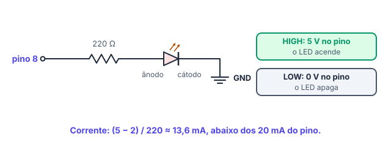

# 💡 Saídas digitais, LED e Blink

> [← Programação Arduino em C/C++](16-programacao-arduino.md) · Próximo: [Monitor serial →](18-monitor-serial.md)

**Nível:** 🟢 Iniciante

> 📖 **Antes, leia:** [Programação Arduino em C/C++](16-programacao-arduino.md) e o cálculo do resistor do LED na [aula de Lei de Ohm](11-lei-de-ohm.md).

## 🎯 Você vai aprender

- Configurar um pino como **saída** com `pinMode`.
- Ligar e desligar o pino com `digitalWrite` (**HIGH** e **LOW**).
- Esperar com `delay`.
- Ligar um **LED com resistor** num pino, com a conta da corrente.
- Escrever o **Blink** e calcular o período e a frequência dele.
- Controlar **dois LEDs** (síncronos, alternados e ritmados) e montar um **semáforo**.
- (ampliação) Ver o pino como um **bit do registrador PORTB**.

## Em uma frase

> 💡 Uma **saída digital** só tem dois estados: **HIGH** (5 V, liga) e **LOW** (0 V, desliga). Piscar um LED é trocar de estado e esperar.

## 1. As três funções

| Função | O que faz | Onde vai |
| ------ | --------- | -------- |
| `pinMode(8, OUTPUT);` | Configura o pino 8 como **saída** | No `setup()` |
| `digitalWrite(8, HIGH);` | Põe **5 V** no pino 8 | No `loop()` |
| `digitalWrite(8, LOW);` | Põe **0 V** no pino 8 | No `loop()` |
| `delay(1000);` | **Espera** 1 000 ms (1 s) sem fazer mais nada | No `loop()` |

> ⚠️ Durante o `delay`, o Arduino **não faz mais nada**: não lê botão, não pisca outro LED. A aula [delay() e millis()](20-delay-e-millis.md) mostra como fugir disso.

## 2. LED num pino

O pino é uma fonte de 5 V (em HIGH) que aguenta uns **20 mA**. O LED vai **em série com um resistor**, do pino até o GND:



| Ligação | Detalhe |
| ------- | ------- |
| Pino 8 → resistor | 220 Ω (ou 330 Ω) |
| Resistor → **ânodo** do LED | A perna **longa** |
| **Cátodo** do LED → GND | A perna curta |

Corrente com LED vermelho (2 V): i = (5 − 2) / 220 ≈ **13,6 mA**, abaixo dos 20 mA recomendados. Sem o resistor, o LED e o pino podem queimar.

## 3. O Blink

```cpp
const int LED = 8;

void setup() {
  pinMode(LED, OUTPUT);     // o pino 8 vira saída
}

void loop() {
  digitalWrite(LED, HIGH);  // liga: 5 V no pino
  delay(1000);              // espera 1 s aceso
  digitalWrite(LED, LOW);   // desliga: 0 V no pino
  delay(1000);              // espera 1 s apagado
}
```

| Tempo (ms) | O que acontece |
| ---------- | -------------- |
| 0 | `HIGH`: o LED acende |
| 1 000 | `LOW`: o LED apaga |
| 2 000 | `HIGH` de novo: o `loop()` recomeçou |
| 3 000 | `LOW` |

| Medida | Conta | Valor |
| ------ | ----- | ----- |
| **Período** (um ciclo completo) | 1 000 + 1 000 | **2 000 ms = 2 s** |
| **Frequência** (ciclos por segundo) | 1 / 2 | **0,5 Hz** |
| Tempo aceso | 1 000 de 2 000 | **50 %** do tempo |

> 💡 **Sem placa e sem montagem:** troque `8` por `LED_BUILTIN` (o pino 13). O LED **L** da placa pisca sozinho.

## 4. O LED num pino, o código em outro

Um aluno montou o LED no **pino 7**, mas o código diz `const int LED = 8;`. O que acontece?

| Pergunta | Resposta |
| -------- | -------- |
| O LED pisca? | **Não**: o código liga e desliga o pino 8, onde não há nada |
| O pino 8 está mudando? | **Sim**: o programa roda normalmente, só não tem LED ali |
| Como consertar? | Ou muda o fio para o pino 8, ou muda a constante para `7`. Com a constante, é **um número só** |

## 5. Dois LEDs

Com os LEDs nos pinos 8 e 9, cada um com o seu resistor:

| Comportamento | O que o `loop()` faz |
| ------------- | -------------------- |
| **Síncronos** | Liga os dois, espera, desliga os dois, espera |
| **Alternados** | Liga um e desliga o outro, espera, inverte, espera |
| **Ritmados** | Um padrão de tempos, como a batida de um coração: duas piscadas rápidas e uma pausa |

```cpp
const int LED_A = 8;
const int LED_B = 9;

void setup() {
  pinMode(LED_A, OUTPUT);
  pinMode(LED_B, OUTPUT);
}

void loop() {                  // alternados
  digitalWrite(LED_A, HIGH);
  digitalWrite(LED_B, LOW);
  delay(500);
  digitalWrite(LED_A, LOW);
  digitalWrite(LED_B, HIGH);
  delay(500);
}
```

## 6. Semáforo

Com três LEDs (verde no pino 8, amarelo no 9 e vermelho no 10), o semáforo acende **um de cada vez**:

| Fase | Pino em HIGH | Tempo |
| ---- | ------------ | ----- |
| Siga | 8 (verde) | 5 s |
| Atenção | 9 (amarelo) | 2 s |
| Pare | 10 (vermelho) | 5 s |

Período: 5 + 2 + 5 = **12 s**. O [projeto 03](../laboratorio/projetos/03-semaforo/README.md) do laboratório traz a montagem e os testes.

## 7. O pino é um bit (ampliação)

Dentro do ATmega328P, os pinos 8 a 13 são os bits 0 a 5 do registrador **PORTB**, e os pinos 0 a 7 são os bits do **PORTD**. `digitalWrite(8, HIGH)` põe em 1 o **bit 0** do PORTB.

| Pino do Uno | 13 | 12 | 11 | 10 | 9 | 8 |
| ----------- | -- | -- | -- | -- | - | - |
| Bit do PORTB | 5 | 4 | 3 | 2 | 1 | **0** |

**Exemplo:** `PORTB = 0x21;` → 0x21 = 0010 0001 → bits 0 e 5 em 1 → **pinos 8 e 13** em HIGH, de uma vez só. É o binário e o hexadecimal da primeira parte, mandando na placa.

## 🔬 Mão na massa

1. Faça o [projeto 01 · Blink](../laboratorio/projetos/01-blink/README.md) no laboratório do site (ou no Tinkercad, ou no Wokwi), com o LED no pino 8.
2. Troque os dois `delay(1000)` por `delay(250)`. O que acontece com o período?
3. **Desafio dos LEDs:** com dois LEDs, faça os três comportamentos da seção 5 (síncronos, alternados e ritmados). Depois, compare com o [projeto 02](../laboratorio/projetos/02-dois-leds-alternados/README.md).
4. **Desafio com conferência:** no [desafio 01 · Monte o Blink](../laboratorio/desafios/01-monte-o-blink/README.md), monte o circuito do zero. O laboratório confere a montagem.

## ⚠️ Erros comuns

| Erro | Como evitar |
| ---- | ----------- |
| Esquecer o `pinMode(..., OUTPUT)` | Sem ele, o pino fica como entrada e o LED quase não acende |
| Esquecer o `delay` depois do `LOW` | O LED apaga por microssegundos e parece **sempre aceso** |
| LED num pino e código em outro | Use uma constante para o pino e confira a montagem |
| LED sem resistor | Sempre 220 Ω ou 330 Ω em série |
| LED invertido | A perna longa vai do lado do pino (pelo resistor) |

## 💡 Macetes

- **Período = soma dos `delay` do `loop()`** (quando o resto do código é rápido).
- **Teste com o LED L** (`LED_BUILTIN`) antes de montar o circuito.
- **Uma constante por pino**, com nomes que dizem o que o LED faz: `LED_VERDE`, `LED_ERRO`.

## 🧾 Resumo

| Ideia | Em poucas palavras |
| ----- | ------------------ |
| Saída digital | `pinMode(p, OUTPUT)` no setup; `digitalWrite(p, HIGH/LOW)` no loop |
| HIGH e LOW | 5 V e 0 V |
| `delay(ms)` | Espera parada: o Arduino não faz mais nada |
| LED no pino | Pino → resistor → ânodo; cátodo → GND (≈ 13,6 mA com 220 Ω) |
| Blink | Período = soma dos tempos; frequência = 1 / período |
| Registrador (ampliação) | Pinos 8 a 13 = bits 0 a 5 do PORTB |

## ✅ Teste rápido

**1.** Qual função configura um pino como saída?

<details>
<summary>Ver resposta</summary>

**Resposta:** `pinMode`

`pinMode(pino, OUTPUT);`, no `setup()`.
</details>

**2.** `digitalWrite(8, HIGH)` põe qual tensão no pino 8?

<details>
<summary>Ver resposta</summary>

**Grandeza:** `5 V`

HIGH é **5 V** no Uno; LOW é 0 V.
</details>

**3.** Quantos milissegundos o `delay(250)` espera?

<details>
<summary>Ver resposta</summary>

**Número:** `250`

O `delay` recebe o tempo em **milissegundos**: 250 ms = 0,25 s.
</details>

**4.** No Blink com dois `delay(1000)`, qual é o período?

<details>
<summary>Ver resposta</summary>

**Grandeza:** `2 s`

1 s aceso + 1 s apagado = **2 s** por ciclo.
</details>

**5.** Qual pino é o `LED_BUILTIN` do Uno?

<details>
<summary>Ver resposta</summary>

**Número:** `13`

O LED **L** da placa fica no **pino 13**.
</details>

**6.** O LED está no pino 7 e o código liga e desliga o pino 8. O LED pisca? Responda sim ou não.

<details>
<summary>Ver resposta</summary>

**Resposta:** `não`

O código mexe no pino 8, onde não há LED. Mude o fio ou o número no código.
</details>

**7.** (ampliação) Qual bit do PORTB corresponde ao pino 8?

<details>
<summary>Ver resposta</summary>

**Número:** `0`

Os pinos 8 a 13 são os bits **0** a 5 do PORTB.
</details>

## ✏️ Agora pratique

São 9 exercícios sobre este assunto, do fácil ao difícil, com resolução passo a passo:

| 🟢 Fácil | 🟡 Intermediário | 🔴 Difícil |
| -------- | ---------------- | ---------- |
| [Exercícios 01 a 03](../exercicios/17-saidas-digitais/facil.md) | [Exercícios 04 a 06](../exercicios/17-saidas-digitais/intermediario.md) | [Exercícios 07 a 09](../exercicios/17-saidas-digitais/dificil.md) |

## 📚 Referências

- MCROBERTS, Michael. *Arduino básico*. 2. ed. São Paulo: Novatec, 2015. Projetos 1 a 3 (LED, sinalizador e semáforo).
- BANZI, Massimo; SHILOH, Michael. *Primeiros passos com o Arduino*. 2. ed. São Paulo: Novatec, 2015.
- [digitalWrite, na referência do Arduino](https://docs.arduino.cc/language-reference/en/functions/digital-io/digitalwrite/) (em inglês).
