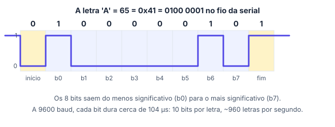

# 📟 Monitor serial

> [← Saídas digitais, LED e Blink](17-saidas-digitais.md) · [Voltar para Sistemas Digitais →](../README.md)

**Nível:** 🟢 Iniciante

> 📖 **Antes, leia:** [Saídas digitais, LED e Blink](17-saidas-digitais.md). Para a seção de bits, ajuda lembrar a [tabela ASCII](04-codificacao.md).

## 🎯 Você vai aprender

- Abrir a comunicação com `Serial.begin` e escolher a **velocidade** (baud).
- Mandar texto e números com `Serial.print` e `Serial.println`.
- Mostrar números em **binário** e **hexadecimal** direto do Arduino.
- **Depurar** um programa imprimindo o que ele está fazendo.
- Por que a serial mostra o que o **programa** mandou, e não o que o **circuito** fez.
- (ampliação) Como uma letra viaja **bit a bit** pelo fio, e como **receber** comandos do computador.

## Em uma frase

> 💡 A serial é o **canal de texto** entre o Arduino e o computador: o `Serial.println` escreve uma linha no **monitor serial** da IDE.

## 1. Abrindo a serial

```cpp
void setup() {
  Serial.begin(9600);   // abre a serial a 9600 bits por segundo
}
```

| Detalhe | O que saber |
| ------- | ----------- |
| `Serial.begin(9600)` | Vai no `setup()`. Sem ele, nada aparece |
| **Baud** | Bits por segundo. 9600 é o mais usado nos exemplos; 115200 é mais rápido |
| Monitor serial | Na IDE, o ícone de lupa no canto. A velocidade **dele** tem que ser **igual** à do código |
| Pinos 0 (RX) e 1 (TX) | A serial passa por eles: não ligue LEDs ali quando usar a serial |

> ⚠️ **Velocidades diferentes** (código em 9600 e monitor em 115200) fazem aparecer caracteres estranhos, como `ÿ⸮⸮`. Confira o número no canto do monitor.

## 2. `print` e `println`

| Comando | O que faz |
| ------- | --------- |
| `Serial.print(x)` | Escreve e **continua na mesma linha** |
| `Serial.println(x)` | Escreve e **pula para a próxima linha** |

```cpp
Serial.print("Temperatura: ");
Serial.print(25);
Serial.println(" graus");
Serial.println("Fim");
```

O monitor mostra:

```text
Temperatura: 25 graus
Fim
```

## 3. Números, letras e bases

| Código | O que aparece |
| ------ | ------------- |
| `Serial.println(65);` | `65` |
| `Serial.println('A');` | `A` |
| `Serial.println(65, HEX);` | `41` |
| `Serial.println(65, BIN);` | `1000001` (sem os zeros da esquerda) |
| `Serial.println(7 / 2);` | `3` (divisão inteira) |
| `Serial.println(7.0 / 2);` | `3.50` (número com vírgula: **2 casas** por padrão) |
| `Serial.println(3.14159, 4);` | `3.1416` (4 casas, arredondado) |
| `Serial.write(65);` | `A` (manda o **byte** 65, que no ASCII é a letra A) |

> 💡 **Ligação com a primeira parte:** `HEX` e `BIN` fazem as conversões das aulas 2 e 3 para você. E `'A'` e `65` são a mesma coisa para o Arduino: a diferença é só como você pede para mostrar.

## 4. Depurando com a serial

A serial é a forma mais simples de ver **o que o programa está fazendo**. O Blink do [projeto 01](../laboratorio/projetos/01-blink/README.md) avisa cada troca:

```cpp
const int LED = 8;

void setup() {
  pinMode(LED, OUTPUT);
  Serial.begin(9600);
}

void loop() {
  digitalWrite(LED, HIGH);
  Serial.println("Ligado");
  delay(1000);

  digitalWrite(LED, LOW);
  Serial.println("Desligado");
  delay(1000);
}
```

O monitor mostra uma linha por segundo:

```text
Ligado
Desligado
Ligado
Desligado
```

> ⚠️ **A serial mostra o que o programa mandou, não o que o circuito fez.** Se o LED estiver desconectado ou invertido, o monitor continua escrevendo "Ligado". Para saber se o LED acende, olhe o LED (ou meça com o multímetro).

**Imprimindo variáveis** (com o `Serial.begin(9600);` no `setup()`):

```cpp
int contagem = 0;   // global: guarda o valor entre as voltas

void loop() {
  contagem = contagem + 1;
  Serial.print("Volta número ");
  Serial.println(contagem);
  delay(500);
}
```

## 5. A letra no fio (ampliação)

Na serial, cada caractere vai **um bit de cada vez**: um bit de **início** (0), os 8 bits do caractere, do **menos** significativo para o **mais**, e um bit de **fim** (1).



| Conta | Valor |
| ----- | ----- |
| Tempo de um bit a 9600 baud | 1 / 9 600 ≈ **104 µs** |
| Bits por caractere | 1 (início) + 8 + 1 (fim) = **10** |
| Caracteres por segundo | 9 600 / 10 = **960** |

Ou seja, imprimir uma linha de 96 caracteres leva cerca de **0,1 s**. Em programas que precisam ser rápidos, imprimir demais atrasa tudo.

## 6. Recebendo comandos (ampliação)

O monitor também **manda** texto para o Arduino. `Serial.available()` diz quantos bytes chegaram e `Serial.read()` lê um:

```cpp
const int LED = 8;

void setup() {
  pinMode(LED, OUTPUT);
  Serial.begin(9600);
}

void loop() {
  if (Serial.available() > 0) {
    char c = Serial.read();               // um caractere por vez
    if (c == '1') digitalWrite(LED, HIGH);
    if (c == '0') digitalWrite(LED, LOW);
  }
}
```

Digite `1` e Enter no monitor: o LED acende. Com a opção **Nova linha** do monitor ligada, o Enter também manda o caractere de nova linha (`'\n'`), que este código simplesmente ignora.

## 🔬 Mão na massa

1. No Tinkercad (ou no Wokwi), monte o Blink com a serial da seção 4 e abra o **Monitor serial**. Uma linha aparece a cada segundo?
2. Tire o LED da montagem e rode de novo: o monitor muda?
3. Imprima `Serial.println(200, BIN);` e `Serial.println(200, HEX);` e confira com as contas das aulas 2 e 3.
4. (ampliação) Monte o código da seção 6 e controle o LED pelo teclado.

## ⚠️ Erros comuns

| Erro | Como evitar |
| ---- | ----------- |
| Esquecer o `Serial.begin` | Sem ele, o monitor fica vazio |
| Velocidade diferente no monitor | Use o mesmo número do `Serial.begin` |
| Usar os pinos 0 e 1 para LEDs | Eles são a serial: use outros |
| `println` dentro do `loop()` sem `delay` | O monitor é inundado de linhas e o programa fica lento |
| Achar que "Ligado" no monitor prova que o LED acendeu | A serial mostra o programa, não o circuito |

## 💡 Macetes

- **Rótulo antes do valor:** `Serial.print("x = "); Serial.println(x);` deixa claro o que é cada número.
- **Depurar por etapas:** imprima "cheguei aqui" em pontos do código para descobrir onde o programa trava.
- **9600 baud ≈ 960 letras por segundo:** imprima só o necessário.

## 🧾 Resumo

| Ideia | Em poucas palavras |
| ----- | ------------------ |
| `Serial.begin(9600)` | No `setup()`; o monitor na mesma velocidade |
| `print` × `println` | Mesma linha × pula linha |
| Bases | `println(x, BIN)` e `println(x, HEX)`; números com vírgula saem com 2 casas |
| Depurar | Imprimir o que o programa faz, com rótulos |
| Cuidado | A serial mostra o **programa**, não o **circuito** |
| Velocidade (ampliação) | 10 bits por caractere: a 9600 baud, ~960 caracteres por segundo |

## ✅ Teste rápido

**1.** Qual comando abre a serial a 9600 baud?

<details>
<summary>Ver resposta</summary>

**Resposta:** `Serial.begin(9600) | Serial.begin(9600);`

No `setup()`: `Serial.begin(9600);`
</details>

**2.** Qual dos dois pula para a próxima linha no fim: `print` ou `println`?

<details>
<summary>Ver resposta</summary>

**Resposta:** `println`

O `ln` vem de *line*: escreve e pula a linha.
</details>

**3.** O que aparece com `Serial.println(65, HEX);`?

<details>
<summary>Ver resposta</summary>

**Resposta:** `41`

65 = 4 × 16 + 1 → **41** em hexadecimal.
</details>

**4.** E com `Serial.println(7 / 2);`?

<details>
<summary>Ver resposta</summary>

**Resposta:** `3`

Os dois números são inteiros: divisão inteira, **3**.
</details>

**5.** E com `Serial.println(2.5 * 2);`?

<details>
<summary>Ver resposta</summary>

**Resposta:** `5.00`

2,5 × 2 = 5, mas é um número com vírgula (`float`): o `println` mostra **2 casas**, `5.00`.
</details>

**6.** O código usa `Serial.begin(9600)` e o monitor está em 115200. O que aparece? Responda com a letra: (a) o texto certo, (b) caracteres estranhos, (c) nada.

<details>
<summary>Ver resposta</summary>

**Resposta:** `b`

Com velocidades diferentes, o computador lê os bits no ritmo errado e monta **caracteres estranhos**.
</details>

**7.** O monitor mostra "Ligado", mas o LED está desconectado. O LED está aceso? Responda sim ou não.

<details>
<summary>Ver resposta</summary>

**Resposta:** `não`

A serial só repete o que o **programa** mandou. Sem ligação, não há corrente no LED.
</details>

## ✏️ Agora pratique

São 9 exercícios sobre este assunto, do fácil ao difícil, com resolução passo a passo:

| 🟢 Fácil | 🟡 Intermediário | 🔴 Difícil |
| -------- | ---------------- | ---------- |
| [Exercícios 01 a 03](../exercicios/18-monitor-serial/facil.md) | [Exercícios 04 a 06](../exercicios/18-monitor-serial/intermediario.md) | [Exercícios 07 a 09](../exercicios/18-monitor-serial/dificil.md) |

## 📚 Referências

- MONK, Simon. *Programação com Arduino: começando com sketches*. 2. ed. Porto Alegre: Bookman, 2017. Capítulo sobre o monitor serial.
- [Serial, na referência do Arduino](https://docs.arduino.cc/language-reference/en/functions/communication/serial/) (em inglês).
