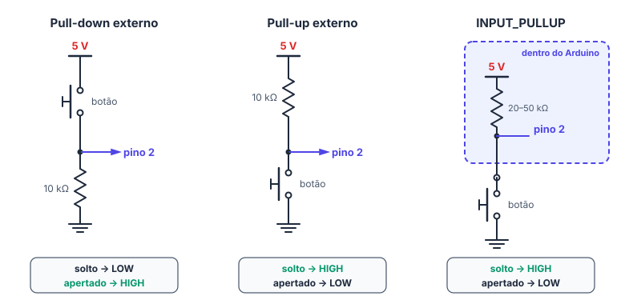
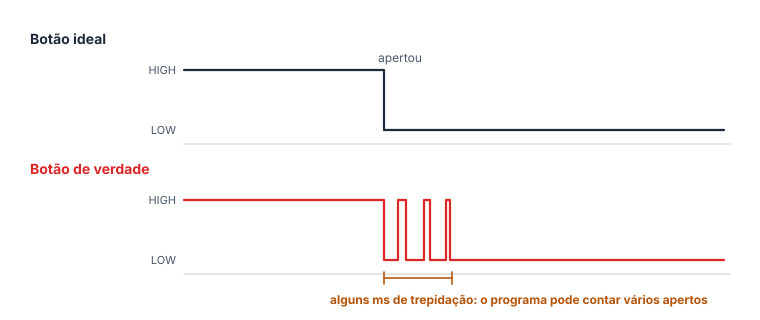

# 🔘 Entradas digitais e botões

> [← Monitor serial](18-monitor-serial.md) · Próximo: [delay() e millis() →](20-delay-e-millis.md)

**Nível:** 🟢 Iniciante

> 📖 **Antes, leia:** [Saídas digitais, LED e Blink](17-saidas-digitais.md), [Monitor serial](18-monitor-serial.md) e o botão de 4 pinos na aula de [Componentes eletrônicos](14-componentes-eletronicos.md).

## 🎯 Você vai aprender

- Configurar um pino como **entrada** e ler com `digitalRead`.
- Entender o que o pino considera **HIGH** e **LOW**, e por que um pino **solto** não serve.
- Ligar um botão com **pull-down**, **pull-up** externo e **pull-up interno** (`INPUT_PULLUP`).
- Detectar a **borda**: o instante em que o botão foi apertado ou solto.
- (ampliação) Lidar com a **trepidação** do botão.

## Em uma frase

> 💡 Uma **entrada digital** lê se o pino está perto de 5 V (**HIGH**) ou de 0 V (**LOW**). Um resistor de pull-up ou pull-down garante que o pino tenha um nível certo mesmo com o botão solto.

## 1. Entrada × saída

| Modo (`pinMode`) | O pino... | Para quê |
| ---------------- | --------- | -------- |
| `OUTPUT` | **Fornece** 0 V ou 5 V | LED, buzzer, sinal para outro circuito |
| `INPUT` | **Lê** a tensão, sem fornecer nada | Sensor que já manda HIGH e LOW (como o PIR) |
| `INPUT_PULLUP` | Lê, com um resistor **interno** ligado ao 5V | Botão ligado ao GND, sem resistor externo |

```cpp
int leitura = digitalRead(2);   // HIGH (1) ou LOW (0)
```

`digitalRead` devolve `HIGH` ou `LOW`, que no fundo são os números **1** e **0**: `Serial.println(digitalRead(2));` mostra `1` ou `0`.

## 2. O que o pino considera HIGH e LOW

Alimentado com 5 V, o ATmega328P do Uno lê:

| Tensão no pino | Leitura |
| -------------- | ------- |
| De **3 V** a 5 V (60 % do 5V para cima) | `HIGH` garantido |
| De **1,5 V** a 3 V | **Indefinido**: pode dar qualquer um |
| De 0 V a **1,5 V** (30 % do 5V para baixo) | `LOW` garantido |

Por isso um sensor de 3,3 V (como a saída do PIR) já conta como HIGH no Uno.

## 3. O pino solto

Com o botão ligado só entre o pino e o 5V, o que acontece com o botão **solto**? O pino não fica ligado a nada: ele fica **flutuando** (*floating*). Uma entrada tem resistência altíssima, e qualquer carga elétrica do ambiente muda a tensão dela. A leitura vira sorteio: muda sozinha e muda quando a mão chega perto.

> ⚠️ Toda entrada precisa de um caminho para um nível conhecido quando ninguém está mandando nela. Esse caminho é um **resistor de pull-up** (puxa para o 5V) ou de **pull-down** (puxa para o GND).

## 4. Pull-down, pull-up e INPUT_PULLUP



| Montagem | Botão solto | Botão apertado | Corrente com o botão apertado |
| -------- | ----------- | -------------- | ----------------------------- |
| **Pull-down** externo: botão no 5V, 10 kΩ do pino ao GND, `INPUT` | `LOW` (o resistor puxa para o GND) | `HIGH` (o botão liga ao 5V) | 5 V / 10 kΩ = **0,5 mA** |
| **Pull-up** externo: 10 kΩ do 5V ao pino, botão no GND, `INPUT` | `HIGH` | `LOW` | 0,5 mA |
| **`INPUT_PULLUP`**: botão no GND, sem resistor externo | `HIGH` | `LOW` | 5 V / 20 a 50 kΩ ≈ **0,1 a 0,25 mA** |

- Com o botão apertado, o resistor fica entre o 5V e o GND: é ele que **limita a corrente**. Sem ele, apertar o botão faria um curto-circuito.
- O resistor "perde" para o botão: o botão é um fio (quase 0 Ω), então o pino vai para o nível do lado do botão.
- **Com pull-up, a lógica fica invertida:** apertado = `LOW`. É só comparar com `LOW` no `if`.

> 💡 O `INPUT_PULLUP` é o jeito mais simples: um fio do pino ao botão, um fio do botão ao GND e nenhum resistor. É o que os projetos do laboratório usam.

## 5. Ler e decidir

```cpp
const int BOTAO = 2;
const int LED = 8;

void setup() {
  pinMode(BOTAO, INPUT_PULLUP);
  pinMode(LED, OUTPUT);
}

void loop() {
  if (digitalRead(BOTAO) == LOW) {   // apertado
    digitalWrite(LED, HIGH);
  } else {
    digitalWrite(LED, LOW);
  }
}
```

O `loop()` roda milhares de vezes por segundo: o LED acompanha o botão na hora. Esse é o [projeto 04](../laboratorio/projetos/04-botao-e-led/README.md) do laboratório.

## 6. A borda: apertou agora?

"O botão **está** apertado" é diferente de "o botão **acabou de ser** apertado". Para contar apertos, ou para um aperto ligar e o próximo desligar, o programa precisa da **borda**: a mudança de um nível para o outro. O truque é guardar a leitura da volta anterior.

| `anterior` | `atual` | Com pull-up, quer dizer |
| ---------- | ------- | ----------------------- |
| `HIGH` | `HIGH` | Continua solto |
| `HIGH` | `LOW` | **Acabou de apertar** (borda de descida) |
| `LOW` | `LOW` | Continua apertado |
| `LOW` | `HIGH` | **Acabou de soltar** (borda de subida) |

```cpp
const int BOTAO = 2;
int anterior = HIGH;   // começa solto
int apertos = 0;

void setup() {
  pinMode(BOTAO, INPUT_PULLUP);
  Serial.begin(9600);
}

void loop() {
  int atual = digitalRead(BOTAO);
  if (anterior == HIGH && atual == LOW) {   // borda de descida: apertou agora
    apertos = apertos + 1;
    Serial.print("Apertos: ");
    Serial.println(apertos);
  }
  anterior = atual;   // a leitura de agora é a "anterior" da próxima volta
}
```

Sem a borda, um `if (digitalRead(BOTAO) == LOW)` conta **uma vez por volta do `loop()`** enquanto o dedo estiver no botão: milhares de apertos em um segundo.

## 7. Trepidação (ampliação)

Os contatos de metal do botão **batem e quicam** antes de firmar: por alguns milissegundos (de 1 a 10 ms, às vezes mais), o sinal vai e volta várias vezes. O programa, rápido, pode ver cada quique como um aperto.



O jeito mais simples de resolver (*debounce*): quando a leitura mudar, espere uns **50 ms** antes de ler de novo.

```cpp
void loop() {
  int atual = digitalRead(BOTAO);
  if (atual != anterior) {          // mudou: apertou ou soltou
    if (atual == LOW) {
      apertos = apertos + 1;
      Serial.println(apertos);
    }
    delay(50);                       // deixa a trepidação passar
  }
  anterior = atual;
}
```

50 ms é muito para o botão e pouco para uma pessoa: ninguém aperta 20 vezes por segundo.

> 📖 O botão do laboratório do site é **ideal**: não trepida. Para ver a trepidação, só com a placa de verdade.

## 🔬 Mão na massa

1. Faça o [projeto 04 · Botão e LED](../laboratorio/projetos/04-botao-e-led/README.md). Rode a variante sem pull-up e veja o pino solto.
2. Monte o contador de apertos da seção 6 (na placa, no Tinkercad ou no Wokwi). Depois tire o `anterior` e veja a contagem disparar.
3. **Liga e desliga:** cada aperto troca o estado do LED. Use a borda.
4. **Desafio com conferência:** no [desafio 03 · O botão acende o LED](../laboratorio/desafios/03-botao-acende-o-led/README.md), ligue os fios para o programa funcionar. O laboratório roda o programa e aperta o botão sozinho.
5. Os projetos [09 · Campainha](../laboratorio/projetos/09-campainha/README.md) e [11 · Alarme de movimento](../laboratorio/projetos/11-alarme-de-movimento/README.md) usam as mesmas ideias com outros componentes.

## ⚠️ Erros comuns

| Erro | Como evitar |
| ---- | ----------- |
| Botão sem pull-up nem pull-down | O pino solto lê lixo. Use `INPUT_PULLUP` ou um resistor de 10 kΩ |
| Comparar com `HIGH` usando pull-up | Com pull-up, apertado é `LOW` |
| Botão no 5V **e** no GND, sem resistor | Apertar faz curto. O resistor (ou o pull-up interno) fica no caminho |
| Botão de 4 pinos girado 90° | Ele vira um fio, sempre ligado. Encaixe atravessando o canal do meio |
| Contar "está apertado" em vez de "apertou agora" | Guarde a leitura anterior e conte só a borda |

## 💡 Macetes

- **Pull-up → apertado é LOW.** Pull-down → apertado é HIGH.
- **Teste a entrada com o monitor:** `Serial.println(digitalRead(2));` mostra 1 e 0 enquanto você aperta.
- **`anterior = atual;` no fim do `loop()`**, sempre, mesmo quando nada mudou.

## 🧾 Resumo

| Ideia | Em poucas palavras |
| ----- | ------------------ |
| `digitalRead(p)` | Devolve `HIGH` (1) ou `LOW` (0) |
| Limites no Uno | HIGH de 3 V para cima, LOW de 1,5 V para baixo; no meio, indefinido |
| Pino solto | Flutua e lê lixo: precisa de pull-up ou pull-down |
| `INPUT_PULLUP` | Resistor interno de 20 a 50 kΩ ao 5V; botão ao GND; apertado = LOW |
| Borda | Comparar a leitura com a da volta anterior |
| Trepidação (ampliação) | Quiques de poucos ms; espere uns 50 ms depois de cada mudança |

## ✅ Teste rápido

**1.** Qual modo de pino liga o resistor de pull-up interno?

<details>
<summary>Ver resposta</summary>

**Resposta:** `INPUT_PULLUP`

`pinMode(pino, INPUT_PULLUP);` liga um resistor de 20 a 50 kΩ entre o pino e o 5V.
</details>

**2.** Com `INPUT_PULLUP` e o botão entre o pino e o GND, o que `digitalRead` devolve com o botão **apertado**?

<details>
<summary>Ver resposta</summary>

**Resposta:** `LOW | 0`

Apertado, o botão liga o pino direto ao GND: **LOW**. Solto, o pull-up deixa em HIGH.
</details>

**3.** Um sensor manda 3,3 V para um pino do Uno. A leitura é HIGH ou LOW?

<details>
<summary>Ver resposta</summary>

**Resposta:** `HIGH | 1`

No Uno, de **3 V** para cima já é HIGH garantido.
</details>

**4.** Pull-down de 10 kΩ e botão ligado ao 5V. Qual é a corrente no resistor com o botão apertado?

<details>
<summary>Ver resposta</summary>

**Grandeza:** `0,5 mA`

i = U / R = 5 V / 10 kΩ = **0,5 mA**.
</details>

**5.** Com pull-up, `anterior` vale `HIGH` e `atual` vale `LOW`. O botão acabou de ser apertado ou solto?

<details>
<summary>Ver resposta</summary>

**Resposta:** `apertado | apertou | acabou de ser apertado`

Com pull-up, ir de HIGH para LOW é **apertar** (borda de descida).
</details>

**6.** (ampliação) Uma pessoa aperta o botão uma vez, e ele trepida: o sinal vai a LOW **3 vezes** antes de firmar. Um contador de bordas sem *debounce* conta quantos apertos?

<details>
<summary>Ver resposta</summary>

**Número:** `3`

Cada ida de HIGH para LOW é uma borda de descida: **3** apertos contados para um aperto de verdade.
</details>

## ✏️ Agora pratique

São 9 exercícios sobre este assunto, do fácil ao difícil, com resolução passo a passo:

| 🟢 Fácil | 🟡 Intermediário | 🔴 Difícil |
| -------- | ---------------- | ---------- |
| [Exercícios 01 a 03](../exercicios/19-entradas-digitais/facil.md) | [Exercícios 04 a 06](../exercicios/19-entradas-digitais/intermediario.md) | [Exercícios 07 a 09](../exercicios/19-entradas-digitais/dificil.md) |

## 📚 Referências

- MCROBERTS, Michael. *Arduino básico*. 2. ed. São Paulo: Novatec, 2015. Projeto 4 (botão).
- MONK, Simon. *Programação com Arduino: começando com sketches*. 2. ed. Porto Alegre: Bookman, 2017. Capítulo de entradas e saídas.
- [Digital Pins, na documentação do Arduino](https://docs.arduino.cc/learn/microcontrollers/digital-pins/) (em inglês): pull-up interno e pino flutuante.
- [Exemplo Debounce, da documentação do Arduino](https://docs.arduino.cc/built-in-examples/digital/Debounce/) (em inglês).
- MICROCHIP. *ATmega328P Datasheet*: limites de tensão das entradas (V_IL e V_IH) e resistor de pull-up (R_PU).
