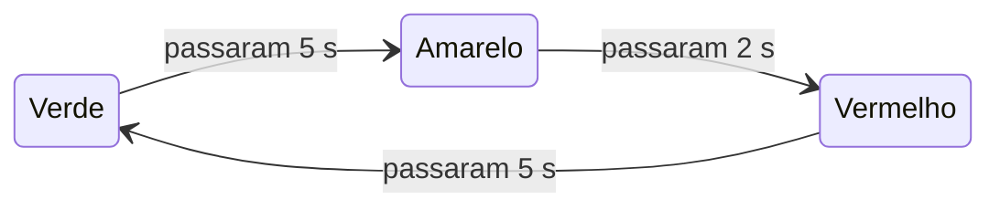

# ⏱️ delay() e millis()

> [← Entradas digitais e botões](19-entradas-digitais.md) · Próximo: [Leitura analógica →](21-leitura-analogica.md)

**Nível:** 🟡 Intermediário

> 📖 **Antes, leia:** [Entradas digitais e botões](19-entradas-digitais.md) e os tipos de variável da aula de [Programação Arduino em C/C++](16-programacao-arduino.md).

## 🎯 Você vai aprender

- Por que o `delay()` **trava** o programa e quando isso é um problema.
- Usar o relógio `millis()` e o tipo **`unsigned long`**.
- Escrever o padrão "**já passou o tempo?**" para várias tarefas ao mesmo tempo.
- Entender o que acontece quando o relógio **volta a zero** (*overflow*).
- (ampliação) Organizar o programa como uma **máquina de estados**.

## Em uma frase

> 💡 O `delay()` manda o Arduino **esperar parado**; o `millis()` só diz **que horas são**. Com ele, o `loop()` olha o relógio, faz o que já está na hora e segue em frente.

## 1. O problema do delay()

O Blink com um botão parece simples:

```cpp
void loop() {
  if (digitalRead(2) == LOW) {   // botão com INPUT_PULLUP
    Serial.println("Apertou");
  }
  digitalWrite(8, HIGH);
  delay(1000);
  digitalWrite(8, LOW);
  delay(1000);
}
```

| Tempo | O que o programa faz |
| ----- | -------------------- |
| 0 s | Lê o botão (uma vez) e acende o LED |
| 0 a 1 s | **Espera**: não lê nada |
| 1 a 2 s | **Espera** de novo |
| 2 s | Lê o botão de novo |

O botão só é lido **uma vez a cada 2 s**. Um aperto rápido no meio da espera passa despercebido. Com dois LEDs em ritmos diferentes, é pior: um `delay` de um segura o outro.

## 2. O relógio: millis()

`millis()` devolve quantos **milissegundos** se passaram desde que o programa começou. Ele não espera nada: só lê o relógio, que anda sozinho (uma interrupção do timer 0 conta o tempo).

| Função | Devolve | Volta a zero depois de |
| ------ | ------- | ---------------------- |
| `millis()` | Milissegundos desde o início | 2³² ms ≈ **49,7 dias** |
| `micros()` | Microssegundos desde o início (de 4 em 4 µs no Uno) | 2³² µs ≈ 71,6 minutos |

O valor é um **`unsigned long`**. No Uno, os tipos inteiros têm estes tamanhos:

| Tipo | Bits | Vai de | Até |
| ---- | ---- | ------ | --- |
| `int` | 16 | −32 768 | 32 767 |
| `unsigned int` | 16 | 0 | 65 535 |
| `long` | 32 | −2 147 483 648 | 2 147 483 647 |
| `unsigned long` | 32 | 0 | 4 294 967 295 |

> ⚠️ Guardar o `millis()` num `int` funciona por **32,767 s**. Depois, o valor não cabe, vira negativo e as contas dão errado. Tempo é sempre `unsigned long`.

## 3. O padrão "já passou o tempo?"

```cpp
const int LED = 8;
unsigned long antes = 0;   // quando o LED trocou pela última vez
int estado = LOW;

void setup() {
  pinMode(LED, OUTPUT);
}

void loop() {
  unsigned long agora = millis();
  if (agora - antes >= 1000) {   // já passou 1 s desde a última troca?
    antes = agora;               // anota a hora da troca
    estado = !estado;
    digitalWrite(LED, estado);
  }
  // aqui o programa está livre: dá para ler botão, sensor, serial...
}
```

| Passo | O que acontece |
| ----- | -------------- |
| 1 | Lê o relógio em `agora` |
| 2 | Compara com a hora da última troca: **já deu o intervalo?** |
| 3 | Se deu: faz a tarefa **e anota a hora** em `antes` |
| 4 | Se não deu: não faz nada e o `loop()` segue (volta em microssegundos) |

O `loop()` passa pelo `if` milhares de vezes por segundo, e quase sempre a resposta é "ainda não". O LED pisca igual ao Blink, mas o programa **nunca para**.

## 4. Várias tarefas ao mesmo tempo

Cada tarefa ganha **o seu** `antes` e o seu intervalo:

```cpp
unsigned long antesA = 0, antesB = 0;

void loop() {
  unsigned long agora = millis();
  if (agora - antesA >= 500) {   // tarefa A: a cada 500 ms
    antesA = agora;
    // troca o LED A
  }
  if (agora - antesB >= 300) {   // tarefa B: a cada 300 ms
    antesB = agora;
    // troca o LED B
  }
}
```

Em 6 s, o LED A acende 6 vezes e o B, 10, cada um no seu ritmo. É o [projeto 05 · Pisca sem delay](../laboratorio/projetos/05-pisca-sem-delay/README.md), que traz também a versão com `delay()` para comparar.

## 5. Quando o relógio volta a zero

Depois de 49,7 dias, o `millis()` passa de 4 294 967 295 para **0**. A subtração sem sinal "dá a volta" junto e continua certa:

| `antes` | `agora` (já voltou a zero) | `agora - antes` em `unsigned long` |
| ------- | -------------------------- | ---------------------------------- |
| 4 294 967 000 | 200 | 200 − 4 294 967 000 + 4 294 967 296 = **496** ✅ |

Já o jeito "hora marcada" quebra:

```cpp
unsigned long proximo = antes + 500;   // 4 294 967 500 não cabe: vira 204
if (millis() >= proximo) { ... }       // 4 294 967 100 >= 204: dispara 400 ms antes da hora
```

> 💡 Regra: compare sempre a **diferença**, `agora - antes >= intervalo`. Nunca some o intervalo à hora para comparar depois.

## 6. Máquina de estados (ampliação)

Um semáforo com `delay()` passa 12 s por volta preso nas esperas. Com `millis()`, ele vira uma **máquina de estados**: uma variável diz em que fase ele está, e o `loop()` só troca de fase quando dá o tempo.



```cpp
const int VERDE = 8, AMARELO = 9, VERMELHO = 10;
const unsigned long DURACAO[] = {5000, 2000, 5000};   // verde, amarelo, vermelho

int estado = 0;               // 0 = verde, 1 = amarelo, 2 = vermelho
unsigned long inicio = 0;     // quando o estado atual começou

void acender(int e) {
  digitalWrite(VERDE, e == 0);
  digitalWrite(AMARELO, e == 1);
  digitalWrite(VERMELHO, e == 2);
}

void setup() {
  pinMode(VERDE, OUTPUT);
  pinMode(AMARELO, OUTPUT);
  pinMode(VERMELHO, OUTPUT);
  acender(estado);
}

void loop() {
  if (millis() - inicio >= DURACAO[estado]) {
    estado = (estado + 1) % 3;   // próximo estado: 0 → 1 → 2 → 0
    inicio = millis();
    acender(estado);
  }
  // livre: aqui entraria o botão de pedestre
}
```

| Tempo | Estado | LED aceso |
| ----- | ------ | --------- |
| 0 a 5 s | 0 | Verde |
| 5 a 7 s | 1 | Amarelo |
| 7 a 12 s | 2 | Vermelho |
| 12 a 17 s | 0 | Verde de novo |

## 🔬 Mão na massa

1. Faça o [projeto 05 · Pisca sem delay](../laboratorio/projetos/05-pisca-sem-delay/README.md) e compare a versão com `millis()` com a versão com `delay()`.
2. Reescreva o [semáforo do projeto 03](../laboratorio/projetos/03-semaforo/README.md) como a máquina de estados da seção 6 e acrescente um botão que, apertado no verde, encurta a fase (na placa, no Tinkercad ou no Wokwi).
3. Junte o pisca com millis e o [botão do projeto 04](../laboratorio/projetos/04-botao-e-led/README.md): o botão acende um terceiro LED na hora, sem esperar o pisca.

## ⚠️ Erros comuns

| Erro | Como evitar |
| ---- | ----------- |
| Guardar o tempo num `int` | `unsigned long` sempre. O `int` estoura em 32,767 s |
| Esquecer de anotar `antes = agora;` | A condição continua verdadeira e a tarefa roda a cada volta do `loop()` |
| Somar o intervalo e comparar (`millis() >= proximo`) | Quebra quando o relógio volta a zero. Compare a diferença |
| Misturar `delay()` longo com `millis()` | O `delay()` atrasa todas as outras tarefas. Deixe só esperas curtas (poucos ms), se precisar |
| Um `antes` para duas tarefas | Cada tarefa tem o seu |

## 💡 Macetes

- **`agora - antes >= intervalo`**: leia como "já passou o intervalo desde antes?".
- **Leia o relógio uma vez** no começo do `loop()` (`agora`) e use o mesmo valor em todas as tarefas.
- **Nomes que dizem o tempo:** `INTERVALO_LED`, `antesDoSensor`.

## 🧾 Resumo

| Ideia | Em poucas palavras |
| ----- | ------------------ |
| `delay(ms)` | Espera parada: nada mais roda |
| `millis()` | Relógio em ms desde o início, `unsigned long`, volta a zero em 49,7 dias |
| Padrão | `if (agora - antes >= intervalo) { antes = agora; tarefa; }` |
| Várias tarefas | Um `antes` e um intervalo para cada uma |
| Overflow | A diferença sem sinal continua certa; somar e comparar, não |
| Máquina de estados (ampliação) | Uma variável de estado e a hora em que ele começou |

## ✅ Teste rápido

**1.** Qual é o maior valor que um `int` guarda no Uno?

<details>
<summary>Ver resposta</summary>

**Número:** `32767`

O `int` do Uno tem 16 bits com sinal: de −32 768 a **32 767**.
</details>

**2.** Qual tipo guarda o valor do `millis()` sem estourar por 49 dias?

<details>
<summary>Ver resposta</summary>

**Resposta:** `unsigned long`

32 bits sem sinal: até 4 294 967 295 ms, uns 49,7 dias.
</details>

**3.** `millis()` devolve 90 000. Quanto tempo se passou desde o início do programa?

<details>
<summary>Ver resposta</summary>

**Grandeza:** `90 s`

90 000 ms = **90 s** (1 min e 30 s).
</details>

**4.** Com `if (agora - antes >= 250) { antes = agora; ... }`, quantas vezes a tarefa roda em 1 s?

<details>
<summary>Ver resposta</summary>

**Número:** `4`

1 000 / 250 = **4** vezes por segundo.
</details>

**5.** O `loop()` tem um `delay(2000)` e lê um botão uma vez por volta. Qual é o maior tempo que o botão pode ficar sem ser lido?

<details>
<summary>Ver resposta</summary>

**Grandeza:** `2 s`

Durante o `delay(2000)`, nada é lido: até **2 s** sem olhar o botão.
</details>

**6.** `antes` vale 4 294 967 000 e o relógio voltou a zero: `agora` vale 300. Quanto dá `agora - antes` em `unsigned long`?

<details>
<summary>Ver resposta</summary>

**Número:** `596`

300 − 4 294 967 000 + 4 294 967 296 = **596**: os 296 ms que faltavam para o fim da volta, mais os 300 depois do zero.
</details>

## ✏️ Agora pratique

São 9 exercícios sobre este assunto, do fácil ao difícil, com resolução passo a passo:

| 🟢 Fácil | 🟡 Intermediário | 🔴 Difícil |
| -------- | ---------------- | ---------- |
| [Exercícios 01 a 03](../exercicios/20-delay-e-millis/facil.md) | [Exercícios 04 a 06](../exercicios/20-delay-e-millis/intermediario.md) | [Exercícios 07 a 09](../exercicios/20-delay-e-millis/dificil.md) |

## 📚 Referências

- MONK, Simon. *Programação com Arduino: começando com sketches*. 2. ed. Porto Alegre: Bookman, 2017. Capítulos de tipos e de tempo.
- [Exemplo BlinkWithoutDelay, da documentação do Arduino](https://docs.arduino.cc/built-in-examples/digital/BlinkWithoutDelay/) (em inglês).
- [Referência de `millis()`](https://docs.arduino.cc/language-reference/en/functions/time/millis/) e de [`unsigned long`](https://docs.arduino.cc/language-reference/en/variables/data-types/unsignedLong/) (em inglês).
