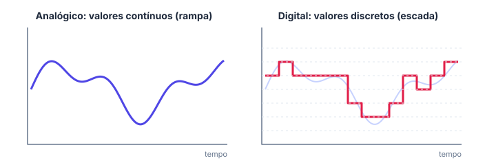
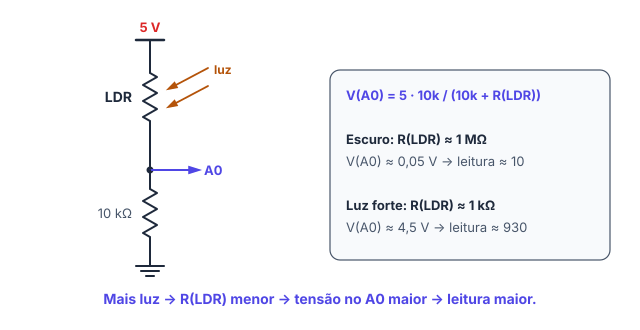

# 🎛️ Leitura analógica

> [← delay() e millis()](20-delay-e-millis.md) · Próximo: [PWM e analogWrite() →](22-pwm.md)

**Nível:** 🟡 Intermediário

> 📖 **Antes, leia:** o divisor de tensão em [Circuitos série e paralelo](12-circuitos-serie-e-paralelo.md), o potenciômetro e o LDR em [Componentes eletrônicos](14-componentes-eletronicos.md), e a ideia de amostrar um sinal em [Analógico e digital](01-analogico-e-digital.md).

## 🎯 Você vai aprender

- Ler uma **tensão** com `analogRead` e entender a escala de **0 a 1023**.
- Converter a leitura em **volts** e em outras escalas com **`map()`**.
- Ler um **potenciômetro** e um **LDR** montados como divisor de tensão.
- Decidir com um **limite** e evitar o pisca-pisca com **histerese**.
- (ampliação) Saber quanto tempo uma leitura leva e como reduzir o ruído.

## Em uma frase

> 💡 O conversor analógico-digital (**ADC**) do Arduino mede a tensão de um pino entre 0 e 5 V e devolve um número inteiro de **0 a 1023**.

## 1. Analógico × digital no Arduino

| | Entrada digital | Entrada analógica |
| - | --------------- | ----------------- |
| Função | `digitalRead(pino)` | `analogRead(pino)` |
| Pinos do Uno | 0 a 13 (e os analógicos) | **A0 a A5** |
| Devolve | `HIGH` ou `LOW` | Um número de **0 a 1023** |
| Serve para | Botão, PIR, chave | Potenciômetro, LDR, sensor de temperatura |

O `analogRead` não precisa de `pinMode`: os pinos A0 a A5 já começam como entrada.



É o que a [primeira aula](01-analogico-e-digital.md) mostrou: o ADC transforma uma tensão que pode ter **qualquer valor** num número com **degraus**.

## 2. O ADC de 10 bits

O ADC do Uno tem **10 bits**: 2¹⁰ = **1024** valores, de 0 a 1023. Ele divide de 0 a 5 V em degraus de uns **4,9 mV**.

$$\text{leitura} \approx \frac{V \cdot 1023}{5}$$

| Tensão no pino | Conta | `analogRead` |
| -------------- | ----- | ------------ |
| 0 V | 0 · 1023 / 5 | **0** |
| 1 V | 1 · 1023 / 5 = 204,6 | **204** |
| 2,5 V | 2,5 · 1023 / 5 = 511,5 | **511** |
| 3,3 V | 3,3 · 1023 / 5 = 675,2 | **675** |
| 5 V | 5 · 1023 / 5 | **1023** |

> 📖 A folha de dados do ATmega328P usa 1024 no lugar de 1023 (leitura = V · 1024 / 5, sem passar de 1023). A diferença é de no máximo **1 degrau**, menor que o ruído de qualquer sensor. Nos exercícios, ±1 está certo.

## 3. De volta para volts

```cpp
int leitura = analogRead(A0);          // 0 a 1023
float tensao = leitura * 5.0 / 1023;   // 0 a 5 V
```

> ⚠️ Escreva **`5.0`**, com o ponto. `leitura * 5 / 1023` é conta só com inteiros: 511 · 5 / 1023 = 2 555 / 1 023 = **2** (a parte decimal some antes de chegar ao `float`).

O `Serial.print` de um `float` mostra **duas casas**: `2.50`.

## 4. Sensores que viram tensão: o divisor

O ADC lê **tensão**. Sensores que mudam de **resistência** entram num divisor de tensão:

| Sensor | Montagem | Tensão no pino |
| ------ | -------- | -------------- |
| **Potenciômetro** | Pontas no 5V e no GND, cursor no A0 | Proporcional ao giro: de 0 a 5 V |
| **LDR** | LDR do 5V ao A0, resistor fixo do A0 ao GND | Sobe com a luz |



**Exemplo:** LDR com 10 kΩ (sala iluminada) e resistor de 10 kΩ:

$$V_{A0} = 5 \cdot \frac{10}{10 + 10} = 2{,}5\ \text{V} \quad\Rightarrow\quad \text{leitura} \approx 511$$

Com o LDR coberto (uns 100 kΩ): V = 5 · 10 / 110 ≈ 0,45 V, leitura ≈ 93. **Menos luz, leitura menor.**

> 💡 Quer o contrário (leitura maior no escuro)? Troque o LDR e o resistor de lugar.

## 5. map() e constrain()

`map()` faz uma **regra de três** de uma faixa para outra:

```cpp
int brilho = map(leitura, 0, 1023, 0, 255);    // 0–1023 → 0–255
int porcento = map(leitura, 0, 1023, 0, 100);  // 0–1023 → 0–100
```

Por dentro: `(x − deMin) · (paraMax − paraMin) / (deMax − deMin) + paraMin`, só com **inteiros**. A divisão **trunca**:

| Leitura | `map(leitura, 0, 1023, 0, 100)` | Conta |
| ------- | ------------------------------- | ----- |
| 511 | **49** | 51 100 / 1 023 = 49,95 → 49 |
| 1023 | **100** | 102 300 / 1 023 = 100 |

O `map()` não limita o resultado: se o LDR da sua sala vai de 200 a 800 e você mapeia `map(leitura, 200, 800, 0, 100)`, uma leitura de 850 dá 108. Para segurar dentro da faixa, use **`constrain()`**:

```cpp
int luz = constrain(map(leitura, 200, 800, 0, 100), 0, 100);   // sempre de 0 a 100
```

## 6. Limite e histerese

Para decidir (acender a luz quando escurece), compare a leitura com um **limite**, escolhido olhando as leituras no monitor serial:

```cpp
if (analogRead(A0) < 300) {   // escuro
  digitalWrite(LED, HIGH);
} else {
  digitalWrite(LED, LOW);
}
```

Perto do limite, a leitura oscila (299, 301, 298...) e o LED pisca. A **histerese** usa dois limites: acende abaixo de 280 e só apaga acima de 320. No meio, mantém como está.

```cpp
int luz = analogRead(A0);
if (luz < 280) {
  digitalWrite(LED, HIGH);
} else if (luz > 320) {
  digitalWrite(LED, LOW);
}   // entre 280 e 320: não mexe no LED
```

## 7. Tempo e ruído (ampliação)

| Detalhe | Valor no Uno |
| ------- | ------------ |
| Tempo de uma leitura | Uns **100 µs** (umas 10 000 leituras por segundo) |
| Canais | 6 (A0 a A5), um ADC só: uma leitura por vez |
| Referência | 5 V (padrão). `analogReference(INTERNAL)` usa 1,1 V: degraus de ≈ 1,07 mV, para sinais pequenos |

Para reduzir o ruído, tire a **média** de várias leituras:

```cpp
long soma = 0;
for (int i = 0; i < 8; i++) {
  soma = soma + analogRead(A0);
}
int media = soma / 8;
```

## 🔬 Mão na massa

1. Faça o [projeto 06 · Potenciômetro e monitor serial](../laboratorio/projetos/06-potenciometro-e-serial/README.md): gire o cursor e confira a tabela da seção 2.
2. Faça o [projeto 08 · Luz automática](../laboratorio/projetos/08-luz-automatica/README.md) e escolha o limite pelas leituras. Depois, acrescente a histerese da seção 6.
3. No [experimento 03 · Divisor de tensão](../laboratorio/experimentos/03-divisor-de-tensao/README.md), meça a tensão do LDR com o multímetro e calcule a leitura que o Arduino daria.

## ⚠️ Erros comuns

| Erro | Como evitar |
| ---- | ----------- |
| `leitura * 5 / 1023` | Use `5.0`: senão a conta é inteira e dá 0, 1, 2, 3, 4 ou 5 |
| LDR sozinho no pino, sem resistor | O LDR precisa do divisor: sem o resistor, o pino não muda de tensão |
| Mais de 5 V no pino analógico | Queima a entrada. Sensor de 12 V precisa de divisor antes |
| Pino analógico solto | Lê valores que mudam sozinhos. Confira o fio do cursor ou do sensor |
| Esperar que `map()` limite a faixa | Use `constrain()` |

## 💡 Macetes

- **Imprima a leitura crua primeiro** (`Serial.println(analogRead(A0));`) e só depois converta.
- **Meia escala ≈ 511**, um quinto ≈ 204, cada volt ≈ 205 degraus.
- **Escolha o limite medindo**: anote a leitura com o sensor nas duas situações e pegue o meio.

## 🧾 Resumo

| Ideia | Em poucas palavras |
| ----- | ------------------ |
| `analogRead(A0)` | Tensão de 0 a 5 V → número de 0 a 1023 |
| ADC de 10 bits | 1024 valores, degraus de ≈ 4,9 mV |
| Para volts | `leitura * 5.0 / 1023` (com `5.0`) |
| Divisor | Potenciômetro e LDR viram tensão no pino |
| `map()` | Regra de três com inteiros: trunca e não limita |
| `constrain()` | Segura o valor dentro da faixa |
| Histerese | Dois limites, para não piscar perto do limite |

## ✅ Teste rápido

**1.** Quantos valores diferentes o ADC de 10 bits do Uno consegue dar?

<details>
<summary>Ver resposta</summary>

**Número:** `1024`

2¹⁰ = **1024** valores, de 0 a 1023.
</details>

**2.** O pino A0 está com 2 V. Quanto dá `analogRead(A0)`?

<details>
<summary>Ver resposta</summary>

**Número:** `409 ± 1`

2 · 1023 / 5 = 409,2 → **409**.
</details>

**3.** A leitura deu 1023. Qual é a tensão no pino?

<details>
<summary>Ver resposta</summary>

**Grandeza:** `5 V`

1023 é o fundo da escala: **5 V** (ou mais, o que nunca deve acontecer).
</details>

**4.** Quanto dá `map(1000, 0, 1023, 0, 100)`?

<details>
<summary>Ver resposta</summary>

**Número:** `97`

1000 · 100 / 1023 = 97,75 → o `map()` trunca: **97**.
</details>

**5.** LDR de 30 kΩ do 5V ao A0 e resistor de 10 kΩ do A0 ao GND. Qual é a tensão no A0?

<details>
<summary>Ver resposta</summary>

**Grandeza:** `1,25 V`

V = 5 · 10 / (30 + 10) = **1,25 V**.
</details>

**6.** Na montagem da pergunta 5, a sala escurece. A leitura sobe ou desce?

<details>
<summary>Ver resposta</summary>

**Resposta:** `desce | diminui | cai`

No escuro, a resistência do LDR **sobe**, ele "pega" mais da tensão, e sobra menos para o resistor de baixo: a leitura **desce**.
</details>

## ✏️ Agora pratique

São 9 exercícios sobre este assunto, do fácil ao difícil, com resolução passo a passo:

| 🟢 Fácil | 🟡 Intermediário | 🔴 Difícil |
| -------- | ---------------- | ---------- |
| [Exercícios 01 a 03](../exercicios/21-leitura-analogica/facil.md) | [Exercícios 04 a 06](../exercicios/21-leitura-analogica/intermediario.md) | [Exercícios 07 a 09](../exercicios/21-leitura-analogica/dificil.md) |

## 📚 Referências

- MCROBERTS, Michael. *Arduino básico*. 2. ed. São Paulo: Novatec, 2015. Projetos com potenciômetro e sensor de luz.
- MONK, Simon. *Programação com Arduino: começando com sketches*. 2. ed. Porto Alegre: Bookman, 2017. Capítulo de entradas analógicas.
- [Analog Input Pins, na documentação do Arduino](https://docs.arduino.cc/learn/microcontrollers/analog-input/) (em inglês).
- [Referência de `analogRead()`](https://docs.arduino.cc/language-reference/en/functions/analog-io/analogRead/) e de [`map()`](https://docs.arduino.cc/language-reference/en/functions/math/map/) (em inglês).
