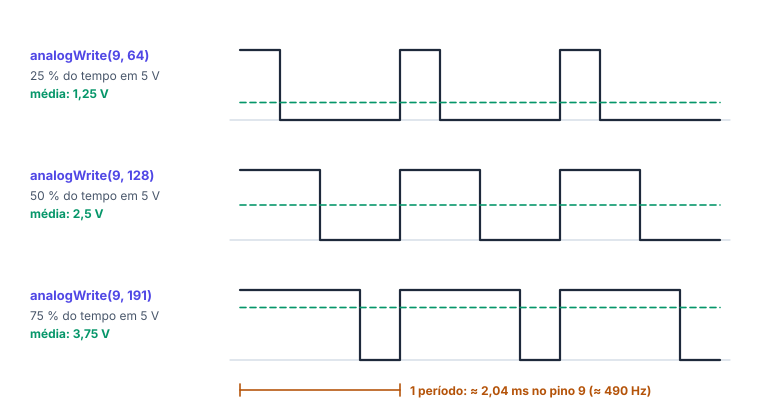

# 🌗 PWM e analogWrite()

> [← Leitura analógica](21-leitura-analogica.md) · Próximo: [Sensores e atuadores →](23-sensores-e-atuadores.md)

**Nível:** 🟡 Intermediário

> 📖 **Antes, leia:** [Saídas digitais, LED e Blink](17-saidas-digitais.md) e [Leitura analógica](21-leitura-analogica.md).

## 🎯 Você vai aprender

- O que é **PWM** e o que é o **ciclo de trabalho** (*duty cycle*).
- Usar o `analogWrite` nos pinos com **~** e calcular a **tensão média**.
- Saber a **frequência** e o **período** do PWM do Uno.
- Controlar o brilho de um LED e misturar cores num **LED RGB**.
- (ampliação) Saber qual **timer** faz cada pino, e por que `tone()` e `Servo` atrapalham o PWM.

## Em uma frase

> 💡 O pino digital só tem 0 V e 5 V. O **PWM** liga e desliga o pino centenas de vezes por segundo, e a fração do tempo em que ele fica ligado decide a **média**: é ela que o LED (pelo olho) e o motor sentem.

## 1. O truque do PWM

PWM é *Pulse Width Modulation*, modulação por largura de pulso. A frequência fica fixa; o que muda é **quanto tempo** de cada período o pino passa em 5 V.



| Nome | O que é | Fórmula |
| ---- | ------- | ------- |
| Período (T) | Duração de um ciclo, ligado + desligado | T = 1 / f |
| Tempo ligado (t_on) | Parte do período em 5 V | t_on = D · T |
| **Ciclo de trabalho** (D) | Fração do período em 5 V | D = t_on / T |
| Tensão média | O que "sobra" na média | V_média = D · 5 V |

## 2. analogWrite()

```cpp
analogWrite(9, 128);   // pino 9: PWM com uns 50 % do tempo em 5 V
```

| Valor | Ciclo de trabalho (valor / 255) | Tensão média |
| ----- | ------------------------------- | ------------ |
| 0 | 0 % (sempre 0 V) | 0 V |
| 64 | ≈ 25 % | ≈ 1,25 V |
| 128 | ≈ 50 % | ≈ 2,5 V |
| 191 | ≈ 75 % | ≈ 3,75 V |
| 255 | 100 % (sempre 5 V) | 5 V |

- **Só nos pinos com ~:** no Uno, **3, 5, 6, 9, 10 e 11**.
- **Não precisa de `pinMode`**: o `analogWrite` já põe o pino como saída.
- **O nome engana:** não sai tensão analógica de verdade. Sai uma onda quadrada de 0 e 5 V; quem tira a média é o olho, o motor ou um filtro.
- Num pino **sem** ~, `analogWrite` vira liga-desliga: abaixo de 128 fica em LOW, de 128 para cima fica em HIGH.

## 3. Frequência e período

| Pinos | Frequência | Período |
| ----- | ---------- | ------- |
| 5 e 6 | ≈ 980 Hz (976,6 Hz) | ≈ 1,02 ms |
| 3, 9, 10 e 11 | ≈ 490 Hz (490,2 Hz) | ≈ 2,04 ms |

**Exemplo:** `analogWrite(9, 191)` → D = 191 / 255 ≈ 0,75 → t_on = 0,75 · 2,04 ms ≈ **1,53 ms** ligado a cada 2,04 ms.

O olho não percebe nada acima de umas 60 a 100 piscadas por segundo: a 490 Hz, o LED parece **aceso com menos brilho**, sem piscar.

## 4. Brilho de LED e LED RGB

O PWM não muda a corrente do LED **enquanto ele está ligado**: com 220 Ω, continua uns 12 a 13 mA. Muda a **corrente média**:

| `analogWrite` | Corrente ligado | Corrente média |
| ------------- | --------------- | -------------- |
| 255 | 12 mA | 12 mA |
| 128 | 12 mA | ≈ 6 mA |
| 64 | 12 mA | ≈ 3 mA |

Ligando o potenciômetro ao brilho: `analogWrite(9, map(analogRead(A0), 0, 1023, 0, 255));`. É o [projeto 07 · Dimmer com PWM](../laboratorio/projetos/07-dimmer-pwm/README.md).

No **LED RGB**, cada cor ganha um pino PWM e um resistor. Misturando:

| Vermelho | Verde | Azul | Cor |
| -------- | ----- | ---- | --- |
| 255 | 255 | 0 | Amarelo |
| 255 | 0 | 255 | Magenta |
| 0 | 255 | 255 | Ciano |
| 255 | 255 | 255 | Branco |
| 255 | 128 | 0 | Laranja |

Isso vale para o LED de **cátodo comum** (perna comum no GND). No de **ânodo comum** (perna comum no 5V), a cor acende com o pino em **LOW**: escreva `255 - valor`. Veja o [projeto 10 · LED RGB](../laboratorio/projetos/10-led-rgb/README.md).

## 5. E o motor?

Um motor também responde à tensão média: PWM controla a **velocidade**. Mas o pino aguenta só uns 20 mA (40 mA no máximo), e um motor pequeno pede centenas de mA. O PWM vai para a base de um **transistor**, e o transistor liga o motor: veja a aula de [Sensores e atuadores](23-sensores-e-atuadores.md).

## 6. Os timers por trás do PWM (ampliação)

O PWM é feito pelos **timers** do ATmega328P, que contam sozinhos sem ocupar o programa:

| Timer | Pinos de PWM | Também usado por |
| ----- | ------------ | ---------------- |
| Timer 0 | 5 e 6 | `millis()`, `micros()` e `delay()` |
| Timer 1 | 9 e 10 | Biblioteca `Servo` (no Uno, desliga o PWM do 9 e do 10) |
| Timer 2 | 3 e 11 | `tone()` (enquanto toca, o PWM do 3 e do 11 para) |

Por isso a ordem importa num projeto com tudo junto: servo, buzzer e LED com PWM não podem disputar o mesmo timer.

## 🔬 Mão na massa

1. Faça o [projeto 07 · Dimmer com PWM](../laboratorio/projetos/07-dimmer-pwm/README.md) e confira a tabela da seção 4.
2. Faça o [projeto 10 · LED RGB](../laboratorio/projetos/10-led-rgb/README.md) e acrescente o laranja e o ciano.
3. **Respiração:** sem potenciômetro, faça o brilho subir de 0 a 255 e voltar, sem `delay` longo (use `millis()`).

## ⚠️ Erros comuns

| Erro | Como evitar |
| ---- | ----------- |
| `analogWrite` num pino sem ~ | Só liga ou desliga. Use 3, 5, 6, 9, 10 ou 11 |
| Valor acima de 255 | Converta antes com `map(…, 0, 1023, 0, 255)` ou divida a leitura por 4 |
| Achar que sai 2,5 V "de verdade" | Sai 0 e 5 V alternando; a média é 2,5 V |
| Motor direto no pino com PWM | O pino não aguenta: use um transistor |
| `tone()` ou `Servo` junto com PWM nos pinos do mesmo timer | Mude o LED para um pino de outro timer |

## 💡 Macetes

- **D = valor / 255** e **V_média = D · 5 V**.
- **490 Hz → 2,04 ms**; **980 Hz → 1,02 ms**.
- **Para lembrar os pinos com PWM:** procure o **~** ao lado do número na placa.

## 🧾 Resumo

| Ideia | Em poucas palavras |
| ----- | ------------------ |
| PWM | Liga e desliga rápido; o tempo ligado decide a média |
| Ciclo de trabalho | D = t_on / T = valor / 255 |
| `analogWrite(p, v)` | v de 0 a 255, só nos pinos 3, 5, 6, 9, 10 e 11 |
| Frequência | ≈ 490 Hz (≈ 980 Hz nos pinos 5 e 6) |
| LED | O brilho segue a corrente média |
| LED RGB | Três PWM: mistura de vermelho, verde e azul |
| Timers (ampliação) | `tone()` usa o do 3 e do 11; `Servo`, o do 9 e do 10 |

## ✅ Teste rápido

**1.** O pino 7 do Uno faz PWM? Responda sim ou não.

<details>
<summary>Ver resposta</summary>

**Resposta:** `não | nao`

Os pinos com PWM são 3, 5, 6, 9, 10 e 11. O 7 **não** tem o ~.
</details>

**2.** Com `analogWrite(9, 64)`, qual é o ciclo de trabalho, em porcentagem?

<details>
<summary>Ver resposta</summary>

**Número:** `25 ± 0,5`

64 / 255 ≈ 0,251 → **25 %**.
</details>

**3.** Qual é a tensão média com `analogWrite(9, 51)`?

<details>
<summary>Ver resposta</summary>

**Grandeza:** `1 V ± 0,02 V`

D = 51 / 255 = 0,2 → 0,2 · 5 V = **1 V**.
</details>

**4.** O PWM do pino 9 tem uns 490 Hz. Qual é o período?

<details>
<summary>Ver resposta</summary>

**Grandeza:** `2,04 ms ± 0,01 ms`

T = 1 / 490 Hz ≈ 0,00204 s = **2,04 ms**.
</details>

**5.** Que valor de `analogWrite` dá uma tensão média de 4 V?

<details>
<summary>Ver resposta</summary>

**Número:** `204 ± 1`

D = 4 / 5 = 0,8 → 0,8 · 255 = **204**.
</details>

**6.** LED RGB de cátodo comum: vermelho e verde em 255, azul em 0. Que cor aparece?

<details>
<summary>Ver resposta</summary>

**Resposta:** `amarelo`

Vermelho + verde = **amarelo**.
</details>

## ✏️ Agora pratique

São 9 exercícios sobre este assunto, do fácil ao difícil, com resolução passo a passo:

| 🟢 Fácil | 🟡 Intermediário | 🔴 Difícil |
| -------- | ---------------- | ---------- |
| [Exercícios 01 a 03](../exercicios/22-pwm/facil.md) | [Exercícios 04 a 06](../exercicios/22-pwm/intermediario.md) | [Exercícios 07 a 09](../exercicios/22-pwm/dificil.md) |

## 📚 Referências

- MCROBERTS, Michael. *Arduino básico*. 2. ed. São Paulo: Novatec, 2015. Projetos com PWM e LED RGB.
- BANZI, Massimo; SHILOH, Michael. *Primeiros passos com o Arduino*. 2. ed. São Paulo: Novatec, 2015. Capítulo de PWM.
- [Basics of PWM, na documentação do Arduino](https://docs.arduino.cc/learn/microcontrollers/analog-output/) (em inglês).
- [Referência de `analogWrite()`](https://docs.arduino.cc/language-reference/en/functions/analog-io/analogWrite/) (em inglês): pinos e frequências de cada placa.
