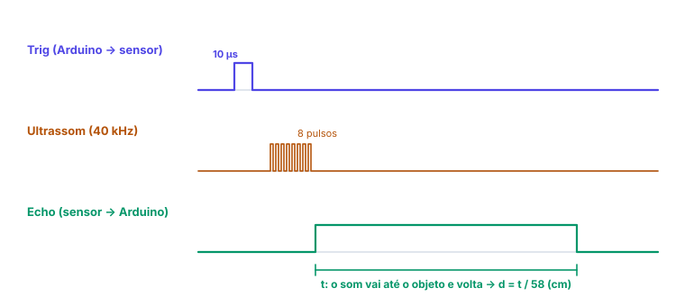

# 📡 Sensores e atuadores

> [← PWM e analogWrite()](22-pwm.md) · [Voltar para Sistemas Digitais →](../README.md)

**Nível:** 🔴 Avançado

> 📖 **Antes, leia:** [Entradas digitais e botões](19-entradas-digitais.md), [PWM e analogWrite()](22-pwm.md) e o transistor e a ponte H na aula de [Componentes eletrônicos](14-componentes-eletronicos.md).

## 🎯 Você vai aprender

- Separar **sensores** (o Arduino lê) de **atuadores** (o Arduino comanda), e o tipo de sinal de cada um.
- Tocar notas num **buzzer** com `tone()`.
- Ler um sensor de presença **PIR** e um sensor de distância **ultrassônico** (HC-SR04) com `pulseIn()`.
- Posicionar um **servo** com a biblioteca `Servo`.
- Ligar um **motor** por um transistor, calcular o resistor da base e proteger o circuito com um diodo.
- Usar um **relé** com segurança e lembrar da **ponte H**.

## Em uma frase

> 💡 O Arduino conversa com o mundo por tensões e pulsos: **sensores** viram HIGH/LOW, tensão ou largura de pulso; **atuadores** recebem nível, PWM ou pulso, e os que pedem corrente demais passam por um **transistor**.

## 1. Sensores, atuadores e o tipo de sinal

| Peça | Papel | Sinal | Como o Arduino trata |
| ---- | ----- | ----- | -------------------- |
| Botão | Sensor | Digital (HIGH/LOW) | `digitalRead` |
| PIR | Sensor | Digital (HIGH/LOW) | `digitalRead` |
| Potenciômetro, LDR | Sensor | Tensão de 0 a 5 V | `analogRead` |
| HC-SR04 (ultrassom) | Sensor | **Largura de pulso** | `pulseIn` |
| LED | Atuador | Nível ou PWM | `digitalWrite`, `analogWrite` |
| Buzzer passivo | Atuador | Onda quadrada na frequência da nota | `tone` |
| Servo | Atuador | Pulso de 0,5 a 2,4 ms a cada 20 ms | Biblioteca `Servo` |
| Motor DC, relé | Atuador | Nível ou PWM, **por um transistor** | `digitalWrite`, `analogWrite` |

## 2. Buzzer e tone()

O **buzzer passivo** é um alto-falante pequeno: precisa de um sinal que liga e desliga na frequência da nota. O `tone()` gera esse sinal sozinho, com um timer.

| Função | O que faz |
| ------ | --------- |
| `tone(8, 440);` | Toca 440 Hz no pino 8 até mandar parar |
| `tone(8, 440, 200);` | Toca 440 Hz por 200 ms e para sozinho (o programa **não** espera) |
| `noTone(8);` | Para o som |

| Nota | Dó | Ré | Mi | Fá | Sol | Lá | Si | Dó |
| ---- | -- | -- | -- | -- | --- | -- | -- | -- |
| Frequência (Hz) | 262 | 294 | 330 | 349 | 392 | **440** | 494 | 523 |

Subir uma **oitava** dobra a frequência: o lá de 440 Hz vira 880 Hz.

- O **buzzer ativo** tem oscilador dentro: com `digitalWrite(pino, HIGH)`, ele apita numa nota só.
- No Uno, só **um** `tone()` toca por vez, e ele usa o timer 2: enquanto toca, o PWM dos pinos 3 e 11 para.

Veja o [projeto 09 · Campainha](../laboratorio/projetos/09-campainha/README.md).

## 3. Sensor de presença PIR

O PIR (*Passive InfraRed*) percebe a **mudança** do calor (infravermelho) na frente dele, como uma pessoa passando. O módulo comum (HC-SR501) tem 3 pinos:

| Pino | Ligação | Observação |
| ---- | ------- | ---------- |
| VCC | 5V | Aceita de 5 a 20 V |
| OUT | Pino digital (`INPUT`, sem pull-up) | **3,3 V** com movimento: já é HIGH no Uno |
| GND | GND | |

- **Aquecimento:** depois de ligado, leva até 1 minuto para estabilizar e pode disparar sozinho nesse tempo.
- **Dois ajustes** (potenciômetros no módulo): sensibilidade (alcance de até uns 7 m) e tempo que a saída fica em HIGH depois do movimento (de alguns segundos a alguns minutos).
- Para escrever a mensagem **uma vez** por movimento, detecte a **borda de subida** (LOW → HIGH), como na aula de [entradas digitais](19-entradas-digitais.md).

Veja o [projeto 11 · Alarme de movimento](../laboratorio/projetos/11-alarme-de-movimento/README.md).

## 4. Sensor ultrassônico HC-SR04 e pulseIn()

O HC-SR04 mede distância como um morcego: manda um som que não ouvimos (40 kHz) e cronometra o eco.



```cpp
long medirDistancia() {
  digitalWrite(TRIG, LOW);
  delayMicroseconds(2);
  digitalWrite(TRIG, HIGH);   // pulso de 10 µs dispara a medida
  delayMicroseconds(10);
  digitalWrite(TRIG, LOW);
  long t = pulseIn(ECHO, HIGH, 30000);   // µs em HIGH no Echo; 0 se passar de 30 ms
  return (t + 29) / 58;                  // 58 µs por cm (ida e volta), arredondando
}
```

O som anda uns **343 m/s** = 0,0343 cm/µs. O tempo do Echo é de **ida e volta**:

$$d = \frac{t \cdot 0{,}0343}{2} \approx \frac{t}{58} \qquad (t \text{ em µs}, d \text{ em cm})$$

| Distância | Echo em HIGH |
| --------- | ------------ |
| 2 cm (mínimo) | ≈ 116 µs |
| 20 cm | ≈ 1 160 µs |
| 1 m | ≈ 5 800 µs |
| 4 m (máximo) | ≈ 23 200 µs |

- `pulseIn(pino, HIGH, limite)` devolve a largura do pulso em **µs**, ou **0** se ele não vier dentro do limite (em µs; o padrão é 1 s). Por isso **0 quer dizer "sem eco"**, e não "objeto encostado".
- Superfícies macias (tecido) ou inclinadas devolvem pouco eco: a medida falha.

Veja o [projeto 12 · Cancela automática](../laboratorio/projetos/12-cancela-automatica/README.md).

## 5. Servo

O **servo** tem um motor, engrenagens e um circuito que segura o eixo num **ângulo** de 0° a 180°. O ângulo vem da **largura de um pulso** que chega a cada 20 ms (50 vezes por segundo):

| `servo.write(...)` | Pulso no fio de sinal (biblioteca `Servo`) |
| ------------------ | ------------------------------------------ |
| 0 | 544 µs |
| 45 | 1 008 µs |
| 90 | 1 472 µs |
| 180 | 2 400 µs |

```cpp
#include <Servo.h>

Servo braco;

void setup() {
  braco.attach(6);   // fio de sinal (laranja) no pino 6
}

void loop() {
  braco.write(0);
  delay(1000);
  braco.write(90);
  delay(1000);
}
```

| Fio do SG90 | Ligação |
| ----------- | ------- |
| Marrom | GND |
| Vermelho | 5V |
| Laranja | Pino de sinal |

> ⚠️ Ao se mexer, o servo puxa **picos de algumas centenas de mA**. Um micro servo sem carga funciona no 5V do Uno; servos maiores, ou vários, pedem uma fonte separada, com o **GND ligado** ao do Arduino.

No Uno, a biblioteca `Servo` usa o timer 1 e desliga o PWM dos pinos 9 e 10.

## 6. Motor DC com transistor

O pino aguenta uns 20 mA; um motor pequeno pede de 100 a 500 mA. O pino comanda a **base** de um transistor NPN, e o transistor liga o motor:


**Resistor da base, passo a passo** (motor de 200 mA, transistor com ganho β = 100, V_BE ≈ 0,7 V):

| Passo | Conta | Resultado |
| ----- | ----- | --------- |
| 1. Corrente mínima na base | I_B = I_C / β = 200 mA / 100 | 2 mA |
| 2. Margem para o transistor saturar (conduzir de vez) | 5 × 2 mA | 10 mA |
| 3. Resistor | R_B = (5 − 0,7) V / 10 mA | 430 Ω |
| 4. Valor comercial | 470 Ω → (5 − 0,7) / 470 | ≈ 9,1 mA (ainda 4,5 vezes o mínimo) |

- **Diodo de roda livre** (como o 1N4007) em paralelo com o motor, com o cátodo (a faixa) no lado positivo: quando o transistor desliga, o motor gera um pico de tensão, e o diodo dá um caminho para ele em vez de queimar o transistor.
- **PWM na base** controla a velocidade: `analogWrite(9, 128)` deixa o motor com metade da tensão média.
- **GND comum:** se o motor tem fonte própria (pilhas, 9 V), o GND dela vai junto com o GND do Arduino.

## 7. Relé

O **relé** é uma chave mecânica movida por um eletroímã (a bobina). Com ele, um circuito pequeno liga outro, isolado.

| Contato | Sem a bobina acionada | Com a bobina acionada |
| ------- | --------------------- | --------------------- |
| **COM** (comum) ↔ **NA** (normalmente aberto) | Aberto | Fechado |
| **COM** ↔ **NF** (normalmente fechado) | Fechado | Aberto |

- Uma bobina de 5 V com 70 Ω pede 5 / 70 ≈ **71 mA**: precisa de transistor e de diodo, como o motor. Os **módulos de relé** já trazem os dois (e alguns acionam com o pino em **LOW**: leia a descrição).
- Use **NA** para a carga que deve ligar só quando o relé é acionado.

> ⚠️ **Segurança:** relés de módulo aguentam a tensão da tomada (127 ou 220 V), mas isso **não** é para montar em protoboard nem sem supervisão. Choque na rede elétrica mata. Na aula, use cargas de baixa tensão (um LED com a sua fonte, um motor de pilhas).

## 8. Ponte H (revisão)

Para inverter o sentido do motor, a corrente precisa passar por ele ao contrário: é a **ponte H** da [aula 14](14-componentes-eletronicos.md). Num módulo pronto (L298N, L293D, L9110S), o Arduino só comanda as entradas:

| IN1 | IN2 | Motor |
| --- | --- | ----- |
| HIGH | LOW | Gira para um lado |
| LOW | HIGH | Gira para o outro |
| LOW | LOW | Para |

A velocidade vem de um PWM no pino de habilitação (ENA) do módulo.

## 9. O que o laboratório do site simula

| Peça | No laboratório |
| ---- | -------------- |
| Buzzer | ✅ Mede a frequência no pino e, se quiser, toca o som |
| PIR | ✅ Botão de movimento; a saída vai a 3,3 V na hora (sem aquecimento nem tempo de espera) |
| HC-SR04 | ✅ Distância ajustável de 2 a 450 cm; o eco sai no tempo certo (acima de 4 m, sem eco) |
| Servo | ✅ Ângulo pela largura do pulso; avisa quando falta alimentação |
| Motor, transistor, diodo, relé, ponte H | ❌ Fora do simulador: monte no Tinkercad, no Wokwi ou na placa |

## 🔬 Mão na massa

1. [Projeto 09 · Campainha](../laboratorio/projetos/09-campainha/README.md): toque uma melodia de 4 notas com a tabela da seção 2.
2. [Projeto 11 · Alarme de movimento](../laboratorio/projetos/11-alarme-de-movimento/README.md): conte as passagens.
3. [Projeto 12 · Cancela automática](../laboratorio/projetos/12-cancela-automatica/README.md): faça a cancela descer só 2 s depois de o carro passar.
4. No Tinkercad ou no Wokwi, monte o motor com transistor e diodo da seção 6 e controle a velocidade com um potenciômetro.

## ⚠️ Erros comuns

| Erro | Como evitar |
| ---- | ----------- |
| Motor, relé ou vários servos direto no pino | Transistor (ou módulo) e, se precisar, fonte separada com GND comum |
| Motor sem diodo de roda livre | O pico ao desligar queima o transistor |
| Trig e Echo trocados | O sensor nunca dispara e o `pulseIn` devolve 0 |
| Tratar 0 do `pulseIn` como "encostado" | 0 é "sem eco": trate à parte |
| Esquecer o `#include <Servo.h>` e o `attach` | Sem eles, o servo não recebe pulso |
| `tone()` junto com PWM no 3 ou no 11 | Mude o LED para outro pino com ~ |
| Mexer em 127/220 V na protoboard | Nunca. Use baixa tensão na aula |

## 💡 Macetes

- **Ultrassom:** distância em cm ≈ tempo em µs / 58.
- **Servo:** 0° ≈ 0,5 ms, 90° ≈ 1,5 ms, 180° ≈ 2,4 ms, a cada 20 ms.
- **Transistor:** I_B = I_C / β, com margem de umas 5 vezes; R_B = (5 − 0,7) / I_B.
- **Oitava acima = frequência em dobro.**

## 🧾 Resumo

| Peça | Em poucas palavras |
| ---- | ------------------ |
| Buzzer passivo | `tone(pino, f)` e `noTone(pino)`; uma nota por vez |
| PIR | Saída digital de 3,3 V; detecte a borda de subida |
| HC-SR04 | Pulso de 10 µs no Trig; `pulseIn` no Echo; d ≈ t / 58 |
| Servo | Biblioteca `Servo`: `attach` e `write(ângulo)`; pulso a cada 20 ms |
| Motor DC | Transistor + resistor de base + diodo de roda livre; PWM controla a velocidade |
| Relé | Bobina por transistor (ou módulo); COM, NA e NF; nada de rede elétrica na aula |
| Ponte H | Dois sinais escolhem o sentido; o PWM, a velocidade |

## ✅ Teste rápido

**1.** O servo é um sensor ou um atuador?

<details>
<summary>Ver resposta</summary>

**Resposta:** `atuador`

O Arduino **comanda** o servo: é um **atuador**.
</details>

**2.** Qual é a frequência da nota tocada por `tone(8, 880)`?

<details>
<summary>Ver resposta</summary>

**Grandeza:** `880 Hz`

O segundo argumento é a frequência: **880 Hz**, o lá uma oitava acima do 440.
</details>

**3.** O Echo do HC-SR04 ficou 1 160 µs em HIGH. A que distância está o objeto, em cm?

<details>
<summary>Ver resposta</summary>

**Número:** `20`

1 160 / 58 = **20 cm**.
</details>

**4.** O `pulseIn(ECHO, HIGH, 30000)` devolveu 0. O que isso quer dizer? Responda com a letra.

(a) o objeto está encostado no sensor; (b) o eco não voltou dentro de 30 ms; (c) o sensor mediu 0 cm.

<details>
<summary>Ver resposta</summary>

**Resposta:** `b`

0 é o "tempo esgotado" do `pulseIn`: **sem eco** dentro do limite.
</details>

**5.** Motor de 300 mA e transistor com β = 100. Qual é a corrente mínima na base?

<details>
<summary>Ver resposta</summary>

**Grandeza:** `3 mA`

I_B = I_C / β = 300 mA / 100 = **3 mA**. Na prática, use umas 5 vezes isso.
</details>

**6.** A carga deve ligar **só** quando o relé está acionado. Ela vai no contato NA ou NF?

<details>
<summary>Ver resposta</summary>

**Resposta:** `NA | normalmente aberto`

**NA** (normalmente aberto): fica aberto até a bobina ser acionada.
</details>

## ✏️ Agora pratique

São 9 exercícios sobre este assunto, do fácil ao difícil, com resolução passo a passo:

| 🟢 Fácil | 🟡 Intermediário | 🔴 Difícil |
| -------- | ---------------- | ---------- |
| [Exercícios 01 a 03](../exercicios/23-sensores-e-atuadores/facil.md) | [Exercícios 04 a 06](../exercicios/23-sensores-e-atuadores/intermediario.md) | [Exercícios 07 a 09](../exercicios/23-sensores-e-atuadores/dificil.md) |

## 📚 Referências

- MCROBERTS, Michael. *Arduino básico*. 2. ed. São Paulo: Novatec, 2015. Projetos com piezo, servo, motor e sensor ultrassônico.
- MONK, Simon. *Programação com Arduino: começando com sketches*. 2. ed. Porto Alegre: Bookman, 2017.
- BOYLESTAD, Robert L.; NASHELSKY, Louis. *Dispositivos eletrônicos e teoria de circuitos*. 11. ed. São Paulo: Pearson, 2013. Transistor como chave.
- [Referência de `tone()`](https://docs.arduino.cc/language-reference/en/functions/advanced-io/tone/) e de [`pulseIn()`](https://docs.arduino.cc/language-reference/en/functions/advanced-io/pulseIn/) (em inglês).
- [Biblioteca Servo](https://docs.arduino.cc/libraries/servo/) (em inglês).
- [Guia do sensor PIR, da Adafruit](https://learn.adafruit.com/pir-passive-infrared-proximity-motion-sensor) (em inglês).
