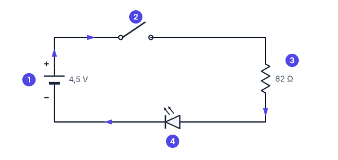
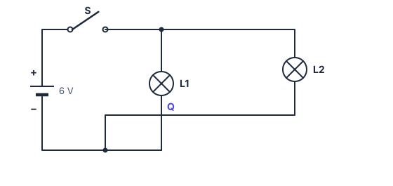

# ⚡ Introdução à eletrônica · 🔴 Difícil

> [← voltar para Exercícios](../README.md) · 📖 Antes, leia: [Introdução à eletrônica](../../aulas/10-introducao-a-eletronica.md) · Próximo: [Lei de Ohm →](../11-lei-de-ohm/facil.md)

Resolva no papel primeiro. No site, digite a resposta e clique em **Conferir**; no GitHub, abra **Ver resposta**.

---

## Exercício 07: Um jumper no lugar errado

Na bancada, uma bateria de 9 V acende uma lâmpada pelos fios. Sem querer, alguém encosta um **jumper** ligando as duas pontas da lâmpada, como no desenho do curto-circuito da aula.

**a)** A lâmpada continua acesa? Responda sim ou não.

Ver resposta

**Resposta:** `não`

O jumper é um caminho sem resistência ao lado da lâmpada. A corrente vai quase toda por ele, e a lâmpada apaga.

**b)** Por onde passa quase toda a corrente? Responda com a letra.

| Letra | Opção |
| ----- | ----- |
| a | Pela lâmpada |
| b | Pelo jumper |
| c | Não passa corrente nenhuma |

Ver resposta

**Resposta:** `b`

A corrente prefere o caminho de **menor resistência**: o jumper. Ela não some (letra c): pelo contrário, fica enorme.

**c)** A corrente que sai da bateria fica **maior** ou **menor** do que antes do jumper?

Ver resposta

**Resposta:** `maior`

Antes, a lâmpada limitava a corrente. Com o curto, quase nada limita: a corrente dispara, e a bateria e os fios esquentam. Por isso se tira o jumper na hora.

---

## Exercício 08: A lanterna não acende

A lanterna do esquema abaixo não acende. Quatro defeitos são possíveis:

| Letra | Defeito |
| ----- | ------- |
| a | O interruptor ② está desligado |
| b | A bateria ① está descarregada (0 V) |
| c | Um fio soltou do resistor ③ |
| d | O resistor ③ foi trocado por um de 100 Ω |

**a)** Quais defeitos deixam o circuito **aberto**? Responda com as letras, em ordem alfabética (por exemplo, `bd`).

Ver resposta

**Resposta:** `ac | a,c | a e c`

| Letra | O caminho fica | Por quê |
| ----- | -------------- | ------- |
| a | **Aberto** | O interruptor desligado interrompe o caminho |
| b | Fechado | O caminho existe, mas não há tensão para empurrar a corrente |
| c | **Aberto** | O fio solto é uma interrupção |
| d | Fechado | 100 Ω é só um pouco mais que 82 Ω: o LED acende, um pouco mais fraco |

**b)** Dos defeitos que **não** abrem o circuito, qual também deixa o LED apagado? Responda com a letra.

Ver resposta

**Resposta:** `b`

Com a bateria descarregada, o caminho está completo, mas não há tensão: sem o "empurrão", não há corrente. Com 100 Ω (letra d), o LED continua aceso.

---

## Exercício 09: Fios que se cruzam

No esquema, a chave S liga a bateria a duas lâmpadas. O fio de volta da lâmpada L2 cruza o fio de L1 no ponto **Q**.

**a)** Com a chave S fechada, L1 acende? Responda sim ou não.

Ver resposta

**Resposta:** `sim`

L1 sai do fio de cima (depois da chave) e desce até o fio de baixo, que volta ao −. O caminho está completo.

**b)** No ponto Q, o fio de L2 está ligado ao fio de L1?

Ver resposta

**Resposta:** `não`

No ponto Q **não há bolinha**: os fios só passam um por cima do outro, sem ligação.

**c)** Com a chave S fechada, L2 acende?

Ver resposta

**Resposta:** `sim`

O fio de volta de L2 passa por Q sem se ligar, segue para a esquerda e desce até o fio de baixo, onde **há** uma bolinha. Ele chega ao − por esse caminho, então o circuito de L2 está fechado.

**d)** Com a chave S **aberta**, quantas lâmpadas acendem?

Ver resposta

**Número:** `0`

A chave está antes das duas lâmpadas, no único caminho que sai do + da bateria. Aberta, ela corta a corrente para as duas.

