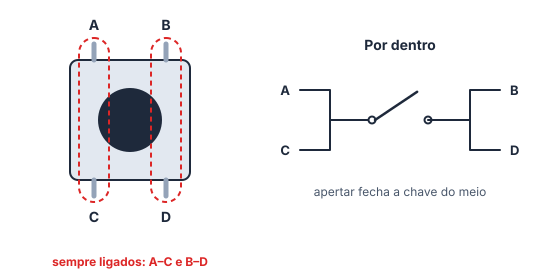

# 🧩 Componentes eletrônicos · 🟡 Intermediário

> [← voltar para Exercícios](../README.md) · 📖 Antes, leia: [Componentes eletrônicos](../../aulas/14-componentes-eletronicos.md) · Próximo: [Difícil →](dificil.md)

Resolva no papel primeiro. No site, digite a resposta (com a unidade, se quiser) e clique em **Conferir**; no GitHub, abra **Ver resposta**.

---

## Exercício 04: Tolerância

Um resistor tem as faixas **amarelo, violeta, marrom, dourado**.

**a)** Qual é o **menor** valor que ele pode ter, de verdade?

Ver resposta

**Grandeza:** `446,5 Ω`

Valor: 47 × 10 = 470 Ω. Dourado = ± 5 %, e 5 % de 470 = 23,5. Mínimo: 470 − 23,5 = **446,5 Ω**.

**b)** E o **maior**?

Ver resposta

**Grandeza:** `493,5 Ω`

470 + 23,5 = **493,5 Ω**

**c)** O multímetro mediu **455 Ω**. O resistor está dentro da tolerância? Responda sim ou não.

Ver resposta

**Resposta:** `sim`

455 está entre 446,5 e 493,5. Resistor bom.

---

## Exercício 05: O giro do potenciômetro

Um potenciômetro linear de 10 kΩ gira **270°** e está ligado entre **5 V** e **GND**.

**a)** Qual é a tensão no cursor com o eixo em **90°**?

Ver resposta

**Grandeza:** `1,67 V ± 0,01 V`

U = 5 · 90 / 270 = 5 / 3 ≈ **1,67 V**

**b)** E em **270°**, no fim do curso?

Ver resposta

**Grandeza:** `5 V`

No fim do curso, o cursor encosta na ponta do 5 V: **5 V**.

**c)** Em que ângulo o cursor fica com **2 V**? Escreva só o número, em graus.

Ver resposta

**Número:** `108`

2 = 5 · ângulo / 270 → ângulo = 270 · 2 / 5 = **108°**

---

## Exercício 06: O botão de 4 pinos

Use a figura do botão, com os pinos A, B, C e D.

**a)** Com o botão **solto**, os pinos A e C estão ligados? Responda sim ou não.

Ver resposta

**Resposta:** `sim`

A e C formam um dos pares que estão **sempre** ligados por dentro.

**b)** Com o botão **solto**, os pinos A e B estão ligados?

Ver resposta

**Resposta:** `não`

A e B estão em pares diferentes. Só ficam ligados quando o botão é apertado.

**c)** Com o botão **apertado**, os pinos C e D estão ligados?

Ver resposta

**Resposta:** `sim`

Apertar liga o par A–C ao par B–D, então C (do primeiro par) fica ligado a D (do segundo).

