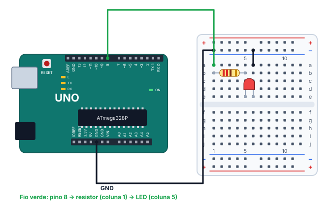

# 💡 Projeto 01 · Blink

> [← voltar para o Laboratório Arduino](../../README.md) · Próximo: [Dois LEDs alternados →](../02-dois-leds-alternados/README.md)

**Nível:** 🟢 Iniciante

O primeiro projeto de todo mundo: um LED no pino 8 que fica 1 s aceso e 1 s apagado, com uma mensagem no monitor serial a cada troca.

> 📖 **Antes, leia:** [Saídas digitais, LED e Blink](../../../aulas/17-saidas-digitais.md) e [Monitor serial](../../../aulas/18-monitor-serial.md).

<div class="laboratorio" data-projeto="circuito.json" data-titulo="Blink no laboratório" data-descricao="O circuito já montado e o programa compilado: clique em Executar e acompanhe o LED e o monitor serial. Os casos de teste dá para fazer lá mesmo."></div>

> 💡 No site, o laboratório roda o programa num Arduino Uno simulado. No GitHub, a montagem está em [`circuito.json`](circuito.json).

## 🎯 Objetivo

- Ligar um LED com resistor num pino digital.
- Usar `pinMode`, `digitalWrite` e `delay`.
- Acompanhar o programa pelo monitor serial, e entender por que ele **não** prova que o circuito está certo.

## 🧰 Componentes

| Qtd. | Componente | Detalhe |
| ---- | ---------- | ------- |
| 1 | Arduino Uno R3 | Com o cabo USB |
| 1 | Protoboard | Meia (400 furos) ou inteira |
| 1 | LED vermelho | Perna longa = ânodo (+) |
| 1 | Resistor de 220 Ω | Faixas vermelho, vermelho, marrom |
| 3 | Fios | Um para o pino 8 e dois para o GND |

## 🔌 Montagem



| Ligação | De | Para |
| ------- | -- | ---- |
| Fio verde | Pino 8 | Coluna 1, linha a |
| Resistor de 220 Ω | Coluna 1, linha b | Coluna 5, linha b |
| LED | Ânodo (perna longa) na coluna 5, linha e | Cátodo (perna curta) na coluna 6, linha e |
| Fio preto | Coluna 6, linha a | Barramento − de cima |
| Fio preto | GND da placa | Barramento − de cima |

A corrente faz este caminho: pino 8 → resistor → LED → barramento − → GND. Com o LED vermelho (2 V), ela fica em (5 − 2) / 220 ≈ **13,6 mA**, abaixo dos 20 mA recomendados para o pino.

| Pino do Uno | Ligado a | Modo |
| ----------- | -------- | ---- |
| 8 | Resistor e LED | Saída (`OUTPUT`) |
| GND | Cátodo do LED, pelo barramento − | — |
| 0 e 1 | Nada: são a serial | — |

## ⌨️ Código inicial

```cpp
const int LED = 8;

void setup() {
  // 1. Configure o pino LED como saída.
  // 2. Abra a serial a 9600 baud.
}

void loop() {
  // 3. Ligue o LED e escreva "Ligado" no monitor serial.
  // 4. Espere 1 s.
  // 5. Desligue o LED e escreva "Desligado".
  // 6. Espere 1 s.
}
```

## 🆘 Dicas

<details>
<summary>Dica 1: o setup</summary>

Duas linhas: `pinMode(LED, OUTPUT);` e `Serial.begin(9600);`.
</details>

<details>
<summary>Dica 2: ligar e escrever</summary>

`digitalWrite(LED, HIGH);` põe 5 V no pino. Logo depois, `Serial.println("Ligado");` escreve a linha no monitor.
</details>

<details>
<summary>Dica 3: o LED parece sempre aceso</summary>

Falta o `delay(1000);` **depois** do `LOW`. Sem ele, o `loop()` recomeça na hora e o LED fica apagado por alguns microssegundos só.
</details>

<details>
<summary>Dica 4: o LED não acende de jeito nenhum</summary>

Confira, nesta ordem: o fio está no pino 8? A perna longa está do lado do resistor? O cátodo chega ao barramento −, e o barramento ao GND? Teste o código com `LED_BUILTIN` no lugar do `8`: se o LED L da placa piscar, o problema está na montagem.
</details>

## 🧪 Casos de teste

Comece pela montagem e pelo código certos (caso 1). Em cada caso seguinte, faça **só** a mudança indicada, confira e desfaça antes do próximo. No laboratório do site, todos os casos funcionam: os que mudam o código usam os programas prontos da aba **Código**.

| # | O que mudar | O que tem que acontecer |
| - | ----------- | ----------------------- |
| 1 | Nada | O LED pisca, 1 s aceso e 1 s apagado. O monitor mostra `Ligado` e `Desligado`, alternados, uma linha por segundo |
| 2 | No código, `const int LED = 7;` (no laboratório: o programa "Com defeito: pino 7") | O LED não acende: o programa mexe no pino 7, onde não há nada |
| 3 | Tire o fio verde do pino 8 | O LED não acende |
| 4 | Tire o fio do GND da placa | O LED não acende: falta o caminho de volta |
| 5 | Vire o LED, com a perna longa na coluna 6 (no laboratório: tecla **I**) | O LED não acende: invertido, ele bloqueia a corrente |
| 6 | Troque os dois `delay(1000)` por `delay(500)` (no laboratório: o programa "Intervalo de 500 ms") | Pisca no dobro da frequência: período de 1 s |
| 7 | Aperte o reset da placa (no laboratório: **↺ Reiniciar**) | O programa recomeça do zero: a próxima linha é `Ligado` |
| 8 | Pare a simulação ou tire o USB (no laboratório: **■ Parar**) | O LED para de piscar e o monitor não recebe mais linhas |
| 9 | Com o LED fora da protoboard, olhe o monitor | Continua aparecendo `Ligado` e `Desligado`: a serial mostra o **programa**, não o circuito |

## ✅ Critérios de conclusão

- [ ] O LED pisca com 1 s aceso e 1 s apagado.
- [ ] O monitor mostra `Ligado` e `Desligado`, alternados, e as mensagens batem com o LED.
- [ ] O LED tem resistor e a perna longa está do lado do pino.
- [ ] Os casos 2 a 9 deram o resultado da tabela.
- [ ] Você sabe explicar o caso 9 com as suas palavras.

## 🔑 Solução

<details>
<summary>Ver a solução</summary>

```cpp
const int LED = 8;

void setup() {
  pinMode(LED, OUTPUT);
  Serial.begin(9600);
}

void loop() {
  digitalWrite(LED, HIGH);
  Serial.println("Ligado");
  delay(1000);

  digitalWrite(LED, LOW);
  Serial.println("Desligado");
  delay(1000);
}
```

O mesmo código está no arquivo [`blink.ino`](blink.ino), para baixar e abrir na IDE do Arduino.
</details>

## 🚀 Para ir além

- **Sem montar nada:** troque `8` por `LED_BUILTIN` e veja o LED L da placa piscar.
- **Contador:** imprima o número da piscada (`Piscada 1`, `Piscada 2`...) com uma variável global.
- **SOS:** pisque o SOS do código Morse: três piscadas curtas, três longas e três curtas, com uma pausa no fim.
- **Dois pinos:** passe para o [projeto 02](../02-dois-leds-alternados/README.md).

## 📚 Referências

- MCROBERTS, Michael. *Arduino básico*. 2. ed. São Paulo: Novatec, 2015. Projeto 1.
- [Exemplo Blink, na documentação do Arduino](https://docs.arduino.cc/built-in-examples/basics/Blink/) (em inglês).
