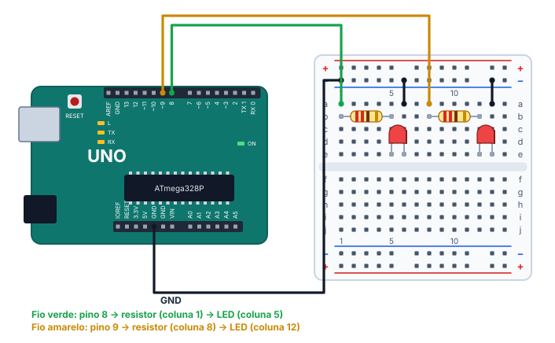

# 🔁 Projeto 02 · Dois LEDs alternados

> [← voltar para o Laboratório Arduino](../../README.md) · Próximo: [Semáforo →](../03-semaforo/README.md)

**Nível:** 🟢 Iniciante

Dois LEDs, nos pinos 8 e 9, que se revezam a cada 500 ms: quando um acende, o outro apaga. Depois, você muda o código para eles piscarem juntos e num ritmo próprio.

> 📖 **Antes, leia:** [Saídas digitais, LED e Blink](../../../aulas/17-saidas-digitais.md) e faça o [projeto 01](../01-blink/README.md).

## 🎯 Objetivo

- Controlar **dois pinos** de saída no mesmo programa.
- Montar dois LEDs, cada um com o **seu** resistor, com um retorno comum ao GND.
- Criar três comportamentos: **alternados**, **síncronos** e **ritmados**.

## 🧰 Componentes

| Qtd. | Componente | Detalhe |
| ---- | ---------- | ------- |
| 1 | Arduino Uno R3 | Com o cabo USB |
| 1 | Protoboard | Meia (400 furos) ou inteira |
| 2 | LEDs vermelhos | Perna longa = ânodo (+) |
| 2 | Resistores de 220 Ω | Um para cada LED |
| 5 | Fios | Um para cada pino, dois para o barramento − e um para o GND |

## 🔌 Montagem



| Ligação | De | Para |
| ------- | -- | ---- |
| Fio verde | Pino 8 | Coluna 1, linha a |
| Resistor A (220 Ω) | Coluna 1, linha b | Coluna 5, linha b |
| LED A | Ânodo na coluna 5, linha e | Cátodo na coluna 6, linha e |
| Fio preto | Coluna 6, linha a | Barramento − de cima |
| Fio amarelo | Pino 9 | Coluna 8, linha a |
| Resistor B (220 Ω) | Coluna 8, linha b | Coluna 12, linha b |
| LED B | Ânodo na coluna 12, linha e | Cátodo na coluna 13, linha e |
| Fio preto | Coluna 13, linha a | Barramento − de cima |
| Fio preto | GND da placa | Barramento − de cima |

> ⚠️ **Um resistor para cada LED.** Com um resistor só, no retorno comum, os dois LEDs ficariam em paralelo quando acendem juntos, dividindo a corrente de um jeito desigual, como na [aula de série e paralelo](../../../aulas/12-circuitos-serie-e-paralelo.md).

| Pino do Uno | Ligado a | Modo |
| ----------- | -------- | ---- |
| 8 | LED A | Saída (`OUTPUT`) |
| 9 | LED B | Saída (`OUTPUT`) |
| GND | Os dois cátodos, pelo barramento − | — |

## ⌨️ Código inicial

```cpp
const int LED_A = 8;
const int LED_B = 9;

void setup() {
  // 1. Configure os dois pinos como saída.
}

void loop() {
  // 2. Acenda o A e apague o B. Espere 500 ms.
  // 3. Apague o A e acenda o B. Espere 500 ms.
}
```

## 🆘 Dicas

<details>
<summary>Dica 1: o setup</summary>

Um `pinMode` para cada pino: `pinMode(LED_A, OUTPUT);` e `pinMode(LED_B, OUTPUT);`.
</details>

<details>
<summary>Dica 2: alternar</summary>

Em cada metade do `loop()`, escreva nos **dois** pinos: um em `HIGH` e o outro em `LOW`. Depois, o `delay(500)`.
</details>

<details>
<summary>Dica 3: só um LED funciona</summary>

Compare as duas montagens, peça por peça: o LED que não acende está invertido? O fio do cátodo dele chega ao barramento −? O `pinMode` do pino dele está no `setup()`?
</details>

## 🧪 Casos de teste

Comece pela montagem e pelo código certos (caso 1). Em cada caso seguinte, faça **só** a mudança indicada, confira e desfaça antes do próximo.

| # | O que mudar | O que tem que acontecer |
| - | ----------- | ----------------------- |
| 1 | Nada | Os LEDs se revezam a cada 500 ms, e nunca ficam os dois acesos juntos |
| 2 | Vire o LED B | Só o LED A pisca |
| 3 | Apague o `pinMode(LED_B, OUTPUT);` | O LED B fica bem fraquinho, quase apagado: o pino 9 continua como entrada |
| 4 | Tire o fio do GND da placa | Nenhum dos dois acende: os dois voltam ao GND pelo mesmo barramento |
| 5 | Troque os números: `LED_A = 9` e `LED_B = 8` | Parece igual: com tempos iguais, não dá para saber quem começa |

## ✏️ Desafios

**1. Síncronos:** mude o `loop()` para os dois LEDs acenderem e apagarem **juntos**, 500 ms cada.

<details>
<summary>Ver uma resposta</summary>

```cpp
void loop() {
  digitalWrite(LED_A, HIGH);
  digitalWrite(LED_B, HIGH);
  delay(500);
  digitalWrite(LED_A, LOW);
  digitalWrite(LED_B, LOW);
  delay(500);
}
```
</details>

**2. Ritmados:** faça o LED A piscar como uma batida de coração (duas piscadas rápidas de 100 ms e uma pausa de 700 ms), com o LED B aceso só durante a pausa.

<details>
<summary>Ver uma resposta</summary>

```cpp
void loop() {
  digitalWrite(LED_B, LOW);
  digitalWrite(LED_A, HIGH);
  delay(100);
  digitalWrite(LED_A, LOW);
  delay(100);
  digitalWrite(LED_A, HIGH);
  delay(100);
  digitalWrite(LED_A, LOW);
  digitalWrite(LED_B, HIGH);
  delay(700);
}
```

O período é 100 + 100 + 100 + 700 = 1 000 ms.
</details>

**3. Tempos diferentes:** com 300 ms para o A e 700 ms para o B, refaça o caso 5. Agora dá para perceber a troca?

<details>
<summary>Ver a resposta</summary>

Sim: o LED que fica 700 ms aceso passa a ser o outro. Com tempos diferentes, a constante errada aparece na hora. Por isso vale usar nomes claros (`LED_VERMELHO`, `LED_ERRO`) e conferir a montagem com a tabela de pinos.
</details>

## ✅ Critérios de conclusão

- [ ] Os LEDs se revezam a cada 500 ms.
- [ ] Cada LED tem o seu resistor e os dois voltam ao GND pelo barramento −.
- [ ] Os casos 2 a 5 deram o resultado da tabela.
- [ ] Você fez os desafios 1 e 2.

## 🔑 Solução

<details>
<summary>Ver a solução</summary>

```cpp
const int LED_A = 8;
const int LED_B = 9;

void setup() {
  pinMode(LED_A, OUTPUT);
  pinMode(LED_B, OUTPUT);
}

void loop() {
  digitalWrite(LED_A, HIGH);
  digitalWrite(LED_B, LOW);
  delay(500);

  digitalWrite(LED_A, LOW);
  digitalWrite(LED_B, HIGH);
  delay(500);
}
```

O mesmo código está no arquivo [`dois-leds.ino`](dois-leds.ino).
</details>

## 🚀 Para ir além

- **Função:** escreva `void piscar(int pino, int tempo)` e use-a no `loop()`.
- **Corrida de luz:** com quatro LEDs (pinos 8 a 11), acenda um de cada vez, indo e voltando.
- **Semáforo:** com três LEDs, passe para o [projeto 03](../03-semaforo/README.md).

## 📚 Referências

- MCROBERTS, Michael. *Arduino básico*. 2. ed. São Paulo: Novatec, 2015. Projeto 2.
- [digitalWrite, na referência do Arduino](https://docs.arduino.cc/language-reference/en/functions/digital-io/digitalwrite/) (em inglês).
