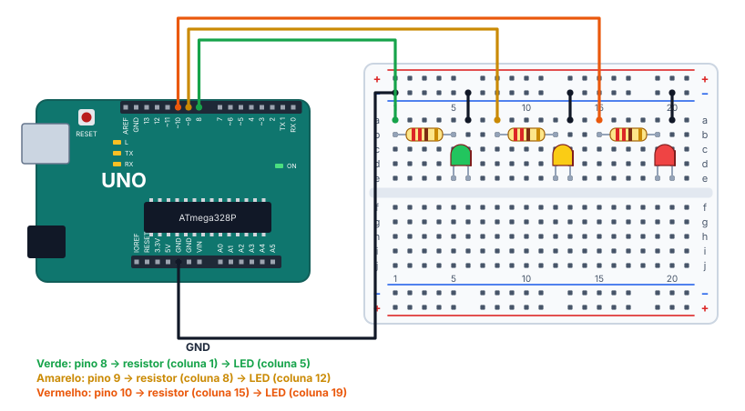

# 🚦 Projeto 03 · Semáforo

> [← voltar para o Laboratório Arduino](../../README.md)

**Nível:** 🟡 Intermediário

Um semáforo com três LEDs: verde por 5 s, amarelo por 2 s e vermelho por 5 s, sempre **um de cada vez**. O monitor serial mostra a cor de cada fase.

> 📖 **Antes, leia:** a seção de semáforo da aula [Saídas digitais, LED e Blink](../../../aulas/17-saidas-digitais.md#6-semáforo) e faça o [projeto 02](../02-dois-leds-alternados/README.md).

<div class="laboratorio" data-projeto="circuito.json" data-titulo="Semáforo no laboratório" data-descricao="Os três LEDs montados e o programa compilado: clique em Executar e confira o tempo de cada fase pelo relógio do simulador."></div>

> 💡 No site, o laboratório roda o programa num Arduino Uno simulado. No GitHub, a montagem está em [`circuito.json`](circuito.json).

## 🎯 Objetivo

- Controlar três saídas em sequência, com tempos diferentes.
- Garantir que **só um** LED fique aceso em cada fase.
- Calcular o período do ciclo e conferir a ordem das fases pelo monitor serial.

## 🧰 Componentes

| Qtd. | Componente | Detalhe |
| ---- | ---------- | ------- |
| 1 | Arduino Uno R3 | Com o cabo USB |
| 1 | Protoboard | Meia (400 furos) ou inteira |
| 3 | LEDs | Um verde, um amarelo e um vermelho |
| 3 | Resistores de 220 Ω | Um para cada LED |
| 7 | Fios | Um para cada pino, três para o barramento − e um para o GND |

## 🔌 Montagem



| LED | Pino | Resistor | Ânodo | Cátodo e retorno |
| --- | ---- | -------- | ----- | ---------------- |
| Verde | 8 (fio verde até a coluna 1) | Coluna 1 → 5 | Coluna 5 | Coluna 6 → barramento − |
| Amarelo | 9 (fio amarelo até a coluna 8) | Coluna 8 → 12 | Coluna 12 | Coluna 13 → barramento − |
| Vermelho | 10 (fio laranja até a coluna 15) | Coluna 15 → 19 | Coluna 19 | Coluna 20 → barramento − |

O barramento − vai ao GND da placa por um fio preto. Com 220 Ω, cada LED fica com uns 13 mA, e só um acende por vez: a placa fornece uns 13 mA no total.

## ⏱️ As fases

| Fase | Pino em HIGH | Tempo | Mensagem no monitor |
| ---- | ------------ | ----- | ------------------- |
| Siga | 8 (verde) | 5 s | `Verde` |
| Atenção | 9 (amarelo) | 2 s | `Amarelo` |
| Pare | 10 (vermelho) | 5 s | `Vermelho` |


Período: 5 + 2 + 5 = **12 s**, ou 5 ciclos por minuto.

## ⌨️ Código inicial

```cpp
const int VERDE = 8;
const int AMARELO = 9;
const int VERMELHO = 10;

void setup() {
  // 1. Configure os três pinos como saída.
  // 2. Abra a serial a 9600 baud.
}

void loop() {
  // 3. Siga: só o verde aceso. Escreva "Verde". Espere 5 s.
  // 4. Atenção: só o amarelo aceso. Escreva "Amarelo". Espere 2 s.
  // 5. Pare: só o vermelho aceso. Escreva "Vermelho". Espere 5 s.
}
```

## 🆘 Dicas

<details>
<summary>Dica 1: um LED de cada vez</summary>

Em cada fase, pense em **dois** passos: apagar o LED da fase anterior e acender o da fase nova.
</details>

<details>
<summary>Dica 2: o vermelho não apaga mais</summary>

O `loop()` termina com o vermelho aceso, e a volta seguinte começa pelo verde. Se ninguém apagar o vermelho, ele fica aceso para sempre. Apague o vermelho no começo da fase verde.
</details>

<details>
<summary>Dica 3: as cores estão na ordem errada</summary>

Confira a tabela de montagem: cada cor tem o seu pino. Se o amarelo e o vermelho trocaram de lugar na protoboard, o vermelho acende por 2 s, e o amarelo por 5 s.
</details>

## 🧪 Casos de teste

Comece pela montagem e pelo código certos (caso 1). Em cada caso seguinte, faça **só** a mudança indicada, confira e desfaça antes do próximo. No laboratório do site, o caso 3 usa o programa pronto "Com defeito: o vermelho não apaga", e o caso 4 dá para fazer trocando a cor dos dois LEDs na aba **Selecionado**.

| # | O que mudar | O que tem que acontecer |
| - | ----------- | ----------------------- |
| 1 | Nada | Verde por 5 s, amarelo por 2 s, vermelho por 5 s, e recomeça. Nunca há dois LEDs acesos juntos |
| 2 | Olhe o monitor | `Verde`, `Amarelo` e `Vermelho`, nessa ordem, cada linha no começo da fase |
| 3 | Apague a linha que desliga o vermelho no começo do `loop()` | Na primeira volta, tudo certo. Da segunda em diante, o vermelho não apaga mais: fica aceso junto com o verde e com o amarelo |
| 4 | Troque o LED amarelo com o vermelho na protoboard | A sequência fica verde (5 s), **vermelho (2 s)** e **amarelo (5 s)** |
| 5 | Cronometre 1 minuto | O verde acende 5 vezes |

## ✅ Critérios de conclusão

- [ ] As três fases têm os tempos certos (5 s, 2 s e 5 s).
- [ ] Só um LED fica aceso em cada fase, em todas as voltas.
- [ ] O monitor mostra as fases na ordem certa.
- [ ] Os casos 2 a 5 deram o resultado da tabela.

## 🔑 Solução

<details>
<summary>Ver a solução</summary>

```cpp
const int VERDE = 8;
const int AMARELO = 9;
const int VERMELHO = 10;

void setup() {
  pinMode(VERDE, OUTPUT);
  pinMode(AMARELO, OUTPUT);
  pinMode(VERMELHO, OUTPUT);
  Serial.begin(9600);
}

void loop() {
  // Siga: só o verde. O vermelho da volta anterior apaga aqui.
  digitalWrite(VERMELHO, LOW);
  digitalWrite(VERDE, HIGH);
  Serial.println("Verde");
  delay(5000);

  // Atenção: só o amarelo.
  digitalWrite(VERDE, LOW);
  digitalWrite(AMARELO, HIGH);
  Serial.println("Amarelo");
  delay(2000);

  // Pare: só o vermelho.
  digitalWrite(AMARELO, LOW);
  digitalWrite(VERMELHO, HIGH);
  Serial.println("Vermelho");
  delay(5000);
}
```

O mesmo código está no arquivo [`semaforo.ino`](semaforo.ino).
</details>

## 🚀 Para ir além

- **Função por fase:** escreva `void fase(int pino, unsigned long tempo)`, que apaga os três LEDs, acende o do pino e espera o tempo.
- **Semáforo de pedestres:** acrescente dois LEDs (verde e vermelho do pedestre), acesos ao contrário do semáforo dos carros.
- **Botão de pedestre:** depois da aula de entradas digitais, faça o verde dos carros encurtar quando alguém aperta o botão.

## 📚 Referências

- MCROBERTS, Michael. *Arduino básico*. 2. ed. São Paulo: Novatec, 2015. Projetos 3 e 4 (semáforo).
- [Exemplos de controle de fluxo do Arduino](https://docs.arduino.cc/built-in-examples/) (em inglês).
