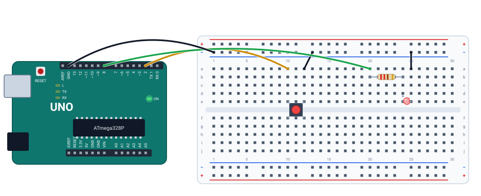

# 🔘 Projeto 04 · Botão e LED

> [← voltar para o Laboratório Arduino](../../README.md)

**Nível:** 🟢 Iniciante

O LED do pino 8 acende **enquanto** o botão do pino 2 estiver apertado. É a primeira vez que o programa **lê** o mundo: o pino 2 é uma entrada, com o resistor de pull-up que já vem dentro do Arduino.

> 📖 **Antes, leia:** a aula [Entradas digitais e botões](../../../aulas/19-entradas-digitais.md) e faça o [projeto 01](../01-blink/README.md).

<div class="laboratorio" data-projeto="circuito.json" data-titulo="Botão e LED no laboratório" data-descricao="O botão e o LED montados e o programa compilado: clique em Executar e segure o botão com o mouse."></div>

> 💡 No site, o laboratório roda o programa num Arduino Uno simulado. No GitHub, a montagem está em [`circuito.json`](circuito.json).

## 🎯 Objetivo

- Ler um botão com `digitalRead()` e decidir com `if`.
- Usar o pull-up interno (`INPUT_PULLUP`) e entender por que apertado vira `LOW`.
- Ver o que acontece com um pino de entrada **solto**.

## 🧰 Componentes

| Qtd. | Componente | Detalhe |
| ---- | ---------- | ------- |
| 1 | Arduino Uno R3 | Com o cabo USB |
| 1 | Protoboard | Meia (400 furos) ou inteira |
| 1 | Botão de 4 pernas | Encaixado sobre o canal do meio |
| 1 | LED vermelho | |
| 1 | Resistor de 220 Ω | Para o LED |
| 5 | Fios | Dois para o botão, dois para o LED e um para o GND |

## 🔌 Montagem



| Peça | Ligações |
| ---- | -------- |
| Botão | Pernas nas colunas 10 e 12, sobre o canal do meio. Coluna 10 → **pino 2** (fio amarelo). Coluna 12 → barramento − (fio preto) |
| Resistor | Coluna 20 → 24. A coluna 20 recebe o **pino 8** (fio verde) |
| LED | Ânodo (perna longa) na coluna 24, cátodo na 25. Coluna 25 → barramento − |
| Retorno | Barramento − → GND da placa (fio preto) |

O botão não tem resistor externo: quem segura o pino 2 em HIGH é o **pull-up interno** (de 20 a 50 kΩ até o 5V, pela folha de dados do ATmega328P), ligado pelo `INPUT_PULLUP`.

## 🔁 Por que apertado é LOW

| Botão | O que liga o pino 2 | `digitalRead(2)` | LED |
| ----- | ------------------- | ---------------- | --- |
| Solto | Só o pull-up, até o 5V | `HIGH` | Apagado |
| Apertado | O botão, direto ao GND (o pull-up perde) | `LOW` | Aceso |

Com o pull-up, a lógica fica **invertida**: apertado = `LOW`. Por isso o `if` compara com `LOW`.

## ⌨️ Código inicial

```cpp
const int BOTAO = 2;
const int LED = 8;

void setup() {
  // 1. Botão como entrada com o pull-up interno.
  // 2. LED como saída.
}

void loop() {
  // 3. Leia o botão.
  // 4. Apertado (LOW)? Acenda o LED. Senão, apague.
}
```

## 🆘 Dicas

<details>
<summary>Dica 1: qual modo de pino?</summary>

`pinMode(BOTAO, INPUT_PULLUP);`. Sem o `_PULLUP`, o pino fica solto quando o botão está solto.
</details>

<details>
<summary>Dica 2: o LED acende ao contrário</summary>

Você comparou com `HIGH`. Com o pull-up, solto lê `HIGH` e apertado lê `LOW`.
</details>

<details>
<summary>Dica 3: o botão não faz nada</summary>

Confira se as pernas estão **sobre o canal do meio** e se o fio preto vai da coluna 12 ao barramento −. Sem esse fio, apertar o botão não liga o pino a lugar nenhum.
</details>

## 🧪 Casos de teste

Comece pela montagem e pelo código certos (caso 1). Em cada caso seguinte, faça **só** a mudança indicada, confira e desfaça antes do próximo. No laboratório, segure o botão com o mouse (ou selecione e segure Enter); o caso 2 usa o programa pronto "Com defeito: sem o pull-up", na aba **Código**. O caso 5 muda o código: faça na IDE do Arduino ou no Wokwi.

| # | O que mudar | O que tem que acontecer |
| - | ----------- | ----------------------- |
| 1 | Nada | Solto: apagado. Segurando: aceso. Soltou: apaga na hora |
| 2 | `INPUT` no lugar de `INPUT_PULLUP` | Ninguém segura o pino 2. No simulador, o pino solto lê `LOW` e o LED fica **aceso sem ninguém apertar**. Na placa, o pino solto lê o que pegar do ambiente: o LED pisca sozinho ou muda quando a mão chega perto |
| 3 | Tire o fio preto do botão (coluna 12 → barramento −) | O LED não acende nunca: apertar não liga o pino ao GND, e o pull-up mantém `HIGH` |
| 4 | Passe o fio amarelo do pino 2 para o pino 3 | O LED não acende nunca: o programa lê o pino 2, que ficou só com o pull-up |
| 5 | Troque `== LOW` por `== HIGH` | Lógica invertida: aceso com o botão solto, apaga quando aperta |

## ✅ Critérios de conclusão

- [ ] O LED acende só enquanto o botão está apertado.
- [ ] Você explica por que o `if` compara com `LOW`.
- [ ] Os casos 2 a 5 deram o resultado da tabela.

## 🔑 Solução

<details>
<summary>Ver a solução</summary>

```cpp
const int BOTAO = 2;
const int LED = 8;

void setup() {
  pinMode(BOTAO, INPUT_PULLUP);   // solto = HIGH, apertado = LOW
  pinMode(LED, OUTPUT);
}

void loop() {
  if (digitalRead(BOTAO) == LOW) {   // apertado
    digitalWrite(LED, HIGH);
  } else {
    digitalWrite(LED, LOW);
  }
}
```

O mesmo código está no arquivo [`botao-led.ino`](botao-led.ino). A versão com defeito do caso 2 está em [`botao-sem-pullup.ino`](botao-sem-pullup.ino).
</details>

## 🚀 Para ir além

- **Uma linha só:** `digitalWrite(LED, !digitalRead(BOTAO));` faz o mesmo. Explique por que o `!` resolve a inversão.
- **Liga e desliga:** cada aperto troca o estado do LED (aperta uma vez, acende; aperta de novo, apaga). Vai precisar guardar a leitura anterior e detectar a **borda**: veja a aula [Entradas digitais e botões](../../../aulas/19-entradas-digitais.md).
- **Pull-down externo:** monte o botão entre o 5V e o pino, com um resistor de 10 kΩ do pino ao GND, e use `INPUT`. Agora apertado é `HIGH`.

## 📚 Referências

- MCROBERTS, Michael. *Arduino básico*. 2. ed. São Paulo: Novatec, 2015. Projeto 4 (botão).
- [Exemplo Button, da documentação oficial do Arduino](https://docs.arduino.cc/built-in-examples/digital/Button/) (em inglês).
- [Exemplo InputPullupSerial](https://docs.arduino.cc/built-in-examples/digital/InputPullupSerial/) (em inglês).
