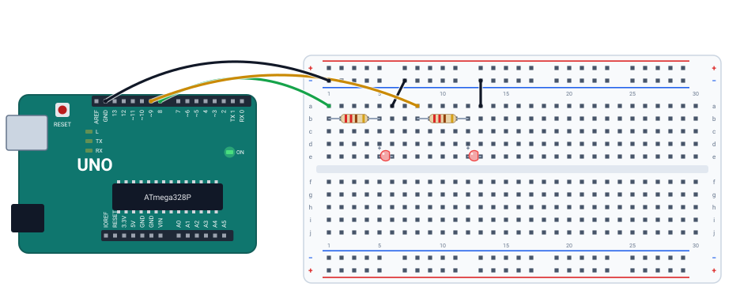
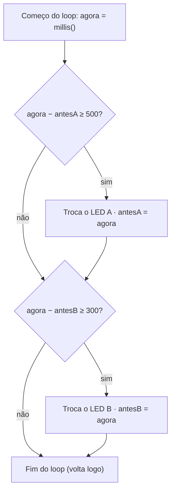

# ⏱️ Projeto 05 · Pisca sem delay

> [← voltar para o Laboratório Arduino](../../README.md)

**Nível:** 🟡 Intermediário

Dois LEDs piscando **ao mesmo tempo**, cada um no seu ritmo: o do pino 8 troca a cada 500 ms e o do pino 9 a cada 300 ms. Com `delay()`, isso não dá certo, porque cada espera para o programa inteiro. Com `millis()`, o `loop()` só olha o relógio e segue em frente.

> 📖 **Antes, leia:** a aula [delay() e millis()](../../../aulas/20-delay-e-millis.md) e faça o [projeto 02](../02-dois-leds-alternados/README.md).

<div class="laboratorio" data-projeto="circuito.json" data-titulo="Pisca sem delay no laboratório" data-descricao="Os dois LEDs montados e o programa com millis() compilado. Na aba Código, compare com a versão com delay()."></div>

> 💡 No site, o laboratório roda o programa num Arduino Uno simulado. No GitHub, a montagem está em [`circuito.json`](circuito.json).

## 🎯 Objetivo

- Ver na prática por que `delay()` **bloqueia** o programa.
- Controlar duas tarefas independentes com `millis()` e `unsigned long`.
- Reconhecer o padrão "já passou o tempo? então age e anota a hora".

## 🧰 Componentes

| Qtd. | Componente | Detalhe |
| ---- | ---------- | ------- |
| 1 | Arduino Uno R3 | Com o cabo USB |
| 1 | Protoboard | Meia (400 furos) ou inteira |
| 2 | LEDs | Qualquer cor |
| 2 | Resistores de 220 Ω | Um para cada LED |
| 5 | Fios | Um para cada pino, dois para o barramento − e um para o GND |

## 🔌 Montagem



| LED | Pino | Resistor | Ânodo | Cátodo e retorno |
| --- | ---- | -------- | ----- | ---------------- |
| A | 8 (fio verde até a coluna 1) | Coluna 1 → 5 | Coluna 5 | Coluna 6 → barramento − |
| B | 9 (fio amarelo até a coluna 8) | Coluna 8 → 12 | Coluna 12 | Coluna 13 → barramento − |

É a mesma montagem do projeto 02. O barramento − vai ao GND da placa.

## 🧠 O padrão do millis()



| Com `delay()` | Com `millis()` |
| ------------- | -------------- |
| "Espere 500 ms" para o programa todo | "Já passaram 500 ms desde a última troca?" leva microssegundos |
| Uma tarefa por vez | Várias tarefas, cada uma com o seu relógio |
| Botões e sensores ficam sem ser lidos durante a espera | O `loop()` roda milhares de vezes por segundo |

`millis()` devolve um `unsigned long` (32 bits, sem sinal): chega a 4.294.967.295 ms, uns **49,7 dias**. Guardar esse valor num `int` (16 bits no Uno) estraga a conta depois de 32,767 s (caso 4).

## ⌨️ Código inicial

```cpp
const int LED_A = 8;
const int LED_B = 9;

unsigned long antesA = 0;   // quando o LED A trocou pela última vez
unsigned long antesB = 0;
int estadoA = LOW;
int estadoB = LOW;

void setup() {
  pinMode(LED_A, OUTPUT);
  pinMode(LED_B, OUTPUT);
}

void loop() {
  unsigned long agora = millis();

  // 1. Se já passaram 500 ms desde antesA: anote agora em antesA, inverta estadoA e escreva no LED A.
  // 2. Faça o mesmo para o LED B, com 300 ms.
}
```

## 🆘 Dicas

<details>
<summary>Dica 1: como inverter o estado?</summary>

`estadoA = !estadoA;` troca `LOW` por `HIGH` e vice-versa. Depois, `digitalWrite(LED_A, estadoA);`.
</details>

<details>
<summary>Dica 2: o LED não pisca, fica aceso fraco</summary>

Faltou anotar a hora: sem `antesA = agora;`, a condição continua verdadeira e o LED troca em toda volta do `loop()`, rápido demais para ver.
</details>

<details>
<summary>Dica 3: por que subtrair em vez de somar?</summary>

`agora - antes >= intervalo` continua certo mesmo quando o `millis()` passa do máximo e volta a zero (depois de 49,7 dias), porque a subtração sem sinal "dá a volta" junto.
</details>

## 🧪 Casos de teste

No laboratório, use o relógio `t = ... s` ao lado dos botões. O caso 2 usa o programa pronto "Do jeito errado: com delay", na aba **Código**. Os casos 3 e 4 mudam o código: faça na IDE do Arduino ou no Wokwi.

| # | O que mudar | O que tem que acontecer |
| - | ----------- | ----------------------- |
| 1 | Nada | Os dois piscam ao mesmo tempo, cada um no seu ritmo. Em 6 s, o LED A acende 6 vezes e o B, 10 |
| 2 | A versão com `delay()` | Um espera o outro: A acende em 0 s, B em 1 s, A de novo em 1,6 s, B em 2,6 s... Nunca piscam juntos, e o ciclo vira 1,6 s |
| 3 | Troque 300 por 1000 | Só o B fica mais lento; o A continua com 500 ms |
| 4 | Declare `antesA` e `antesB` como `int` | Até uns 32,8 s, tudo certo. Daí em diante, a conta dá sempre "já passou": os LEDs trocam a cada volta do `loop()` e parecem **meio acesos**, sem piscar |

## ✅ Critérios de conclusão

- [ ] Os dois LEDs piscam juntos, com 500 ms e 300 ms.
- [ ] O programa não tem nenhum `delay()`.
- [ ] Você explica a diferença entre os casos 1 e 2.
- [ ] Você explica o que deu errado no caso 4.

## 🔑 Solução

<details>
<summary>Ver a solução</summary>

```cpp
const int LED_A = 8;
const int LED_B = 9;

unsigned long antesA = 0;
unsigned long antesB = 0;
int estadoA = LOW;
int estadoB = LOW;

void setup() {
  pinMode(LED_A, OUTPUT);
  pinMode(LED_B, OUTPUT);
}

void loop() {
  unsigned long agora = millis();

  if (agora - antesA >= 500) {
    antesA = agora;
    estadoA = !estadoA;
    digitalWrite(LED_A, estadoA);
  }

  if (agora - antesB >= 300) {
    antesB = agora;
    estadoB = !estadoB;
    digitalWrite(LED_B, estadoB);
  }
}
```

O mesmo código está no arquivo [`pisca-sem-delay.ino`](pisca-sem-delay.ino). A versão com `delay()` está em [`pisca-com-delay.ino`](pisca-com-delay.ino).
</details>

## 🚀 Para ir além

- **Terceiro LED:** acrescente um LED no pino 10 com 700 ms. Não muda nada nos outros dois.
- **Botão que não espera:** junte com o [projeto 04](../04-botao-e-led/README.md): o botão acende um terceiro LED na hora, mesmo com os dois piscando.
- **Ritmo assimétrico:** o LED A fica 100 ms aceso e 900 ms apagado. Dica: o intervalo depende do estado atual.

## 📚 Referências

- MONK, Simon. *Programação com Arduino: começando com sketches*. 2. ed. Porto Alegre: Bookman, 2017. Capítulo sobre `millis()`.
- [Exemplo BlinkWithoutDelay, da documentação oficial do Arduino](https://docs.arduino.cc/built-in-examples/digital/BlinkWithoutDelay/) (em inglês).
- [Referência de `millis()`](https://docs.arduino.cc/language-reference/en/functions/time/millis/) (em inglês).
