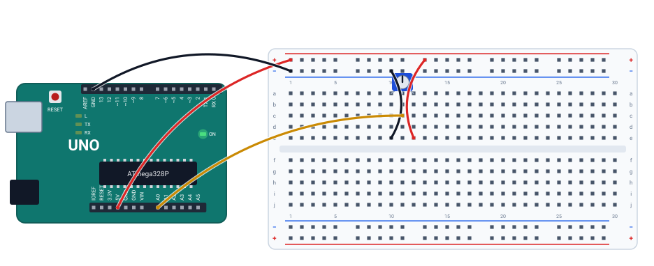

# 🎛️ Projeto 06 · Potenciômetro e monitor serial

> [← voltar para o Laboratório Arduino](../../README.md)

**Nível:** 🟢 Iniciante

Gire o potenciômetro e acompanhe no monitor serial a leitura do pino A0 (de 0 a 1023), a tensão que ela representa e a posição em porcentagem. É o primeiro contato com o **conversor analógico-digital** (ADC) do Arduino.

> 📖 **Antes, leia:** a aula [Leitura analógica](../../../aulas/21-leitura-analogica.md) e a do [Monitor serial](../../../aulas/18-monitor-serial.md).

<div class="laboratorio" data-projeto="circuito.json" data-titulo="Potenciômetro no laboratório" data-descricao="O potenciômetro no A0 e o programa compilado: execute, selecione o potenciômetro e gire o cursor na aba Selecionado."></div>

> 💡 No site, o laboratório roda o programa num Arduino Uno simulado. No GitHub, a montagem está em [`circuito.json`](circuito.json).

## 🎯 Objetivo

- Ler uma tensão com `analogRead()` e entender a escala de 0 a 1023.
- Converter a leitura em volts e em porcentagem (`map()`).
- Reconhecer o potenciômetro como um **divisor de tensão** ajustável.

## 🧰 Componentes

| Qtd. | Componente | Detalhe |
| ---- | ---------- | ------- |
| 1 | Arduino Uno R3 | Com o cabo USB |
| 1 | Protoboard | Meia (400 furos) ou inteira |
| 1 | Potenciômetro de 10 kΩ | Linear (marcado "B10K") |
| 5 | Fios | 5V e GND aos barramentos, as duas pontas e o cursor |

## 🔌 Montagem



| Perna do potenciômetro | Coluna | Ligação |
| ---------------------- | ------ | ------- |
| Ponta 1 | 10 | Barramento − (GND) |
| Cursor (meio) | 11 | Pino **A0** (fio amarelo) |
| Ponta 3 | 12 | Barramento + (5V) |

Os barramentos recebem o **5V** (fio vermelho) e o **GND** (fio preto) da placa.

## 📏 Da tensão ao número

O ADC do Uno tem **10 bits**: divide de 0 a 5 V em 1024 degraus (0 a 1023), de uns 4,9 mV cada.

| Posição do cursor | Tensão no A0 | `analogRead(A0)` | Linha no monitor |
| ----------------- | ------------ | ---------------- | ---------------- |
| 0 % | 0 V | 0 | `Leitura: 0  Tensão: 0.00 V  Posição: 0 %` |
| 25 % | 1,25 V | 255 | `Leitura: 255  Tensão: 1.25 V  Posição: 24 %` |
| 50 % | 2,5 V | 511 | `Leitura: 511  Tensão: 2.50 V  Posição: 49 %` |
| 75 % | 3,75 V | 767 | `Leitura: 767  Tensão: 3.75 V  Posição: 74 %` |
| 100 % | 5 V | 1023 | `Leitura: 1023  Tensão: 5.00 V  Posição: 100 %` |

As linhas acima saíram do programa rodando no laboratório. Repare nos **24 %, 49 % e 74 %**: o `map()` faz conta com inteiros e **trunca** (511 × 100 / 1023 = 49,95 → 49).

## ⌨️ Código inicial

```cpp
void setup() {
  // 1. Abra a serial a 9600 baud.
}

void loop() {
  // 2. Leia o A0 (0 a 1023).
  // 3. Converta para volts: leitura × 5.0 / 1023 (use float).
  // 4. Converta para porcentagem com map().
  // 5. Mostre tudo numa linha: Leitura: 511  Tensão: 2.50 V  Posição: 49 %
  // 6. Espere 250 ms.
}
```

## 🆘 Dicas

<details>
<summary>Dica 1: a tensão sai sempre 0 ou 5</summary>

`leitura * 5 / 1023` com inteiros joga fora a parte decimal. Use `5.0` e guarde num `float`.
</details>

<details>
<summary>Dica 2: como o map() funciona?</summary>

`map(valor, deMin, deMax, paraMin, paraMax)` faz uma regra de três: `map(leitura, 0, 1023, 0, 100)` leva 0–1023 para 0–100.
</details>

<details>
<summary>Dica 3: o monitor mostra símbolos estranhos</summary>

O baud do monitor tem que ser igual ao do `Serial.begin()`: 9600.
</details>

## 🧪 Casos de teste

No laboratório, selecione o potenciômetro e mova **Posição do cursor**, na aba **Selecionado**. O monitor fica na aba **Serial**.

| # | O que mudar | O que tem que acontecer |
| - | ----------- | ----------------------- |
| 1 | Cursor em 0 %, 25 %, 50 %, 75 % e 100 % | As linhas da tabela "Da tensão ao número" |
| 2 | Troque os fios das pontas (5V na coluna 10, GND na 12) | A escala inverte: com o cursor em 100 %, a leitura vira 0 |
| 3 | Tire o fio do cursor ao A0 | O A0 fica solto. No simulador, ele lê 0. Na placa, lê valores que mudam sozinhos (e mudam quando a mão chega perto) |

## ✅ Critérios de conclusão

- [ ] O monitor mostra leitura, tensão (com duas casas) e posição.
- [ ] Os extremos dão 0 e 1023.
- [ ] Você explica por que 50 % aparece como 49 %.
- [ ] Os casos 2 e 3 deram o resultado da tabela.

## 🔑 Solução

<details>
<summary>Ver a solução</summary>

```cpp
void setup() {
  Serial.begin(9600);
}

void loop() {
  int leitura = analogRead(A0);                  // 0 a 1023
  float tensao = leitura * 5.0 / 1023;           // 0 a 5 V
  int porcento = map(leitura, 0, 1023, 0, 100);  // 0 a 100 %

  Serial.print("Leitura: ");
  Serial.print(leitura);
  Serial.print("  Tensão: ");
  Serial.print(tensao);
  Serial.print(" V  Posição: ");
  Serial.print(porcento);
  Serial.println(" %");

  delay(250);
}
```

O mesmo código está no arquivo [`potenciometro.ino`](potenciometro.ino).
</details>

## 🚀 Para ir além

- **Porcentagem arredondada:** calcule `(leitura * 100L + 511) / 1023` e compare com o `map()`. Por que o `L`?
- **Barra no monitor:** imprima um `#` para cada 5 %, formando uma barra que cresce quando você gira.
- **Gráfico:** abra o **Serial Plotter** da IDE do Arduino e imprima só a leitura, uma por linha.

## 📚 Referências

- MCROBERTS, Michael. *Arduino básico*. 2. ed. São Paulo: Novatec, 2015. Projeto com potenciômetro.
- [Exemplo AnalogReadSerial, da documentação oficial do Arduino](https://docs.arduino.cc/built-in-examples/basics/AnalogReadSerial/) (em inglês).
- [Referência de `map()`](https://docs.arduino.cc/language-reference/en/functions/math/map/) (em inglês).
