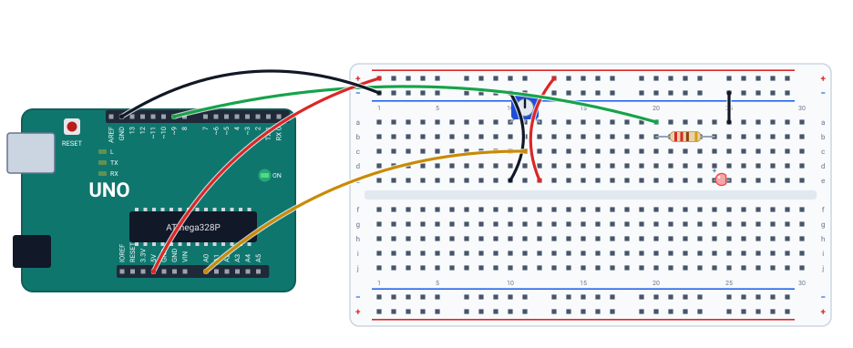

# 💡 Projeto 07 · Dimmer com PWM

> [← voltar para o Laboratório Arduino](../../README.md)

**Nível:** 🟡 Intermediário

O potenciômetro controla o **brilho** do LED. O pino digital só tem dois níveis, 0 V e 5 V; o truque é ligar e desligar o LED quase 500 vezes por segundo e mudar a fração do tempo em que ele fica ligado. Isso é **PWM**, e quem faz é o `analogWrite()`.

> 📖 **Antes, leia:** a aula [PWM e analogWrite()](../../../aulas/22-pwm.md) e faça o [projeto 06](../06-potenciometro-e-serial/README.md).

<div class="laboratorio" data-projeto="circuito.json" data-titulo="Dimmer no laboratório" data-descricao="Potenciômetro no A0 e LED no pino 9 (PWM): execute e gire o cursor para ver o brilho mudar."></div>

> 💡 No site, o laboratório roda o programa num Arduino Uno simulado. No GitHub, a montagem está em [`circuito.json`](circuito.json).

## 🎯 Objetivo

- Usar `analogWrite()` num pino com `~` e entender o ciclo de trabalho (*duty cycle*).
- Converter a escala do ADC (0–1023) para a do PWM (0–255) com `map()`.
- Ver o que acontece com `analogWrite()` num pino **sem** PWM.

## 🧰 Componentes

| Qtd. | Componente | Detalhe |
| ---- | ---------- | ------- |
| 1 | Arduino Uno R3 | Com o cabo USB |
| 1 | Protoboard | Meia (400 furos) ou inteira |
| 1 | Potenciômetro de 10 kΩ | Linear |
| 1 | LED vermelho | |
| 1 | Resistor de 220 Ω | Para o LED |
| 7 | Fios | 5V e GND, as pontas e o cursor do potenciômetro, o pino 9 e o retorno do LED |

## 🔌 Montagem



| Peça | Ligações |
| ---- | -------- |
| Potenciômetro | Colunas 10, 11 e 12: ponta no barramento −, cursor no **A0**, ponta no barramento + (igual ao projeto 06) |
| Resistor | Coluna 20 → 24. A coluna 20 recebe o **pino 9** (fio verde) |
| LED | Ânodo na coluna 24, cátodo na 25. Coluna 25 → barramento − |
| Alimentação | Barramento + no 5V, barramento − no GND |

O pino 9 tem o `~` na placa: ele faz PWM. No Uno, os pinos com PWM são **3, 5, 6, 9, 10 e 11**.

## 📊 Do potenciômetro ao brilho

| Posição | `analogRead(A0)` | `brilho = map(...)` | Tempo ligado | Corrente média no LED |
| ------- | ---------------- | ------------------- | ------------ | --------------------- |
| 0 % | 0 | 0 | 0 % | 0 mA |
| 25 % | 255 | 63 | 25 % | ≈ 3 mA |
| 50 % | 511 | 127 | 50 % | ≈ 6 mA |
| 100 % | 1023 | 255 | 100 % | ≈ 12 mA |

Com o LED aceso direto, a corrente é (5 − 2) V / 245 Ω ≈ 12 mA (a resistência de saída do pino entra na conta). O PWM não muda essa corrente: muda **quanto tempo** ela passa. O olho tira a média.

## ⌨️ Código inicial

```cpp
const int LED = 9;   // pino com ~

void setup() {
  // 1. LED como saída. Serial a 9600.
}

void loop() {
  // 2. Leia o A0.
  // 3. Converta de 0–1023 para 0–255 com map().
  // 4. Escreva o brilho no LED com analogWrite().
  // 5. Mostre "Brilho: N" no monitor e espere 250 ms.
}
```

## 🆘 Dicas

<details>
<summary>Dica 1: por que não analogWrite(LED, leitura)?</summary>

O `analogWrite()` espera de 0 a 255. Acima disso, o brilho sai errado (em vários pinos, o valor "dá a volta": 256 vira 0). Converta antes com `map(leitura, 0, 1023, 0, 255)`, ou divida por 4.
</details>

<details>
<summary>Dica 2: o LED só acende ou apaga, sem meio-termo</summary>

O LED está num pino sem `~`. Veja o caso 3.
</details>

## 🧪 Casos de teste

No laboratório, selecione o potenciômetro e mova **Posição do cursor**, na aba **Selecionado**. O caso 3 muda o código: faça na IDE do Arduino ou no Wokwi.

| # | O que mudar | O que tem que acontecer |
| - | ----------- | ----------------------- |
| 1 | Cursor em 0 %, 25 %, 50 % e 100 % | O monitor mostra `Brilho: 0`, `63`, `127` e `255`, e o LED vai de apagado a brilho total |
| 2 | Gire devagar de 0 a 100 % | O brilho sobe aos poucos, sem saltos |
| 3 | Passe o LED para o pino 8 (no código e no fio) | Sem PWM, o `analogWrite()` só liga ou desliga: abaixo de 128 apagado (50 % → `Brilho: 127`, apagado), de 128 para cima aceso inteiro (60 % → `Brilho: 153`, aceso) |
| 4 | Tire o fio do cursor ao A0 | No simulador, o A0 solto lê 0: `Brilho: 0`, LED apagado. Na placa, o brilho oscila sozinho |

## ✅ Critérios de conclusão

- [ ] O brilho acompanha o potenciômetro, do apagado ao máximo.
- [ ] O monitor mostra o valor que vai para o `analogWrite()`.
- [ ] Você explica por que 1023 vira 255.
- [ ] Você explica o caso 3.

## 🔑 Solução

<details>
<summary>Ver a solução</summary>

```cpp
const int LED = 9;   // pino com ~: faz PWM

void setup() {
  pinMode(LED, OUTPUT);
  Serial.begin(9600);
}

void loop() {
  int leitura = analogRead(A0);
  int brilho = map(leitura, 0, 1023, 0, 255);
  analogWrite(LED, brilho);

  Serial.print("Brilho: ");
  Serial.println(brilho);
  delay(250);
}
```

O mesmo código está no arquivo [`dimmer.ino`](dimmer.ino).
</details>

## 🚀 Para ir além

- **Respiração:** sem o potenciômetro, faça o brilho subir de 0 a 255 e descer de volta, em 2 s cada, com `millis()`.
- **Olho humano:** o brilho percebido não é linear. Compare 25 % e 50 % e tente `brilho = leitura * leitura / 4092` (com `long`).
- **Frequência:** os pinos 5 e 6 fazem PWM a uns 980 Hz; os outros, a uns 490 Hz. Num LED não faz diferença; num motor, faz.

## 📚 Referências

- MCROBERTS, Michael. *Arduino básico*. 2. ed. São Paulo: Novatec, 2015. Projeto com PWM.
- [Exemplo Fading, da documentação oficial do Arduino](https://docs.arduino.cc/built-in-examples/analog/Fading/) (em inglês).
- [Referência de `analogWrite()`](https://docs.arduino.cc/language-reference/en/functions/analog-io/analogWrite/) (em inglês).
