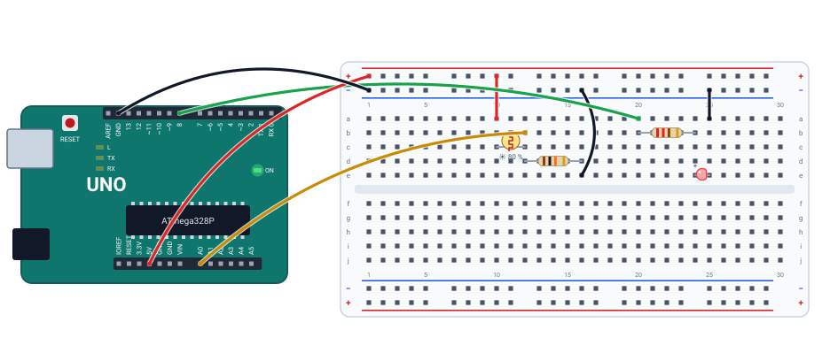

# 🌙 Projeto 08 · Luz automática

> [← voltar para o Laboratório Arduino](../../README.md)

**Nível:** 🟡 Intermediário

Um LED que acende sozinho quando escurece, como a luz de um poste. O sensor é um **LDR**, um resistor que muda com a luz, montado num divisor de tensão com um resistor de 10 kΩ. O Arduino lê a tensão no A0 e compara com um limite.

> 📖 **Antes, leia:** a aula [Leitura analógica](../../../aulas/21-leitura-analogica.md) e a parte de divisor de tensão de [Circuitos série e paralelo](../../../aulas/12-circuitos-serie-e-paralelo.md). Faça antes o [projeto 06](../06-potenciometro-e-serial/README.md).

<div class="laboratorio" data-projeto="circuito.json" data-titulo="Luz automática no laboratório" data-descricao="LDR no A0 e LED no pino 8: execute, selecione o LDR e diminua a luz na aba Selecionado."></div>

> 💡 No site, o laboratório roda o programa num Arduino Uno simulado. No GitHub, a montagem está em [`circuito.json`](circuito.json).

## 🎯 Objetivo

- Montar um sensor de luz com LDR e resistor (divisor de tensão).
- Escolher um **limite** a partir das leituras no monitor serial.
- Tomar uma decisão com a leitura analógica.

## 🧰 Componentes

| Qtd. | Componente | Detalhe |
| ---- | ---------- | ------- |
| 1 | Arduino Uno R3 | Com o cabo USB |
| 1 | Protoboard | Meia (400 furos) ou inteira |
| 1 | LDR | Fotorresistor de 5 mm |
| 1 | Resistor de 10 kΩ | Do divisor |
| 1 | LED | Qualquer cor |
| 1 | Resistor de 220 Ω | Para o LED |
| 7 | Fios | 5V e GND, o LDR, o A0, o resistor do divisor, o pino 8 e o retorno do LED |

## 🔌 Montagem



| Peça | Ligações |
| ---- | -------- |
| LDR | Colunas 10 e 12. Coluna 10 → barramento + (5V) |
| Resistor de 10 kΩ | Coluna 12 → 16. Coluna 16 → barramento − (GND) |
| Ponto do meio | Coluna 12 (entre o LDR e o resistor) → **A0** (fio amarelo) |
| Resistor de 220 Ω e LED | Pino **8** → coluna 20, resistor 20 → 24, LED de 24 a 25, coluna 25 → barramento − |
| Alimentação | Barramento + no 5V, barramento − no GND |

## 🔆 Como o divisor vira sensor

$$V_{A0} = 5\,\text{V} \cdot \frac{10\,\text{k}\Omega}{10\,\text{k}\Omega + R_{LDR}}$$

Mais luz → $R_{LDR}$ menor → $V_{A0}$ maior → leitura maior. No laboratório, o LDR vai de 1 MΩ (escuro total) a 1 kΩ (luz forte), uma curva simplificada; um LDR real varia de modelo para modelo, por isso o limite se escolhe medindo.

| Luz no sensor (laboratório) | Leitura no monitor | LED (limite 300) |
| --------------------------- | ------------------ | ---------------- |
| 80 % | `Luz: 732` | Apagado |
| 54 % | `Luz: 301` | Apagado |
| 53 % | `Luz: 286` | **Aceso** |
| 20 % | `Luz: 39` | Aceso |

As leituras saíram do programa rodando no laboratório.

## ⌨️ Código inicial

```cpp
const int LED = 8;
const int LIMITE = 300;   // leitura abaixo disso: escuro

void setup() {
  // 1. LED como saída. Serial a 9600.
}

void loop() {
  // 2. Leia o A0.
  // 3. Abaixo do LIMITE? Acenda o LED. Senão, apague.
  // 4. Mostre "Luz: N" no monitor e espere 250 ms.
}
```

## 🆘 Dicas

<details>
<summary>Dica 1: como escolher o LIMITE?</summary>

Rode o programa e anote a leitura com o ambiente claro e com o LDR coberto. Um limite no meio dos dois funciona.
</details>

<details>
<summary>Dica 2: o LED acende no claro</summary>

Ou o `if` está com `>`, ou o LDR e o resistor estão trocados (aí mais luz **baixa** a tensão). Veja o caso 3.
</details>

<details>
<summary>Dica 3: o LED pisca quando a luz está perto do limite</summary>

A leitura oscila um pouco em volta do limite. Use dois limites (histerese): acende abaixo de 280 e só apaga acima de 320.
</details>

## 🧪 Casos de teste

No laboratório, selecione o LDR e mova **Luz no sensor**, na aba **Selecionado**. O monitor fica na aba **Serial**. O caso 4 muda o código: faça na IDE do Arduino ou no Wokwi.

| # | O que mudar | O que tem que acontecer |
| - | ----------- | ----------------------- |
| 1 | Luz em 80 %, 54 %, 53 % e 20 % | As leituras e o LED da tabela acima: o LED acende de 53 % para baixo |
| 2 | Tire o fio do LDR ao 5V | Não chega tensão ao divisor: `Luz: 0` e o LED aceso, como se fosse noite |
| 3 | Troque as pontas do divisor: coluna 10 no barramento − e coluna 16 no + | Agora o LDR fica do lado do GND, e a lógica inverte: com 80 % de luz, `Luz: 291` e o LED **aceso**; com 20 %, `Luz: 984` e apagado |
| 4 | Mude o `LIMITE` para 700 | O LED acende com bem mais luz: com 78 % (`Luz: 702`) ainda apagado, com 77 % (`Luz: 687`) já aceso |

## ✅ Critérios de conclusão

- [ ] O LED acende no escuro e apaga no claro.
- [ ] O monitor mostra a leitura, e você escolheu o limite a partir dela.
- [ ] Você explica, pela fórmula do divisor, por que mais luz dá leitura maior.

## 🔑 Solução

<details>
<summary>Ver a solução</summary>

```cpp
const int LED = 8;
const int LIMITE = 300;   // leitura abaixo disso: escuro

void setup() {
  pinMode(LED, OUTPUT);
  Serial.begin(9600);
}

void loop() {
  int luz = analogRead(A0);

  if (luz < LIMITE) {
    digitalWrite(LED, HIGH);
  } else {
    digitalWrite(LED, LOW);
  }

  Serial.print("Luz: ");
  Serial.println(luz);
  delay(250);
}
```

O mesmo código está no arquivo [`luz-automatica.ino`](luz-automatica.ino).
</details>

## 🚀 Para ir além

- **Histerese:** implemente a dica 3 e mostre no monitor quando o LED muda.
- **Brilho proporcional:** passe o LED para o pino 9 e use `analogWrite()`: quanto mais escuro, mais forte.
- **Sem falso alarme:** só acenda depois de 2 s seguidos de escuro (uma sombra rápida não conta), com `millis()`.

## 📚 Referências

- MCROBERTS, Michael. *Arduino básico*. 2. ed. São Paulo: Novatec, 2015. Projeto com sensor de luz.
- [Exemplo AnalogInput, da documentação oficial do Arduino](https://docs.arduino.cc/built-in-examples/analog/AnalogInput/) (em inglês).
