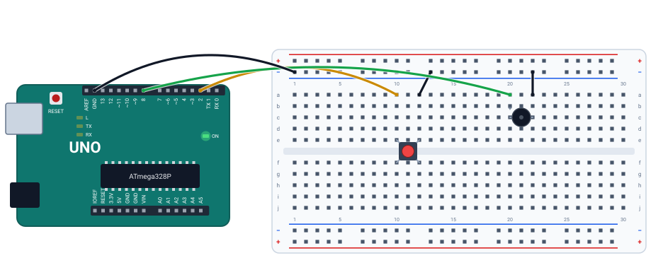

# 🔔 Projeto 09 · Campainha

> [← voltar para o Laboratório Arduino](../../README.md)

**Nível:** 🟢 Iniciante

Apertou o botão, o buzzer toca "dim-dom": uma nota de 880 Hz e outra de 659 Hz. O `tone()` gera uma onda quadrada na frequência pedida, e o buzzer transforma essa onda em som.

> 📖 **Antes, leia:** a parte de buzzer da aula [Sensores e atuadores](../../../aulas/23-sensores-e-atuadores.md) e faça o [projeto 04](../04-botao-e-led/README.md).

<div class="laboratorio" data-projeto="circuito.json" data-titulo="Campainha no laboratório" data-descricao="Botão no pino 2 e buzzer no pino 8: execute e segure o botão. Para ouvir, marque Tocar o som nas propriedades do buzzer."></div>

> 💡 No site, o laboratório roda o programa num Arduino Uno simulado. No GitHub, a montagem está em [`circuito.json`](circuito.json).

## 🎯 Objetivo

- Gerar sons com `tone()` e parar com `noTone()`.
- Relacionar frequência (Hz) com nota musical.
- Juntar uma entrada (botão) com uma saída nova (buzzer).

## 🧰 Componentes

| Qtd. | Componente | Detalhe |
| ---- | ---------- | ------- |
| 1 | Arduino Uno R3 | Com o cabo USB |
| 1 | Protoboard | Meia (400 furos) ou inteira |
| 1 | Botão de 4 pernas | Sobre o canal do meio |
| 1 | Buzzer **passivo** | Sem oscilador interno (veja abaixo) |
| 5 | Fios | Dois para o botão, dois para o buzzer e um para o GND |

## 🔌 Montagem



| Peça | Ligações |
| ---- | -------- |
| Botão | Colunas 10 e 12. Coluna 10 → **pino 2**, coluna 12 → barramento − (igual ao projeto 04) |
| Buzzer | Perna + na coluna 20, perna − na 22. Coluna 20 → **pino 8** (fio verde), coluna 22 → barramento − |
| Retorno | Barramento − → GND da placa |

## 🎵 Buzzer passivo × ativo

| Tipo | Como reconhecer | Como tocar |
| ---- | --------------- | ---------- |
| Passivo | Embaixo, a placa de circuito aparece | `tone(pino, frequência)`: a nota sai na frequência pedida |
| Ativo | Embaixo, fechado (selado) | `digitalWrite(pino, HIGH)`: toca sempre a mesma nota, a do oscilador interno |

| Nota | Frequência | Duração na campainha |
| ---- | ---------- | -------------------- |
| Lá (A5) | 880 Hz | 300 ms |
| Mi (E5) | 659 Hz | 400 ms |
| Silêncio | — | 300 ms antes de tocar de novo |

## ⌨️ Código inicial

```cpp
const int BOTAO = 2;
const int BUZZER = 8;

void setup() {
  // 1. Botão com o pull-up interno. Serial a 9600.
}

void loop() {
  // 2. Se o botão estiver apertado (LOW):
  //    escreva "Dim-dom!", toque 880 Hz por 300 ms, 659 Hz por 400 ms,
  //    pare o som e espere 300 ms.
}
```

## 🆘 Dicas

<details>
<summary>Dica 1: tone() já espera?</summary>

Não: `tone(BUZZER, 880)` liga a nota e o programa segue. Quem segura a nota pelo tempo certo é o `delay()` logo depois.
</details>

<details>
<summary>Dica 2: o som não para</summary>

Faltou `noTone(BUZZER);` depois da segunda nota.
</details>

<details>
<summary>Dica 3: sai só um clique</summary>

O buzzer é ativo, ou o `tone()` e o `noTone()` estão sem `delay()` entre eles.
</details>

## 🧪 Casos de teste

No laboratório, segure o botão com o mouse. Ao lado do buzzer aparece a frequência medida no pino; para ouvir, marque **Tocar o som** nas propriedades do buzzer. O caso 4 muda o código: faça na IDE do Arduino ou no Wokwi.

| # | O que mudar | O que tem que acontecer |
| - | ----------- | ----------------------- |
| 1 | Aperte e solte | `Dim-dom!` no monitor, 880 Hz e depois 659 Hz, e silêncio |
| 2 | Segure o botão por 3 s | Toca de novo a cada 1 s (300 + 400 + 300 ms): 4 vezes `Dim-dom!` |
| 3 | Tire o fio do buzzer ao barramento − | Mudo: sem caminho de volta, não passa corrente pelo buzzer |
| 4 | Troque 880 por 440 | A primeira nota fica uma oitava abaixo (o lá central) |

## ✅ Critérios de conclusão

- [ ] O botão dispara as duas notas, na ordem e com as durações certas.
- [ ] O som para depois da segunda nota.
- [ ] Você sabe dizer se o seu buzzer é passivo ou ativo.

## 🔑 Solução

<details>
<summary>Ver a solução</summary>

```cpp
const int BOTAO = 2;
const int BUZZER = 8;

void setup() {
  pinMode(BOTAO, INPUT_PULLUP);
  Serial.begin(9600);
}

void loop() {
  if (digitalRead(BOTAO) == LOW) {   // apertado
    Serial.println("Dim-dom!");
    tone(BUZZER, 880);   // lá agudo
    delay(300);
    tone(BUZZER, 659);   // mi
    delay(400);
    noTone(BUZZER);
    delay(300);          // pausa antes de tocar de novo
  }
}
```

O mesmo código está no arquivo [`campainha.ino`](campainha.ino).
</details>

## 🚀 Para ir além

- **Melodia:** guarde notas e durações em dois vetores e toque com um `for`.
- **Toque com duração:** `tone(pino, frequência, duração)` desliga sozinho. Reescreva a campainha com ele (ainda precisa esperar entre as notas).
- **Cuidado com o PWM:** o `tone()` usa o timer 2, e enquanto toca, o `analogWrite()` dos pinos 3 e 11 para de funcionar.

## 📚 Referências

- MCROBERTS, Michael. *Arduino básico*. 2. ed. São Paulo: Novatec, 2015. Projetos com piezo.
- [Exemplo toneMelody, da documentação oficial do Arduino](https://docs.arduino.cc/built-in-examples/digital/toneMelody/) (em inglês).
- [Referência de `tone()`](https://docs.arduino.cc/language-reference/en/functions/advanced-io/tone/) (em inglês).
