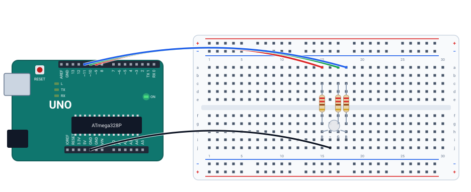

# 🌈 Projeto 10 · LED RGB

> [← voltar para o Laboratório Arduino](../../README.md)

**Nível:** 🟡 Intermediário

Um LED RGB tem três LEDs num encapsulamento só: vermelho, verde e azul. Com um pino PWM para cada cor, dá para misturar: vermelho + verde = amarelo, vermelho + azul = magenta, os três = branco. O programa troca de cor a cada segundo e diz qual é no monitor.

> 📖 **Antes, leia:** a aula [PWM e analogWrite()](../../../aulas/22-pwm.md) e faça o [projeto 07](../07-dimmer-pwm/README.md).

<div class="laboratorio" data-projeto="circuito.json" data-titulo="LED RGB no laboratório" data-descricao="LED RGB de cátodo comum nos pinos 9, 10 e 11: execute e acompanhe as cores e o monitor serial."></div>

> 💡 No site, o laboratório roda o programa num Arduino Uno simulado. No GitHub, a montagem está em [`circuito.json`](circuito.json).

## 🎯 Objetivo

- Ligar um LED RGB de cátodo comum, com um resistor por cor.
- Misturar cores com `analogWrite()` em três pinos PWM.
- Organizar o código com uma função que recebe a cor.

## 🧰 Componentes

| Qtd. | Componente | Detalhe |
| ---- | ---------- | ------- |
| 1 | Arduino Uno R3 | Com o cabo USB |
| 1 | Protoboard | Meia (400 furos) ou inteira |
| 1 | LED RGB de **cátodo comum** | 4 pernas; a mais longa é o comum |
| 3 | Resistores de 220 Ω | Um para cada cor |
| 4 | Fios | Um para cada cor e um para o GND |

## 🔌 Montagem



| Perna do LED (coluna) | Resistor | Pino |
| --------------------- | -------- | ---- |
| R, vermelho (15) | Coluna 15, de cima para baixo do canal do meio | **9** (fio vermelho) |
| Comum, a mais longa (16) | — | **GND** (fio preto) |
| G, verde (17) | Coluna 17, cruzando o canal | **10** (fio verde) |
| B, azul (18) | Coluna 18, cruzando o canal | **11** (fio azul) |

Cada resistor fica em pé, cruzando o canal do meio: uma ponta na metade de cima (onde chega o fio do pino) e a outra na metade de baixo (onde está a perna do LED). Confira a ordem das pernas na folha de dados do seu LED: ela muda entre fabricantes.

## 🎨 As cores do programa

| Cor | Vermelho (9) | Verde (10) | Azul (11) |
| --- | ------------ | ---------- | --------- |
| `Vermelho` | 255 | 0 | 0 |
| `Verde` | 0 | 255 | 0 |
| `Azul` | 0 | 0 | 255 |
| `Amarelo` | 255 | 255 | 0 |
| `Magenta` | 255 | 0 | 255 |
| `Branco` | 255 | 255 | 255 |
| `Apagado` | 0 | 0 | 0 |

Cada cor dura 1 s, e o ciclo todo, 7 s. O verde e o azul têm tensão direta maior (≈ 3 V) que o vermelho (≈ 2 V): com o mesmo resistor de 220 Ω, eles recebem uns 8 mA, contra uns 12 mA do vermelho. Para acertar o branco, ajuste os resistores ou os valores do PWM.

## ⌨️ Código inicial

```cpp
const int VERMELHO = 9;   // pinos com ~
const int VERDE = 10;
const int AZUL = 11;

void cor(int r, int g, int b, const char *nome) {
  // 1. Escreva r, g e b nos três pinos com analogWrite().
  // 2. Mostre o nome no monitor e espere 1 s.
}

void setup() {
  // 3. Os três pinos como saída. Serial a 9600.
}

void loop() {
  // 4. Chame cor() para cada linha da tabela, na ordem.
}
```

## 🆘 Dicas

<details>
<summary>Dica 1: nada acende</summary>

Confira a perna comum: no cátodo comum, ela vai ao **GND**. Se o seu LED for de ânodo comum, ela vai ao 5V, e a lógica inverte (veja "Para ir além").
</details>

<details>
<summary>Dica 2: as cores saem trocadas</summary>

A ordem das pernas do seu LED é outra, ou dois fios estão trocados. Acenda uma cor por vez para descobrir qual pino vai em qual perna.
</details>

## 🧪 Casos de teste

No laboratório, acompanhe a cor do LED e a aba **Serial**. O caso 4 muda o código: faça na IDE do Arduino ou no Wokwi.

| # | O que mudar | O que tem que acontecer |
| - | ----------- | ----------------------- |
| 1 | Nada | As cores da tabela, uma por segundo, com o nome no monitor |
| 2 | Tire o fio da perna comum ao GND | Nada acende, em nenhuma cor: as três correntes precisam voltar pelo comum |
| 3 | Troque os fios dos pinos 10 e 11 | Com `Verde` acende o azul, com `Azul` acende o verde, e `Amarelo` vira magenta |
| 4 | Acrescente `cor(255, 128, 0, "Laranja")` | Uma cor nova, entre o vermelho e o amarelo |

## ✅ Critérios de conclusão

- [ ] As sete cores aparecem na ordem, uma por segundo.
- [ ] O monitor mostra o nome de cada cor.
- [ ] Você explica por que vermelho + verde dá amarelo.

## 🔑 Solução

<details>
<summary>Ver a solução</summary>

```cpp
const int VERMELHO = 9;   // pinos com ~
const int VERDE = 10;
const int AZUL = 11;

void cor(int r, int g, int b, const char *nome) {
  analogWrite(VERMELHO, r);
  analogWrite(VERDE, g);
  analogWrite(AZUL, b);
  Serial.println(nome);
  delay(1000);
}

void setup() {
  pinMode(VERMELHO, OUTPUT);
  pinMode(VERDE, OUTPUT);
  pinMode(AZUL, OUTPUT);
  Serial.begin(9600);
}

void loop() {
  cor(255, 0, 0, "Vermelho");
  cor(0, 255, 0, "Verde");
  cor(0, 0, 255, "Azul");
  cor(255, 255, 0, "Amarelo");
  cor(255, 0, 255, "Magenta");
  cor(255, 255, 255, "Branco");
  cor(0, 0, 0, "Apagado");
}
```

O mesmo código está no arquivo [`rgb.ino`](rgb.ino).
</details>

## 🚀 Para ir além

- **Ânodo comum:** com a perna comum no 5V, cada cor acende com `LOW`. Basta escrever `255 - r`, `255 - g` e `255 - b`.
- **Arco-íris:** passe pelas cores aos poucos, mudando um canal de cada vez de 0 a 255.
- **Cor pelo potenciômetro:** junte com o [projeto 06](../06-potenciometro-e-serial/README.md) e escolha a cor girando o cursor.

## 📚 Referências

- MCROBERTS, Michael. *Arduino básico*. 2. ed. São Paulo: Novatec, 2015. Projeto com LED RGB.
- MONK, Simon. *Programação com Arduino: começando com sketches*. 2. ed. Porto Alegre: Bookman, 2017.
- [Referência de `analogWrite()`](https://docs.arduino.cc/language-reference/en/functions/analog-io/analogWrite/) (em inglês).
