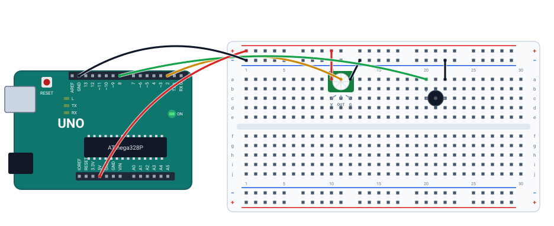
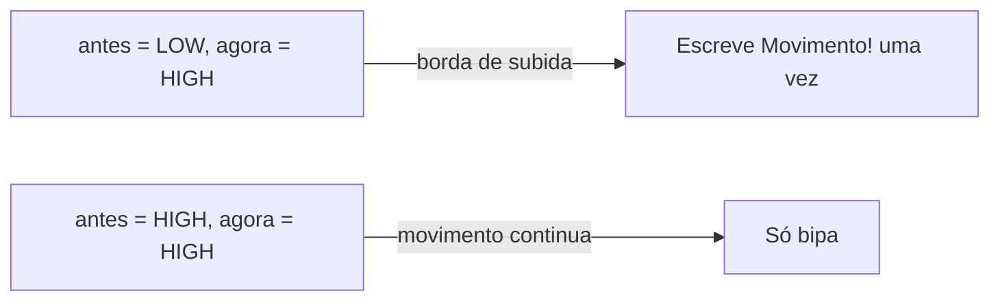

# 🚨 Projeto 11 · Alarme de movimento

> [← voltar para o Laboratório Arduino](../../README.md)

**Nível:** 🟡 Intermediário

Um sensor de presença (PIR) no pino 2 dispara um bipe no buzzer e pisca o LED "L" da placa. A mensagem `Movimento!` sai **uma vez** quando o movimento começa, e não a cada volta do `loop()`: o programa detecta a **borda de subida** do sinal.

> 📖 **Antes, leia:** a parte de PIR da aula [Sensores e atuadores](../../../aulas/23-sensores-e-atuadores.md) e a de borda da aula [Entradas digitais e botões](../../../aulas/19-entradas-digitais.md). Faça antes o [projeto 09](../09-campainha/README.md).

<div class="laboratorio" data-projeto="circuito.json" data-titulo="Alarme no laboratório" data-descricao="Sensor PIR no pino 2 e buzzer no pino 8: execute e segure o sensor com o mouse para simular alguém passando."></div>

> 💡 No site, o laboratório roda o programa num Arduino Uno simulado. No GitHub, a montagem está em [`circuito.json`](circuito.json).

## 🎯 Objetivo

- Ler um sensor digital com alimentação própria (VCC, OUT, GND).
- Detectar a borda de subida, guardando a leitura anterior.
- Disparar dois atuadores juntos: buzzer e LED.

## 🧰 Componentes

| Qtd. | Componente | Detalhe |
| ---- | ---------- | ------- |
| 1 | Arduino Uno R3 | O LED "L" da placa (pino 13) faz o papel do LED de alarme |
| 1 | Protoboard | Meia (400 furos) ou inteira |
| 1 | Sensor PIR | Do tipo HC-SR501, com 3 pinos |
| 1 | Buzzer passivo | |
| 7 | Fios | 5V e GND, os três do sensor e os dois do buzzer |

## 🔌 Montagem



| Peça | Ligações |
| ---- | -------- |
| Sensor PIR | VCC (coluna 10) → barramento +. OUT (coluna 11) → **pino 2** (fio amarelo). GND (coluna 12) → barramento − |
| Buzzer | Perna + na coluna 20 → **pino 8**. Perna − na coluna 22 → barramento − |
| Alimentação | Barramento + no 5V, barramento − no GND |

## 👀 Como o PIR responde

| Situação | Saída OUT | `digitalRead(2)` |
| -------- | --------- | ---------------- |
| Ninguém se mexendo | 0 V | `LOW` |
| Movimento na frente | ≈ 3,3 V (já conta como HIGH no Uno) | `HIGH` |

No sensor de verdade, há dois ajustes (sensibilidade e tempo que a saída fica em HIGH) e um aquecimento de até 1 minuto depois de ligar, quando ele pode disparar sozinho. No laboratório, a saída acompanha o botão de movimento na hora.



## ⌨️ Código inicial

```cpp
const int PIR = 2;
const int BUZZER = 8;
const int LED = 13;

int antes = LOW;   // o que o sensor lia na volta anterior

void setup() {
  // 1. PIR como entrada (sem pull-up: o sensor manda o nível). LED como saída. Serial a 9600.
}

void loop() {
  // 2. Leia o sensor em "agora".
  // 3. Se agora é HIGH e antes era LOW: escreva "Movimento!".
  // 4. Guarde agora em antes.
  // 5. Se agora é HIGH: LED aceso e bipe de 1000 Hz por 150 ms; depois, tudo desligado por 150 ms.
}
```

## 🆘 Dicas

<details>
<summary>Dica 1: a mensagem sai sem parar</summary>

Faltou a comparação com `antes` (ou faltou atualizar `antes = agora;`). Veja o caso 3.
</details>

<details>
<summary>Dica 2: precisa de INPUT_PULLUP?</summary>

Não: a saída do PIR já fornece HIGH e LOW. O pull-up é para o que fica solto, como o botão.
</details>

## 🧪 Casos de teste

No laboratório, segure o sensor com o mouse (ou selecione e use **Fazer movimento**, na aba **Selecionado**). O LED "L" fica na própria placa. O caso 3 muda o código: faça na IDE do Arduino ou no Wokwi.

| # | O que mudar | O que tem que acontecer |
| - | ----------- | ----------------------- |
| 1 | Nada, sem movimento | Silêncio, LED apagado, monitor vazio |
| 2 | Faça movimento por uns 2 s e pare | `Movimento!` **uma vez** no começo; bipes de 1000 Hz e o LED piscando enquanto durar; parou o movimento, parou tudo |
| 3 | Apague o `&& antes == LOW` | `Movimento!` a cada bipe, uns 3 por segundo, enquanto durar o movimento |
| 4 | Tire o fio do VCC do sensor | Nada dispara, e o laboratório avisa que o PIR precisa de 5V e GND para funcionar |

## ✅ Critérios de conclusão

- [ ] O alarme bipa e pisca enquanto há movimento, e para quando acaba.
- [ ] A mensagem sai uma vez por movimento.
- [ ] Você explica para que serve a variável `antes`.

## 🔑 Solução

<details>
<summary>Ver a solução</summary>

```cpp
const int PIR = 2;
const int BUZZER = 8;
const int LED = 13;

int antes = LOW;   // o que o sensor lia na volta anterior

void setup() {
  pinMode(PIR, INPUT);
  pinMode(LED, OUTPUT);
  Serial.begin(9600);
}

void loop() {
  int agora = digitalRead(PIR);

  if (agora == HIGH && antes == LOW) {
    Serial.println("Movimento!");
  }
  antes = agora;

  if (agora == HIGH) {
    digitalWrite(LED, HIGH);
    tone(BUZZER, 1000);
    delay(150);
    noTone(BUZZER);
    digitalWrite(LED, LOW);
    delay(150);
  }
}
```

O mesmo código está no arquivo [`alarme.ino`](alarme.ino).
</details>

## 🚀 Para ir além

- **Contador de passagens:** conte as bordas de subida e mostre `Passagens: N`.
- **Armar e desarmar:** um botão (com pull-up) liga e desliga o alarme; desarmado, o sensor não faz nada.
- **Alarme que continua:** depois de disparar, o bipe dura 5 s mesmo que o movimento pare, com `millis()`.

## 📚 Referências

- MONK, Simon. *Programação com Arduino: começando com sketches*. 2. ed. Porto Alegre: Bookman, 2017.
- [Guia do sensor PIR, da Adafruit](https://learn.adafruit.com/pir-passive-infrared-proximity-motion-sensor) (em inglês).
- [Referência de `digitalRead()`](https://docs.arduino.cc/language-reference/en/functions/digital-io/digitalread/) (em inglês).
