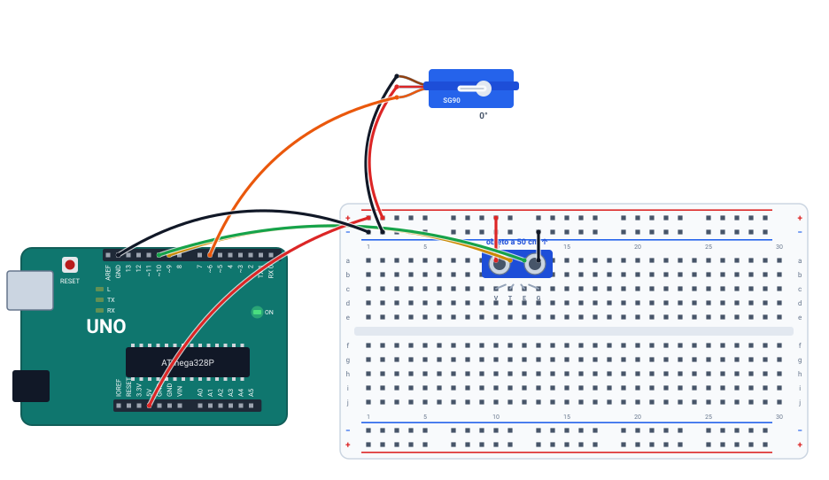

# 🚧 Projeto 12 · Cancela automática

> [← voltar para o Laboratório Arduino](../../README.md)

**Nível:** 🔴 Avançado

A cancela de um estacionamento: um sensor ultrassônico mede a distância e, quando um carro chega a menos de 20 cm, um servo levanta a cancela até 90°. Sem carro, ela fica baixada (0°). O monitor serial mostra cada medida.

> 📖 **Antes, leia:** as partes de ultrassom e de servo da aula [Sensores e atuadores](../../../aulas/23-sensores-e-atuadores.md). Faça antes o [projeto 06](../06-potenciometro-e-serial/README.md).

<div class="laboratorio" data-projeto="circuito.json" data-titulo="Cancela no laboratório" data-descricao="Ultrassom nos pinos 9 e 10 e servo no pino 6: execute, selecione o sensor e aproxime o objeto na aba Selecionado."></div>

> 💡 No site, o laboratório roda o programa num Arduino Uno simulado. No GitHub, a montagem está em [`circuito.json`](circuito.json).

## 🎯 Objetivo

- Medir distância com o HC-SR04: pulso no Trig e `pulseIn()` no Echo.
- Converter o tempo do eco em centímetros.
- Controlar um servo com a biblioteca `Servo`.
- Juntar sensor, decisão e atuador num sistema.

## 🧰 Componentes

| Qtd. | Componente | Detalhe |
| ---- | ---------- | ------- |
| 1 | Arduino Uno R3 | Com o cabo USB |
| 1 | Protoboard | Meia (400 furos) ou inteira |
| 1 | Sensor ultrassônico HC-SR04 | 4 pinos: VCC, Trig, Echo, GND |
| 1 | Micro servo (SG90 ou parecido) | Fios marrom (GND), vermelho (5V) e laranja (sinal) |
| 9 | Fios | 5V e GND, os quatro do sensor e os três do servo |

## 🔌 Montagem



| Peça | Ligações |
| ---- | -------- |
| HC-SR04 | VCC (coluna 10) → barramento +. Trig (11) → **pino 9**. Echo (12) → **pino 10**. GND (13) → barramento − |
| Servo | Marrom → barramento −. Vermelho → barramento +. Laranja → **pino 6** |
| Alimentação | Barramento + no 5V, barramento − no GND |

> ⚠️ Um micro servo sem carga funciona no 5V do Arduino. Servos maiores, ou com carga, puxam picos de corrente que reiniciam a placa: use uma fonte separada, com o GND ligado ao do Arduino.

## 📡 Como o ultrassom mede

| Passo | Quem faz | O quê |
| ----- | -------- | ----- |
| 1 | Arduino | Pulso de 10 µs em HIGH no Trig |
| 2 | Sensor | Emite 8 pulsos de ultrassom (40 kHz) e põe o Echo em HIGH |
| 3 | Som | Vai até o objeto e volta |
| 4 | Sensor | Põe o Echo em LOW quando o eco chega |
| 5 | Arduino | `pulseIn(ECHO, HIGH)` mede quanto tempo o Echo ficou em HIGH |

O som anda uns 343 m/s, ou **0,0343 cm/µs**. Ida e volta: $d = \dfrac{t \cdot 0{,}0343}{2} \approx \dfrac{t}{58}$, com $t$ em µs e $d$ em cm. Um objeto a 50 cm dá um eco de uns 2.900 µs. Sem objeto até 4 m, o eco não volta a tempo, e o `pulseIn()` com limite de 30 ms devolve **0**.

| Ângulo no `write()` | Pulso no fio laranja (a cada 20 ms) | Cancela |
| ------------------- | ----------------------------------- | ------- |
| 0 | ≈ 0,5 ms | Baixada |
| 90 | ≈ 1,5 ms | Levantada |

## ⌨️ Código inicial

```cpp
#include <Servo.h>

const int TRIG = 9;
const int ECHO = 10;
const int SERVO = 6;

Servo cancela;

long medirDistancia() {
  // 1. Trig em LOW por 2 µs, HIGH por 10 µs, LOW de novo.
  // 2. Meça o pulso do Echo com pulseIn(ECHO, HIGH, 30000).
  // 3. Converta para cm (58 µs por cm) e devolva.
}

void setup() {
  // 4. Trig como saída, Echo como entrada. Prenda o servo no pino 6 e baixe a cancela (0°).
  // 5. Serial a 9600.
}

void loop() {
  // 6. Meça. Entre 1 e 19 cm: cancela a 90°. Senão: 0°.
  // 7. Mostre "Distância: N cm" e espere 200 ms.
}
```

## 🆘 Dicas

<details>
<summary>Dica 1: a distância sai sempre 0</summary>

O `pulseIn()` não viu eco. Confira se o Trig e o Echo não estão trocados (caso 3) e se o sensor tem 5V e GND.
</details>

<details>
<summary>Dica 2: por que distancia > 0 no if?</summary>

Zero quer dizer "sem eco", e não "objeto encostado". Sem esse teste, a cancela abriria quando não há nada na frente.
</details>

<details>
<summary>Dica 3: a medida sai 1 cm a menos</summary>

A divisão inteira trunca: 2.899 / 58 = 49,98 vira 49. Some metade do divisor antes de dividir, `(duracao + 29) / 58`, para arredondar. No Uno, o `pulseIn()` ainda mede um pouquinho a menos, porque as interrupções do `millis()` roubam alguns ciclos durante a contagem.
</details>

## 🧪 Casos de teste

No laboratório, selecione o sensor e mova **Objeto na frente do sensor**, na aba **Selecionado**. O ângulo do servo aparece ao lado dele, e as medidas, na aba **Serial**.

| # | O que mudar | O que tem que acontecer |
| - | ----------- | ----------------------- |
| 1 | Objeto a 50 cm | `Distância: 50 cm`, cancela baixada (0°) |
| 2 | Objeto a 19 cm e depois a 20 cm | Com 19, a cancela sobe para 90°. Com 20, volta a 0° (a condição é **menor que** 20) |
| 3 | Troque os fios do Trig e do Echo | Ninguém dispara o sensor: `Distância: 0 cm` com qualquer objeto, e a cancela não sobe |
| 4 | Objeto além de 4 m (máximo do controle) | Sem eco: `Distância: 0 cm`, cancela baixada |
| 5 | Tire o fio vermelho do servo | O servo não se mexe, e o laboratório avisa que ele precisa de 5V e GND. O sensor continua medindo |

## ✅ Critérios de conclusão

- [ ] A distância no monitor bate com a do objeto.
- [ ] A cancela sobe abaixo de 20 cm e desce a partir de 20 cm.
- [ ] Sem eco (0), a cancela fica baixada.
- [ ] Você explica de onde vem o 58.

## 🔑 Solução

<details>
<summary>Ver a solução</summary>

```cpp
#include <Servo.h>

const int TRIG = 9;
const int ECHO = 10;
const int SERVO = 6;

Servo cancela;

long medirDistancia() {
  digitalWrite(TRIG, LOW);
  delayMicroseconds(2);
  digitalWrite(TRIG, HIGH);
  delayMicroseconds(10);
  digitalWrite(TRIG, LOW);
  long duracao = pulseIn(ECHO, HIGH, 30000);   // até 30 ms; 0 se não voltar eco
  return (duracao + 29) / 58;                  // 58 µs por cm, arredondando
}

void setup() {
  pinMode(TRIG, OUTPUT);
  pinMode(ECHO, INPUT);
  cancela.attach(SERVO);
  cancela.write(0);
  Serial.begin(9600);
}

void loop() {
  long distancia = medirDistancia();

  if (distancia > 0 && distancia < 20) {
    cancela.write(90);   // abre
  } else {
    cancela.write(0);    // fecha
  }

  Serial.print("Distância: ");
  Serial.print(distancia);
  Serial.println(" cm");
  delay(200);
}
```

O código completo, com os comentários, está no arquivo [`cancela.ino`](cancela.ino). A biblioteca `Servo` já vem com a IDE do Arduino.
</details>

## 🚀 Para ir além

- **Cancela que espera:** depois que o carro passa, a cancela só desce 2 s depois, com `millis()`.
- **Movimento suave:** em vez de pular de 0° a 90°, suba de 5 em 5 graus.
- **Semáforo da cancela:** junte com o [projeto 03](../03-semaforo/README.md): LED verde com a cancela levantada, vermelho com ela baixada.

## 📚 Referências

- MCROBERTS, Michael. *Arduino básico*. 2. ed. São Paulo: Novatec, 2015. Projetos com servo e com sensor ultrassônico.
- [Servomotores com Arduino, com o exemplo Sweep](https://docs.arduino.cc/learn/electronics/servo-motors/) (em inglês).
- [Referência de `pulseIn()`](https://docs.arduino.cc/language-reference/en/functions/advanced-io/pulseIn/) (em inglês).
